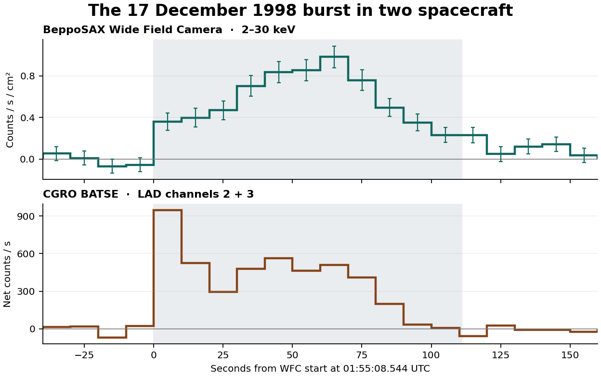

# Recovering the published BATSE counterpart of BeppoSAX FXT 981217

Rossi et al. (2005) investigated this BeppoSAX–BATSE association, and Vetere et al.'s 2007 electronic Table 2 credits them for GRB981217 and its X-ray-rich classification. The 2026 WFC catalog gives the X-ray transient a tentative GRB classification and leaves its BATSE field empty. This packet reconciles the WFC entry with STK01 11164a (GRB 981217A, GUSBAD 981217.079) and measures the prompt hard and soft profiles from public light curves. It independently recovers a published association. The hard counterpart and X-ray-rich classification have prior art. [2005 joint study](https://doi.org/10.1393/ncc/i2005-10053-1) · [2007 electronic catalog row](https://www.ssdc.asi.it/grb_wfc/wfc_cat2.js)

The WFC coordinates fall inside both BATSE fitted circles. The 1.95-arcminute WFC position and the 6.9-degree Stern position already appear separately in their respective catalogs. The ratio of the reported solid angles is 45,020.

| Measurement | BeppoSAX WFC | CGRO BATSE, Stern | CGRO BATSE, GUSBAD |
|---|---:|---:|---:|
| UTC on 1998-12-17 | 01:55:08.544 | 01:55:08 | 01:55:09 |
| J2000 RA, Dec (degrees) | 294.6259, +80.5517 | 293.5, +74.0 | 231, +82 |
| Quoted position error | 1.95 arcmin | 6.9 deg | 11 deg |
| Offset from WFC | — | 6.556 deg | 9.255 deg |
| Catalog T90 | 111.0 ± 10.7 s | 87 s | — |

Stern and GUSBAD use the same BATSE observations. The timing offsets express catalog agreement at the approximate one-second precision of the BATSE start times. The independent spacecraft are BeppoSAX and CGRO. Both BATSE fits put the emission far north, where the circles encompass a large range in right ascension.

## Search and controls

We checked the 149 WFC events against all 3,906 Stern catalog rows, including triggered and untriggered events. Of the 18 WFC `GRB?` events, ten occurred before BATSE shut down in June 2000. They define the counterpart-search family. The other eight have no BATSE observing epoch. The initial screen accepted a BATSE start from 120 seconds before WFC start to 120 seconds after the end of WFC T90, and a separation within the larger of 20 degrees and twice the quoted BATSE error radius. A second screen requires agreement within the Stern radius. FXT 981217 is the sole match among the ten on either screen. Across all 97 WFC rows in the overlap era the wide screen recovers 29 pairs, of which 23 already carry a BATSE ID in the WFC input table. Other blank-ID matches in the established-GRB population are preserved in the output without a novelty claim.

We shifted all WFC event times together by a random signed offset, uniform in magnitude from 1 to 180 days, preserving directions, durations and clustering. Among 50,000 shifts, 280 had at least one candidate match across the ten with the original gate (0.56%), and 68 did with the single-radius gate (0.136%). For the larger all-class population containing many hour-long stellar flares, 26,414 and 9,329 shifts respectively returned a match. These are empirical background fractions for defined families and gates. They do not assign a probability to astrophysical identity, account for other research directions explored, or model spacecraft exposure at each shifted instant. The code records every zero-shift match, all cut values, and the RNG seed.

## Raw light curves

BATSE daily, 1.024-second discriminator counts independently recover the emission in 108 bins during the WFC 111-second window. We used all eight LADs, summed channels 2 and 3, and fit the background to off-source bins from −210 to −30 and +141 to +321 s relative to WFC start. The linear fit gives **44,321 excess counts** with 1,916 counts of estimated residual standard error, including background-fit uncertainty. Linear and quadratic backgrounds with two choices of outer boundary give 44,321 to 48,439 counts. LAD 7 and LAD 3 contribute 19,212 and 12,278 counts, respectively. GUSBAD independently selected these two detectors. The channel edges differ by detector. Their summed interval extends from about 52–63 keV up to 300–352 keV. Channel 3 alone contributes 16,719 counts with fitted standard error 1,313, extending the identifiable emission above its detector-dependent lower edge of about 109–131 keV. These are deposited-energy counts, without response deconvolution or dead-time correction. The linear-fit errors treat background residuals as independent. The time-slide calculation above addresses the catalog association.

The archived quality bytes tag 90 of the 108 in-window bins for short-timescale background variation in LADs 3 and 7. These are the brightest two LADs in the independent GUSBAD reduction. All 108 bins have zero overflow, gain-imbalance, and spacecraft-reorientation bits. Channel 6, the charged-particle monitor, shows a deficit under the linear fit and an excess consistent with zero under the quadratic fit. The identification rests on the two spacecraft and the catalog positions, with the LAD flags retained in the extract. Recounting the BATSE photons used in the Stern and GUSBAD catalogs is a consistency check.

On the original WFC ten-second grid, the largest nominal BATSE 2+3 excess during the source window falls in the first bin (+0.0 to +10.0 s, approximately 947 counts/s). The largest nominal WFC 2–30 keV flux falls at +60.0 to +70.1 s (0.983 ± 0.105 counts/s/cm²). The WFC peak is broad. The bin difference describes the observed profiles. It is not a calibrated spectral lag. The BeppoSAX GRBM light curve exists for that day, but its adjacent samples bracket a gap from UTC seconds 6638.782 to 8221.782, containing the entire 6908.544–7019.544 s event. A GRBM upper limit cannot be inferred from these data.

The Ulysses GRB detector also had live coverage. Projecting the geocentric Ulysses vector onto the WFC line of sight places the pulse there 553.6 seconds later. In the predicted 111-second window the net rate was +5.56 counts/s. With the same centered background subtraction, 22 of 715 off-target windows that day gave an equal or larger excess. The add-one rank fraction is 3.21%. The controls share some background intervals. This check is inconclusive as a third detection. The WFC error circle also introduces up to about 1.5 seconds of geometric delay uncertainty. The spatial and temporal association above uses WFC and BATSE.

Run `python ulysses.py` to retrieve and decode the checksum-verified spacecraft day. The compact result is in `ulysses.json`. The ephemeris header, exact vectors and original query parameters are preserved in `inputs/ulysses_horizons.txt`. The time tags follow the archive's UT convention, and the detector integration units for these records are one eighth second. [Ulysses archive and telemetry specification](https://spdf.gsfc.nasa.gov/pub/data/ulysses/gamma/grb_1sec/) · [JPL Horizons](https://ssd.jpl.nasa.gov/horizons/)

## Prior reports and the scope of the result

- In ’t Zand et al. (2026), A&A 711 A60, list FXT 981217, WFC unit 2, observation period 6002, with reference 9 (Vetere et al. 2007), an empty BATSE field in both preprint Table 1 and the published electronic Table A.2, row 50, and GRBM peak flux `n.a.` in the preprint. The case is therefore an archival cross-identification of two known detections. [WFC catalog, preprint Table 1](https://arxiv.org/html/2512.16845v2) · [published electronic catalog](https://vizier.cds.unistra.fr/viz-bin/VizieR?-source=J/A%2BA/711/A60) · [published paper](https://doi.org/10.1051/0004-6361/202558641) · [light curves](https://doi.org/10.5281/zenodo.18849381)
- The live ASI/SSDC 2007 electronic catalog, Table 2, lists GRB981217 with a duration of 110 s, classification XRR and reference RS05. The paper identifies RS05 as Rossi et al. (2005). Rossi et al.'s original four-page paper explicitly identifies GRB981217 in Figure 2 and describes its BATSE peak flux of about 0.4 photons/cm²/s alongside the WFC light curve and energy spectrum. The measured association was published in 2005. Piro et al. (2026) later excluded 981217 from the joint GRBM analysis due to incomplete GRBM coverage. [Electronic table](https://www.ssdc.asi.it/grb_wfc/tab2.php) · [machine-readable target row](https://www.ssdc.asi.it/grb_wfc/wfc_cat2.js) · [Vetere et al.](https://arxiv.org/abs/0707.1900) · [Rossi et al. full paper, Fig. 2](http://eprints.bice.rm.cnr.it/15626/1/ncc8996.pdf) · [Piro et al.](https://doi.org/10.1051/0004-6361/202661201)
- Stern et al. and Schmidt's GUSBAD catalog detected the gamma-ray event independently in BATSE data. HEASARC GRBCAT lists GRB 981217A with observatory BATSE-CGRO and cites GUSBAD. The IPN master list calls the 01:55:08 event a Stern untriggered event, lists BATSE rate increase and marks SAX N/O. The IPN localization table gives the Stern circle and zeroes in the SAX fields. Another gamma-ray burst at 13:43:24 is a distinct event. [Stern](https://heasarc.gsfc.nasa.gov/W3Browse/gamma-ray-bursts/sterngrb.html) · [GUSBAD](https://heasarc.gsfc.nasa.gov/W3Browse/all/gusbad.html) · [GRBCAT](https://heasarc.gsfc.nasa.gov/W3Browse/all/grbcat.html) · [IPN master list](https://ipn3.ssl.berkeley.edu/masterli.html) · [IPN localization table](https://ipn3.ssl.berkeley.edu/interpla.html)
- Rossi et al. plot the WFC light curve and give its fluence and spectral index for GRB981217. The hard- and soft-band peak-bin comparison above was not identified in their four-page paper. We have not established publication priority for the specific profile measurements tabulated here. They are new extractions for this repository. The recent catalog discrepancy, measurement repeatability and supporting primary counts are the scope of this contribution.

## Reproduction

To verify the extracts directly against upstream source bytes, run `python verify_sources.py --cache /path/to/cache`. This checks all 149 WFC rows against the final electronic Table A.2, all 3,906 BATSE rows, and the target’s individual gamma-ray count, flag, calibration and WFC light-curve values. The final table revises the duration of post-CGRO event 000901. The screening sample predates that event.

Run `python analyze.py` from this directory with Python 3 and NumPy. It rewrites `measurements.json` and `joint_lightcurve.csv` from the frozen inputs. For the joint light curve, the WFC columns contain background-subtracted counts/s/cm² and their published standard errors. The BATSE column contains net summed LAD counts/s after the primary background fit. Bins with fewer than eight BATSE samples have no rate. `inputs/provenance.json` records the upstream file hashes and URLs. The CSV files retain the catalog populations used to count trials and all raw discriminator channels, detectors and flags within 850 seconds of the target. Raw WFC fluxes are J. J. M. in ’t Zand et al., distributed under [CC BY 4.0](https://creativecommons.org/licenses/by/4.0/). BATSE science data are from the NASA/GSFC HEASARC archive.
