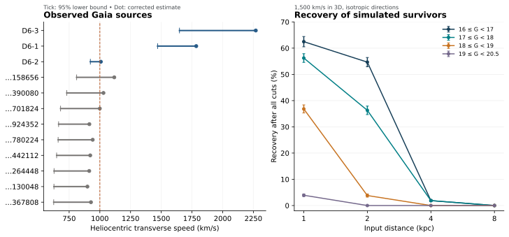

# A bounded search for hypervelocity supernova survivors

**No new thermonuclear-supernova survivor was validated.** Across the white-dwarf spectroscopic products from DESI DR1, SDSS-V DR19/DR20 and LAMOST DR12, **0 of 67,433 distinct quality-selected Gaia DR3 sources** had a measured heliocentric transverse speed above 1,000 km/s at corrected parallax S/N ≥5. Relaxing the threshold to S/N ≥3 gave **0 of 75,684**. Both samples reach the same maximum, **704.6 km/s**, for the previously published hydrogen-atmosphere white dwarf SDSS J125834.93−005946.1. A separate Gaia-first search recovered D6-1, D6-2 and D6-3. Only D6-1 and D6-3 clear its one-sided 95% transverse-speed threshold. [Deduplicated census](union/README.md) · [Gaia source measurements](search/kinematics.csv) · [Published identification](https://arxiv.org/abs/2209.09915)

**The all-sky null is weak, not an exclusion of undiscovered D⁶ stars.** The first Gaia trigger recovers only **3/11** published D⁶ controls: the **other eight are all faint (G approximately 19.0–20.5) and fail raw parallax S/N >3**, with some parallaxes negative. All eleven pass its colour and proper-motion precuts, so the loss occurs at the parallax gate. The cut also misses all eight LP 40−365-type controls at its >1,000 km/s transverse-speed gate and US 708 at its >35 mas/yr proper-motion gate (US 708 has only 5.73 mas/yr). It selects *measured sideways motion*, not extreme radial motion. **None of the eleven published D⁶ controls is present in the four white-dwarf-oriented spectroscopic parent tables.** Consequently the 0/67,433 catalogue result and the twelve-object Gaia tail cannot rule out more high-velocity supernova survivors or yield a useful Galactic abundance bound. The simulated recovery curves are conditional on their selected magnitude/error templates and do not supply a complete sky, spectral-targeting or luminosity selection function. [Failures by individual source](control/recovery.csv) · [Parent coverage](union/controls.csv)

## Survey yield and selection

The spectroscopic parent contains 113,166 distinct Gaia DR3 identifiers after matching release-qualified IDs. The participating products have different sky footprints and targeting rules and include ordinary-star contaminants. The same corrected-parallax and astrometric-quality selection was applied to every source in this table. The maxima are point estimates of transverse speed in the heliocentric frame.

| Spectroscopic product | Distinct DR3 IDs | Eligible at corrected parallax S/N ≥5 | Above 1,000 km/s | Maximum (km/s) |
|---|---:|---:|---:|---:|
| DESI DR1, Swan et al. v1 | 63,152 | 33,322 | 0 | 704.6 |
| SDSS-V DR19, classified SnowWhite spectra | 10,364 | 7,843 | 0 | 486.9 |
| SDSS-V DR20, classified SnowWhite spectra | 50,862 | 36,400 | 0 | 602.0 |
| LAMOST DR12 v2, low-resolution white-dwarf table | 13,850 | 8,956 | 0 | 457.9 |
| **Union after removing repeat IDs** | **113,166** | **67,433** | **0** | **704.6** |

Only **two of twenty** published survivor controls occur in these spectral products. J1240+6710 has a transverse speed of 423 km/s. J1109+0001 has a point estimate of 1,026 km/s but parallax S/N of only 1.32. The observed zero counts are exact for the stated data and cuts. Under independent, exchangeable draws with the same selection and measurement, the five-sigma count gives a one-sided 95% upper fraction of **44.4 per million** for a *measured threshold exceedance*. The data do not determine the abundance of Galactic survivors. [Survey overlaps and eligibility](union/overlap.csv) · [Positive controls in the union](union/controls.csv) · [DESI](desi/README.md) · [SDSS](sdss/README.md) · [LAMOST and archive coverage](spectra/README.md)

## Gaia search and completeness

The all-sky Gaia search found 1,023,709 sources with proper motion >35 mas/yr, colour BP−RP <1.2, raw parallax S/N >3 and absolute-G proxy >3.5. Twelve exceeded a raw transverse-speed estimate of 1,000 km/s. The three known Shen objects passed. For the other nine, individual zero-point corrections and propagation of the parallax/proper-motion covariance gave one-sided 95% lower bounds of **624–811 km/s**. The largest belongs to Gaia DR3 6094201393481158656. Its corrected point estimate is 1,117 km/s, a neighbour lies 1.35 arcsec away, and its XP continuum is consistent with a cool star. Its geometric Bailer-Jones lower distance quantile implies 1,064 km/s while the photogeometric lower quantile implies 859 km/s. The methods share Gaia data. Neither a systemic RV nor a remnant composition is established for this object. [Source and distance tests](search/README.md) · [XP and extinction test](spectra/README.md)

The initial Gaia gate recovered **3/11 D⁶, 0/8 LP 40−365-like and 0/1 US 708-like** published controls. The record-speed benchmark J0927−6335 has raw parallax S/N 0.59. An exact replay of the broader El-Badry et al. (2026) published selection recovers 10/11, 3/8 and 0/1 respectively. The reference set uses that paper's classifications, including disputed progenitors. Tests against the survey's 11 visually identified blends show that five routine Gaia quality cuts flag just 4/11. A bright-neighbour statistic flags 11/11, and also flags the genuine J0927−6335. [Control-by-control results](control/README.md) · [Latest systematic survey](https://arxiv.org/abs/2606.11293) · [Werner et al. on J0927−6335](https://arxiv.org/abs/2408.08397)

Injections use the measured astrometric uncertainties of 744 Gaia templates, with magnitudes, colours and quality flags held fixed. At true 3D speed 1,500 km/s with isotropic directions and 17 ≤ G < 18, the full Gaia cut recovers **56.2% at 1 kpc, 36.3% at 2 kpc and 1.9% at 4 kpc**. Template standard errors are 1.7, 1.6 and 0.4 percentage points. The figure's left panel uses actual Gaia measurements. The right panel uses synthetic signals and shows one template standard error. Extinction, intrinsic luminosity, crowded-field failures and the probability of obtaining follow-up spectra are additional parts of a Galactic selection function. [Injection grid and assumptions](search/README.md) · [Numerical results](search/injection.csv)

## Spectroscopic and orbit checks completed

- **Partly burnt and carbon-rich objects.** A lower-speed DESI search among 1,452 proper-motion and quality-selected objects with metal, oxygen or carbon spectral labels recovers J1109+0001, J1240+6710 and LP 93−21. All three were previously studied. Four DESI Mg I lines in J1109+0001 yield +96.5 ± 7.5 km/s, consistent with the published +100 ± 10 km/s. LP 93−21 illustrates a competing interpretation involving a halo merger and pressure-shifted carbon lines. [Composition search and spectra](metals/README.md) · [Mg line fits](spectra/README.md)
- **Fast helium subdwarfs.** Of 2,791 entries with SDSS or LAMOST catalogue RVs in the Culpan et al. hot-subdwarf sample, only US 708 exceeds an absolute RV of 700 km/s. A helium-line refit recovers its high velocity. A newer independent local comparison contains no star with a published Galactic-rest speed above 1,000 km/s among 247 single-lined systems with full velocities. [Hot-subdwarf measurements, coverage and restrictions](hot/README.md)
- **False classifications.** Seven of the nine additional Gaia hits have calibrated XP spectra, and two have ordinary F-star spectra in SDSS/LAMOST. Separate examination of the five highest-speed, three-sigma DR20 SnowWhite entries finds F or K spectra. Both tentative DZ classifications have luminous K-giant counterparts. Flux deficits and line shifts are reported with masks, continuum choices and formal uncertainties. [Gaia-first spectra](spectra/README.md) · [DR20 spectral checks](sdss_followup/README.md)
- **Speeds and origin.** All 4,096 reference draws for each Shen star are unbound in both tested Galactic potentials. The geometric-distance median Galactocentric speeds are 1,991, 1,126 and 2,303 km/s for D6-1, D6-2 and D6-3. Among seven known objects tested against all 310 Green supernova remnants, the D6-2 trajectory passes 0.905° from the centre of G70.0−21.5 about 94,000 years ago. Shen et al. had already proposed this association. No additional projected shell intersection was found in that 200,000-year test. [Seven sets of phase-space and orbit results](origin/README.md) · [Shen spectral replay](shen/README.md)
- **Novelty.** Checks include SIMBAD identifiers and position cones, the 92 targets of El-Badry et al. (2026), primary papers by Shen, Raddi, Igoshev, Werner and others, the earlier repository index and a November 17, 2026 arXiv search. All objects advanced by the complementary chemistry and hot-subdwarf searches have published counterparts. [Literature records, queries and limits](literature/README.md)

## Outstanding evidence

For seven of the nine additional Gaia hits, the queried surveys supply no classifying ground-based spectrum. **Gaia DR3 6094201393481158656 remains an unresolved follow-up target, not a survivor:** its zero-point-corrected transverse-speed point estimate is **1,117 km/s**, but its one-sided **95% lower limit is 811 km/s**; its neighbour is **1.349 arcsec** away and its Gaia XP continuum and GSP-Phot fit are consistent with an ordinary cool star. To settle its identity and systemic speed, obtain **≤0.2-arcsec high-resolution imaging** to verify separation/flux leakage, then **spatially resolved, two-epoch optical spectra (R ≥ 5,000, covering approximately 3,800–9,000 Å)** of the brighter object to measure an uncontaminated RV and constrain H/He and metal/C/O line patterns. A **Gaia DR4 five-/six-parameter astrometric solution**, or comparably precise independent astrometry with blend diagnostics, must also establish the distance and proper motion. Neither a single low-resolution XP spectrum nor the current nominal inverse parallax can establish a record-speed compact remnant. The public spectra, distances and line measurements in this study support no new speed record, unusual abundance pattern or birthplace. A survey-wide thermonuclear-survivor rate would additionally require a luminosity and spatial population model and a selection function for both detection and spectroscopy.

## Reproduction and attribution

Start with [the replay guide](REPLAY.md) and the frozen [SHA-256 file manifest](SHA256SUMS). Individual directories contain the input URLs, observing IDs, exact queries or query builders, response hashes, observing frames and fit diagnostics. The result reuses the frame, posterior sampling, potentials, orbital integrator and literature index from the repository's [unbound-star investigation](../dr1-dr19-unbound-stars/METHODS.md). Its target populations differ from those in that work and from the repository's [DESI white-dwarf RV variability](../desi-white-dwarf-velocity-variables/README.md), [abundance audit](../polluted-white-dwarf-composition-audit/README.md) and [wide polluted-pair analysis](../wide-polluted-white-dwarf-pairs/README.md).
