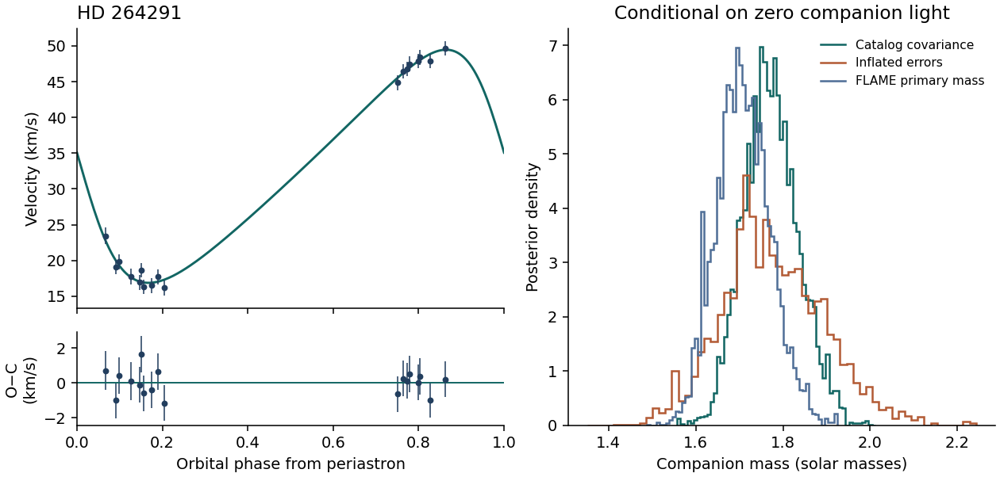
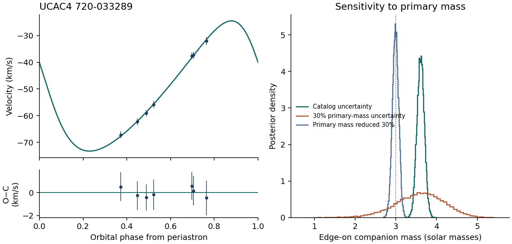

# HD 264291 has a coherent 1007-day RV and astrometric orbit

The 18 nightly LAMOST velocities for Gaia DR3 3378588057203660160 and its Gaia DR3 orbit yield a companion mass of **1.77 (1.71–1.84) solar masses if the companion is dark**. The two data sets agree within their uncertainties. The primary is a chemically peculiar A1 IV SrSi star, classified in SIMBAD as an emission-line object. The result establishes a binary orbit. Its mass inference depends on identifying the measured spectrum with the primary, the primary-mass prior, and the treatment of photocentre light. Both an unresolved inner binary and contaminating light require independent tests before assigning compact-object status.

| Sensitivity model | Period (days) | Inclination (deg) | RV mass function (solar masses) | Minimum companion mass (solar masses) | Companion mass (solar masses) |
|---|---:|---:|---:|---:|---:|
| Gaia catalog covariance, nightly floor 1 km/s | 1007.3 (1001.8–1013.1) | 99.5 (97.8–101.1) | 0.384 (0.360–0.410) | 1.73 (1.67–1.80) | 1.77 (1.71–1.84) |
| Gaia standard errors ×3, nightly floor 2 km/s | 1005.7 (993.9–1017.4) | 99.7 (95.2–104.1) | 0.379 (0.336–0.433) | 1.72 (1.62–1.84) | 1.77 (1.67–1.89) |
| Gaia catalog covariance, FLAME primary mass | 1007.4 (1001.8–1013.0) | 99.5 (97.8–101.1) | 0.384 (0.361–0.412) | 1.67 (1.61–1.74) | 1.71 (1.65–1.77) |

Fits use all 100 retained exposures combined per observing night using inverse-variance weights. We add the nightly error floor in quadrature after combining exposures. Times are the weighted mean exposure starts in JD UTC. Their small difference from the barycentric times of the Gaia ephemeris is negligible for this long-period orbit at km/s precision. The joint likelihood and mass solver are identical to the DR3 control pipeline. The first and second fits assume a Gaussian primary-mass prior of 1.950 ± 0.059 solar masses from Gaia binary_masses. The third uses the independent-method FLAME estimate of 1.814 ± 0.055, which also uses Gaia data. The models share the assumption that the companion has zero optical light. The corresponding eccentricity is 0.315 (0.290–0.341) for the nominal model. The best-fit RV RMS is 0.69 km/s. The chi-squared contributions are 8.02 from RVs and 0.89 from Gaia for a total of 17 degrees of freedom. The 1,146-day baseline spans just over one orbit, with seasonal gaps. The intervals are conditional 16th–84th percentiles. Elevated RUWE of 4.70 in the single-star solution and the orbital fit's Gaia goodness-of-fit of 6.83 warrant the uncertainty-inflation check. The single-star parallax of 2.161 ± 0.121 mas also differs from the NSS parallax of 1.568 ± 0.041 mas. The orbital likelihood uses the NSS parallax.

A chronological holdout gives an independent phase check. Fitting the Gaia likelihood and the first 11 nights through March 2020 predicts the last seven nights (October 2020 to February 2021) at an RMS error of 1.20 km/s. A posterior-predictive test using the shared orbital covariance and the nominal 1 km/s nightly floor gives a tail fraction of 0.471 for the seven-dimensional observed residual. This is a retrospective temporal split within a selected target. [Training residuals](lamost_training_residuals.csv)

From this directory, run `python fit_lamost.py` and `python plot_candidate.py`. The exact Gaia NSS row can be retrieved from ESA's Gaia DR3 TAP with `SELECT * FROM gaiadr3.nss_two_body_orbit WHERE source_id=3378588057203660160`. The input hashes, fitted parameters and mass posterior densities are in [lamost_candidate_fits.json](lamost_candidate_fits.json). [Per-night observed minus fitted velocities](lamost_candidate_residuals.csv) · [SIMBAD identities](candidate_identifications.csv) · [SIMBAD-indexed bibliography](hd264291_bibliography.csv)

## Three APOGEE orbital diagnostics

HD 192288 (Gaia DR3 1830677037678583680) has 13 APOGEE visits spanning 983 days. All 13 are flagged for suspect broad lines and RVs. They appear in DR19 as reprocessed or carried-forward DR17 observations. The catalog SB1 has a mass function of just 0.302 solar masses. The nominal edge-on mass of 4.05 solar masses requires the Gaia estimate of 10.78 solar masses for the primary. The measured RV range of 49.0 km/s resembles the predicted 41.7 km/s range, but a joint Gaia + APOGEE fit allowing a free constant survey offset gives a chi-squared of 189.4 for 12 degrees of freedom after adding a 1 km/s error floor. Only at a 5 km/s floor does the fit become acceptable (11.5/12). This sensitivity and the flags preclude validation.

LHA 120-S 80 (Gaia DR3 4661290764764683776) is an emission-line LMC B8 Ie supergiant already listed in the [Gaia stellar multiplicity study](https://arxiv.org/abs/2206.05595). Its two flagged APOGEE visits differ by 247.5 km/s, compared with 2.66 km/s predicted at those epochs. This discrepancy remains across 0, 1 and 5 km/s floor tests. Gaia DR3 4685960537144695552 has three quality-passing visits concentrated at nearly the same phase, with only 0.003 km/s predicted variation. Its visits offer little leverage on the orbital shape.

Run `python sdss_sb1.py` from this directory to regenerate the offset-profiled, covariance-propagated checks and formal joint fits. To extract the three full six-parameter likelihoods from the Gaia bulk input, pass `--full-nss-csv-gz PATH`. Each test generates 16,384 Gaia covariance draws, retaining physical eccentricity, positive period and positive amplitude. The rank test compares the offset-profiled fixed-ephemeris chi-squared against those draws plus independent RV noise. Its Monte Carlo resolution is about 0.00006. The conditional mass estimates in the fit JSON for HD 192288 only illustrate a model-fit failure and dependence on the assumed RV floor. The SDSS release flags and all residuals remain available for audit. [Results, covariance propagation and hashes](sdss_sb1_fits.json) · [Residuals for all fits](sdss_sb1_residuals.csv) · [DR19 flag definitions](https://www.sdss.org/dr19/data_access/bitmasks/)

## UCAC4 720-033289 has a validated SB1 orbit and a primary-mass-dependent black-hole threshold

For Gaia DR3 275582835635329024, 30 LAMOST exposures on seven nights spanning 388 days confirm the orbital motion predicted by Gaia. Fitting the complete six-parameter Gaia SB1 covariance and seven independently measured nightly velocities gives a period of 470.1 (467.5–472.7) days and a spectroscopic mass function of 0.640 (0.606–0.675) solar masses. The nightly fit residual RMS is 0.396 km/s with chi-squared 0.744 for six degrees of freedom. A chronological holdout using only Gaia and the first three nights predicts all four measurements in the second observing season with an RMS error of 0.544 km/s. These results support the orbit. The spectrum, luminosity and mass of its companion require separate constraints.

| Assumption about luminous star | Minimum companion mass (16th, median, 84th percentile), solar masses | Fraction of draws with minimum mass above 3 |
|---|---:|---:|
| Gaia FLAME 4.947 ± 0.040 solar masses | 3.51, 3.60, 3.69 | 30,000 of 30,000 |
| Gaussian sensitivity model, 4.947 ± 1.484 solar masses | 2.99, 3.60, 4.17 | 83.4% |
| Fixed at 3.463 solar masses (30% lower) | 2.91, 2.99, 3.06 | 43.3% |

The primary mass must exceed **3.49 solar masses** (3.33–3.67 given orbital uncertainty) to place the edge-on companion above 3 solar masses. This is the value obtained by solving the mass-function equation for the primary at fixed minimum secondary mass 3. The system lacks a measured orbital inclination in DR3. The table gives conditional lower bounds, with no inclination prior. An unseen normal star or an unresolved pair may contribute light. The nominal mass, conditional uncertainty and robustness runs each assume that the published RVs trace the primary. The broad Gaussian is a sensitivity calculation. It does not calibrate FLAME's actual mass-error distribution for this giant.

The joint model marginalizes an unconstrained constant LAMOST–Gaia velocity offset. It combines each night's velocities with inverse-variance weights and adds a common 1 km/s nightly floor. We importance-sample the nonlinear likelihood using 65,536 Gaussian draws from the Gaia covariance and reject unphysical orbits. In the nominal fit the effective sample size exceeds 59,000. The enlarged-error check (Gaia standard errors ×3 and 2 km/s nightly floor) gives an RV mass function of 0.637 (0.541–0.738) solar masses, with 81.3% of samples above the 3-solar-mass minimum threshold under the broad primary-mass prior. The nominal model's reduced chi-squared is below one, consistent with conservative nightly errors and limited degrees of freedom.

Run `python giant_sb1.py` and `python plot_giant.py` against the FLAME-extension LAMOST exposure table. The archived NSS likelihood is the ESA Gaia DR3 TAP response to `SELECT * FROM gaiadr3.nss_two_body_orbit WHERE source_id=275582835635329024`. [Parameters, posteriors, input hashes and holdout](giant_sb1_fits.json) · [Nightly residuals](giant_sb1_residuals.csv) · [Gaia covariance input](flame_giant_nss.csv)
