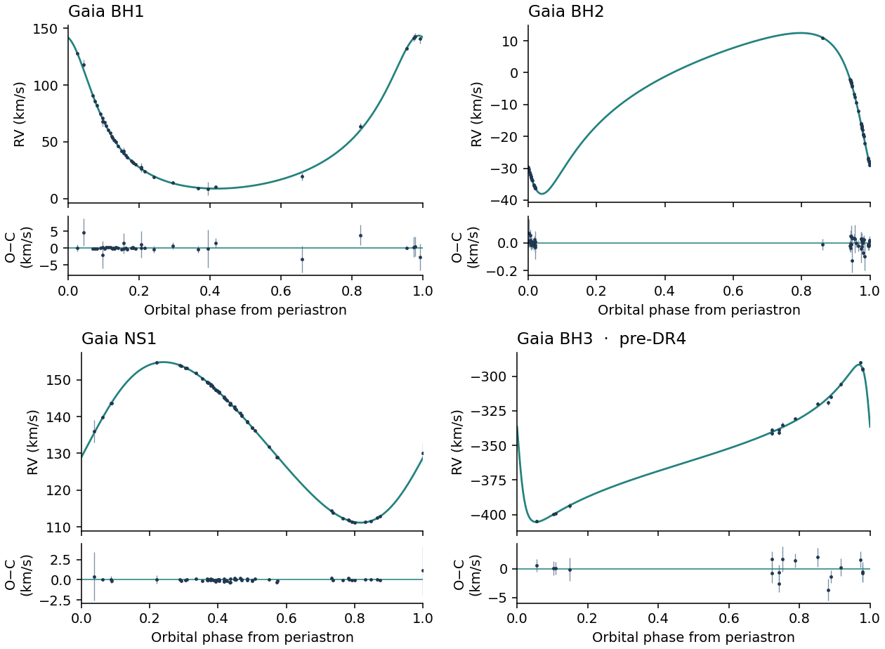

# Dynamical control recovery

The joint fits reproduce the two Gaia DR3 black-hole masses and the neutron-star mass of Gaia NS1. The pre-DR4 Gaia BH3 timeseries independently exercises the same orbital equations. All four are designated controls. Their recovery measures the fitter's accuracy at known positions and periods. The original follow-up programs targeted these objects specifically.

| Control | Input RVs | Period, d | Inclination, deg | RV mass function, solar masses | Edge-on companion, solar masses | Companion mass, solar masses (16th–84th percentile) | RV RMS, km/s |
|---|---:|---:|---:|---:|---:|---:|---:|
| BH1 | 41 | 185.59 | 126.53 | 4.151 | 5.64 | 9.63 (9.45–9.81) | 1.285 |
| BH2 | 48 | 1276.77 | 34.89 | 1.334 | 2.63 | 8.93 (8.60–9.25) | 0.035 |
| NS1 | 59 | 730.80 | 68.79 | 0.769 | 1.67 | 1.90 (1.87–1.93) | 0.200 |
| BH3 | 17 | 4212.84 | 110.61 | 25.950 | 27.42 | 33.12 (32.65–33.58) | 1.513 |

An edge-on companion threshold of 3 solar masses would miss BH2 despite its 8.93-solar-mass companion. The initial search must preserve astrometric inclinations.



## Inputs and likelihood

For BH1, BH2 and NS1, the likelihood combines the marginalized DR3 NSS covariance with individual published follow-up RVs (HJD UTC). Gaia contributes the NSS parallax, four astrometric Thiele–Innes coefficients, eccentricity, period and periastron epoch. BH2 additionally contributes the two line-of-sight orbital coefficients and systemic velocity from the Gaia AstroSpectroSB1 solution. Position and proper motion are integrated out of the catalog likelihood. Each model uses the luminous star's barycentric orbit for the photocentre, which assumes negligible companion light. We try both possible ascending nodes and progressively tighten the RV likelihood to handle phase drift. The quoted intervals assume the Gaussian errors and locally uniform orbital-parameter priors used in the code. The independent primary-mass Gaussians have means and standard deviations of 0.93 ± 0.05, 1.07 ± 0.19, 0.79 ± 0.01 and 0.76 ± 0.05 solar masses, respectively, as in the source analyses. NS1 uses the factor-of-three Gaia error inflation tested by the discovery authors and their already zero-point-corrected RV table. We use the published velocity scale and add no instrumental jitter. We approximate the three published HJD UTC times as catalog-frame JD. The roughly minute-scale offset is small compared with the orbital time and quoted RV precision here.

For BH3 we use the ESA pre-release astrometric and RV epochs, including 599 unflagged along-scan CCD measurements. Its Gaussian likelihood uses the published per-CCD uncertainties, with fitted position, proper motion and parallax. The fit uses no instrument-specific independent survey RV for this control. Correlated attitude or calibration errors could broaden its intervals. The starting period and geometry use the published orbit.

The Monte Carlo uses 5,000 draws from the local normal proposal, weighted by the nonlinear likelihood divided by the proposal density. The effective sample sizes are 4,165 (BH1), 2,464 (BH2), 2,203 (NS1) and 1,449 (BH3). This measures a local posterior conditional on the selected mode. Residuals include every input RV. See [fit results and parameter conventions](control_fits.json) and [observed minus fitted velocities](control_residuals.csv). The DR3 epoch origin is JD 2457389.0 and the pre-DR4 origin is Julian year 2017.5.

## Reproduction

Run in this directory with Python 3, numpy, scipy, matplotlib and Poppler's pdftotext installed.

```bash
python fetch_controls.py /data/gaia-control-inputs --out /data/gaia-control-tables
OPENBLAS_NUM_THREADS=1 python fit_controls.py /data/gaia-control-inputs --tables /data/gaia-control-tables --out /data/gaia-control-fits
```

The fetch command requires all six frozen source names and URLs and verifies byte lengths and SHA-256 hashes before parsing or writing tables. It never rewrites the frozen receipt or tables in this directory. A changed Gaia TAP response fails closed; use the originally hashed bytes or start a separately documented campaign for new inputs. `plot_controls.py` plots the committed result tables; it does not plot the separate replay output.

[Exact input URLs, lengths and raw SHA-256](sources.json) · [DR3 Gaussian likelihood input](nss_controls.csv) · [Parsed discovery-paper RVs](published_rv.csv)

The RV tables are from El-Badry et al. [BH1 Table D1](https://arxiv.org/abs/2209.06833v3), [BH2 Table 1](https://arxiv.org/abs/2302.07880v2), and [NS1 Table 1](https://arxiv.org/abs/2402.06722v2). The BH3 observations are from [Gaia Collaboration, Panuzzo et al.](https://doi.org/10.1051/0004-6361/202449763) and the [associated ESA repository](https://doi.org/10.5281/zenodo.10977502). The ordering of covariance entries follows the [Gaia DR3 NSS archive model](https://gea.esac.esa.int/archive/documentation/GDR3/Gaia_archive/chap_datamodel/sec_dm_non--single_stars_tables/ssec_dm_nss_two_body_orbit.html).

## Measurable velocity-variability search depth

Using the four best-fit control RV amplitudes, eccentricities, orientations and periods, we measured whether each real clean target cadence would detect RV variability. Of the initial 983 mass-screened targets, 59 have a clean LAMOST, SDSS or DESI observation and 28 have at least one within-instrument repeat after nightly binning. The table gives the number of target cadences reaching each phase-averaged probability of rejecting a constant RV at single-target p < 0.001.

| Detection probability | BH1-like | BH2-like | NS1-like | BH3-like |
|---|---:|---:|---:|---:|
| At least 50% | 23 | 18 | 16 | 18 |
| At least 90% | 12 | 13 | 13 | 17 |

We integrate over 1,024 evenly spaced periastron phases. For each phase the weighted within-instrument variance of the noiseless model gives the noncentrality of a chi-squared test for constant RV. Its upper tail at the null threshold integrates over Gaussian measurement noise. Each instrument has a free zero point. Repeated exposures within a night share the adopted calibration floor of 1 km/s for LAMOST and APOGEE, 5 km/s for BOSS, and the published analysis-specific floor in the DESI epoch file. Orbital orientation and amplitude equal those of each measured control. This sensitivity covers an RV variability flag. Compact-object mass, light exclusion, Gaia selection completeness, and population occurrence need separate information. The calculations depend on the chosen error floors and intrinsic stellar jitter.

Run `python cadence_depth.py` to reproduce the initial screen. [Per-source detection probabilities](cadence_initial.csv) · [Input hashes and aggregate depth](cadence_initial.json)
