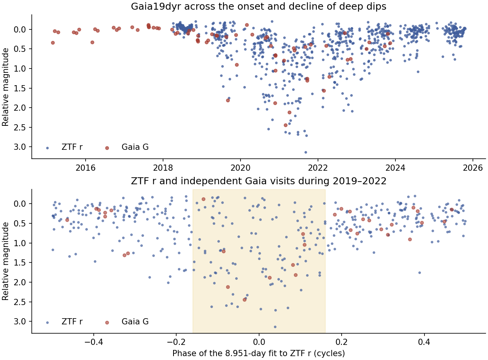

# A transient deep-dipping state in Gaia19dyr

The candidate young star **Gaia19dyr** (AT 2019pse, Gaia DR3 4266891305243650560, 2MASS J18542109+0052399) developed deep optical dips at a preferred phase of an approximately nine-day cycle. The r-band 5th–95th percentile span grew from 0.24 mag in 2018 to 2.41 mag in 2021, then fell to 0.50 mag in 2025. The nearly tenfold rise in magnitude span and the cross-instrument phase agreement characterize an object originally reported for a single 1.6-mag fade. A 2.41-mag span corresponds to a factor of 9.2 in flux between those percentiles. [Original Gaia alert](https://gsaweb.ast.cam.ac.uk/alerts/alert/Gaia19dyr/) · [VSX entry](https://www.aavso.org/vsx/index.php?view=detail.top&oid=844765)

## Observations

ZTF archive photometry gives 782 r-band nights and 652 g-band nights in 2018–25. Gaia contributes 69 independent observing nights in 2015–23 (distinct nights, including overlapping survey dates). The extraction retains ZTF rows with zero catalog flags and magnitude error below 0.15. Each ZTF object/filter series has its own 20th-percentile magnitude subtracted before measurements are combined by UTC MJD night. The 20th percentile serves as a bright-state reference. Gaia points are combined by integer MJD(TCB). Using one median per night prevents high-cadence visits from dominating. [ZTF archive interface](https://irsa.ipac.caltech.edu/docs/program_interface/ztf_lightcurve_api.html) · [Gaia epoch measurements](https://gsaweb.ast.cam.ac.uk/alerts/alert/Gaia19dyr/lightcurve.csv)

| Year | ZTF r nights | Nights >1 mag below reference | 5–95% span (mag) | Strongest 2–30 d period (d) |
|---|---:|---:|---:|---:|
| 2018 | 95 | 0 | 0.24 | 9.07 |
| 2019 | 84 | 5 | 1.31 | 4.49 |
| 2020 | 100 | 23 | 1.82 | 9.01 |
| 2021 | 103 | 40 | 2.41 | 8.96 |
| 2022 | 112 | 26 | 1.74 | 8.92 |
| 2023 | 105 | 4 | 0.98 | 8.99 |
| 2024 | 91 | 1 | 0.76 | 8.97 |
| 2025 | 92 | 0 | 0.50 | 8.91 |

A least-squares sinusoid with independent yearly offsets gives **8.95066 days** on 399 ZTF r nights in 2019–22. The sinusoid accounts for 29.2% of the within-year variance. Omitting each year in turn yields 8.935–8.965 days. These values describe a characteristic recurrence with evolving dip profiles. Seasonal period estimates and phase offsets vary. The 2019 search favors the first harmonic. The 2023–25 data retain power near nine days even as the large dips subside. The table and tests refer to detected photometry, so the faintest events may be undersampled.

The r-band fit sets phase zero at its faint sinusoidal extremum, JD 2459000 minus 0.10970 cycles. Define the dip window within 0.16 cycles of that phase. During 2019–22, **Gaia measured a median 1.16 mag fainter inside the window** (9 nights) than outside (24 nights). Removing the Gaia discovery visit gives 0.98 mag. ZTF g gives 0.47 mag on 317 nights (85 inside). The fitted recurrence and phase use only r-band data. The target, years, window and analysis were selected during exploratory work with both archives available.

For a cadence-preserving diagnostic, the script rotates the fitted phase independently in each year while retaining every measured magnitude, date and within-season phase pattern. It compares the observed in-phase sinusoid projection to 20,000 rotations. The one-sided fractions are 0.0080 for Gaia, 0.0279 for Gaia with the original alert excluded and 0.0140 for g. These condition on the selected target and r-band fit, and quantify inter-season phase agreement. They cannot be interpreted as the false-alarm probabilities of the original survey-wide search.

## Localization and comparison stars

The six ZTF g/r/i object centroids agree with the Gaia target position to within 0.15 arcsec. A Gaia DR3 cone search to 85 arcsec places the nearest resolved neighbor 5.43 arcsec away at G = 20.90, compared to target G = 15.67. Three stars 10–85 arcsec away meet 14.7 < G < 16.7 and provide local controls. At the same r-band phase and years their in-minus-out median differences range from −0.0023 to +0.0027 mag across 395–398 nights each. Their r-band 5–95% spans are 0.073–0.100 mag. Independent Gaia photometry and the much fainter nearest neighbor favor variability at the target position. An unresolved companion remains possible. [VizieR Gaia DR3](https://vizier.cfa.harvard.edu/viz-bin/VizieR?-source=I/355/gaiadr3)

## Interpretation and reporting history

The Gaia team identified a candidate YSO and reported the 2019 fade. SIMBAD lists a candidate young stellar object and the queried VSX record lists YSO with no period. A 4-arcsec search of the Gaia DR3 eclipsing-binary and Chen et al. ZTF periodic-variable catalogs returned no rows. Searches by alert, TNS, Gaia and 2MASS identifiers did not locate a prior report of this target’s multiyear amplitude change and recurrence. The finding concerns the evolution and phase preference of the dips. The photometry does not determine whether a rotating disk structure, variable extinction, or a more complex stellar system produces them. A fixed ephemeris beyond the measured seasons would overstate the phase stability. [SIMBAD](https://simbad.cds.unistra.fr/simbad/sim-id?Ident=2MASS%20J18542109%2B0052399) · [Gaia DR3 EB catalog](https://doi.org/10.1051/0004-6361/202245330) · [ZTF periodic catalog](https://doi.org/10.3847/1538-4365/ab9cae)

## Replay

Run `OPENBLAS_NUM_THREADS=1 python analyze.py` in this directory with NumPy and pandas installed. It reads the frozen nightly rows and emits the quantities in `measurements.json`. Run `python plot.py` with Matplotlib to regenerate the figure. `sources.json` gives exact archive requests, raw-response SHA-256 values and row counts. `python fetch.py` rebuilds the nightly rows and object summary when the archive returns the frozen source bytes. The survey responses can change in later releases. `field.tsv`, `vsx.tsv`, `simbad.csv` and the two catalog query receipts preserve the source and field checks.
