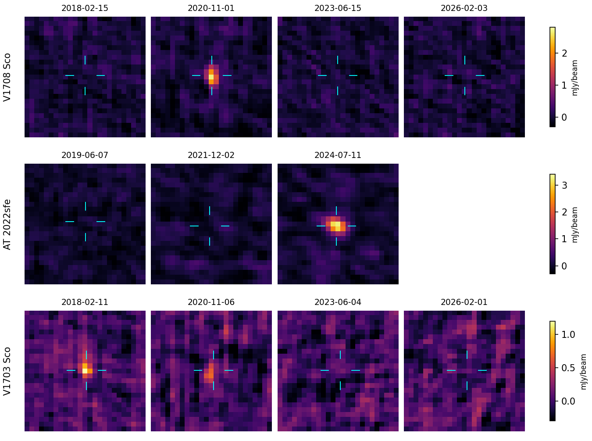

# Archival radio counterparts to two Galactic nova eruptions and a fading symbiotic system

At the positions of the optically discovered V1708 Sco and the infrared-discovered AT 2022sfe (PGIR22akgylf), 3-GHz VLA Sky Survey images show compact radio sources after eruption. Earlier images cover each position at comparable sensitivity. A third system, the symbiotic variable V1703 Sco (OGLE-2011-BLG-1444), faded between 2018 and 2026 and has positive positional measurements in two independent ASKAP bands.

| Source | Radio observation | Forced amplitude, mJy/beam | Independent epochs or instruments |
|---|---|---:|---|
| V1708 Sco | 2020 Nov 1, +54.91 d | 2.598 | −0.041 in 2018, +0.149 in 2023 and +0.142 in 2026. Largest field-noise estimate on the bright date is 0.144 mJy/beam. |
| AT 2022sfe | 2024 Jul 11, +695.49 d | 3.602 | +0.027 in 2019 and −0.046 in 2021. Largest bright-date field-noise estimate is 0.167 mJy/beam. |
| V1703 Sco | 2018 Feb 11 | 1.141 | +0.704 in 2020, +0.287 in 2023 and −0.024 in 2026. At 1.3675 GHz the separate ASKAP telescope measures 0.688 mJy/beam at the optical position. |

Elapsed days use midnight UTC on the *reported discovery date*, so fractional discovery times are not implied. For V1703 Sco the OGLE light curve already showed a rise in 2011 and an extended optical maximum. We leave the eruption epoch blank. [OGLE analysis of V1703 Sco](https://academic.oup.com/mnras/article/443/1/784/2908022)



Each panel spans 25 arcsec. The reticle marks the published optical/infrared position. Color scales in mJy/beam are constant within each row.

## Evidence for each association

**V1708 Sco.** The VLA peak pixel is 2.662 mJy/beam. A fit with a free centroid gives 2.635 mJy/beam at 0.284 arcsec from the nova. The fixed-position amplitude is 18.0 times the larger of two local noise estimates. Using five times that larger noise estimate as a blank-epoch sensitivity threshold gives 0.745, 0.700 and 1.030 mJy/beam in 2018, 2023 and 2026 respectively. Optical work identified a pulsating red-giant progenitor. eROSITA saw the supersoft X-ray source on September 24–25 before the radio observation. The data locate the radio-bright epoch in this known symbiotic nova's eruption and bracket it with radio-faint measurements. They do not resolve thermal ejecta, an ionized wind, and synchrotron emission. [Optical identification](https://www.astronomerstelegram.org/?read=14017) · [eROSITA observations](https://www.astronomerstelegram.org/?read=14057)

**AT 2022sfe.** A radio source appeared at the infrared discovery position between the 2021 and 2024 VLA visits. The peak pixel is 3.236 mJy/beam, the free-centroid amplitude is 3.611 mJy/beam and the fitted displacement is 0.108 arcsec. The fixed-position signal exceeds the larger local noise estimate by 21.6 times. The pre-eruption five-noise sensitivity thresholds are 0.695 and 0.995 mJy/beam. The +695-day visit establishes radio emission almost two years after discovery. Sparse cadence leaves the onset and peak dates unconstrained. A 2026 optical study measured an unusually slow rise to maximum on 2022 December 26.93, placing the 3-GHz detection about 563 days after optical peak. The discovery team measured broad optical emission lines and a roughly 1,050 km/s P-Cygni absorption component. [Spectroscopic discovery and original coordinates](https://www.astronomerstelegram.org/?read=15587) · [TESS and ground-based optical analysis](https://arxiv.org/abs/2606.12532)

**V1703 Sco.** A compact 3-GHz source lies 0.308 arcsec from the symbiotic star in 2018. Its fixed-position amplitude is 10.1 times the larger local noise estimate. Independent VLA imaging in 2020 gives 0.704 mJy/beam, or 3.6 times the control-position scatter. The 2018–2026 amplitude difference is 1.165 mJy/beam. Combining the larger field-noise estimate in each image in quadrature gives 0.220 mJy/beam. Calibration systematics are additional. At 1.3675 GHz the ASKAP RACS-mid fixed pixel is 0.688 mJy/beam, with local median −0.011 and robust RMS 0.151. The brightest pixel within eight pixels of the star is also its nearest pixel, 0.89 arcsec away. RACS-low at 887.5 MHz gives 0.622 mJy/beam with median −0.023 and RMS 0.211. The low-frequency local maximum is displaced by 5.68 arcsec. These correspond to 4.62 and 3.06 local noise units at the prespecified optical position. They provide support in independent radio data, with larger beams and greater potential for confusion. Fluxes from RACS survey mosaics cannot be assigned unique epochs here. The decline of the 3-GHz counterpart is measurable. Its physical relationship to the 2011 outburst remains open because the first radio epoch is already years later. [Symbiotic database and coordinates](https://sirrah.troja.mff.cuni.cz/~merc/nodsv/stars/ogle-2011-blg-1444.html) · [RACS-mid data release](https://www.cambridge.org/core/journals/publications-of-the-astronomical-society-of-australia/article/rapid-askap-continuum-survey-v-cataloguing-the-sky-at-13675-mhz-and-the-second-data-release-of-racsmid/42CC05A854F5FCD310A87FAEA1E5F578)

## Selection, noise and prior work

We screened the coordinate- and ISO-date-parseable entries in Koji Mukai's online nova list, using declination above −40°. There were 197 parsed eruption rows, 161 north of that limit, representing 160 distinct names because U Sco recurs. The 613 distinct target/quick-look-image pairs form the measured sample. In each map we searched within 3.5 native pixels of the published position and estimated the image noise by scaled median absolute deviation in a 10–40 pixel annulus. `screen.csv` preserves every tested image URI, target coordinate, observing date, selected peak, offset and central-pixel value. It includes known radio novae such as RS Oph and V1723 Sco. The targets discussed above were selected after this search. This is a candidate-identification study with heterogeneous cadence and discovery selection. [Mukai catalog](https://asd.gsfc.nasa.gov/Koji.Mukai/novae/novae.html) · [VLASS survey](https://science.nrao.edu/vlass)

The same preliminary peak search at 21,918 offset positions (8-pixel grid spacing, radii 8–28 pixels, with image coverage) yields four control peaks at or above 10 image-noise units, of which two reach 18 and 22. The latter occur in repeat images of the same field. These controls include real neighboring emission and correlated image noise. They are not independent statistical trials. In the reported bright epochs the forced target measurements exceed every local control, and no control amplitude in their individual beam-fit grids exceeds 0.307 mJy/beam. The optical/IR catalogs supply the target positions. The fitted separations are measured against those positions. They are not absolute astrometric error bars.

The final [measurements](measurements.csv) use a fixed-position elliptical Gaussian with the image-header restoring beam and a local constant background over a 6-arcsec fitting radius. We also report the actual maximum pixel within 2 arcsec, a free-centroid fit for strong sources, a 10–35-arcsec annular image RMS, and the scaled median absolute deviation of 36 off-source, fixed-position fits. Blank-epoch limits quoted above are sensitivity thresholds. Image amplitudes are uncorrected quick-look flux densities per beam. NRAO reports peak scales about 15% low in VLASS1.1 and about 8% low from VLASS1.2 onward. The two noise estimates describe the field only. [NRAO quick-look limitations](https://science.nrao.edu/vlass/data-access/vlass-epoch-1-quick-look-users-guide)

Target-name and alias searches on 2026-11-15 covered V1708 Sco, Nova Sco 2020, TCP J17234205-3103072, AT 2022sfe, ZTF22abazrjk, PGIR22akgylf, V1703 Sco, VVV-NOV-003 and OGLE-2011-BLG-1444. We found the optical, infrared and X-ray identifications and no source-specific publication of these radio measurements. The 2026 ASKAP nova study reported V6598 Sgr, V1716 Sco and V1723 Sco. The 2023 ASKAP pilot study also identified known novae recovered by this screen. The symbiotic database leaves the radio field blank for V1703 Sco. Anonymous radio components in public survey products and unpublished targeted observations remain possible. [2023 ASKAP pilot study](https://www.cambridge.org/core/journals/publications-of-the-astronomical-society-of-australia/article/classical-novae-in-the-askap-pilot-surveys/A050027C6592CD3C863E220CBE18254F) · [2026 ASKAP study](https://doi.org/10.1017/pasa.2026.10247) · [2021 VLA nova compilation](https://arxiv.org/abs/2107.06251)

## Reproduction

Use Python 3, NumPy, SciPy and Astropy. Matplotlib is required only for the figure.

```bash
python measure.py > measurements-recomputed.csv
python askap.py > askap-recomputed.csv
python plot.py
```

The eleven VLA FITS cutouts are native CADC cutouts from NRAO VLASS 3-GHz Stokes I quick-look images. `observations.csv` contains the original archive identifiers. `measure.py --fetch` restores missing VLA cutouts. The two RACS FITS files contain 105 × 105 native pixels cut without resampling from CSIRO's highest-resolution RACS HiPS tiles. The HiPS products themselves are reprojected survey images. `askap.py --fetch` recreates the cutouts from the original CSIRO tile URLs in `askap.csv`. The two measurement tables record input SHA-256 digests. [CADC VLASS image service](https://ws.cadc-ccda.hia-iha.nrc-cnrc.gc.ca/caom2ops/capabilities) · [CSIRO RACS-mid map properties](https://casda.csiro.au/hips/RACS/mid/I/properties)

To repeat the preliminary map search from the 613 archived survey identifiers, run `python screen.py replay.csv`. For a single source use `python screen.py replay.csv --name "V1708 Sco"`. The discovery images and final fits can be examined without downloading the full cohort.
