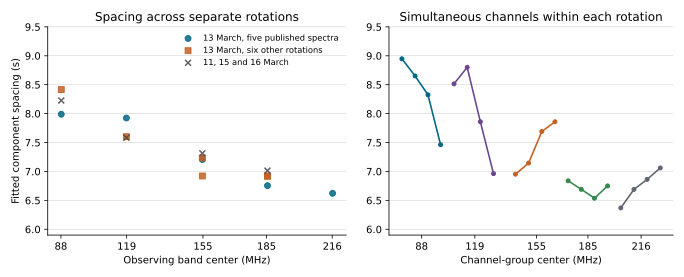

# Radio pulse components draw closer together at higher frequencies in GLEAM-X J162759.5−523504.3

On 13 March 2018 the Murchison Widefield Array (MWA) resolved a pair of peaks in bright profiles of the main emission component of this 1,091-second Galactic radio transient. Across 11 separate rotations their median fitted separation decreased from **8.20 seconds at 88 MHz to 6.62 seconds at 216 MHz**. The 1.58-second difference is 19% of the low-frequency separation and just over three native time samples. Every change of observing band between consecutive eligible rotations changed the measured separation in the opposite direction.

**Band cycling is a competing explanation for the apparent frequency trend.** The MWA switched observing bands between rotations; those 11 measurements were **not simultaneous across 88–216 MHz**. Pulse-to-pulse variation linked to the observing sequence could mimic the ordering. Within-rotation channel comparisons partly constrain this alternative, but the upper bands give mixed behavior and do not establish a persistent broadband frequency law.

| Band center (MHz) | Rotations | Leading peak (s) | Trailing peak (s) | Separation (s) | Separation from smoothed maxima (s) |
|---:|---:|---:|---:|---:|---:|
| 88.16 | 2 | 12.32 | 20.52 | 8.20 | 7.93 |
| 118.88 | 2 | 12.03 | 19.79 | 7.76 | 7.33 |
| 154.72 | 3 | 12.06 | 19.01 | 7.21 | 6.60 |
| 185.44 | 3 | 12.24 | 18.99 | 6.92 | 6.30 |
| 216.16 | 1 | 12.09 | 18.71 | 6.62 | 5.85 |

Each entry is a median over rotations in that band. Peak positions use the arbitrary folded-time origin of the discovery team's profile-stack code. The leading peak moves relatively little across bands. Most of the change is in the trailing peak. A common delay translating the entire profile preserves the peak separation.



## Independent rotations, time order and method dependence

The discovery team's five rotations used for their dispersion measurement give a strictly decreasing sequence across bands. Six **different rotations on the same night** reproduce the trend. In these six, the coefficient of log frequency is −1.74 seconds when a quadratic trend in observation time is fitted. Across all 11, a linear time adjustment gives −1.80 seconds per unit of natural-log frequency and −0.023 seconds per hour. Leaving out one rotation at a time gives frequency coefficients between −2.06 and −1.68 seconds. All ten steps between successive qualifying observations show opposite changes in band and spacing, including reversals in the direction of the frequency scan.

Four measurements from other nights supply a further comparison. On 11 March the spacing was 7.58 s at 119 MHz and 7.31 s at 155 MHz. On 15 March it was 7.01 s at 185 MHz, and on 16 March it was 8.23 s at 88 MHz. The last two dates each sampled one eligible band, so temporal evolution also allows their difference. All observations come from the same telescope.

The rank correlation on 13 March is −0.949. Among the 277,200 assignments of the five band labels to 11 ordered spacing values with these band counts, ten give an equally large absolute correlation. This exact two-sided fraction, 0.0000361, **assumes exchangeable rotations**. When circular shifts preserve the temporal order of both sequences, the observed alignment ranks first of only 11. Removing both rotations at 88 MHz, where the discovery paper reports ionospheric scintillation, gives a correlation of −0.910 across nine rotations. Flat and sloped background models and direct smoothed maxima all give decreasing median separations through all five bands. Nine of the 11 profiles have a smoothed valley at least twice the native off-pulse noise below the weaker peak. Restricting to these nine gives a correlation of −0.975 for both fitted separations and direct peak separations. Absolute separations across the three estimators differ by up to ~1.7 s. The strong result is the ordering across bands.

## What simultaneous frequency channels show

The five public dynamic spectra permit a frequency comparison *within* a single rotation, where pulse-to-pulse evolution cannot mimic a difference. Each published spectrum was divided into four equal-count contiguous groups of channels. In the 88-MHz rotation, the fitted spacing changes from 8.95 s at 76.48 MHz to 7.46 s at 99.04 MHz. In the 119-MHz rotation it changes from 8.51 s at 106.88 MHz to 6.96 s at 129.92 MHz. The three upper-band rotations show changes of +0.91, −0.09 and +0.69 s between their outer quarters. Direct peak locations in the channel groups can also be unstable, particularly in the scintillating 88-MHz spectrum. These observations support a frequency-dependent mean profile during a specific emission state. They leave open how much comes from changing component amplitudes, blending, propagation or evolution between rotations.

Across each native 0.32-MHz channel, the published dispersion measure of 57 pc cm⁻³ predicts about 0.22 s of dispersive smearing at 88 MHz and 0.015 s at 216 MHz. Differential weighting or scattering can still alter a blended profile. On the four upper-band dynamic spectra, a model giving both components a common exponential scattering tail proportional to frequency⁻⁴ and a fixed intrinsic separation gives a weighted residual sum of squares of 625 across 188 time bins. Allowing the intrinsic spacing to vary by band gives 419. Each fit allows independent amplitudes, widths, leading peak phases and linear backgrounds in each band. These residuals describe a sensitivity test. The off-pulse noise estimate uses only 15 time bins, and correlated noise, more complex scattering and asymmetric component shapes remain possible. [Model fits](scattering_models.csv) The discovery authors describe an earlier, wider-spaced secondary component. The fit here starts at folded time +4 s, well after that precursor, and only models the two peaks near +12 and +19 s. These data do not determine an emission altitude, a scattering time or whether the source is a white dwarf or neutron star.

## Selection and reproducibility

We inspected the 72 distinct total-intensity profile files in the upstream dedispersed-profiles directory, which includes partial observations. The discovery authors count 71 detected pulses. The 13 March event emerged during exploration of both 2018 activity episodes, including early and late pulse components, fine structure, and cross-profile correlations. We chose the comparison dates and component windows after inspection. The permutation calculation is conditional on that selection and gives no campaign-wide false-alarm probability. We used the published 1,091.1708 s constant-period stack and performed no period scan for this result.

Of 12 profile files on 13 March, 11 meet the coverage and noise requirements. Of 21 files from 11 through 16 March, 15 qualify. Input timestamps are GPS observation starts, converted to UTC using the 18-second offset in 2018. The 0.5-s samples are already barycentered and dedispersed. We require at least 37 of the 46 samples in the fit interval (+4 to +27 s), at least six off-pulse samples (earlier than −35 or later than +33 s) and at least one window sample five scaled median absolute deviations above the off-pulse median. A pair of Gaussian components on a linear baseline is fitted by ordinary least squares. Leading and trailing centroids are constrained to 9–15 s and 16–22 s. The raw-maxima comparison smooths the interpolated profile with a Gaussian of 0.75 s standard deviation. Channel groups use frequencies from the upstream files and unweighted channel means. Every cell in the 32–54.5 s fit interval and 56–63 s baseline interval in those five aligned spectra is present. Zero padding elsewhere is excluded.

From this directory, run the following with Python, NumPy and SciPy installed. Matplotlib regenerates the figure. Supply a local cache to replay offline. A new cache downloads the pinned inputs and verifies their SHA-256 digests.

```sh
python replay.py --cache /tmp/gleam-x-j1627-cache
OPENBLAS_NUM_THREADS=1 python scattering.py --cache /tmp/gleam-x-j1627-cache
python plot.py
```

[Observation ledger](profiles.csv) · [Same-rotation channel measurements](simultaneous_quarters.csv) · [Exact checks](summary.json) · [Input checksums](inputs.json) · [Source revision and authors' code](https://github.com/nhurleywalker/GLEAM-X_Periodic_Transient/tree/653038358ec146f4eba7128e3c97d319bd55ca72)

## Prior work and falsification

Hurley-Walker et al. (2022) discovered the source, described profile evolution and measured the broadband dispersion and spectrum. Their Extended Data Fig. 1 displays five rotations used here. Their Extended Data Fig. 5 compares emission windows in January and March. Kramer et al. (2024) investigated **quasi-periodic substructure**, finding it in two of 12 GLEAM-X pulses examined. The present measurement concerns how the separation of two peaks within the main component changes across frequency in a specific March interval. Searches of the indexed primary literature on 15 November 2026 combined the source name and aliases with “component separation”, “pulse profile”, “March 13”, “frequency-dependent”, “radius-to-frequency mapping”, “subpulse” and “scintillation”. We found no prior numerical report of this band ordering. [Discovery paper](https://doi.org/10.1038/s41586-021-04272-x) · [Substructure analysis](https://doi.org/10.1038/s41550-023-02125-3)

A decisive test would use a further bright rotation observed *simultaneously* from roughly 90 to 215 MHz. It would separate frequency dependence from a repeating temporal change in the emission pattern. Multiple rotations with comparable signal-to-noise at both edges could also distinguish a moving maximum from changing amplitudes of unresolved components. The archived MWA observations used a single band on each rotation.
