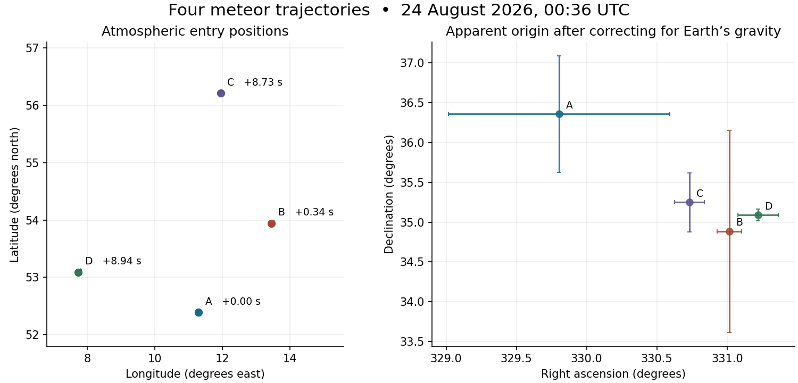

# Four meteor paths over northern Europe in 8.94 seconds

On 24 August 2026 the Global Meteor Network (GMN) recorded four meteors over Germany and waters near Denmark with geocentric speeds of 36.14–37.32 km/s. The reconstructed points of origin on the sky (radiants) are within 1.78° of one another. Their entry positions span 440 km. The four preferred solutions use 17 different cameras, with no camera shared between paths. The four tracks are a candidate meteoroid cluster. Debris dispersed before reaching Earth could produce these measurements. A brief concentration within a diffuse meteoroid stream could also produce them. The trajectories alone cannot identify a parent or date a breakup. GMN recorded the meteors and published their orbits. The contribution here is their association and the survey-wide tests of it. [Global Meteor Network observations](https://globalmeteornetwork.org/data/) · [Event measurements](tracks.csv)

| Path | Start UTC, 00:36 + seconds | Entry lat, lon (°N, °E) | Geocentric RA, Dec (°) | Geocentric speed (km/s) | Cameras | Convergence angle |
|---|---:|---|---|---:|---:|---:|
| A | 08.325 | 52.390, 11.297 | 329.806, +36.358 | 37.321 ± 0.247 | 6 | 75.4° |
| B | 08.662 | 53.942, 13.459 | 331.016, +34.884 | 36.143 ± 0.153 | 2 | 8.3° |
| C | 17.053 | 56.208, 11.954 | 330.733, +35.251 | 36.644 ± 0.111 | 3 | 88.4° |
| D | 17.269 | 53.089, 7.735 | 331.219, +35.091 | 36.273 ± 0.035 | 6 | 89.8° |



C and D entered the atmosphere 440.3 km apart within 0.216 seconds. Two reductions of C and two of D repeat the same tracks. The six archive rows describe four paths. Taking the reduction with most cameras and then largest convergence angle gives the four above. Switching to the other solutions for both C and D still yields a time span under 9.3 s. The minimum lateral displacement among the four preferred tracks is 211.7 km, far exceeding their 10–18 km luminous height range. These lateral distances use a spherical Earth and the component of each midpoint separation perpendicular to the track direction. The cuts and the evidence code use the smaller of the two projections. Heights are GMN values in km above sea level. [Numerical replay](evidence.py)

**The weakest member is B.** Its two lines of sight meet at only 8.3°, and its formal declination uncertainty is 1.27°. Raising the convergence cut to 15° leaves three distinct tracks spanning the same 8.94 s, measured by 15 separate cameras. A has the largest radiant and velocity offset from the others. Thus the data support close trajectories with finite dispersion. A single exact radiant and speed is a stronger physical model than the adopted association rule.

## What the cameras recorded

The nightly image summaries show streaks at the expected time on at least two contributing cameras for each of the four paths. We matched time-labelled exposures for all 18 cameras in the six archive rows, including the extra camera in an alternate fit. The preferred four fits use 17 cameras. The two cameras for path B both show faint features. Multiple features appear in those blocks, so assigning a particular streak to the fitted trajectory requires the calibrated frames. The image summaries support the presence of transients. The subsecond chronology and orbit geometry come from the trajectory fits. The station manifest gives timestamps, tile positions, original image links and SHA-256 fingerprints. [Camera evidence and same-field controls](station-evidence/README.md)

## Search population and chance groups

We read the 22 complete UTC months from January 2025 through October 2026, totaling 1,765,062 solutions. The exploratory screen included shower-assigned rows, first considered a 400 km radius, found many nearly identical trajectories, then required at least 10 km of lateral separation. We inspected the unassigned triples and extended the entry-position radius to 600 km after spotting the fourth August path outside the original radius. The reported configuration requires no GMN shower assignment, convergence ≥5°, finite fields, descending endpoints and positive geocentric speed. Every pair in a group must start within 10 seconds, have radiants within 4°, differ in speed by at most 2.2 km/s, and have entry-position chord distance ≤600 km and lateral separation ≥10 km. The timescale and radiant/speed scales have precedent in a CAMS and SonotaCo cluster search. [Ashimbekova, Vaubaillon & Koten](https://arxiv.org/abs/2503.16157) · [Executable cuts](survey.py)

A separate pass merged plausible repetitions of one luminous track before testing the association. It links solutions within 10 s, 5°, 3 km/s, 80 km in 3D midpoint distance, and 4 km laterally against both directions. It retains the best-sampled solution per connected component. The 1,313,542 eligible rows become 1,242,480 representatives. The only four-path group in that pass was the August event. All three-path matches are retained, including the four subsets of the August group. Each monthly file is a separate search block. Matches straddling UTC month boundaries are outside the count. [Monthly denominators and input digests](geographic/months.csv) · [Complete accepted groups](geographic/groups.csv)

| Repeated full-survey control | Real groups of four | Shuffles with any group of four | Fraction |
|---|---|---:|---:|
| All eligible rows, actual times shuffled within five minutes worldwide | 4 combinations of the same four paths | 33 / 1,000 | 3.3% |
| Deduplicated paths, actual times shuffled within five minutes and 15° × 15° geographic tiles | 1 | 24 / 3,000 | 0.8% |
| Same deduplicated paths and tiles, actual times shuffled within one minute | 1 | 141 / 3,000 | 4.7% |

The permutations preserve the actual timestamps inside each block and all spatial, radiant and speed information for each meteor. The short-block test retains much of the concentration of arrivals around the observed event. These are empirical frequencies for the specified searches. The choice to investigate unassigned triples and expand the radius was exploratory, so they do not give a discovery-wide probability of fragmentation. Regional exposure and sub-minute structure can also affect the null. The full per-realization counts are included for the [worldwide](primary/shuffles.csv), [five-minute regional](geographic/shuffles.csv) and [one-minute regional](geographic60/shuffles.csv) tests.

## Competing shower explanations and prior reports

We compared the group median radiant and speed to the 10 November 2026 IAU Meteor Data Center release. We compared tabulated solutions within 15° of the observed solar longitude, applied linear radiant drift where supplied and used zero drift otherwise. We ranked by the quadrature sum of angular offset divided by 4° and speed offset divided by 2.2 km/s. The nearest August entry under that metric, the omicron-Andromedids, is 11.86° and 4.84 km/s away. Timing, incomplete shower catalogs and uncertain drift limit this check. [IAU MDC release](https://iaumdc.astro.sk/downloads) · [Nearest catalog solutions for all four dates](shower-comparison.csv)

Three other dates yielded distinct triples. The 19 November 2025 group crossed central Europe in 2.17 s with a maximum radiant separation of 0.70°. The 15-Cancrids are a plausible source, 1.38° and 1.20 km/s from the group median. Both December groups are near the Geminids at peak season. We retain all three as comparisons. A blank GMN shower code alone would have made the November and December results easy to overinterpret. [All solutions](tracks.csv)

The report search on 14 November 2026 used combinations of “meteor cluster”, “meteoroid cluster”, “August 24 2026”, “00:36”, “Germany”, “Denmark” and the equivalent German date. The reviewed literature includes the CAMS and SonotaCo database search, Koten and colleagues' review of known clusters, August 2026 observing reports and GMN releases. We found no earlier identification of this four-path event in the material reviewed. Local camera logs and unpublished investigations are incompletely indexed. An independent astrometric reduction of the calibrated camera frames, particularly for B, would directly test the four-member interpretation. GMN publishes the reconstructed trajectories and station summary images. Operators control access to the underlying frames. [Cluster literature](https://doi.org/10.1016/j.icarus.2026.117085) · [GMN data policy](https://globalmeteornetwork.org/wiki/index.php?title=Main_Page#GMN_data_policy)

## Reproduction and credit

From this directory the first command reproduces the event geometry offline from the released track extract. Python 3.12, NumPy 2.3.5, pandas 2.2.3 and SciPy 1.17.0 were used. Matplotlib is optional for the figure. The full survey downloads 1.64 GB of public monthly text tables. The file digests in months.csv identify the versions analyzed. GMN periodically republishes these files. On a byte mismatch compare the monthly counts and the individual IDs before attributing numerical differences to the analysis.

```sh
python evidence.py
python figure.py
python survey.py --fetch --cache /tmp/gmn-months --output /tmp/gmn-global
python survey.py --cache /tmp/gmn-months --output /tmp/gmn-regional --regional --trials 3000
python survey.py --cache /tmp/gmn-months --output /tmp/gmn-60 --regional --block 60 --trials 3000
curl -fsS https://iaumdc.astro.sk/downloads/lists_shw_data/streamfulldata.json -o /tmp/mdc.json
python evidence.py --extract /tmp/gmn-months --mdc /tmp/mdc.json
```

The MDC JSON SHA-256 was `03b682ec7476b1d490865a5636d704cc820bbd316aa13dddc45cc0705e4851d8`. GMN and its camera operators supply the trajectory data under CC BY 4.0. The CSV extract selects and renames columns. Grouping, distance estimates, statistical tests and figure are derived here. We acknowledge Vida et al. (2020, MNRAS 491, 2688) for the trajectory method and Vida et al. (2021, MNRAS 506, 5046) for the network. [Archive and data credits](https://globalmeteornetwork.org/data/) · [Trajectory method](https://doi.org/10.1093/mnras/stz3160) · [Network methodology](https://doi.org/10.1093/mnras/stab2008) · [CC BY 4.0](https://creativecommons.org/licenses/by/4.0/)
