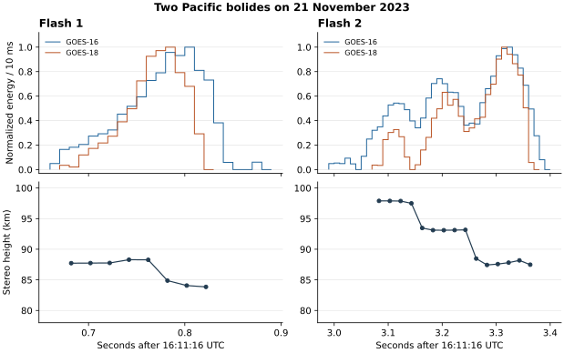

# Two Pacific bolides resolved by both GOES lightning mappers

On 21 November 2023, GOES-16 and GOES-18 each recorded two subsecond optical transients over the eastern Pacific. GOES-16 measured their onsets **2.328 seconds apart**. Stereo reconstruction places the brightest joint 20 ms intervals **315 km apart**, at heights of approximately **85 km and 88 km**. The separation requires two distinct atmospheric sources under ordinary Solar System meteor speeds. NASA cataloged the flashes individually in 2023. The contribution here is the paired three-dimensional measurement, its check against the original NOAA groups, and its survey context. [NASA event A](https://neo-bolide.ndc.nasa.gov/service/event/656ce8725c197e06984541d6) · [NASA event B](https://neo-bolide.ndc.nasa.gov/service/event/656ce9225c197e06984556e5)

| Quantity | Western flash A | Eastern flash B |
|---|---:|---:|
| GOES-16 UTC onset (16:11 + seconds) | 16.667 | 18.995 |
| GOES-18 UTC onset (16:11 + seconds) | 16.672 | 19.073 |
| GOES-16 / GOES-18 optical groups | 93 / 68 | 179 / 127 |
| Brightest stereo bin, start (16:11 + seconds) | 16.772 | 19.313 |
| Stereo latitude, longitude | 11.719° S, 110.458° W | 11.841° S, 107.608° W |
| Stereo height above WGS84 | 84.9 km | 87.8 km |
| Closest approach of satellite sight lines | 0.9 km | 4.3 km |
| Independent ±10 km coordinate offsets, height range tested | 71–98 km | 74–101 km |
| NASA analyst rating | Medium | High |



## Measurement

The NASA event extracts hold time, group energy, longitude and latitude from the GOES Geostationary Lightning Mapper (GLM). For each event, take 20 ms bins beginning at the later of the two spacecraft onsets. Find each spacecraft's energy-weighted group centroid in the common interval. Cast a ray from each spacecraft's nominal position through the centroid on the GLM lightning ellipsoid, with WGS84 semiaxes raised by 14 km at the equator and 6 km at the pole. Take the midpoint of the shortest segment between rays. Report the bin maximizing the geometric mean of the two spacecraft energy sums. The two points are separated by the straight-line ECEF distance. Absolute heights depend on pixel sampling and the assumed ray geometry. GLM's nominal pixel width is about 8–14 km. [GLM navigation](https://doi.org/10.1175/JTECH-D-19-0100.1) · [NOAA instrument specifications](https://www.nesdis.noaa.gov/our-satellites/currently-flying/goes-east-west/geostationary-lightning-mapper-glm)

Two contemporaneous NOAA Level-2 granules contain all **467** NASA-extracted optical groups. Each group's time, energy, latitude and longitude were reproduced from the corresponding original granule. This checks product identity and extraction, while the independent views come from the two spacecraft. NOAA assigned good group quality to all 161 western-flash groups and 304 of 306 eastern-flash groups. Removing the two flagged groups leaves the reported peak-bin coordinates unchanged. The analysts marked both flashes isolated from nearby lightning and both light curves “very good.” The second flash moved across multiple pixels on both instruments. GOES-18 assigned the first flash one ground-track pixel. The step changes in reconstructed height reflect pixel sampling. A detailed orbit or precise speed would exceed the spatial resolution. [NOAA and NASA product URLs, hashes and original classifications](sources.json)

To test sensitivity to pixel assignment, offset each of four reported coordinates (eastward and northward for each spacecraft) by −10, 0 and +10 km at each peak. Across all 81 reconstructions per flash and all 6,561 pairings, separation ranges from **292 to 339 km**. These are geometric stress tests, not statistical confidence intervals. Even 292 km across the **entire 2.718 s** from first recorded light to last requires **107 km/s**. One body on an ordinary bound heliocentric orbit entering Earth's atmosphere can approach roughly 73 km/s. Each independently reconstructed source lies far above ordinary lightning clouds.

## How unusual is the pairing?

The NASA catalog snapshot contains 11,611 published records spanning July 2017–October 2026. Each of the 2,826 events with attachments from distinct satellites enters the comparison once, including the target events. For each event use the earliest instrument onset. Of the five pairs with onset separations of at most 10 seconds, the four comparison pairs are **1,235–4,539 km** apart in catalog coordinates. The Pacific pair is **327 km** apart using those coarse coordinates and **315 km** using the optical measurements. The analysis began with an all-event search for close dates and positions. The stereo subset and numerical thresholds were examined after seeing the pair. [Frozen stereo survey](stereo-catalog.csv)

The date coincided with enhanced Leonid activity. The International Meteor Organization's calendar forecast a possible enhancement from the 1767 dust trail at 12 UTC, about four hours before the flashes. An independent ground-network study reports extended 2023 Leonid activity. Seven stereo bolides in this archive occurred within 16:00–17:00 UTC on the same day. Two independent meteoroids from a dense stream are a credible explanation. [IMO 2023 calendar, p. 18](https://www.imo.net/files/meteor-shower/cal2023.pdf) · [SPMN independent observations](https://www.hou.usra.edu/meetings/lpsc2024/pdf/1322.pdf)

The control preserves every observed arrival time, event count and spatial footprint within fixed UTC blocks, then randomly relabels positions within each block. The code analytically calculates the expected number of pairs within 2.5 s and 350 km under these permutations, including pairs straddling a block edge. Expected counts are **0.0476** with one-hour blocks (both phase offsets), **0.067–0.10** with half-hour blocks, and **0.167–1.0** with ten-minute blocks. The latter can condition on only the two target events in a block. This sensitivity and the exploratory selection preclude a discovery significance for a common parent. Membership of a particular dust trail and fragmentation before atmospheric entry remain open.

## Reproduction

Run from this directory with Python 3 and NumPy. The ordinary run needs no network. The optional NOAA check needs netCDF4 and fetches two checksum-pinned granules. To redraw the figure, add `--plot light-curves.svg` with Matplotlib installed.

```sh
python analyze.py
python analyze.py --noaa-cache /tmp/pacific-glm-noaa
```

The four flash CSVs preserve the NASA products byte-for-byte. The stereo-catalog CSV retains event IDs, earliest attachment times and published catalog coordinates so the search universe can be inspected independently. The [source manifest](sources.json) includes the full catalog receipt. Searches for the observation date and time with “Leonid,” “GLM,” “bolide,” and “double” located published work on the shower and instrument, but no previous triangulation of this specific pair. Publication priority and common origin remain unverified. [GLM bolide pipeline](https://doi.org/10.1029/2025EA004896)
