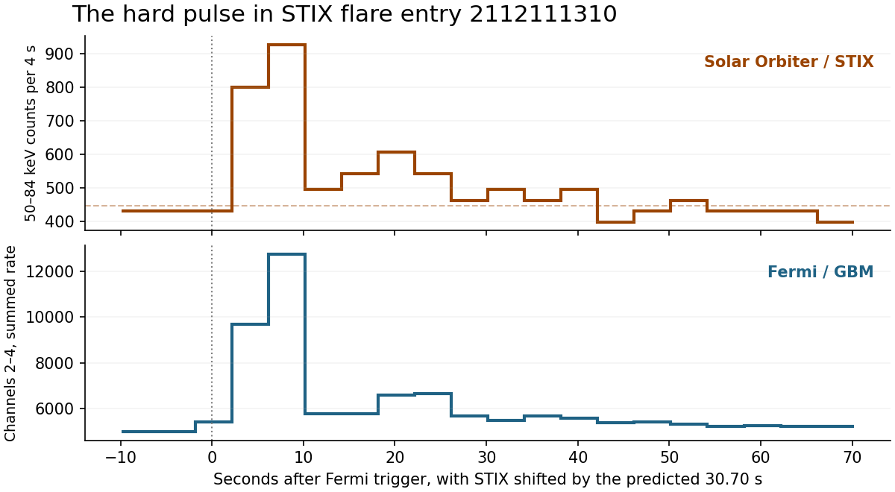

# A kilonova-associated gamma-ray burst in the STIX solar-flare catalog

Solar Orbiter recorded the prompt emission of GRB 211211A inside STIX solar-flare entry **2112111310** (database row **4595**). The public catalog assigns this 44-second event an estimated GOES class of B3, with no measured GOES class or CFL location. The hard X-ray counts trace the independently measured Fermi light curve, including the initial maximum and the weaker second episode. The attribution matters for solar work using this row's peak counts or estimated flare class. **A weak coincident solar contribution is not excluded**; the result identifies the dominant hard pulse, not the absence of every solar signal. The burst and its kilonova association were established previously. [STIX catalog, 2021-12-11](https://datacenter.stix.i4ds.net/query/flares/2021-12-11T00:00:00/2021-12-12T00:00:00) · [Rastinejad et al.](https://doi.org/10.1038/s41586-022-05390-w)



GOES-16's one-minute full-disk measurements showed no corresponding B3-level solar X-ray rise; these averages cannot rule out every brief or weak solar component. Across 26 one-minute samples spanning the event, its 1–8 Å irradiance stayed between 3.85 and 4.49 × 10⁻⁸ W m⁻². Both channel quality flags were zero throughout. This constrains the solar contribution independently of the gamma-ray light-curve match. [GOES-16 data and reproduction](solar-control.md)

## Measurement

Fermi triggered at 13:09:59.651 UTC. The Swift/XRT position, an event-epoch JPL Horizons geocentric geometric vector for Solar Orbiter and the Fermi inertial position give a **30.6996-second** later arrival at Solar Orbiter, near 13:10:30.351 UTC. The separation between the spacecraft was 43.815 light-seconds. The STIX catalog interval is 13:10:20.589–13:11:04.589 UTC. Its listed peak at 13:10:44.589 is a catalog-level summary. The highest 50–84 keV bin in the L1 file is centered at 13:10:38.509 UTC, within that interval. [Swift localization and GBM circulars](https://gcn.nasa.gov/circulars/events/grb-211211a)

| Independent comparison | Result |
| --- | --- |
| STIX 50–84 keV versus Fermi/GBM 22–300 keV at predicted arrival | Pearson r = 0.96857 in 20 four-second samples |
| Same comparison scanning ±8 s in 0.25 s steps | r = 0.97328 at −0.25 s relative to the prediction |
| Fixed-delay r in the other STIX energy channels | 0.659 in 4–10, 0.280 in 10–15, 0.913 in 15–25 and 0.744 in 25–50 keV |
| 50–84 keV peak and background | 927 counts in 4 s, local background median 447 |
| Catalog-window excess, 50–84 keV | 1,261 counts above the mean of local sidebands, 11 bins |
| Science-pixel data, 50–150 keV | 4,091 excess counts in two 20-s integrations, with positive net counts in 28 of 32 detectors |
| Positive control, published STIX GRB 230307A | Fixed-delay r = 0.94192 and optimized r = 0.94974 |
| Rejected single-bin excess, GBM trigger bn250920121 | Fixed-delay r = −0.23044 and optimized r = −0.05101 |

The soft-channel count rise is also timed to the burst. Both 4–10 keV bins spanning the dominant hard maximum reach 303 counts, compared with a local mean of 244. The ground flare catalog’s own per-channel statistics give peaks of 303 (4–10 keV) and 927 (50–84 keV). The raw onboard thermal index, nonthermal index, location status and flare progress all stay at zero throughout the catalog interval. A small independent solar contribution to the soft counts is possible. Off-axis deposited counts cannot by themselves determine the source photon spectrum or an incident 50–150 keV fluence. The four-second sampling does not resolve a subsecond precursor or provide subsecond travel-time precision. [STIX data-center pipeline](https://doi.org/10.1051/0004-6361/202346031)

## Controls and selection

The initial exploratory screen ranked Fermi bursts after MJD 59090 that had published fluence and 64-ms peak flux. I tried the 32 highest peak fluxes against daily STIX light curves. Twenty-one target-date files were available in the chosen mirror's requested date folders during the screen. A large-bin search was used to select 211211A, the previously published 230307A positive control, and a 2025-09-20 spike that failed the subsequent profile comparison. The 2024-06-12 STIX pilot also gave no strong excess. This screen cannot establish a population frequency. The periods and cuts were chosen during exploration.

For each case the analysis sums all 12 GBM NaI detectors in TRIGDAT channels 2–4, preferring the finest available bins where time bins overlap. It integrates that external template over STIX bin boundaries. The sign of the geometric delay follows from projecting the Fermi-to-Solar-Orbiter vector onto the direction of incoming wave travel. Solar Orbiter vectors are geocentric ICRF, evaluated at the trigger time converted to TDB. The Fermi EIC vector comes from the TRIGDAT row with start time nearest the trigger. STIX UTC uses the FITS observation epoch plus the DATA time at bin center. A quarter-second lag fit samples the template between 4-s bin centers. [GBM TRIGDAT specification and energy channels](https://fermi.gsfc.nasa.gov/ssc/data/analysis/gbm/gbm_data_tools/gdt-docs/_modules/gbm/data/trigdat.html)

The same lag fit was run on 1,075 disjoint 80-second background blocks in the 211211A STIX file with block start more than 200 s from the predicted arrival. None matched the candidate's fitted amplitude or correlation. The plus-one empirical tail fraction is 1/1,076 (0.00093) for each statistic. This is a same-day, selected-event control rank, not a global detection probability for every choice in the exploratory search. The fixed-delay comparison, the matching weaker peak, the second STIX product and the successful published control provide distinct checks. For the science product, count excess is relative to 21 same-observation 20-s bins centered more than 80 s from the catalog peak. The quick-look and science products use overlapping detector counts. [Known 230307A STIX detection](https://gcn.nasa.gov/circulars/33410)

## Prior records

The inspected 211211A event circulars and MPE burst compilation did not identify STIX, including in the reports from the participating high-energy instruments. The STIX team's public GRB directory showed entries for 221009A and 230307A. The STIX flare service and targeted science packet already contain the 2021 event. The contribution here is the reproducible attribution of the catalog row's hard signal to the known GRB. Searches by flare ID, date, instrument and burst name did not produce a prior published attribution. Unindexed or internal team identifications remain possible. [GCN event page](https://gcn.nasa.gov/circulars/events/grb-211211a) · [MPE compilation](https://www.mpe.mpg.de/~jcg/grb211211A.html) · [STIX public GRB directory](https://datacenter.stix.i4ds.net/pub/GRB/)

## Reproduction

With Python 3, NumPy and Astropy installed, run this command from the directory containing this file. A fresh cache downloads eight versioned public FITS files and checks their SHA-256 digests. The analysis writes the numerical results and aligned profiles to the output directory.

```sh
python reproduce.py --cache /tmp/stix-grb-inputs --out /tmp/stix-grb-result
```

`inputs.json` contains the exact file URLs, hashes, sky positions, trigger times, catalog fields, JPL Horizons query URLs and returned vectors. `measurements.json` reports measurements and controls. `profiles.csv` contains all five STIX channels plus the integrated, zero-offset Fermi template for each bin. STIX data are provided by the Solar Orbiter/STIX team through the NASA archive mirror. Fermi/GBM data are provided by NASA HEASARC. [STIX data archive](https://umbra.nascom.nasa.gov/solar_orbiter/science/STIX/L1/2021/12/11/) · [Fermi burst files](https://heasarc.gsfc.nasa.gov/FTP/fermi/data/gbm/triggers/2021/bn211211549/current/) · [JPL Horizons](https://ssd.jpl.nasa.gov/horizons/)
