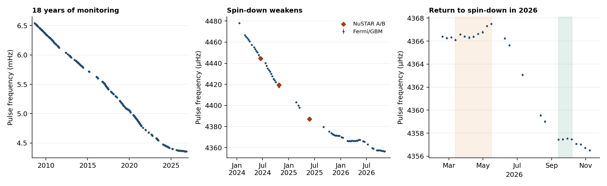

# GX 1+4 resumed spinning down after its reported near-standstill

On 2026 May 22, Takagi and colleagues reported that the neutron star GX 1+4 had interrupted decades of spin-down with a near-standstill and a short spin-up. They left open whether it was entering sustained spin-up. **Fermi measurements taken after their alert show that the pulsar resumed spinning down. By November 7, it had lost 10.986 ± 0.119 µHz from its May peak**, almost eight times the 1.386 µHz it had gained over the preceding 64 days. [Takagi et al., ATel 17809](https://www.astronomerstelegram.org/?read=17809)

| Interval in 2026 | GBM epochs | Frequency change (µHz) |
| --- | ---: | ---: |
| March 12 to May 15, approaching the previously reported high | 9 | +1.386 ± 0.127 |
| May 15 to September 13 | 7 | −10.037 ± 0.114 |
| September 13 to October 6 | 4 | +0.014 ± 0.114 |
| October 6 to November 7 | 5 | −0.964 ± 0.119 |

The first six post-alert measurements each fall below the previous frequency, counting from the May high. Four measurements then occupy a band only 0.073 µHz wide for 23.69 days at roughly 4,357.5 µHz. The last four descend again. The four-point interval is consistent with constant frequency at the recorded precision. It does not establish a separate physical equilibrium state. Dates mark the barycentric midpoints of multi-day integrations and uncertainties propagate the published endpoint errors.

The episode came as the long-term rate of spin-down weakened. A fit to 278 measurements from 2009 through 2022 gives −132.24 µHz/year. Separate fits give −75.94 in 2024, −39.09 in 2025 and −16.67 µHz/year in the available 2026 record. An independent search of NuSTAR photons recovers the early stage of the slowdown, including a measurement inside a 168-day gap in the GBM record.



## Reconstructing the previously reported frequency rise

The March and May endpoint frequencies were 4,366.106 and 4,367.491 µHz, 64.464 days apart. The quoted uncertainty is the quadrature sum of the two published measurement errors. The largest rise among all 1,550 covered 24–80-day pairs selected these endpoints retrospectively. Pairs share epochs, accretion torque fluctuates, and the interval was selected from the data. The endpoint error measures frequency precision. A discovery false-alarm probability would also require a model for torque noise and the search procedure.

| Check | Result |
| --- | --- |
| Least-squares slope across the nine epochs | +6.60 µHz/year |
| Alternating epochs, fitted separately | +7.06 and +5.65 µHz/year |
| Delete any single epoch and refit | All nine slopes positive, +5.39 to +7.68 µHz/year |
| Mission search-window edge | Every frequency is at least 10.80 µHz inside the nearer boundary |
| Signal and exposure | At least 376 pulse profiles contribute per epoch. The smallest pulsed amplitude divided by its quoted uncertainty is 6.07 |
| Historical comparisons ending before MJD 61088 | All 1,440 differences over 24–80 days are negative. The same holds for all 1,826 differences over 18–90 days and all 1,768 over 30–100 days |
| Orbital frequency shift over 64.464 days | At most 0.188 µHz under the deliberately enlarged neutron-star velocity amplitude described below |

GBM barycenters its frequency measurements but applies no binary orbit for GX 1+4. The donor's infrared radial-velocity orbit has period 1,160.8 days, eccentricity about 0.10 and semiamplitude 14.62 km/s. Published mass estimates put the donor and neutron star near equal mass. Allowing a neutron-star semiamplitude of **30 km/s**, the maximum radial-velocity change over this interval is bounded by K × 2π × Δt/P × (1+e)²/(1−e²)^(3/2). The corresponding pulse-frequency change is below 0.188 µHz at any orbital phase. Binary Doppler motion at this scale cannot supply the measured rise. This analysis measures the spring rise using GBM alone. [GBM monitor parameters](https://gammaray.nsstc.nasa.gov/gbm/science/pulsars/lightcurves/gx1p4.html) · [Infrared orbit and masses, Hinkle et al.](https://arxiv.org/abs/astro-ph/0512253)

## Independent pulse and flux measurements

Three public NuSTAR visits sampled the slower decline in 2024–25. The first, middle and last science observations in the nine-visit campaign were chosen to span the baseline. Searching 3.9–5.0 mHz independently in each focal-plane module yielded the following frequencies.

| Visit date | NuSTAR observation | FPMA (µHz) | FPMB (µHz) |
| --- | --- | ---: | ---: |
| 2024 June 16 | 31002031001 | 4,444.504 | 4,444.496 |
| 2024 October 23 | 31002031009 | 4,419.293 | 4,419.543 |
| 2025 May 25 | 31002031017 | 4,387.312 | 4,386.962 |

Both modules give a June-to-May rate near −61 µHz/year, less than half the magnitude of the historical GBM slope. The last visit falls between GBM observations at MJD 60751.96 and 60919.99. Those two frequencies bracket both NuSTAR measurements. The two modules are simultaneous. NuSTAR provides an independent instrument and an earlier baseline.

The NuSTAR search bins 3–35 keV photons in 2-second intervals within a 60-arcsecond source aperture, subtracts the mean rate scaled by each bin's good-time exposure, and sums power at the fundamental and second harmonic. The two modules agree to within 0.36 µHz at each epoch. The 100–180 arcsecond comparison annulus also shows the pulse, at substantially smaller power, consistent with telescope point-spread wings. Frequencies include a geocentric Earth-velocity correction at mid-visit. Omitted spacecraft motion can change the instantaneous frequency by about 0.11 µHz for a 7.5 km/s orbit. Pulse-profile evolution and spacecraft clock corrections also limit precision. Extra digits in the CSV serve numerical replay. [NuSTAR data archive](https://heasarc.gsfc.nasa.gov/docs/nustar/nustar_archive.html)

MAXI/GSC measured 2–20 keV flux on 58 of the 65 calendar days overlapping the frequency increase. The median was 0.0432 photons cm⁻² s⁻¹, versus 0.0576 on 56 days in the preceding 65-day window and 0.0362 on 61 days afterward. Inverse-variance means follow the same sequence (0.0573, 0.0410, 0.0391). These daily data show no sustained brightening above the preceding window. Sparse daily scans permit shorter missed flares. MAXI measures band-limited flux in this Galactic-plane field. It cannot establish the accretion flow geometry or a bolometric luminosity change. [MAXI source light curves](https://maxi.riken.jp/star_data/J1732-247/J1732-247.html) · [Flux columns and observing cadence](https://maxi.riken.jp/top/lc_readme.txt)

## Selection and scientific scope

This was an exploratory inspection of nine public GBM histories. The source list, file checksums and number of history rows per target are in [sources.json](sources.json). We inspected coarse time bins and, where cadence allowed, 50-day slopes. GX 1+4 stood out for a persistently flattening decline. We then examined individual points, calendar windows and paired differences for that source. Gaps in monitoring can conceal earlier episodes. A quantitative assessment of incidence across pulsars requires a pre-specified detection rule.

Takagi et al. reported both the 2025–26 near-standstill and the spring spin-up on 2026 May 22. Earlier work documents torque and flux reversals dating back decades. The new observational result here is the measured outcome of the open question in that alert, including the later decline, pause at a lower frequency, and renewed decline. The GBM team's continually updated monitor publishes the underlying measurements. A November 14 search for GX 1+4 and V2116 Oph with “2026 spin-up”, “17809”, “spin-down resumed”, “2026 torque reversal” and “second plateau” found the original alert and monitor. We did not locate a separate report measuring these later intervals. Bibliographic priority remains open. [Takagi et al.](https://www.astronomerstelegram.org/?read=17809) · [Historic torque and flux correlations](https://ntrs.nasa.gov/citations/19990089683) · [Long-term pulse history](https://arxiv.org/abs/1105.1907) · [Timing noise and earlier reversals](https://doi.org/10.1093/mnras/stx1045)

## Reproduce the measurements

Run these commands in this directory. The first uses the Python standard library and the checked-in mission measurements.

```sh
python replay.py > /tmp/gx-1p4-measurements.json
diff measurements.json /tmp/gx-1p4-measurements.json
```

[gbm.csv](gbm.csv) retains all 368 GBM rows in the downloaded 2026 November snapshot, including both integration endpoints, the barycentric timing epoch, frequency, quoted error, search boundaries, profile count, detection flag and pulsed amplitude. [maxi.csv](maxi.csv) retains all published daily rows in the three adjacent comparison windows. [measurements.json](measurements.json) includes every annual fit, window count and leave-one-out result. With Astropy installed, `prepare.py GBM_FITS_GZ MAXI_DAT --output DIRECTORY` extracts the released columns. Both mission links update in place and their recorded original SHA-256 hashes identify the frozen source versions.

The optional independent NuSTAR replay needs NumPy, SciPy, Astropy and about 370 MB of compressed event data across six hash-checked files. The official event URLs and hashes are in [sources.json](sources.json). The included [nustar.csv](nustar.csv) records both source and annulus counts, powers and frequencies.

```sh
python -m pip install numpy scipy astropy matplotlib
OPENBLAS_NUM_THREADS=1 python nustar.py /tmp/gx-1p4-events --download > /tmp/gx-1p4-nustar.csv
python plot.py
```

Small numerical differences in the last reported digits can depend on the ephemeris and numerical libraries. The plot uses the included pulse-frequency tables. We acknowledge the Fermi GBM Pulsar Project, the NASA NuSTAR mission and HEASARC, and MAXI data provided by RIKEN, JAXA and the MAXI team. [GBM Accreting Pulsar Histories](https://gammaray.nsstc.nasa.gov/gbm/science/pulsars.html)
