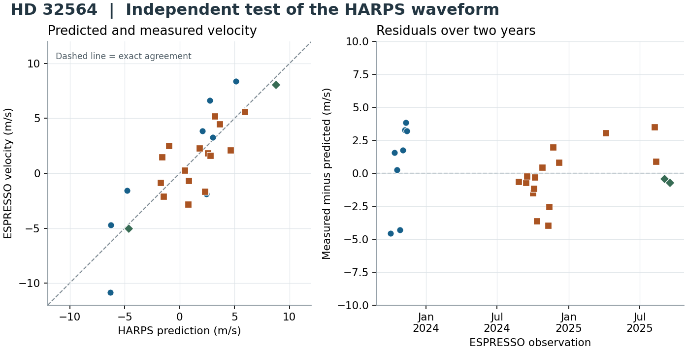

# Two short-period Doppler signals at HD 32564 predict independent VLT velocities

The nearby G dwarf HD 32564 (HIP 23575, TIC 213078996) shows repeating Doppler shifts at **2.55663 and 11.06295 days**. Both periods, phases and amplitudes were fitted to 2009–2016 HARPS spectra before measuring any ESPRESSO velocities. Seven years after the final HARPS observation, ESPRESSO recovered the 2.56-day wave on its own. A joint test also supports the 11.06-day component, with stronger dependence on the other fitted periods. The full waveform brings the independent telescope's RMS velocity scatter from **4.30 to 2.44 m/s** over 25 observations in 2023–2025.

The two strongest signals are candidates for low-mass companions. Assuming circular orbits and the TIC stellar mass of 0.98 solar masses, their HARPS amplitudes imply minimum masses of about **9 and 12 Earth masses**. Stellar activity remains an alternative. We report the observable periodic velocities and the candidate interpretation separately. [Stellar identification and TIC entry](https://exofop.ipac.caltech.edu/tess/target.php?id=213078996)

| HARPS period (days) | HARPS semiamplitude (m/s) | Independent ESPRESSO semiamplitude at fixed phase (m/s) | Increase in ESPRESSO mean square error when removed ((m/s)²) |
| ---: | ---: | ---: | ---: |
| 2.55663 | 4.24 | 4.63 ± 0.88 | 8.56 |
| 11.06295 | 3.54 | 2.75 ± 0.89 | 5.92 |
| 23.60798 | 3.01 | 1.53 ± 0.84 | 1.22 |
| 49.10259 | 1.64 | 1.91 ± 0.80 | 2.31 |

The ESPRESSO uncertainties are conditional least-squares standard errors with the residual variance estimated from those data. The last two waveforms have weaker independent amplitude estimates. The 23.6- and 49.1-day periods are close to a two-to-one relationship and could involve stellar rotation and its harmonics. The data support further tests of those components. The quoted predictions use the full four-component model. In a separate two-term comparison with the HARPS amplitudes and phases held fixed, the 2.56-day term alone gives 2.92 m/s ESPRESSO RMS, and adding only the 11.06-day term gives 3.02 m/s. Thus the independent gain attributed to the second term depends on including the two longer waves; the first term has the stronger standalone evidence.

## Selection and clocks

A blind search used the complete HARPS RVBank v2 and a positional exclusion within 15 arcseconds of a NASA Exoplanet Archive confirmed host. This approximate exclusion can miss high-proper-motion stars. The screen required zero RV quality flags, valid SERVAL velocities and errors, at least 28 observing nights, and at least 24 retained nights spanning 25 days after outlier screening. A Lomb–Scargle search covered max(0.0007, 1.7/time span) to 0.8 cycles/day. The search evaluated 541 stars. Of these, 491 exceeded fractional periodogram power 0.20. HD 32564 ranked 30th by the approximate BIC improvement, among a mixture of known planets, binaries, stellar variability and aliases. We inspected high-ranked stars and their literature. HD 32564 was selected for its numerous measurements, short-period peak, and absence of a corresponding catalogued planet. This target choice was exploratory. The full target analysis includes **all 205 exposures on 191 nights** with no outlier rejection. [HARPS RVBank v2](https://github.com/3fon3fonov/HARPS_RVBank/tree/09626a652ddc93df8771ce3d818ee04a292f7585) · [NASA Exoplanet Archive](https://exoplanetarchive.ipac.caltech.edu/)

We took medians within rounded BJD nights. The initial dominant period had daily aliases at 1.635 and 2.557 days. An extended search to four cycles/day and sequential searches of residuals supplied other aliases and waves near 11.06, 23.59, and 49.14 days. Each of six candidate waveforms was fitted by joint least squares to the HARPS night medians, with sine/cosine terms at four locally optimized periods, separate pre/post-fibre-upgrade zero points, and a linear trend. The four-wave fit preferred 2.55663 days. At 1.63499 days its HARPS RMS was 2.15 m/s, versus 1.86 at 2.55663. Each fit's full parameters were frozen before reading the independent velocities. The JSON hash records the frozen bytes, independent of the replay. [Frozen models](harps_predictions.json)

## Independent instrument and controls

Of 28 ESO archive product records at this position from ESPRESSO, 25 had publicly readable spectra. The headers identify HD 32564, the BJD (TDB), and the cross-correlation velocity, formal uncertainty, and line-shape indicators. The independent test refits only an ESPRESSO offset and linear trend to the observed-minus-predicted velocities. It fixes every HARPS period, amplitude and phase. Correlation after removing the same trend from data and model is 0.824. The alternate 1.635-day waveform gives 3.44 m/s RMS, and the other short-period aliases give 3.37–5.28 m/s. The two pipelines that reduce the same HARPS spectra also agree on the amplitudes. [Archive measurements and product IDs](espresso.csv) · [Full numerical comparison](measurements.json)

After removing a separate mean in each of three annual groups containing 8, 15 and 2 ESPRESSO spectra, the correlation is 0.832. None of 100,000 shuffles of the predicted values within those groups attained this correlation. This tests the frozen waveform under within-group exchangeability. It does not account for every target searched or model of stellar noise. With just an instrument offset, the validation RMS is 2.44 m/s. Offsets per ESO programme suffix also preserve the signal (r = 0.856).

At the two short periods, each term accounts for 73% and 64% of the remaining HARPS RV variance after fitting the other waves and nuisance parameters. The corresponding partial fractions stay below 3% in each of chromatic index, differential line width, H-alpha, Ca II activity, CCF width, bisector and barycentric correction. The ESPRESSO predictions correlate weakly with bisector span, CCF width, CCF contrast and barycentric correction (absolute r ≤ 0.18). Activity indicators and cross-instrument phase coherence constrain explanations, while dedicated red-noise and eccentric-orbit modelling could change component uncertainties. [Activity measurements](harps.csv) · [Controls](measurements.json)

Three ESPRESSO products in programme 116.293R returned HTTP 401. Their velocities were unavailable for this analysis. Using their public exposure-start times and approximate BJD = MJD + 2,400,000.510, the frozen model predicts the three relative waveform values recorded here. At release, use the exact header BJD; the common ESPRESSO offset cancels in differencing. The last visit is predicted to be 3.2 m/s lower than the first and 5.2 m/s lower than the second before any longer-term drift. [Predictions and withheld IDs](withheld_predictions.csv)



Each point is one public ESPRESSO observation. The left panel removes only the fitted ESPRESSO offset and slope from the measured velocities. The right panel uses the same fit and shows measured minus predicted velocity. Colors and symbols identify the three annual groups used in the shuffle.


### Velocities measured directly from ESPRESSO spectral pixels

We remeasured a differential velocity from each of three disjoint wavelength intervals in the 25 public ESPRESSO spectra. Each interval recovers the 2.56-day wave with its HARPS phase and amplitude fixed. In all three, the full HARPS prediction beats the other five frozen alias models. These are three measurements of the same visits, sharing a telescope, reduction and wavelength calibration. [Exposure-by-exposure velocities and FITS prefix digests](s1d-velocities.csv)

| Vacuum wavelength (Å) | Eligible wavelength bins per spectrum | Offset and trend RMS (m/s) | 2.56 d alone | Four waves | Four with 11.06 d omitted | Best of five other aliases | Correlation with pipeline RV |
| --- | ---: | ---: | ---: | ---: | ---: | ---: | ---: |
| 4200–4600 | 54,547 | 4.32 | 2.85 | 2.40 | 3.41 | 3.32 | 0.992 |
| 4600–5000 | 49,484 | 4.30 | 2.87 | 2.37 | 3.46 | 3.29 | 0.991 |
| 5000–5500 | 57,149 | 4.28 | 2.90 | 2.46 | 3.62 | 3.32 | 0.989 |

ESO's S1D_FINAL_A spectra supply barycentric wavelengths, calibrated flux densities, errors and quality flags. The extraction works directly on their common logarithmic grid (499.98 m/s per pixel). Each 512-pixel chunk, including a final partial chunk of at least 128 pixels, must have finite positive flux and errors and zero quality flags in every exposure. A median flux template across visits supplies a local wavelength derivative. We fit each observed chunk with a scale, a linear color term and a first-order velocity shift, refitting once after removing residuals above six quoted flux errors. We omit a chunk for every visit if any fit retains under 80% of its bins. The three intervals retained 107, 97 and 112 chunks. We center each chunk's velocities across visits and use one set of weights for all visits in an interval. The extraction uses neither the HARPS waveform nor the pipeline's scalar RV. The RMS comparisons fit only the offset and trend used in the original validation. Injecting alternating ±5 m/s shifts into the measured flux chunks before template fitting recovered 99.7%, 99.7% and 99.8% of the injected displacement. This checks the estimator's response to an imposed translation. [Extraction and injection replay](s1d_velocities.py)

### A hydrogen line varies with the predicted waveform

The Hα core raises a specific stellar-activity question. Its 1.6 Å flux index correlates with the full frozen waveform at **r = 0.538** after removing a common offset and linear trend from each series. With separate seasonal means the correlation is 0.520. A narrower 0.6 Å core gives 0.546 after detrending. The two Hα passbands overlap and share their continua. The Ca II H+K index gives 0.249. These are descriptive correlations from an exploratory comparison over 25 visits. Atmospheric absorption, throughput changes and stellar variability can all affect line indices. We have not modeled telluric absorption in each exposure. [Per-exposure activity measurements](s1d-activity.csv) · [Line-strength extraction](s1d_activity.py)

Allowing a linear dependence of the pipeline RV on the 1.6 Å Hα index, alongside an offset and trend, gives 4.05 m/s RMS. Including the fixed 2.56-day signal gives 2.92 m/s, and including all four gives 2.38 m/s. The signal persists under this simple correction. The Hα correlation and the common spectral calibration limit what the band agreement can establish about its physical origin.

We transform the vacuum wavelengths into stellar-rest air wavelengths with a fixed −40.695 km/s system velocity and the Morton conversion. Hα uses rectangular core windows and local continuum bands at 6550.87 and 6580.31 Å. The H and K indices use 1.09 Å FWHM triangular cores and two 20 Å continuum bands. Ratios use the mean flux density in each window, with flagged bins removed and at least 95% coverage required. The calcium ratio is instrumental and has no Mount Wilson calibration. The profile release gives normalized flux in 81 bins of width 0.05 Å around each line, for each exposure, and the 16th, 50th and 84th percentiles across visits. The percentile range describes the observed visit-to-visit spread. [243 spectral bins across 25 visits](s1d-profiles.csv) · [Published passbands](https://doi.org/10.1093/mnras/stv1441) · [Wavelength conversion](https://www.sdss4.org/dr12/spectro/spectro_basics/)

Replay requires Python, NumPy, SciPy and Astropy. With no options each script reads the released tables. To extract the pixels again, run the commands below. The two commands share a cache of roughly 325 MB. Each download reads bytes 0–13,000,000 inclusive from the named ESO FITS product, covering both headers and the four complete columns used here. The replays check the original primary-header digests, the prefix digests and the released CSV values. The three later proprietary product IDs were rechecked on 2026-11-14 and still returned HTTP 401.

```sh
python s1d_velocities.py --extract --inject --cache /tmp/hd32564-s1d
python s1d_activity.py --extract --cache /tmp/hd32564-s1d
```

### Correlated stellar noise

We repeated the ESPRESSO comparison with the HARPS waveforms fixed and fitted the noise independently under every hypothesis. The table gives the improvement in maximized log likelihood over a no-waveform model using the same noise family, instrumental offset and linear drift. Only the ESPRESSO covariance and drift are re-estimated. The respective velocity time series contain the same 25 exposures.

| Residual model | 2.56 d alone | Both inner components | Four components | Four with 2.56 d omitted | Four with 11.06 d omitted |
| --- | ---: | ---: | ---: | ---: | ---: |
| Independent jitter | 9.65 | 8.82 | 14.19 | 3.04 | 5.54 |
| Exponentially correlated noise | 10.59 | 11.87 | 17.67 | 3.34 | 6.30 |
| Quasi-periodic stellar variability | 11.86 | 13.57 | 21.32 | 5.44 | 12.37 |

The 2.56-day component improves prediction under all three covariance assumptions. The incremental evidence for 11.06 days depends on the other components and the noise model. Even with only the two inner waveforms, it improves the correlated-noise likelihoods, while its addition slightly lowers the independent-jitter likelihood. The quasi-periodic model allows a stellar period of 15–65 days, phase coherence of 2–300 days and fixed phase smoothness. Its best no-waveform fit selects a 21.8-day stellar period. These fits test specific alternatives with one instrument's small validation sample. Likelihood gains are conditional on the specified hypotheses and are not planet probabilities. [Noise parameters and results](noise_comparison.json) · [Replay with NumPy and SciPy](correlated_noise.py)

### Photometric conjunction test

TESS Sectors 5 and 32 provide 34,443 good two-minute cadences. We measured 2.0- and 3.5-hour boxes centered on the inferior conjunctions predicted by circular HARPS orbits, with the host-star velocity crossing from positive to negative. After median filtering each sector with a 721-cadence window, the combined depths are −3 and −11 parts per million for 2.56 and 11.06 days. Positive values would indicate a dip. When a 200-ppm box is injected into the pipeline-corrected flux before the same filtering, the measured depths increase by 184 and 172 ppm. We found no transit at those specific phases and durations. The measurements leave impact parameter, eccentricity and ephemeris uncertainty open, and do not provide a radius upper bound. The two FITS digests, archive URLs, exposure counts and off-phase checks are preserved for replay. [TESS measurements](tess-check.json) · [Download and replay](photometry.py)

## Earlier work and attribution

The ESO observers acquired these data expressly to study planets. Udry's HARPS programme described preliminary candidates in its wider sample. Delisle and colleagues later obtained ESPRESSO measurements in a comparative survey of inner planetary architectures. Their first survey paper reports signals around HD 23079, HD 196067 and HD 86226. Queries for HD 32564, HIP 23575, TIC 213078996, and the measured periods, the NASA archive, the ExoFOP TOI/CTOI tables, and the 49 SIMBAD-linked papers checked on 2026-11-14 yielded no identified prior public report of these two periods around this star. Prior private identification, an unindexed publication, or ongoing analysis by the observing teams remains possible. [Udry observing programme](https://archive.eso.org/wdb/wdb/eso/abstract/query?progid=183.C-0972) · [Delisle et al. 2025](https://doi.org/10.1051/0004-6361/202555445) · [ESO follow-up programme](https://archive.eso.org/wdb/wdb/eso/abstract/query?progid=116.293R) · [SIMBAD bibliography](https://simbad.cfa.harvard.edu/simbad/sim-id?Ident=HD+32564)

Based on observations collected at the European Southern Observatory under HARPS programmes 183.C-0972, 090.C-0849, 091.C-0936 and 192.C-0852, and VLT/ESPRESSO programme 112.25YG. HARPS RVBank reductions are by Trifonov et al. and Perdelwitz et al. The HARPS discovery fits use SERVAL; the DRS series supplies the same-exposure reduction control. ESPRESSO velocities are the ESO pipeline measurements in the public spectral products. [Trifonov et al. 2020](https://doi.org/10.1051/0004-6361/201936686) · [Perdelwitz et al. 2024](https://doi.org/10.1051/0004-6361/202348263) · [ESO Science Archive](https://archive.eso.org/)

## Replay

From this directory, Python with NumPy and SciPy is sufficient. The source verifier uses the standard library and internet access. The TESS check uses Astropy and downloads two pinned products. It verifies the SHA-256 of the upstream HARPS archive, checks every released target column and row, and retrieves the primary header from each public ESPRESSO product. The per-product hashes cover exact 80-byte FITS cards through END, excluding the trailing FITS padding. ESPRESSO columns preserve the source units of km/s for radial velocities and line widths. The replay converts RV to m/s.

```sh
python replay.py
python verify_sources.py
python correlated_noise.py
python photometry.py
```

The replay checks the six HARPS fits against the frozen prediction file and recomputes independent validation, activity diagnostics and the within-season randomization. The row-level release retains every measured target velocity. The root of the time coordinate for the frozen sine and cosine coefficients is BJD 2456000.0. [Reproduction code](replay.py) · [Source verification](verify_sources.py)

### Recreate the blind target ranking and figure

The full table includes all 541 tested stars, their peak periods and powers, approximate BIC improvements, and pass/fail decisions. The position snapshot contains 4,862 distinct (hostname, RA, Dec) rows obtained by projecting the 6,470-row NASA Planetary Systems Composite Parameters query on 2026-11-14. The query was `select hostname,hd_name,hip_name,gaia_dr3_id,pl_name,ra,dec,pl_orbper from pscomppars` with CSV output. The full response SHA-256 was `77ad5c778104ead7889abd7b6670758834fb9a81a562c0ab3d359981d26573a4`. The discovery screen excluded 674 positional matches among stars with good HARPS velocities before counting usable nights. The 45 MB upstream HARPS archive is pinned by commit and digest in the verifier. Astropy, pandas, NumPy and SciPy run the survey replay; Matplotlib draws the figure. [All screened targets](screen_results.csv) · [Frozen catalog positions](host_positions.csv.gz) · [Search implementation](screen.py)

```sh
python screen.py --output recreated_screen.csv
python plot_validation.py
```

With an existing HARPS zip, pass `--archive HARPS_RVBank_ver02.csv.zip` to run the entire target screen offline.
