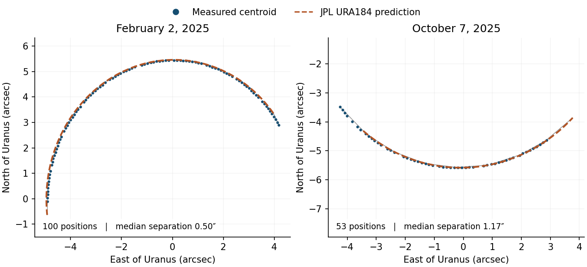

# Satellite search in public Uranus and Neptune imaging

**No new moon has been validated. The strongest source seen in two independent deep JWST visits is Perdita.** Its measured position was a median **0.50 arcsec** from the nominal JPL URA184 prediction on 2025 February 2 and **1.17 arcsec** away on 2025 October 7. That is 16.2 and 37.7 NIRCam pixels. A search using only the nominal known-moon mask can rediscover this object in both visits.

The measurements use 100 February and 53 October native integration centroids. The preferred circular, equatorial fit completes 387 revolutions and has radius **76,418.1 km**, matching JPL's published mean semimajor axis for Perdita. Its RMS residual is 0.37 pixel in February and 0.41 pixel in October. NASA's labeled February image independently identifies the measured source as Perdita. The observing team had already reported qualitative discrepancies for Perdita and several other moons. The contribution here is the two-epoch astrometry against the identified URA184 solution, the image-label registration, the alternative orbit fits, and the quantified false positive in a blind search. [Astrometry and numerical aliases](jwst6379_9482/psf_astrometry/) · [Independent label and catalog tests](jwst6379_9482/identity/IDENTIFICATION.md) · [Prior AGU report](https://scixplorer.org/abs/2025AGUFMP41G.2685H/abstract) · [JPL mean elements](https://ssd.jpl.nasa.gov/sats/elem/)

## What the data establish

| Observation | Measurement | Scope |
|---|---|---|
| Uranus, JWST F150W2, programs 6379 and 9482 | The two-visit search found 628 same-sign orbit solutions to test. After excluding measured Perdita and known-moon trails, 209 remained. None placed even a 3-local-MAD peak within 3 pixels in both original integration stacks. | The two visits are 247 days apart. Integer revolution counts were explicitly tested. A first positive CAL score can come from the wings of a known moon's long trail. |
| Uranus, JWST F162M, program 8975 | 40 of 40 off-grid, geometrically observable sources at 3 µJy (AB 22.71) were recovered in a detector-level challenge including subpixel placement and 0.3-pixel RMS registration perturbations. The exact 95% lower bound is 91.2%. | Circular equatorial orbits at 79,500–80,500 km in two actual visits. Only 80 of 120 random test orbits passed the geometric support test. [Measurements](jwst8975/README.md) |
| Neptune, JWST F140M and F210M, program 2739 | The independent reduction recovers known Hippocamp in both filters. Masking Proteus's measured halo removes all 187 raw crossings. Among 110 supported off-grid paths, 33 recovered at 0.08 µJy and 96 at 0.16 µJy. Counting all 200 draws gives 33 and 96 recoveries. | One spacecraft visit. Requiring both bands gives a conditional 50% bracket AB 25.89–26.64 for equal flux density in both filters across ten radial strata from 30,000 to 130,000 km. This sequence calibrates sensitivity and cannot confirm a new object across visits. [Measurements](jwst2739/README.md) |
| Neptune, JWST MIRI, two visits | No positive or sign-inverted trail passed in either F2100W or F2550W. Half-recovery was bracketed by 0.6–2 mJy at 21 µm and 6–20 mJy at 25.5 µm. | 45,180 templates per filter at 50,000–300,000 km. The injection brackets use 32 off-grid paths in the 180,000–182,000 km annulus. Thermal and reflected flux require different physical size models. [Measurements](miri/README.md) |
| Uranus and Neptune, HST F845M, program 16995 | 1,792 detector-level plant experiments bracket 50% recovery at total AB 22.39–22.89 in the inner tested intervals and AB 22.89–23.39 in the outer intervals. One Neptune feature failed both exposure dropout and locked F763M follow-up. | Counts include the unobservable draws. At each brightness and in each interval, 64 off-grid orbits were tested. The four radius intervals, exact recovery counts, binomial intervals and conditional diameter ranges are published separately. [Measurements](hst16995/README.md) |

The October Perdita fit to an individual visit has median residual 0.29 pixel. A single phase adjustment to the three-dimensional JPL trajectory also explains the largely along-track displacement. The two-visit circular-model radius has an exposure-block jackknife uncertainty of about 0.015 km *within the selected cycle count and model*. The next circular alias gives a radius near 76,550 km. Phase, eccentricity, inclination, optical calibration, and interactions with neighboring moons matter for prediction outside this arc. The catalog comparison represents a measured position discrepancy. A new dynamical ephemeris would require a broader set of data and a dynamical fit. [Conditional uncertainties and SPK cross-check](jwst6379_9482/psf_astrometry/ephemeris_checks.json) · [Alternate radii and residuals](jwst6379_9482/psf_astrometry/circular_aliases.csv)

The October F150W2 aperture measurement is approximately **0.39 µJy, AB 24.92**, with an exposure-to-exposure scaled MAD of 0.052 µJy. The estimate uses the specific CRDS flat named in the FITS headers, the recorded photometric factor, and a trailed-PSF insertion to measure aperture and temporal-subtraction losses. Retaining calibrated jump-flagged pixels yielded usable apertures in six exposures. Rejecting every jump flag left zero apertures above the throughput threshold. For geometric albedo 0.04, 0.08, or 0.16 in this band, a reflecting sphere at the recorded distances has an equivalent diameter of about **24, 17, or 12 km**, assuming a unit phase function. These figures express the albedo dependence of this measurement. [Exposure photometry and reference hashes](jwst9482/integration_check/photometry.json)

## Coverage and reproducibility

The frozen MAST census covers 2022 January 1 through 2026 November 16 UTC. It contains 1,492 observation groups, 2,067 detector exposures and 3,262 file URIs. Alternate reductions of a single exposure share the same observational evidence. The census contains 1,427 WFC3/UVIS groups, 48 NIRCam groups, 17 MIRI groups and no direct NIRISS imaging groups matching the selection. The 10-arcmin sky search also found Triton pointings missed by planet-name matching. Each individual search records its processed fields, known-body masks, usable visits, trial orbit range and injection population. [Archive selection, product mapping and limits](ARCHIVE.md) · [Spacecraft ephemerides and ring geometry](GEOMETRY.md)

The S/2025 U1 positive control recovers the known moon in its 2025 February discovery visit after subtraction of detector-fixed ring light. The two independent halves of the 100 integrations place its peak within one native pixel of each other. They share one spacecraft visit. [S/2025 U1 controls and byte-range hashes](S2025U1_CONTROL.md)

Each linked investigation includes reproduction commands or a runnable script, input hashes or original FITS byte-range receipts, and the numerical decision tables. Coverage is specific to the listed filters, phases, masks and orbit families. Measuring depth for one annulus does not provide a population limit for all moons of either planet.
