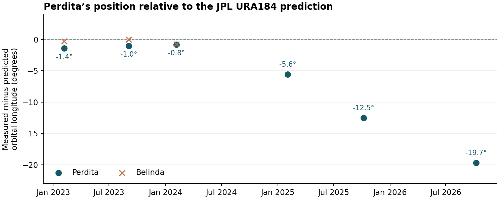

# Satellite search in public Uranus and Neptune imaging

**No new moon passed validation. The strongest repeated source is Perdita, whose measured position diverges substantially from the nominal JPL URA184 track.** The median separation was **0.50 arcsec** on 2025 February 2 and **1.17 arcsec** on 2025 October 7 (16.2 and 37.7 NIRCam pixels). On 2026 October 8 a blind orbit search in two further visits recovered a compact source at the radius of Perdita, 60.7 and 61.9 native pixels from the prediction (about **1.9 arcsec**). A third visit that day confirmed it at the frozen position. It was undetected in the fourth. [2026 astrometry, catalog and fixed-sky checks](nircam_supplement/README.md)

The measurements use 100 February and 53 October native integration centroids. The preferred circular, equatorial fit completes 387 revolutions and has radius **76,418.1 km**, matching JPL's published mean semimajor axis for Perdita. Its RMS residual is 0.37 pixel in February and 0.41 pixel in October. NASA's labeled February image independently identifies the measured source as Perdita. The observing team had already reported qualitative discrepancies for Perdita and several other moons. The contribution here is the two-epoch astrometry against the identified URA184 solution, the image-label registration, the alternative orbit fits, and the quantified false positive in a blind search. [Astrometry and numerical aliases](jwst6379_9482/psf_astrometry/) · [Independent label and catalog tests](jwst6379_9482/identity/IDENTIFICATION.md) · [Prior AGU report](https://scixplorer.org/abs/2025AGUFMP41G.2685H/abstract) · [JPL mean elements](https://ssd.jpl.nasa.gov/sats/elem/)

The projected longitude residual was −1.44° and −1.03° in the two 2023 epochs and −0.83° on 2024 February 6–7. At the last three epochs it was −5.60°, −12.53° and −19.70°. Belinda also shows a −0.78° residual in the 2024 data. The points use each visit's fitted detector positions and the planet's equatorial projection. The 2026 value combines four accepted short- and long-exposure measurements across three visits. [Tabulated history](perdita_history.csv) · [Sky-plane tracks in the two deep 2025 visits](perdita_tracks.png) · [October 2026 long-frame fits](jwst8975/long_holdout/perdita_full_trails.csv)

## What the data establish

| Observation | Measurement | Scope |
|---|---|---|
| Uranus, JWST F150W2, programs 6379 and 9482 | The two-visit search found 628 same-sign orbit solutions to test. After excluding measured Perdita and known-moon trails, 209 remained. None placed even a 3-local-MAD peak within 3 pixels in both original integration stacks. | At 79,500–80,500 km, 7/12 clear injected paths recovered at 0.05 µJy and 21/21 at 0.10 µJy (AB 26.40, 95% lower bound 83.9%). Including known-object vetoes gives 21/36 at 0.10 µJy. Diameters at that flux are 12.8, 9.0 and 6.4 km for F150W2 albedos 0.04, 0.08 and 0.16. [Native recovery and orbit linkage](jwst6379_9482/README.md) |
| Uranus, JWST F162M, program 8975 | 40 of 40 off-grid, geometrically observable sources at 3 µJy (AB 22.71) were recovered in a detector-level challenge including subpixel placement and 0.3-pixel RMS registration perturbations. The exact 95% lower bound is 91.2%. | Circular equatorial orbits at 79,500–80,500 km in two actual visits. Only 80 of 120 random test orbits passed the geometric support test. [Measurements](jwst8975/README.md) |
| Neptune, JWST F140M and F210M, program 2739 | The independent reduction recovers known Hippocamp in both filters. Masking Proteus's measured halo removes all 187 raw crossings. Among 110 supported off-grid paths, 33 recovered at 0.08 µJy and 96 at 0.16 µJy. Counting all 200 draws gives 33 and 96 recoveries. | One spacecraft visit. Requiring both bands gives a conditional 50% bracket AB 25.89–26.64 for equal flux density in both filters across ten radial strata from 30,000 to 130,000 km. This sequence calibrates sensitivity and cannot confirm a new object across visits. [Measurements](jwst2739/README.md) |
| Neptune, JWST MIRI, two visits | No positive or sign-inverted trail passed in either F2100W or F2550W. Half-recovery was bracketed by 0.6–2 mJy at 21 µm and 6–20 mJy at 25.5 µm. | 45,180 templates per filter at 50,000–300,000 km. The injection brackets use 32 off-grid paths in the 180,000–182,000 km annulus. Thermal and reflected flux require different physical size models. [Measurements](miri/README.md) |
| Uranus and Neptune, HST F845M, program 16995 | 1,792 detector-level plant experiments bracket 50% recovery at total AB 22.39–22.89 in the inner tested intervals and AB 22.89–23.39 in the outer intervals. One Neptune feature failed both exposure dropout and locked F763M follow-up. | Counts include the unobservable draws. At each brightness and in each interval, 64 off-grid orbits were tested. The four radius intervals, exact recovery counts, binomial intervals and conditional diameter ranges are published separately. [Measurements](hst16995/README.md) |

The wider HST search evaluated 1,297 registered exposures in 104 searchable epochs across nine filters. All ten narrow-filter cells that survived artifact rejection failed independent follow-up. A single 375-MAD event yielded an apparent AB 18.99 source, while four exposures in the same filter showed no corresponding source at depths of AB 22.21–22.68. [Full HST results and per-file hashes](hst_multiband/README.md)

On 2024 February 6–7, NIRCam recovered Perdita independently in F182M and F210M. The favored 2025-only orbit missed the February 2024 source by 14.24 pixels. The 2024 data also show a comparable small phase offset for Belinda, which limits interpretation of the 2024 absolute offsets. [Independent 2024 holdout and the 31 orbital aliases](jwst2768/README.md)

A separate full-detector 2025 February search between 155,000 and 649,000 km found 246 initial crossings across two same-day visits. None passed localized source tests in both visits. Beyond 584,000 km only 2,587 of 91,397 tracks had sufficient geometric coverage in this pointing. [Outer Uranus search](outer6379/README.md)

The three 2024 F182M visit mosaics extend the search to 650,000 km. Beyond 584,000 km, 182,365 of 191,520 trial orbits had support in at least two visits and none crossed the threshold. Eight crossings closer in came from two distinct stationary sky sources separated by about 40 arcsec. Their apparent orbit failed in the third visit. Of 576 randomly phased off-grid test orbits from 200,000–650,000 km, 106 met the requirement for full dither coverage in all three visits. Among these, 41/106 were recovered at 0.28 µJy and 71/106 at 0.32 µJy, bracketing 50% recovery at F182M AB 25.14–25.28. Beyond 584,000 km, 32 of 83 random orbits qualified and recovery rose from 9/32 at 0.24 µJy to 19/32 at 0.28 µJy (AB 25.28–25.45). [Frozen-sky measurements](jwst2768/wide/locked_sidereal.csv) · [Full-mosaic injection results](jwst2768/wide_injections/completeness.csv)

The 2023 F140M and F300M searches linked two visits 211 days apart. In the same 79,500–80,500 km gap, each recovered 18/18 qualifying off-grid implants at 0.50 µJy (AB 24.65). At 0.10 µJy F140M recovered 1/18 and F300M 7/18. [2023 visit analysis](jwst2739_uranus/README.md)

The October 2025 Perdita fit to an individual visit has median residual 0.29 pixel. A single phase adjustment to the three-dimensional JPL trajectory also explains the largely along-track displacement. The two-visit circular-model radius has an exposure-block jackknife uncertainty of about 0.015 km *within the selected cycle count and model*. The next circular alias gives a radius near 76,550 km. Phase, eccentricity, inclination, optical calibration, and interactions with neighboring moons matter for prediction outside this arc. The catalog comparison represents a measured position discrepancy. A new dynamical ephemeris would require a broader set of data and a dynamical fit. [Conditional uncertainties and SPK cross-check](jwst6379_9482/psf_astrometry/ephemeris_checks.json) · [Alternate radii and residuals](jwst6379_9482/psf_astrometry/circular_aliases.csv)

The October 2025 F150W2 aperture measurement is approximately **0.39 µJy, AB 24.92**, with an exposure-to-exposure scaled MAD of 0.052 µJy. The estimate uses the specific CRDS flat named in the FITS headers, the recorded photometric factor, and a trailed-PSF insertion to measure aperture and temporal-subtraction losses. Retaining calibrated jump-flagged pixels yielded usable apertures in six exposures. Rejecting every jump flag left zero apertures above the throughput threshold. For geometric albedo 0.04, 0.08, or 0.16 in this band, a reflecting sphere at the recorded distances has an equivalent diameter of about **24, 17, or 12 km**, assuming a unit phase function. A separate strict-DQ PSF fit estimated 0.645 µJy from approximately 27% of the modeled flux. The spread between estimators exceeds the internal scatter of the preferred aperture measurement. [Exposure photometry and reference hashes](jwst9482/integration_check/photometry.json)

In October 2026, four independent F140M apertures gave a median **1.020 µJy (AB 23.88)** and an exposure-to-exposure scaled MAD of **0.078 µJy**. The aperture followed the full trails, with about 81% throughput. This is a different filter from the October 2025 F150W2 measurement. [F140M calibrated exposure photometry, model dependence and sizes](jwst8975/long_holdout/README.md)

## Coverage and reproducibility

The frozen MAST census covers 2022 January 1 through 2026 November 16 UTC. It contains 1,492 observation groups, 2,067 detector exposures and 3,262 file URIs. Alternate reductions of a single exposure share the same observational evidence. The census contains 1,427 WFC3/UVIS groups, 48 NIRCam groups, 17 MIRI groups and no direct NIRISS imaging groups matching the selection. The 10-arcmin sky search also found Triton pointings missed by planet-name matching. Every one of the 48 NIRCam observation groups contributed detector pixels to an orbital search. All 17 MIRI groups have measured detector footprints. Eight supplied pixels for orbit searches. The other nine are Neptune fields with no sampled target-centered orbit coverage in the 50,000–300,000 km footprint grid. Three off-planet Uranus parallel fields supported a search of outer orbits. [MIRI group-by-group field geometry](miri/extra/group_coverage.csv) Each individual search records its processed fields, known-body masks, usable visits, trial orbit range and injection population. [Archive selection, product mapping and limits](ARCHIVE.md) · [Spacecraft ephemerides and ring geometry](GEOMETRY.md)

The S/2025 U1 positive control recovers the known moon in its 2025 February discovery visit after subtraction of detector-fixed ring light. The two independent halves of the 100 integrations place its peak within one native pixel of each other. They share one spacecraft visit. [S/2025 U1 controls and byte-range hashes](S2025U1_CONTROL.md)

The [observation-by-observation processing ledger](manifests/processing_ledger.csv) distinguishes archive inclusion, detector footprint or registration checks, actual pixel work and orbit searches. Original FITS, crop receipts and derived arrays have distinct hashes. The [ephemeris restoration script](restore_ephemeris.py) reconstructs NPZ inputs from the published observables.

Each linked investigation includes reproduction commands or a runnable script, input hashes or original FITS byte-range receipts, and the numerical decision tables. Coverage is specific to the listed filters, phases, masks and orbit families. Measuring depth for one annulus does not provide a population limit for all moons of either planet.
