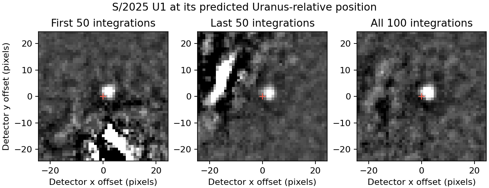

# Known S/2025 U1 recovered in its discovery visit

A compact source appears in each half of the February 2, 2025, F150W2 sequence when shifted along JPL's S/2025 U1 ephemeris. Half-stack peaks differ by one detector pixel. In the full stack the peak is (+2, +2) pixels from the predicted position. It measures 18.12 times the local robust brightness scatter. This is a targeted recovery of the published moon in discovery visit 06379001001. The two halves share the same telescope visit.



| Sample | Integrations | Peak offset (dx, dy), pixels | Local contrast at full-stack peak |
|---|---:|---:|---:|
| First five exposures | 50 | (+2, +2) | 14.73 |
| Final five exposures | 50 | (+2, +1) | 10.18 |
| Combined | 100 | (+2, +2) | 18.12 |

The ten 6379-001 NRCB1 exposures contain ten 204-second integrations each. Native RATEINTS SCI and DQ fields came from public STScI AWS objects. The script validates every 206 byte-range response, retrieves the FITS INT_TIMES table and takes the integration midpoints directly from it. Those midpoints span 01:07:20–07:28:30 UTC. The associated CAL SIP WCS projects the known displacement relative to the moving planet. JPL's URA184 types 2/ICRF segments for Uranus (799) and S/2025 U1 (75052) give the relative position at the light-time-adjusted emission epoch. Horizons supplies the JWST-to-Uranus sightline and distance.

For each exposure the median of its ten aligned integrations estimates the static planet, ring and detector structure at that dither. The reduction subtracts this median before PSF-scale spatial filtering and shift-and-stack. It discards pixels flagged DO_NOT_USE, SATURATED, JUMP_DET or DEAD and requires interpolated valid-pixel support of at least 90%. Some FITS DQ flag bits refer to pipeline-specific detector defects. Temporal median subtraction can attenuate slow motion and structured glare still affects regions next to the rings.

Within three pixels of the ephemeris point, the table records the strongest filtered pixel. Local contrast subtracts the median of the 8–20 pixel annulus and divides by 1.4826 times its median absolute deviation. Correlated residuals and the positional search affect this statistic. Flux calibration, a noise-only trial distribution and blind two-visit injection completeness are outside this control. A second known satellite, Bianca, peaks at 57.01 local scatter units within two pixels in the combined stack. Portia yields 3.47 and its two halves have inconsistent peaks. Its failure illustrates the dependence on orbit, local background and image registration.

From this directory with NumPy, SciPy, Astropy, matplotlib and jplephem installed:

```sh
python moon_spk.py 2460708.35 2460708.86 /data/ura184-feb.bsp /data/ura184-ranges
python positive_control.py /data/headers /data/pixels /data/ura184-feb.bsp /data/horizons /data/control
```

[Native-pixel predictions and measurements](manifests/control_ephemeris.csv) · [Stack measurements](manifests/control_summary.csv) · [FITS byte-range SHA-256 receipts](manifests/control_byte_ranges.csv) · [Ephemeris SHA-256 receipts](manifests/control_ephemeris_receipts.csv) · [NASA discovery notice and observation details](https://science.nasa.gov/blogs/webb/2025/08/19/new-moon-discovered-orbiting-uranus-using-nasas-webb-telescope/) · [JPL satellite ephemerides](https://ssd.jpl.nasa.gov/ftp/eph/satellites/bsp/)
