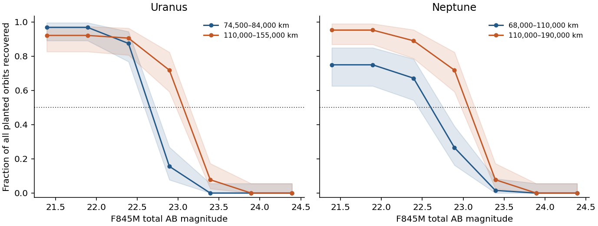

# Hubble F845M recovery limits for four inner-satellite orbit ranges

**No unidentified source passed the independent-visit and exposure-dropout tests in the two program 16995 epochs.** The empirical 50% recovery transition falls between total AB magnitudes 22.39 and 22.89 in the inner of the two sampled intervals around each planet, and between 22.89 and 23.39 in the outer interval. Each interval has 64 uniformly drawn off-grid circular equatorial orbits. The denominator includes draws that fell on the disk, rings, masked moons, detector defects, or outside the usable field. Each orbit was tested at seven brightnesses, for 1,792 plant experiments. The same positions at different brightnesses are repeated measurements.

| Planet and semimajor axis | Recoveries at bright and faint bracket edges | Total F845M AB bracket | Illustrative diameter range |
|---|---:|---:|---:|
| Uranus, 74,500–84,000 km | 56/64 and 10/64 | 22.39–22.89 | 32–71 km |
| Uranus, 110,000–155,000 km | 46/64 and 5/64 | 22.89–23.39 | 26–56 km |
| Neptune, 68,000–110,000 km | 43/64 and 17/64 | 22.39–22.89 | 76–166 km |
| Neptune, 110,000–190,000 km | 46/64 and 5/64 | 22.89–23.39 | 61–132 km |

The diameter span combines both magnitude-bracket edges with geometric albedos 0.04–0.12 and a unit phase function. It describes sensitivity to a reflecting sphere. The calibration uses the actual epoch distances, a CALSPEC solar spectrum integrated through the UVIS2 F845M response, and 0.906 encircled energy in a 10-pixel aperture. The plant catalogs record the 10-pixel aperture magnitudes. Applying the correction makes their total magnitudes 0.107 mag brighter. The AB zeropoints come from the calibrated FLT headers. The bracket edges are measured levels where the sampled recovery fraction passes 50%. The fraction at each tested brightness has its own exact binomial interval. [UVIS2 encircled energy, Table 4](https://arxiv.org/abs/2608.12110) · [Solar and throughput receipts](../manifests/solar_calibration.json) · [Size conversion](../photometry.py)



## Neptune threshold crossing and its rejection

One family of eight adjacent circular templates near 147,000 km passed the initial screen. The highest-ranked template had a score ratio of 1.049 relative to the screen thresholds. In visit 26 its two frame scores were 1.0 and 7.4. In visit 27 they were 32.8 and 0.08. Clipping individual scores before summation still allowed the two isolated peaks to seed a track. Removing the dominant exposure from each visit eliminated the repeat. The best final score ratio anywhere in the Neptune bank was 0.670. The predicted locations in 12 usable F763M measurements give a combined standardized score of 0.64. Proteus gives strong positive measurements in those same holdout data. The evidence rejects this lead as a repeatable satellite. It does not uniquely identify the contaminant. Eight derangements of the visit epochs also produced zero final threshold crossings. [F845M exposure measurements](neptune/f845m_forced.csv) · [Locked F763M predictions](neptune/f763m_predictions.csv) · [Time permutations](neptune/scrambles.csv)

## Images, orbit grid and selection

We selected every F845M WFC3/UVIS exposure of Uranus or Neptune in the public program 16995 target results. Uranus was observed on 2022 November 9–10 in 24 exposures across eight archived visits. Neptune was observed on 2023 September 22–23 in 16 exposures across eight visits. Two visit-23 Neptune exposures failed the illuminated-disk area test. Fourteen Neptune frames in seven visits remained. Uranus has 632,469 supported templates out of 769,861. Neptune has 1,267,818 out of 1,799,990. These counts describe correlated trial orbits. [Selection](selection.csv) · [FITS hashes](inputs.csv) · [Uranus registration](uranus/registration.csv) · [Neptune registration](neptune/registration.csv)

The bank follows circular prograde equatorial motion in the planet's axisymmetric J2/J4 field at 100 km radial intervals and approximately 550 km azimuthal spacing at the reference epoch. The middle epoch of each exposure includes the planet light-time correction. Each detector uses a local SIP-WCS Jacobian in the planet tangent plane. Registration uses the disk and, where usable, a nearby predicted image of Miranda or Proteus. Fitting this restricted orbit model to Horizons positions for Puck and Proteus yields median residuals of 2.25 and 0.96 pixels, respectively. This comparison tests the model and coordinate transform. The endpoints in the injection table apply specifically to circular equatorial tracks. A sufficiently inclined or eccentric moon can miss this bank.

The search excludes the planet and a 14-pixel halo, deprojected ring bands and the full Neptune arc region. Horizons positions are checked by returned target identity. The conservative inner Uranus ring exclusion extends to 72,000 km, enveloping S/2025 U1. Its URA184 positions and a separate projection check against Cordelia are saved. Other known sources have brightness-dependent exclusion radii. The difference of two mask-normalized Gaussian filters (1.1 and 6 pixels) estimates point-source contrast above local glare. DQ flags, unusually sharp events, insufficient PSF support and mask edges remove unusable locations. Residuals are standardized by radial median and median absolute deviation. [Horizons receipt hashes](queries.csv) · [Ephemerides](ephemerides.csv) · [S/2025 U1 positions](s2025u1_spk.csv)

Each visit needs at least two supported samples to contribute. Alternating visits make two disjoint sets, each requiring at least two contributing visits and a stacked score of five. At least two visits must separately reach 4.5. The dropout test requires two visits to retain a score of two after removal of their strongest exposure. These are empirical screening rules. Noise correlation and the number of trials preclude a conversion of the scores to Gaussian discovery probabilities. The F763M holdout and leave-one-out outcomes are reported separately from the initial screen.

We measured the planted PSF from registered real Miranda or Proteus stamps. We applied subpixel shifts, short-exposure trailing and Poisson source counts to the original detector arrays, reran sharp-event masks and filtering, and kept the background noise calibration fixed. Seeding was deterministic. Simultaneous plants were separated by at least 68 pixels in every frame. Recovery required a previously sub-threshold orbit within 2 pixels RMS across all frames in a local bank neighborhood. DQ and the readout history are inherited from the real images. Injections after detector calibration do not simulate charge transfer before readout or fit the range of possible PSF shapes. [Uranus trials and confidence intervals](uranus/completeness.csv) · [Neptune trials and confidence intervals](neptune/completeness.csv)

## Reproduce

Run the following from this directory with NumPy, SciPy, Astropy and Matplotlib. The fetch step compares the files and the parsed ephemerides with the recorded receipts. The initial seed FITS and F763M follow-up together require about 160 MB. Pre-existing calibration or ephemeris revisions can change the returned bytes.

```sh
python fetch.py /path/to/hst-cache
python reduce.py Uranus /path/to/hst-cache uranus --count 64 --mags 21.5 22 22.5 23 23.5 24 24.5
python reduce.py Neptune /path/to/hst-cache neptune --count 64 --mags 21.5 22 22.5 23 23.5 24 24.5
python vet.py /path/to/hst-cache --scrambles 8
python summary.py
```
