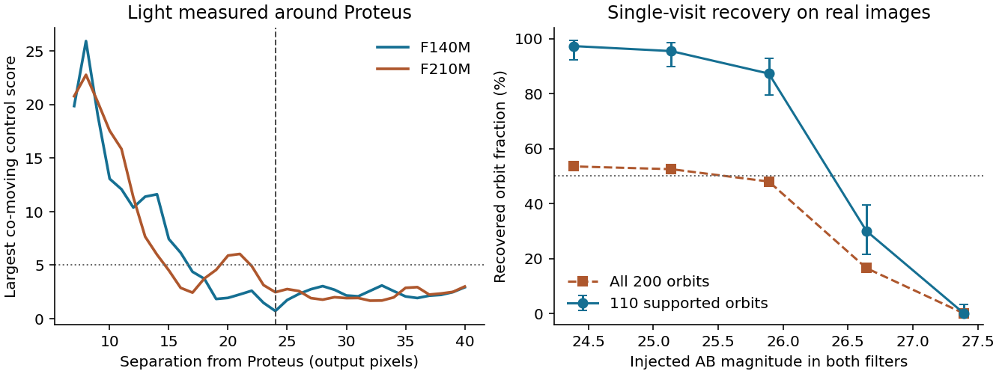

# Neptune in JWST program 2739

**No source passed the F140M and F210M motion tests after excluding light from Proteus.** The surviving footprint supports 39,835 of 72,360 trial orbits. This public NIRCam sequence gives one physical visit, 02739004001, on 2022-07-12. No unknown body from this visit advanced to independent-visit verification. At the predicted position of the previously discovered moon Hippocamp, the F140M and F210M scores are 8.37 and 7.25. [Final grid](screen_masked/radii.csv) · [Known-moon photometry](control_814.json) · [Hippocamp discovery paper](https://doi.org/10.1038/s41586-019-0909-9)

## Field, search and rejection

Each band contributes ten calibrated 85.9 s exposures. The 44 detector tiles map onto twenty independent exposure images; dither overlaps add no extra exposures. Planet-limb fits to four complete disks in each band supply registration. For the six partial disks in each band the reduction transfers the median astrometric shift from the complete ones. Within-band standard deviations of the four east/north shifts are 0.7/0.6 mas (F140M) and 2.7/5.2 mas (F210M). The output pixel scale is 31 mas. There are no overlapping double-counted valid detector pixels in the mosaics. The input receipts give native cutout hashes and the MAST manifest gives the original product URIs, byte ranges, checksums and WCS offsets. [F140M inputs](f140m_inputs.json) · [F210M inputs](nep210_inputs.json) · [Archive products](../manifests/neptune2739_cutouts.csv) · [Byte-range receipts](../manifests/neptune2739_ranges.csv)

The spacecraft observer solution uses 26 epochs for Neptune plus all 16 cataloged moons. The grid spans 30,000–130,000 km at 500 km intervals and all orbital phases at 1° intervals. Each band uses 17 samples across the shutter. Screening requires at least three supported exposures, a score of at least five and a worst leave-one-exposure-out score of at least three in **each** filter, plus a quadrature two-band score of eight. Ring/glare, disk, detector quality and known-moon masks precede the scan. Planets with very red or blue satellites need separate single-filter completeness measurements. These cuts test an image source's color-dependent reproducibility in one visit. [Ephemerides](neptune_observables.csv) · [Horizons hashes](neptune_sources.csv) · [Grid parameters](screen_masked/parameters.json)

The initial disk, ring and moon masks yielded 187 positive and zero sign-inverted joint hits. Every positive hypothesis follows Proteus closely. Their median separations in F140M range from 6.4 to 14.8 pixels. In F210M they range from 5.8 to 12.8 pixels. The strongest trial at 113,000 km has scores 33.6/18.4. A fixed offset from Proteus's ephemeris gives 33.6/17.5 and a sidereally fixed position gives 4.83/0.07. The light can be explained in Proteus's reference frame. The input FITS and WCS support independent detector-frame checks. [Initial peaks](screen/passing.csv) · [Proteus and sidereal controls](halo/raw_peak_checks.csv)

To measure contamination, the reduction sampled 72 position angles at each radius 6–40 pixels from Proteus. A fixed-offset signal reached the five-score threshold at a radius of 21 pixels. The analysis applied a 24-pixel (0.744″) mask to the entire predicted Proteus trail, including a three-pixel guard, and repeated the full survey and injections. Both the positive and sign-inverted searches yield zero two-filter hits. The masked vicinity of Proteus cannot contribute a null limit. The glare control was added after inspecting the initial grid. [Radial controls](halo/proteus_profile.csv) · [Mask definition and cube hashes](halo/mask.json)

## Full radial population

The broader experiment placed 200 off-grid orbits, twenty per 10,000 km radial interval from 30,000 to 130,000 km, with random phases and radii inside each stratum. Of these, 110 met the two-band geometric support requirement. The extraction kept all blind-grid orbits whose first-filter astrometry could match any injection within two pixels at every exposure; 2,674 of the 72,360 templates fit that condition. The recovered template still had to satisfy the two-filter scores and astrometric tolerance in both bands. This removes only grid rows incapable of being counted as a recovery. Every synthetic exposure re-enters background estimation. Plants sharing an image batch remain separated by at least 50 pixels after accounting for their trail lengths. [Placement table](plants_broad/injected_elements.csv) · [Compatible grid rows](plants_broad/recovery_compatible_grid.csv) · [Recovery by radius](plants_broad/recovery_by_radius.csv)

| Total flux per band | AB magnitude | Recovered / supported | Recovered / all 200 |
|---:|---:|---:|---:|
| 0.04 µJy | 27.39 | 0 / 110 | 0% |
| 0.08 µJy | 26.64 | 33 / 110 | 16.5% |
| 0.16 µJy | 25.89 | 96 / 110 | 48.0% |
| 0.32 µJy | 25.14 | 105 / 110 | 52.5% |
| 0.64 µJy | 24.38 | 107 / 110 | 53.5% |

The 50% crossing among supported orbits is bracketed by AB 25.89–26.64. Including all sampled radii and orbital phases gives a bracket of AB 25.14–25.89 by the observed fractions. At the two levels bordering the all-orbit crossing there are 96/200 and 105/200 positives; finite sampling and the large obscured area make a more precise crossing unjustified. The geometry and sampling population determine these numbers. [Full recovery records](plants_broad/plants.csv) · [Conditional binomial intervals and PSF fractions](plants_broad/summary.json)

## Targeted inter-moon sensitivity

The targeted population has uniform orbital phase and radius from 109,500 to 110,500 km, between Hippocamp and Proteus. Injection brightness here denotes the same total flux density in the two filters. The calculation uses STScI photon encircled-energy profiles for injected images, separate Gaussian detection kernels, off-grid orbits, and real image noise and masks. Each trailed injection is added to the registered science images before glare fitting. The 13-pixel stamps contain 85.1% and 84.2% of the modeled total point-source flux. Nine plants out of 60 fall outside the two-filter support criterion. All 60 count in the all-phase denominator.

| Injected µJy per band | AB magnitude | Recovered / 51 supported | 95% binomial interval | Recovered / 60 all phases |
|---:|---:|---:|---:|---:|
| 0.04 | 27.39 | 0 / 51 | 0.0–7.0% | 0.0% |
| 0.08 | 26.64 | 12 / 51 | 12.8–37.5% | 20.0% |
| 0.16 | 25.89 | 42 / 51 | 69.1–91.6% | 70.0% |
| 0.32 | 25.14 | 49 / 51 | 86.5–99.5% | 81.7% |
| 0.64 | 24.38 | 51 / 51 | 93.0–100% | 85.0% |

The 50%-completeness crossing is bracketed by 0.08 and 0.16 µJy (AB 26.64 to 25.89) for this orbit population. Tabulated confidence intervals describe finite injection counts conditional on the supported orbits. Some samples share the same image noise and illumination. Source-photon noise is omitted at these faint levels. Images and their PSFs have already undergone detector calibration and resampling before injection. The full-visit pass fractions do not establish independent-visit recovery at this depth. [Off-grid plants](plants_ee/plants.csv) · [Uncertainty and PSF calibration](plants_ee/summary.json) · [STScI NIRCam encircled energy](https://jwst-docs.stsci.edu/jwst-near-infrared-camera/nircam-performance/nircam-point-spread-functions)

At 0.16 µJy, assuming unit phase factor and same-band geometric albedos of 0.04, 0.08 or 0.16, the F140M flux corresponds to spherical diameters of 35.3, 24.9 or 17.6 km. F210M gives 44.1, 31.2 or 22.0 km. The two conversions use the measured solar spectrum and individual filter throughputs. A physical body must meet both color cuts to enter this search. Albedo and phase assumptions dominate the physical interpretation. [F140M size calculation](size_f140m_0p16uJy.json) · [F210M size calculation](size_f210m_0p16uJy.json)

## Reproduction

From the parent result directory, use the public MAST product manifest and cutout script. The control command below is run independently for both bands, setting 814 (Hippocamp) as the only unmasked known object. Use the STScI short-wavelength encircled-energy file referenced by the companion pilot input script. [Model and source URL](../jwst8975/pilot_inputs.py)

~~~bash
python jwst_cutouts.py manifests/products.csv cache/neptune2739 --planet Neptune --proposal 2739 --filters F140M F210M --half 256
python ephemeris.py Neptune JWST 59772.262 59772.365 cache/horizons cache/nep-eph.npz
for band in F140M F210M; do
    python neptune_cube.py cache/nep-eph.npz "$band" "cache/$band.npz" "cache/$band.json" cache/neptune2739/*.fits
    python neptune_cube.py cache/nep-eph.npz "$band" "cache/$band-control.npz" "cache/$band-control.json" cache/neptune2739/*.fits --control 814
done
python neptune_scan.py cache/F140M-control.npz cache/F210M-control.npz cache/control --control 814
python neptune_scan.py cache/F140M.npz cache/F210M.npz cache/screen
python neptune_vet.py cache/F140M.npz cache/F210M.npz cache/screen cache/peak_checks.csv
python proteus_halo.py cache/F140M.npz cache/F210M.npz cache/F140M-masked.npz cache/F210M-masked.npz cache/halo
python neptune_scan.py cache/F140M-masked.npz cache/F210M-masked.npz cache/screen-masked
python neptune_plants.py cache/F140M-masked.npz cache/F210M-masked.npz cache/plants --n 60 --ee cache/Encircled_Energy_SW_ETCv2.txt
python neptune_plants.py cache/F140M-masked.npz cache/F210M-masked.npz cache/plants-broad --broad --n 200 --seed 2739200 --ee cache/Encircled_Energy_SW_ETCv2.txt
~~~
