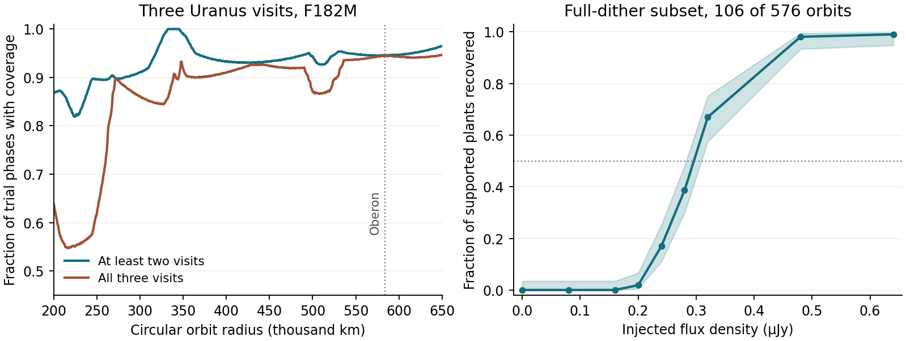

# Three independent Uranus visits on February 6–7, 2024

**None of the 267,000 circular trial orbits per filter in the three inner search intervals survived the glare, known-moon and two-visit tests.** A deliberately unmasked control recovers the source at Perdita's longitude in all three visits in both filters. The brightest anonymous-looking outer-gap feature lies in Miranda's diffraction pattern. The full F182M mosaics extend the search to 650,000 km. Their wide-field hits resolve into two fixed celestial sources. Off-grid injections in the full-dither, three-visit subset give a measured 50% recovery bracket of F182M AB 25.14–25.28. [Raw and vetted grids](grids/) · [Known-body control and native astrometry](perdita/)

## Search footprint and controls

JWST program 2768 provides fifteen 107.37 s exposures per filter, five in each of visits 02768001001, 02768002001 and 02768003001. Ninety-six SCI/ERR/DQ detector tiles intersect the central cutout. Most dithers place the planet itself in a detector gap. Tiles from a single physical exposure share one registered sky mosaic. Empty pixels carry zero weight. Each visit uses its own fitted planet center offset derived from fully enclosed disk images. The inputs and hashed spacecraft ephemerides record exactly which footprint, times and known-moon paths enter each search. [F182M wide inputs](f182_wide_inputs.json) · [F210M wide inputs](f210_wide_inputs.json) · [Source observables](uranus_observables.csv) · [JPL receipts](uranus_sources.csv)

| Region and grid | Trials per band | F182M supported | F210M supported | F182M / F210M initial positive | Surviving |
|---|---:|---:|---:|---:|---:|
| 52,000–65,000 km, 40 km × 1° | 117,360 | 52,743 | 52,682 | 75 / 542 | 0 / 0 after local ring-light control |
| 72,000–79,000 km, 40 km × 0.75° | 84,480 | 79,512 | 79,488 | 0 / 0 | 0 / 0 |
| 108,000–126,000 km, 100 km × 1° | 65,160 | 59,303 | 59,225 | 15 / 1 | 0 / 0 with Miranda halo exclusion |

Each exposure is sampled 17 times. The reference emission JD TDB is 2460347.42. A trial needs a score of five and a worst leave-one-exposure-out score of two in each of at least two visits; the pooled score must reach seven. These counts concern the specified circular, equatorial grid and matched-filter score. The empty regions, eccentric and inclined orbits and sensitivity as a function of source brightness require their own coverage tests. The project injection measurements from other sequences do not set a magnitude limit here.

For the 617 initial inner-region passes, the same-radius local background is the median of ten phase-displaced, separately measured paths in each exposure (±6°, 8°, 10°, 12° and 15°). No nominal pass remains after subtracting that background: the highest F182M/F210M ranks are 0.205/0.177 of threshold. The wider survey uses the measured bright-moon masks. For Miranda profiles, the reduction measures 72 fixed position angles at every radius from 7 to 100 output pixels. A repeatable five-score feature in two visits persists out to 59 pixels. A three-pixel guard gives an updated exclusion radius of 62 pixels (1.92″). The strongest raw object-like F182M trace stays only 21–23 pixels from Miranda in its two strongest visits. The third visit has a score of 1.21 at a 58-pixel separation. The positive and inverted searches return zero after excluding Miranda's contaminated footprint; the two filters retain 56,023 and 56,089 supported traces respectively. [Miranda radial profile](miranda/radial_profile.csv) · [Calibrated exclusion](miranda/receipt.json) · [Inner F182M background audit](grids/F182M_inner_flanks.csv) · [Inner F210M background audit](grids/F210M_inner_flanks.csv)

## A wide-field search through and beyond Oberon's orbit

**No moving source survived the fixed-sky test among 1,208,929 two-visit-supported trial orbits from 200,000 to 650,000 km.** The three full F182M moving-target mosaics supply a separate screen at 500 km radial spacing and 0.25° phase spacing. Of 1,297,440 circular equatorial templates, 1,121,849 have coverage in all three visits. At radii of 584,000 km and above, 182,365 of 191,520 templates have two-visit coverage and none cross the detection threshold. The measured positions of the five bright Uranian moons provide 15 registration checks with a median halo centroid residual of 0.30 binned pixels and maximum 0.88. [Radius-by-radius coverage](wide/radii.csv) · [Known-body image checks](wide_controls.csv) · [Mosaic inputs and hashes](wide_mosaic_inputs.json)

Each binned pixel spans 0.0922″. The reduction subtracts a Gaussian-smoothed local background, standardizes the residual against the local median absolute deviation, and masks all 29 moons and the planet, with larger exclusions for the six brightest moons. The five dither positions are sampled within each mosaic and averaged for a single visit score. Each positive requires at least two visit scores of five and a pooled score of eight. Eight neighboring tracks cross the positive threshold and zero cross the inverted threshold. The nominal signals at 367,500–369,000 km use two distinct stationary sky sources about 40″ apart. The brighter source's position fitted in visit 2 alone, near ICRF (46.40372°, +17.12201°), scores at least 14.85 in visit 1 and 16.38 in visit 3 at its locked celestial position. The weaker source fitted in visit 1 near (46.39200°, +17.12198°) repeats at 5.59–5.69 in visit 2. Visit 3 places the weaker source outside the footprint. All eight putative satellite tracks reach covered sky in visit 3 with scores between −0.63 and −0.06. [All raw positives](wide/passing.csv) · [Fixed celestial coordinates and held-out scores](wide/locked_sidereal.csv)

The wide-mosaic injection experiment draws 64 independent uniform-radius, uniform-phase orbits in each of nine 50,000 km intervals. Of the 576 draws, 106 satisfy the all-three-visit geometry, bank and five-dither context criteria. The calibrated originals use square, exposure-time-weighted drizzle with pixfrac 1 and five equal-duration exposures each. In each covered visit the experiment plants an STScI F182M encircled-energy profile at five positions in each of the five individual exposure trails. The native context bit groups verify that every dither covered the central 5 × 5 native pixels and at least 95% of the square containing each model stamp. The model contributes 90.6–90.8% of the total flux through that stamp. The experiment adds sources in physical flux units to the real binned mosaics before the nonlinear background and local noise measurements. Every compatible template in the blind bank participates, requiring position agreement within two binned pixels throughout. [Plant ledger](wide_injections/plants.csv) · [Calibration and context hashes](wide_context_inputs.json) · [Trial rule and PSF hash](wide_injections/summary.json)

Of those 106 orbits, 41 recover at 0.28 µJy (38.7%, Wilson 95% interval 30.0–48.2%) and 71 at 0.32 µJy (67.0%, 57.6–75.2%). These two flux levels bracket the empirical 50% depth in the fully sampled subset. At 0.48 and 0.64 µJy, 104 and 105 recover. No plant passes on the original zero-flux images. A flux of 0.28 µJy (AB 25.28) corresponds to an 11.5–23.0 km sphere for same-band geometric albedo 0.16–0.04 at unit phase factor. About 18% of the random orbits meet this strict calibration footprint. Gridding on the mosaics assumes equal dither contributions across each full-coverage PSF core and omits upstream outlier rejection of a hypothetical source. No full-field magnitude limit follows for the other 470 draws. For the 584,000–650,000 km subset beyond Oberon, 32 of 83 draws meet the calibration footprint. Nine of those 32 recover at 0.24 µJy and 19 at 0.28 µJy, bracketing the observed half-recovery point at AB 25.28–25.45. [Completeness with intervals](wide_injections/completeness.csv) · [Radius-binned completeness](wide_injections/completeness_by_radius.csv) · [Band-integrated solar flux and size calculation](wide_injections/reflected_size.json)

## Perdita and the 2025 orbital aliases

Unmasking only Perdita gives a 2024 February longitude sweep across the full circle, with the remaining 28 known moons still masked. The strongest F182M path is 1.00° behind nominal with visit scores 7.37, 14.09 and 12.17. In F210M the peak is 0.75° behind nominal, with scores 6.30, 18.46 and 11.88. Eighteen calibrated native exposure tiles supply independent source centroids with a trailed PSF plus local planar background. Formal fit S/N is at least 9.0 in F210M and 11.1 in F182M; the nearest other projected moon is over 15 registered pixels away. The median projected longitude residual relative to predicted Perdita is −0.830° (MAD 0.051°). Ten fits to the comparison moon Belinda give a median of −0.779°. This 2024 February sub-degree offset is comparable to the bright-moon registration/ephemeris control. Position-fit errors exclude shared registration systematics. [2024 F182M astrometry](perdita/F182M_native.csv) · [2024 F210M astrometry](perdita/F210M_native.csv) · [Comparison moons](perdita/frame_longitudes.json)

The 2025 result supplies 31 circular aliases trained entirely on February and October 2025 astrometry. Propagating those solutions without refitting back to February 2024, the 387-turn solution at 76,418.119 km comes closest to the 2024 February source, with an RMS residual of 14.24 pixels (0.44″) and pooled forced scores of 0.37 and −3.45. A naive extrapolation of the independent October-only short-arc circular solution also fails to recover the 2024 February source. Adding first-order eccentricity and inclination components and J2/J4 epicyclic precession to the 2025-only fit changes the best training alias to 388 turns: February and October RMS residuals of 0.22 and 0.24 pixels, but a 2024 February miss of 322 pixels. The closest eccentric/inclined alternative (387 turns) still misses by 14.05 pixels. These sensitivity fits exclude inter-moon perturbations. The 387-turn radius matches JPL's tabulated 76,418 km mean semimajor axis for Perdita. Perdita's published e≈0.005 and i≈1.6°, interactions with neighboring moons, discrete revolution aliases, and registration uncertainty make the two-epoch solution inadequate for precise multiyear extrapolation. The 2024 data alone cannot identify a separate body. [Frozen 2025 aliases](perdita/locked_2025_aliases.csv) · [Eccentric/inclined sensitivity](perdita/epicyclic_aliases.csv) · [JPL mean elements](https://ssd.jpl.nasa.gov/sats/elem/)

## Reproduction

Inside the parent result directory obtain the program's CAL cutouts with the published product manifest and `jwst_cutouts.py` using `--half 330`. Use the F182M and F210M subsets and the URA184 kernel excerpt for the provisional moon. The three sampled ephemeris windows bracket the native exposure times. The 401-pixel cubes cover the inner bands; the 641-pixel cubes cover the 108,000–126,000 km interval.

~~~bash
python moon_spk.py 2460346.55 2460348.26 cache/ura184-2768.bsp cache/ranges
python ephemeris.py Uranus JWST 60346.229 60346.269 cache/horizons cache/2768-eph.npz --ura184 cache/ura184-2768.bsp --window 60347.037 60347.077 --window 60347.690 60347.732
for band in F182M F210M; do
    python neptune_cube.py cache/2768-eph.npz "$band" "cache/2768-$band.npz" "cache/2768-$band.json" cache/uranus2768/*.fits
    python neptune_cube.py cache/2768-eph.npz "$band" "cache/2768-$band-wide.npz" "cache/2768-$band-wide.json" cache/uranus2768/*.fits --size 641
    python broad_scan.py "cache/2768-$band.npz" "cache/$band-inner" --grid 52000 65000 40 1 --support .8 --epoch-jd-tdb 2460347.42
    python broad_scan.py "cache/2768-$band.npz" "cache/$band-perdita" --grid 72000 79000 40 .75 --support .8 --epoch-jd-tdb 2460347.42
    python broad_scan.py "cache/2768-$band-wide.npz" "cache/$band-outer" --grid 108000 126000 100 1 --support .8 --epoch-jd-tdb 2460347.42
    python jwst2768/flanks.py "cache/2768-$band.npz" "cache/$band-inner/passing.csv" "cache/$band-flanks.csv"
done
python jwst2768/miranda.py cache/2768-F182M-wide.npz cache/2768-F210M-wide.npz cache/F182M-clean.npz cache/F210M-clean.npz cache/miranda
for band in F182M F210M; do
    python broad_scan.py "cache/$band-clean.npz" "cache/$band-outer-masked" --grid 108000 126000 100 1 --support .8 --epoch-jd-tdb 2460347.42
    python neptune_cube.py cache/2768-eph.npz "$band" "cache/$band-perdita.npz" "cache/$band-perdita.json" cache/uranus2768/*.fits --control 725
done
python jwst2768/perdita.py cache/phase cache/F182M-perdita.npz cache/F210M-perdita.npz
python jwst2768/mosaic_fetch.py cache/uranus2768wide --manifest cache/wide-mosaic-inputs.json
python jwst2768/mosaic_context.py cache/uranus2768wide cache/wide-context-inputs.json
python jwst2768/wide_mosaic.py cache/2768-eph.npz jwst2768/f182_wide_inputs.json cache/wide-maps cache/wide-inputs.json cache/uranus2768wide/*_i2d.fits
python jwst2768/wide_survey.py cache/wide-survey cache/wide-maps/*.npz
python jwst2768/wide_controls.py cache/2768-eph.npz cache/wide-controls.csv cache/wide-maps/*.npz
python jwst2768/wide_sidereal.py cache/wide-survey/passing.csv cache/wide-survey/locked_sidereal.csv cache/wide-maps/*.npz
curl -fsSL https://jwst-docs.stsci.edu/files/216457060/216457083/1/1762453590926/Encircled_Energy_SW_ETCv2.txt -o cache/ee.txt
python jwst2768/wide_injections.py cache/uranus2768wide cache/ee.txt cache/wide-plants cache/wide-maps/*.npz
python jwst2768/wide_figure.py cache/wide-survey/radii.csv cache/wide-plants/plants.csv cache/wide-plants
python jwst8975/reflected_size.py cache/2768-F182M.npz cache/solar cache/wide-plants/reflected_size.json --band F182M --flux-jy 2.8e-7
~~~
