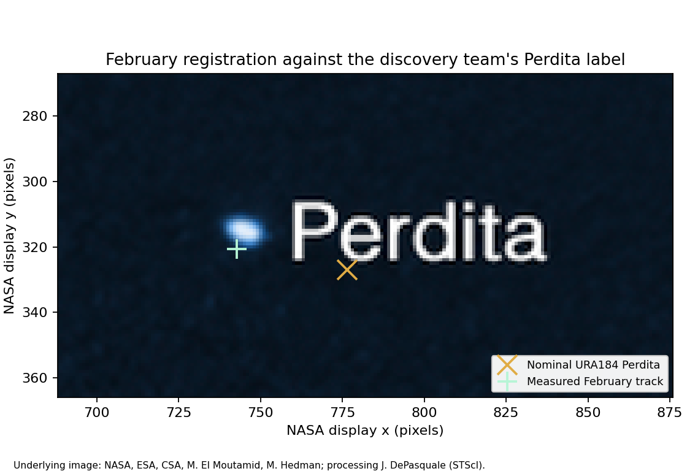

# The two-epoch signal matches Perdita

The February signal maps to the point explicitly labelled **Perdita** by the discovery team in NASA’s independently released 6379 image. At the October sky positions, the JPL Perdita trajectory with one fitted longitude offset follows 53 PSF-trail centroids to 0.77 native pixel RMS. The known-moon interpretation accounts for both visits. This family should be removed from any new-satellite count.



The release image was published on August 19, 2025, before the 9482 observations. It identifies detections separately for Cupid, Belinda, Perdita and nine other previously known moons. The registration holds Perdita out. A similarity transform and effective time for the composite were fitted to nine other labelled moons; the robust fit gives MJD 60708.05877 UTC and 2.000 display pixels per native pixel. In the original 1140-pixel raster, the moving-source centroid lies 5.96 display pixels from the bright core explicitly labelled Perdita. The nominal URA184 location lies 33.49 display pixels from that core. The nine-anchor absolute RMS is 9.54 display pixels, influenced by known-moon position offsets. Four alternative anchor combinations give 5.96–7.67 pixels across all five registrations for the measured source and 33.36–36.41 for the nominal position. The publication graphic is a processed composite, so its label supports identification rather than precision astrometry.

For the October test, the independent reduction queries the JWST observer and each known satellite at every measured integration time. It rotates each cataloged three-dimensional Uranus-relative state about the planet pole through a single fitted angle. The orientation convention is `geometry.pole("Uranus")`. The nominal Perdita coordinates are 37.72 pixels from the October centroids in the median. The fitted phase offset is −12.513°; deleting one complete exposure at a time gives −12.553° to −12.483°, with an exposure-jackknife standard error of 0.051°. Fitting the first 26 centroids alone predicts the remaining 27 with RMS 0.568 pixel. The phase-adjusted Belinda and Cupid hypotheses require approximately −77° and +167°, with RMS 3.37 and 4.56 pixels, respectively. Belinda has a separate strong detection at its nominal position.

The February phase-offset test, using the earlier centroid method, gives −5.708° over 98 positions (exposure-jackknife standard error 0.155°). These offsets are empirical conditional fits. Single-angle adjustments omit changes in radial or vertical distance and calibration uncertainties. The much smaller free circular-fit October residual is reported with the source astrometry. The attachment of formal orbital-element uncertainties or a definitive corrected global ephemeris would require a more complete astrometric solution.

JPL’s listed mean semimajor axes at 2025-01-01 TDB are 74,396 km for Cupid, 75,258 km for Belinda, and 76,418 km for Perdita. The independent 9482 circular fit returns 76,337 km. The URA184 binary’s embedded merge comments say it was built on September 24, 2025. Perdita (725) is explicitly included in the 2025 JWST forward/backward integrations. The comments give no Perdita-specific covariance, condition adjustment or list of individual fitted positions. October 9482 postdates that kernel. The original team’s 6379 abstract reports that Perdita’s observed position differed from a prediction; the abstract does not identify that prediction as URA184. The stated offsets here compare directly with the Horizons response labelled `ura184_merged`.

Rebuild the diagnostic using the registered native maps and measured centroids. `nasa_label_check.py` retrieves only the original NASA release, verifies its SHA-256, and uses input pixel patches with positions documented in the script. The ephemeris query receipts cover both comparison epochs.

```sh
python jwst6379_9482/nasa_label_check.py /data/6379-native-maps.npz jwst6379_9482/identity/february_astrometry.csv /data/nasa_6379_annotated.png jwst6379_9482/identity
python jwst9482/identity_audit.py jwst9482/integration_check/displaced_astrometry.csv /data/jw9482-cube.npz /data/horizons jwst9482/integration_check
python jwst9482/identity_audit.py jwst6379_9482/identity/february_astrometry.csv /data/6379-native-maps.npz /data/horizons jwst6379_9482/identity
```

[Original NASA discovery-team image and credit](https://science.nasa.gov/asset/webb/uranus-new-moon-annotated/) · [GO 6379 team’s AGU abstract](https://scixplorer.org/abs/2025AGUFMP41G.2685H/abstract) · [9482 DDT program](https://www.stsci.edu/jwst/science-execution/approved-programs/directors-discretionary-time) · [JPL mean elements](https://ssd.jpl.nasa.gov/sats/elem/) · [JPL ephemeris documentation](https://ssd.jpl.nasa.gov/sats/ephem/) · [Original URA184 kernel](https://ssd.jpl.nasa.gov/ftp/eph/satellites/bsp/ura184.bsp) · [Registration results and source image checksum](release_registration.json) · [October phase fits](../../jwst9482/integration_check/identity_phase_tests.csv) · [February phase fits](identity_phase_tests.csv) · [Horizons response hashes](identity_horizons_receipts.csv)
