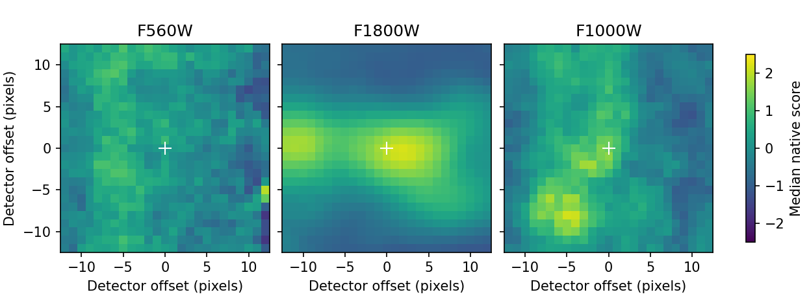
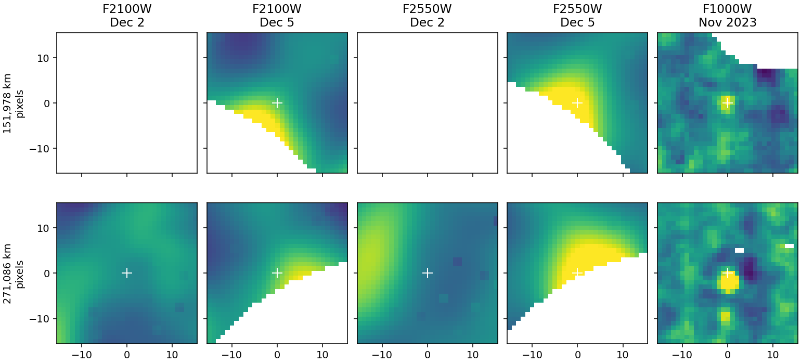

# MIRI outer fields and the Neptune detector edge

**No unidentified moon has a validated two-visit recovery in the 13 remaining MIRI associations.** Four of these associations contain useful pixels in the requested orbital ranges. We screened their 39 previously unsearched calibrated exposures and used eight previously examined program 1272 images as independent Neptune comparators. At Uranus, native-image injections cross 50% recovery between **0.4 and 1.6 µJy** for the observed outer arcs under the specified flat-spectrum population. At Neptune, two point-like single-visit F1000W features remain unidentified. The proposed earlier counterparts fall on structured glare beside exclusion masks. Neither feature yields a credible second observation. [Uranus completeness](uranus_depth.csv) · [Neptune alias validation](neptune_alias_validation.csv) · [Complete MIRI parent search](../README.md)

## Which fields can contain moons?

The 17 public associations comprise 126 individual MIRI images. Eleven contain the planet center, all at Neptune. We projected spacecraft-relative circular equatorial orbits from 50,000–650,000 km at Uranus and 50,000–300,000 km at Neptune into each native SIP image. The coverage audit samples 5,000 km in radius and one degree in propagated reference phase. Two samples in the same visit must land on the detector to contribute to its geometric overlap. These counts precede image-quality and glare masks. [All 126 exposures](exposure_coverage.csv) · [All 17 associations](group_coverage.csv) · [Coverage by radius](radius_coverage.csv) · [Between-visit overlaps](visit_overlaps.csv)

| Planet and selection | Associations | Exposures | Planet center on detector | Geometric coverage and action |
|---|---:|---:|---:|---|
| Uranus 1248, MRS parallels | 3 | 36 | 0 | All three visit footprints intersect outer orbits. First sampled radius 245,000 km. All 36 calibrated images searched. |
| Neptune 1249, MRS parallels and background | 3 | 27 | 0 | No overlap within 300,000 km. |
| Neptune 1272, F1280W parallels and F2550W backgrounds | 4 | 28 | 0 | No overlap within 300,000 km. |
| Neptune 1604, two F1000W parallels | 2 | 24 | 0 | No overlap within 300,000 km. |
| Neptune 1604, F1000W edge visit | 1 | 3 | 3 | Cross-year orbit tests against the four previously searched 1272 associations. |
| Neptune 1272, direct Triton F2100W/F2550W images | 4 | 8 | 8 | Two independent visits, already searched separately in each band. |

All 79 off-chip Neptune exposures have a geometric lower bound above 322,300 km even for a satellite in an arbitrary sky direction. The bound uses the spacecraft distance times the sine of the planet-to-detector angular gap, reduced by 0.001 arcsecond for rounding. The analogous minimum for the Uranus fields is 239,530 km. It explains their lack of inner-moon support despite the Uranus target labels. [Native detector boundary and angular gaps](../footprints.csv) · [Planet and known satellite coordinates](positions.csv) · [Horizons query and response hashes](horizons_receipts.csv)

## Uranus program 1248

The three 12-exposure visits cover 12.3 hours in January 2023. Each used a different filter, F560W, F1800W or F1000W. We evaluated 1,442,400 circular equatorial orbits, spaced by 1,000 km and 0.15 degrees. Native pixel support in two visits exists for **163,627 cells from 264,000 to 650,000 km**. We mask nonfinite science or errors, nonpositive errors, data-quality flags except zero and jump-only, known moons and their halos. The central exclusion encloses the rings and S/2025 U1. The residual score uses a PSF-scale Gaussian and a broader local background estimate with spatially measured median and median absolute deviation. Two supported visit halves must each score 3.2 and their combined visit must score six. Five neighboring positive cells passed in two visits and zero sign-inverted cells passed. [Native input byte hashes](science_inputs.csv) · [Radii and supported cells](uranus_50000_650000_radii.csv) · [Five triggered cells](uranus_50000_650000_leads.csv)

The five cells form one family at 481,000–483,000 km. All depend on the final four exposures of the F1000W visit. Removing that complete activity block leaves a normalized stack of 1.58–2.36 across the five cells, below the 3.2 persistence criterion. The best cell’s F1000W peak lies 5 pixels left and 8 pixels below the frozen prediction. Its F1800W stamp shows extended emission across the detector row. At the predicted pixel the median score is 2.02, and pixels 8–12 columns away on the same row reach 1.82. F560W has no co-located counterpart. Titania is the closest projected known moon, 53–67 pixels from the best track. In the F1000W images, real Titania is recovered in all twelve control apertures, with a median peak displacement of 0.54 pixel. [Dropouts](uranus_activity_dropout.csv) · [Native aperture measurements and moon separations](uranus_native_vet.csv) · [Fixed-sky, detector and planet tests](uranus_motion.csv) · [Measured known moon](uranus_control.csv)



**Conditional image-level sensitivity.** We selected 32 uniformly proposed off-grid orbits at 400,000–600,000 km, requiring real detector support in at least two visits. Two batches keep planted sources at least 34 pixels apart wherever they share an exposure. Each source has equal flux density in the three bands and a filter-specific Gaussian PSF. We added it to the original calibrated science array before masking and local background fitting. A recovery requires a newly passing nearby grid orbit within 2 native pixels RMS and persistence after dropping a complete activity block in each of at least two visits. These are mean-signal plants with the existing native errors and masks. They omit additional source Poisson noise, pre-calibration effects, chromatic thermal modeling and PSF asymmetry. [All 160 native-image plant experiments](uranus_plants.csv) · [Binomial intervals](uranus_depth.csv)

| Flat flux density (µJy) | AB magnitude | Recovered / 32 |
|---:|---:|---:|
| 0.1 | 26.40 | 0 |
| 0.4 | 24.89 | 3 |
| 1.6 | 23.39 | 26 |
| 6.4 | 21.88 | 29 |
| 25.6 | 20.38 | 31 |

The observed 50% transition is AB 23.39–24.89 for this conditional flat-spectrum sample. Most full-orbit phases fall outside these parallel images. Translating the result into a diameter requires a surface-temperature, emissivity, albedo and spectral model.

## Neptune programs 1604 and 1272

The 1604 edge visit contains three 108.227-second F1000W images separated by 11.75 minutes from first to last midpoint. Neptune moves just 0.100 arcsecond against the sidereal sky in that interval. Two program 1272 visits supply four earlier images per visit, two F2100W and two F2550W. We conducted two complementary searches with the same spacecraft-specific positions, known-moon masks and conservative circular 80,000-km central exclusion.

- An unconditional cross-year grid covered 245,000–250,000 km with 2-km radial and 0.4-degree phase steps. **952,993 of 2,250,900 trial orbits** had independent support. Zero positive and zero inverted trials passed. [Grid and results](neptune_245000_250000_summary.json) · [Coverage by radius](neptune_245000_250000_radii.csv)
- A second screen covers 50,000–300,000 km. The 1604 anchor was sampled at 200 km and 0.25 degrees. Of 1,801,440 cells, 517,761 had support. Promising anchor cells above 70% of the visit threshold triggered a finer radius search at 0.5–2 km and three sampled phase offsets, with positive and negative branches selected separately. The positive branch tested 920,723 cells, 806,877 with independent coverage. Of these, 1,197 crossed the nominal two-visit threshold. No inverted cells passed. This adaptive search has a data-dependent gate and lacks measured completeness outside the unconditional test window. [Anchor grid](neptune_anchor_radii.csv) · [Fine-grid counts](neptune_all_summary.json) · [Passing coordinates](neptune_all_leads.csv)

The 1,197 cells cluster around two 2023 locations and five radial alias neighborhoods. No cell passes all three visits. The December 2, 2022 visit covers 972 cells and has no usable support for the remaining 225. At December 5, the apparent earlier F2550W counterparts lie on broad emission beside the central mask. Requiring the pixel to lie one further filter-specific PSF FWHM inside the support boundary leaves only three cells with adequate cross-year coverage. Their maximum rank is 0.160 of the threshold. **All 1,197 proposed associations fail this clearance test.** The unmasked 2023 F1000W features can be measured in single-visit images, with representative finite-aperture fluxes of 0.6–2.3 µJy and 5.2–6.5 µJy. Their three exposures provide too little sky motion for a secure orbital or sidereal classification. Neither feature establishes a two-visit detection. [All alias clearance and coverage tests](neptune_alias_validation.csv) · [Representative native photometry](neptune_alias_representatives.csv)

In the middle F1000W exposure, **2023-11-30 13:36:09.673 UTC**, native Gaussian-plus-plane fits give the following coordinates in the pipeline ICRS WCS. Fit errors measure local centroid uncertainty. Absolute pointing uncertainty is additional because these frames have no independent astrometric recalibration here. All three reception times, native centroids and sky positions are available for follow-up. [Six astrometric measurements](neptune_single_visit_astrometry.csv) · [Native centroid fits](neptune_sky.py)

| Single-visit feature | RA (deg) | Dec (deg) | Formal native fit error (x, y pixels) |
|---|---:|---:|---:|
| Inner 2023 location | 355.487373 | −3.318688 | 0.51, 0.60 |
| Outer 2023 location | 355.485759 | −3.319674 | 0.89, 0.85 |



The earlier program 1272 has separate image-plant depth curves. The 1604 cross-year adaptive screen has no dedicated injected-population limit. [Measured previous Neptune depths](../README.md)

## Reproduce

Run from this directory using Python, Astropy, NumPy, SciPy and Matplotlib. The header cache may be the one populated by the parent MIRI footprint audit. The following calls regenerate files from native FITS bytes and the frozen association metadata.

```sh
python positions.py /data/horizons
python coverage.py /data/miri-headers
python fetch.py /data/miri-extra
python native_search.py Uranus /data/miri-extra /data/miri-headers --grid 50000 650000 1000 0.15
python native_search.py Neptune /data/miri-extra /data/miri-headers --grid 245000 250000 2 0.4
python vet.py /data/miri-extra /data/miri-headers
python reject.py
python depth.py /data/miri-extra /data/miri-headers
python neptune_all.py /data/miri-extra /data/miri-headers
python neptune_check.py /data/miri-extra /data/miri-headers
python neptune_sky.py /data/miri-extra /data/miri-headers
```
