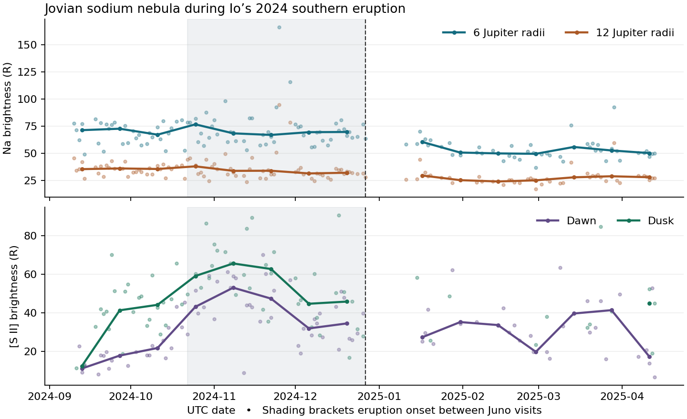

# Jupiter's sodium nebula and sulfur torus during Io's 2024 eruption-onset window

The two ground-based tracers behaved differently during the interval in which Io's southern eruption began. In November 2024, the dawn side of Jupiter's [S II] torus reached **51.7 R**, up from **18.1 R** before Juno's October visit. The dusk side rose from **42.0 to 65.5 R**. The Jovian sodium nebula at 6 Jupiter radii stayed close to its **69.7 R** reference level. Over all 151 complete, overlapping 28-day windows from October 22 through April 17, its largest median was **70.46 R**, just 1.1% above the reference.

Juno observed the southern site before its large thermal brightening on October 22, 2024. On December 27 its JIRAM instrument measured an estimated **140–260 TW**. The site was still thermally active about four months later. The precise onset between the flybys is unknown. The November sulfur brightening falls inside that interval and precedes the December measurement. This establishes the relative timing of the observations. **The cause of the sulfur brightening remains open.** The torus integrates material from across Io, and its line emission also depends on plasma conditions. This timing alone cannot assign the brightening to the southern volcano. Moreover, **a 14-day gap in sodium measurements (December 28, 2024–January 10, 2025, inclusive) could hide a short sodium pulse**; the sampled medians do not rule out such a pulse or establish a causal anti-correlation.



## Ground measurements

R denotes Rayleighs of surface brightness. Each entry is the median of nightly medians. Parentheses give the number of nights with a finite measurement. The Na aperture covers heights of 4–8 Jupiter radii on both sides of the centrifugal plane, with the outermost aperture subtracted. The sulfur columns are the separately fitted east/dawn and west/dusk ansae (the two bright ends of the projected torus) at 6731 Å.

| UTC interval (inclusive) | Na at 6 Jupiter radii, R | Dawn [S II], R | Dusk [S II], R |
| --- | ---: | ---: | ---: |
| Sep 10–Oct 21, pre-PJ66 reference | 69.73 (32) | 18.14 (21) | 41.98 (25) |
| Oct 22–Dec 26, between flybys | 69.40 (49) | 39.84 (37) | 58.07 (35) |
| Nov 1–28, subset of the preceding interval | 67.52 (19) | 51.69 (15) | 65.53 (15) |
| Dec 27–Jan 23 | 62.34 (7) | 27.39 (4) | 41.95 (2) |
| Jan 24–Feb 20 | 50.33 (12) | 34.79 (6) | 48.59 (1) |
| Feb 21–Mar 20 | 49.95 (13) | 28.24 (9) | 33.27 (4) |
| Mar 21–Apr 17 | 52.09 (15) | 26.57 (10) | 45.06 (5) |

Restricting the comparison to nights with all three channels gives 15 reference and 13 November nights. The medians then change from 72.72 to 66.99 R for sodium, 18.11 to 51.69 R for dawn sulfur, and 41.98 to 65.53 R for dusk sulfur. The median within-night dawn sulfur/Na ratio rises from 0.298 to 0.831. This checks whether unequal dates in the three channels produced the apparent change.

The **25 nights from January 24 to March 20** had a 6-radius median **28.4% below reference**. The ratio was 0.716, with an exploratory 95% week-block bootstrap interval of 0.665–0.791. The 3- and 12-radius apertures also faded. These apertures share images and a background measurement. The two sulfur sides likewise share exposures. IoIO and JIRAM are independent instruments. The sulfur measurements after December have sparse coverage in several bins, especially on the dusk side.

## Cadence, sensitivity and alternative explanations

- **Unknown onset and missing nights.** From October 22 through April 17, 96 nights have Na measurements. Every 28-day window contains at least seven. Even the highest 21-day median is only 74.06 R, although its window family has as few as three nights. December 28, 2024 through January 10, 2025 is a 14-day gap without Na observations. A brief sodium pulse within that gap could have been missed. The dated windows measure sampled nights and give no strict bound on flux between them.
- **Historical positive control.** The same statistic recovers the previously reported 2022 enhancement. A 28-day window beginning September 15, 2022 reaches **256.22 R** over seven nights. The known enhancement was 3.64 times brighter by this measure than the brightest window in the 2024 eruption interval. This comparison concerns measured brightness in this aperture, with different viewing geometries and backgrounds.
- **Injection at the actual cadence.** Multiply all measured 6-radius nightly values in a 28-day interval by a constant, and test its median against 1.5 times the pre-October reference. A factor of 2 is recovered for 107/151 possible starts, and a factor of 2.5 for all 151. No original window crosses that threshold. Recovery fractions count deterministic placements and do not represent independent trials or probabilities. They describe sensitivity to a full-duration multiplicative signal in this photometric product.
- **Viewing geometry.** For exposures at airmass ≤1.5, the Na decline persists in all eight 45° System III longitude bins. Eligible bins require at least three nights per interval. At the same airmass limit, November's sulfur enhancement is positive in every eligible bin for both dawn (7/7, +20.7 to +46.6 R) and dusk (8/8, +6.2 to +46.9 R). Matching solar elongation before and after opposition also preserves the Na decline. For 80–110° the medians are 71.0 and 48.7 R (22 and 16 nights), and for 110–140° they are 68.6 and 56.9 R (24 and 12 nights).
- **Instrument and historical controls.** The archived Na Rayleigh conversion factor rose 4.1% between reference and late windows, opposite to the measured decline. The pipeline uses stellar calibrators and flat fields. Jupiter through its neutral-density filter is susceptible to an interference effect and is unsuitable as an absolute standard. Aligning seasons at the date of maximum observed solar elongation gives later-to-earlier 6-radius ratios from 0.44 to 1.89 in other well-sampled seasons. Dimming can occur naturally. These checks do not establish that the eruption dimmed the nebula.
- **What the measurement constrains.** This event provides a direct test of whether a very large and prolonged thermal eruption is always accompanied by a sustained, large enhancement of differential Na brightness in the inner nebula. Even a rise in volcanic gas release could be obscured by natural variation, changes in escape or ionization, spatial redistribution, or emission common to the reference and science apertures. The [S II] brightness is also sensitive to electron density and temperature. No gas mass or mass-loss limit follows directly.

## Provenance and replay

The July 2026 IoIO v2.1 release contains 4,843 Na rows and 6,586 torus rows. The script checks the release MD5 values, excludes explicit bad-data flags, and takes medians of finite exposures per UTC date and channel. The mask column is unavailable for many early Na exposures. Those rows are retained for historical comparisons. Primary and comparison channels and the 28-day metric are selected to test a sustained enhancement. November's subinterval, the later decline and the detailed windows were explored after inspecting the data. They are descriptive, with no discovery p-value. The week-block interval excludes calibration systematics and depends on the block length.

```sh
python reproduce.py --cache /path/to/cache
```

Requires Python with NumPy, pandas and Matplotlib. The first run downloads 9.3 MB of ECSV data. The output includes the 945-date union of nightly measurements in [nightly.csv](nightly.csv), window medians, interquartile ranges and counts in [windows.csv](windows.csv), season controls in [historical.csv](historical.csv), and sensitivity calculations in [checks.json](checks.json). The script uses a fixed random seed. Figure lines are medians in nonoverlapping 14-day intervals with at least three nights. Points are individual nightly medians.

**Literature scope.** Mura et al. publish the thermal discovery and its persistence. Morgenthaler et al. characterize the earlier 2017–2023 optical sequence, including the strong 2022 Na event. Yoneda et al. describe earlier Juno-era Na events. Wang et al. (2026) compare IoIO torus emission to independent Juno/JADE plasma density using data through 2023. A search of the JIRAM discovery paper, the IoIO data release, and indexed work using the event date, Pfd454, IoIO, sodium nebula and plasma torus found no prior quantitative publication of this particular two-tracer chronology. The 2025 EGU abstract describes longer-term monitoring without giving these measurements. Unindexed observing reports and unpublished analyses could exist.

- [Mura et al. 2026, JIRAM eruption observations and images](https://doi.org/10.1029/2025JE009047)
- [Morgenthaler et al. 2026, IoIO v2.1 data and checksums](https://doi.org/10.5281/zenodo.21420670)
- [IoIO v2.0 aperture and column definitions](https://doi.org/10.5281/zenodo.8342758)
- [Morgenthaler et al. 2024, reduction methods and 2017–2023 observations](https://doi.org/10.1029/2023JA032081)
- [Yoneda et al. 2025, extended-Na observations](https://doi.org/10.1016/j.icarus.2024.116301)
- [Yoneda et al., 2025 conference abstract](https://doi.org/10.5194/egusphere-egu25-14285)
- [Wang et al. 2026, Juno/JADE plasma-disk densities and the earlier IoIO series](https://doi.org/10.1029/2026GL123313)
