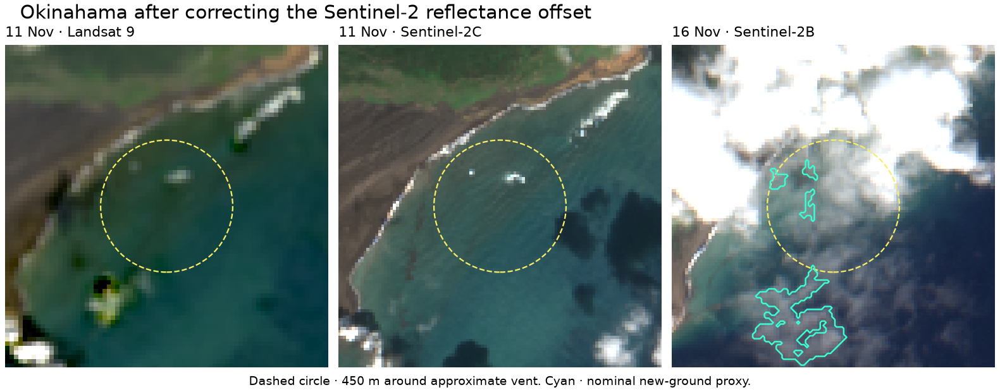

# A duplicate Sentinel-2 reflectance offset affected the Ioto shoreline screen

**Noteworthy correction · Correction.** Earth Search listed a −0.1 reflectance offset for Sentinel-2 GeoTIFF pixels that had already been corrected. We aligned original Level-2A JP2 and converted GeoTIFF crops for six October–November 2026 Ioto scenes. In **all 708,720 paired pixels** across **15 scene-band crops**, the original file's digital number was exactly 1,000 higher. The original product metadata specifies an offset of −1,000 and a quantification factor of 10,000. Applying the listed offset to these GeoTIFF values a second time subtracts **0.1 reflectance**. [Exact original sources and hashes](native-sources.json) · [Paired pixel counts](offset-results.json) · [Earth Search offset guidance](https://github.com/Element84/earth-search/blob/main/docs/collections/sentinel-2-l2a.md)

The B11 check covers all six original Sentinel acquisitions in the frozen October–November sequence. We also checked B03 green, B08 near infrared and B12 shortwave infrared on 22 October and 11 and 16 November. No nonzero source pixel turned into zero in the compared crops. These results identify affected current scenes and bands. Earlier inconsistencies were already reported to Earth Search. The comparison covers the sampled windows and leaves other products and zero-clipped pixels outside its scope. [Exact item metadata audit](s2-offset-metadata-audit.json) · [Earlier Earth Search reports](https://github.com/Element84/earth-search/issues/71)

For the 11 November Sentinel-2C scene, the offset listed in STAC put the clear-water B11 median at −0.08615. Reading the corrected GeoTIFF with its scale alone gives +0.01385. The separate Landsat 9 overpass returns +0.00588 under its own calibration. Negative atmospheric-correction residuals over water alone would be inconclusive. The identical native grid comparisons establish the offset duplication directly. [Failed provider-offset run](provider-offset-results.json) · [Radiometric check](RADIOMETRY.md) · [Corrected results](primary-results.json)

## What the corrected shoreline screen resolves

The Japan Coast Guard observed fresh eruptive material attached to Ioto on 13 November. A later report interpreted 11 and 16 November Sentinel-2 images as showing a connection. GSI mapped ALOS radar returns likely associated with the deposits. Our optical experiment asks how much new land-like surface can be mapped under fixed spectral and coverage rules near the Coast Guard's approximate vent coordinates. [Japan Coast Guard report](https://www.kaiho.mlit.go.jp/info/kouhou/post-1363.html) · [Published Sentinel-2 interpretation](https://news.livedoor.com/article/detail/32839287/) · [GSI radar observations](https://www.gsi.go.jp/uchusokuchi/20261116ioto.html) · [Frozen protocol](PROTOCOL.md)

On 11 November, Landsat 9 and Sentinel-2C passed about 20 minutes apart. Landsat classified **707 of 708** valid cells as water within 450 m of the nominal vent. Sentinel classified **1,562 of 1,590** valid cells as water in the same neighborhood. Neither classified a dry cell there. Their nearest dry cells were about 561 m and 545 m from the nominal vent, respectively. With an exploratory 800 m assignment radius, Landsat found a 0.0261 km² change footprint under the primary baselines, and Sentinel did not recover it. In the 60 m comparison no qualifying cells agreed across sensors. A test with earlier, independently selected baselines retained that disagreement. [Corrected primary data](primary-results.json) · [Wider vent test](vent800-results.json) · [Earlier baselines and wider vent test](alt-vent800-results.json)

On 16 November, the nominal Sentinel-2B screen mapped **0.2176 km²** of qualifying land-like change within the fixed region. The dry-area estimate was 0.2964 km² under relaxed reflectance thresholds and zero under strict thresholds. About half the quantification region had usable data. No connection to inland baseline pixels passed the path test. The maps leave the 11 November attachment and the 16 November exact area unresolved. Low clouds or steam, wet sediment, floating material, tidal exposure, uncertainty in the vent point, and geolocation remain relevant. The 1.1 km region and the coastal exclusion also make the areas partial, rather than island-wide shoreline surveys. They cannot date the first physical contact with shore. [Alternate baseline results](alt-baseline-results.json) · [Sensitivity design](SENSITIVITY.md)



Both pre-eruption scenes returned zero qualifying new ground under the primary rules. Changing to the earlier baseline pair yielded a small 0.0064 km² footprint in the 22 October scene, before the reported onset, illustrating the effect of baseline choice. The 1 and 3 November scenes had no usable coverage in the quantified region after quality masking. Stable inland registration checks were unavailable for several cloudy scenes. In the 11 November Landsat case the fit's preferred two-cell shift reduced the held-out correlation, so no shift was applied. The source products therefore constrain apparent surface change more directly than shoreline position or continuous exposure. [Daily coverage, control and registration data](primary-results.json)

## Reproduce

The [coastal crop bundle](coastal-crops.zip) holds the exact native and converted windows, product metadata and source receipts. Full satellite scenes are unnecessary. Use Python 3.14 with Rasterio, NumPy, SciPy and Affine. The optional figure uses Matplotlib. Point DATA_ROOT at a data drive directory.

```text
python -m zipfile -e coastal-crops.zip DATA_ROOT
python verify_offsets.py DATA_ROOT replay-offsets.json
python screen.py DATA_ROOT/raw replay-primary.json --sentinel-offset zero
python screen.py DATA_ROOT/raw replay-wide.json --sentinel-offset zero --vent-radius 800
python screen.py DATA_ROOT/raw replay-combined.json --sentinel-offset zero --alternate-baselines --vent-radius 800
python plot.py DATA_ROOT/raw shore.png
```

The reflectance source coverage and QA differ between Sentinel-2 and Landsat. The [original run](provider-offset-results.json) used the provider's offset and did not pass the deep-water plausibility gate. The corrected run selects zero additional offset for these already corrected Sentinel GeoTIFFs. Landsat uses its own published scale and offset. The first intact commit defines the primary measurement before the target arrays were read. All source-related records cite the exact acquisition and download URLs. [Landsat scaling](https://www.usgs.gov/faqs/how-do-i-use-a-scale-factor-landsat-level-2-science-products) · [Landsat quality flags](https://www.usgs.gov/landsat-missions/landsat-collection-2-quality-assessment-bands)

Contains modified Copernicus Sentinel data (2026) and USGS Landsat imagery. Earth Search and Planetary Computer distributed the analysis-ready crops. The original Sentinel Level-2A JP2 inputs came from the public Sentinel-2 L2A archive.
