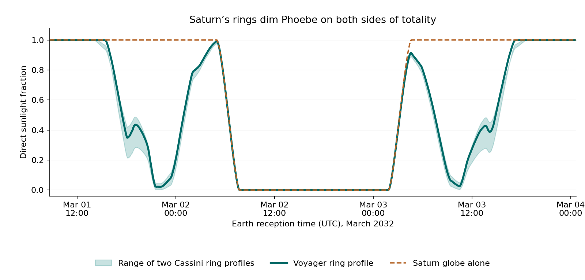

# A double ring shadow brackets Saturn’s 2032 eclipse of Phoebe

On **1–3 March 2032**, Saturn’s distant moon Phoebe should dim deeply, recover nearly all of its direct sunlight, disappear into the planet’s shadow for **18 h 10 min**, brighten again, and then undergo a second deep ring-shadow dip. At the outer minima Saturn’s globe clears the Sun completely as seen from Phoebe. The geometry is observable from Earth. At mid-eclipse the moon is **4.15 arcmin** from Saturn’s center, at **93.7°** solar elongation, with a nominal uneclipsed magnitude of 16.46.



The figure shows the **direct solar illumination of Phoebe**. A telescope also receives light scattered by Saturn and its rings, sky background and reflected planetlight from Phoebe. Phoebe rotates in 9.27 hours. Multi-night differential photometry can establish its rotational baseline. A particularly discriminating observation is a recovery of most of the light between the first dip and the onset of the planet’s shadow. [Phoebe rotation measurement](https://doi.org/10.1093/mnras/stz3463) · [Five-minute predictions](phoebe-lightcurve.csv)

### What to observe, in Earth-received UTC

| Event | Time | Direct sunlight remaining |
|---|---|---|
| First ring-shadow minimum | March 1, 21:40–22:05, depending on ring profile | 0.24–4.33% |
| Recovery before the planet’s shadow | March 2, 04:55 | 97.5–99.1% |
| Total eclipse by Saturn | March 2, 07:43 to March 3, 01:53 | 0% |
| Recovery after leaving the planet’s shadow | March 3, 04:35 | 89.0–91.5% |
| Second ring-shadow minimum | March 3, about 10:30 | 0.42–5.01% |

The depths span the three measured profiles at their own minima. This spread measures sensitivity to the chosen opacity profile. With the Voyager profile, every five-minute sample from 21:15–23:30 on March 1 and 09:10–10:55 on March 3 transmits under 10% of the direct light. At the first minimum Phoebe stands 55° above the horizon at La Palma with the Sun at −39°. At the second it stands 29° above Siding Spring with the Sun at −24°. [Site geometry and visibility checks](checks.json)

### How the ring prediction was tested

The disk-integrated ray calculation uses the radius and opacity in a **Voyager 2 PPS Delta Scorpii** occultation and two **Cassini VIMS** occultations of Aldebaran and Gacrux. The latter profiles sample 2.866–2.977 µm. All three cross the main rings. Their different sightlines, wavelengths, maximum measurable optical depths and radial sampling give different absolute minima. All three produce the same sequence. The two VIMS profiles flag the stellar flux level as unstable and use a maximum measurable opacity for saturated bins. Voyager saturation flags are treated as opaque. Direct transmission through the thin ring plane is calculated as exp(−τ/|sin B|) per ray using the archived normal opacity. Negative noise excursions are clipped to zero. Four absent 10-km Aldebaran bins are interpolated in optical depth. [Voyager standard profile and column definitions](https://pds-rings.seti.org/voyager/pps/profiles.html) · [Cassini VIMS occultations](https://pds-rings.seti.org/cassini/vims/index.html) · [Product URLs and file hashes](ring-sources.json)

The model resolves the finite solar disc with 16,384 deterministic Sobol samples and solves the ray intersection with Saturn’s oblate globe. The largest absolute change in any five-minute series when using 65,536 rays is 0.00145 of the unobstructed flux. An illustrative solar limb-darkening coefficient of 0.6 moves the two Voyager minima from 2.12% and 2.56% to 2.03% and 2.41%. Ring wakes and azimuthal opacity variations, atmospheric refraction, diffraction and scattered light limit a conversion to observed magnitudes. The uniform direct-light model treats the moon as a point. Phoebe’s roughly 106-km radius is small compared with the projected solar radius of ~7,560 km.

We reran the Voyager model with **IMCCE PH20**, a separate numerical orbit fit using astrometry through 2019. The two Phoebe positions differ by **68 km** at mid-event. Using PH20 shifts Saturn’s two totality contacts by **34 and 32 seconds**, and shifts the first ring minimum by one five-minute sampling bin. Both fits share some astrometric observations. The comparison supports the event and the observing windows, while formal timing uncertainties require orbit covariances. An imposed ±1,000 km limb-distance shift moves a Phoebe contact by at most 11 minutes. [PH20 files and description](https://ftp.imcce.fr/pub/ephem/satel/phoebe/) · [Orbit comparison](orbit-check.json)

### The search population and the other total eclipse

The initial branch commit froze Himalia, Elara, Pasiphae, Sinope, Lysithea, Carme, Ananke, Leda and Phoebe over 2020–2040. All nine have full daily JPL state coverage. The search interpolates ICRF barycentric positions and velocities with cubic Hermite polynomials, solves separate Sun-to-moon and occulting-planet-to-moon light times, and adds the moon-to-Earth light time. A 3-hour scan of projected separation minima seeds continuous oblate-limb contact solutions. Repeating the full search at 1.5-hour spacing returns the same two events and identical contact times to the displayed second. Ring-only passages elsewhere in the interval were outside the planetary-disc selection. [Frozen plan](search-plan.md) · [Event table](events.csv) · [JPL requests and state-row hashes](sources.json)

**Sinope** crosses Jupiter’s shadow on **17–18 October 2037**. Predicted totality runs from **15:02 to 00:28 UTC**, about **9 h 27 min**. Sinope is **21.50 arcmin from Jupiter** at mid-eclipse, solar elongation 86.7°, nominal uneclipsed magnitude 18.89. At the start of totality it stands 68° above Maunakea with the Sun at −19°. The closest-approach clearance inside the full shadow is ~21,200 km. A ±1,000 km limb-distance shift moves either contact by up to 8.6 minutes. An independent fit to Sinope’s orbit has yet to be checked.

JPL’s separate observer-table code flags both moons in total eclipse. It gives Phoebe full-eclipse samples from 07:45 to 01:56 UTC, and Sinope from 14:43 to 00:31 UTC. That implementation uses equatorial radii, accounts for finite moon size and omits the oblateness aspect. Its ephemerides are shared with our nominal model. The published UTC times assume TAI−UTC remains 37 seconds after 2017. [Horizons quantity 12](https://ssd.jpl.nasa.gov/horizons/manual.html) · [Observer requests](observer-sources.json)

### Retrospective test and priority

A separate backward search over 1998–2019 yields a partial eclipse of Leda in 2000 and total eclipses of Himalia in 2012 and Phoebe in 2016. On 23 May 2016 Phoebe passed only **32 arcsec** from Saturn’s center at mid-eclipse, versus **249 arcsec** in 2032. Cassini ISS missed the field, and the ground archives checked supplied no disk-eclipse photometry. Five amateur images during the preceding ring shadow have a second complication: from Earth, Phoebe also lay behind the bright rings. [Historical events](historical/events.csv) · [Archive coverage](historical/archive/README.md)

The November 2026 search of indexed primary literature and satellite services used “Phoebe eclipse by Saturn”, “Phoebe shadow March 2032”, “Phoebe May 23 2016 eclipse”, “Sinope October 2037 Jupiter eclipse”, and irregular-satellite eclipse ephemerides. Prior work treats Saturn’s ring shadows, stellar occultations by Phoebe and eclipses of regular satellites. We did not locate a prior dated prediction of this three-part **Phoebe illumination curve**. Horizons already exposes planetary eclipse flags, and a published or private observing calendar could contain either planetary eclipse. The contribution is the dated, testable ring-light-curve prediction and its verification using measured ring profiles. [Phoebe stellar occultations](https://doi.org/10.1093/mnras/stz3463) · [Cassini imaging of Saturn’s shadow on the diffuse Phoebe ring](https://doi.org/10.1016/j.icarus.2014.01.021) · [JPL satellite ephemerides](https://ssd.jpl.nasa.gov/sats/ephem/)

### Reproduce

Run in this directory with Python, NumPy, SciPy, Matplotlib and jplephem. The scripts fetch the public files into the cache directory. Read the source manifests for the specific Horizons solutions and digests used here. A change to the live ephemeris can change the results. Row hashes exclude Horizons’ changing request timestamp. All curves are predictions. The PDS ring opacities and the astrometry underlying the orbits are archival measurements.

```sh
python search.py --cache /tmp/irregular-moon-data
python rings.py --cache /tmp/irregular-moon-data
python check_events.py --cache /tmp/irregular-moon-data
python check_orbit.py --cache /tmp/irregular-moon-data
python plot.py
python search.py --cache /tmp/irregular-moon-data --start-year 1998 --stop-year 2020 --outdir historical
python search.py --cache /tmp/irregular-moon-data --step-hours 1.5 --outdir /tmp/moon-half-step
python rings.py --cache /tmp/irregular-moon-data --samples 16 --outdir /tmp/moon-more-rays
```

Data credit goes to the JPL Solar System Dynamics Group, J. Desmars and IMCCE, the Voyager PPS and Cassini VIMS instrument teams, and the NASA Planetary Data System Ring-Moon Systems Node.
