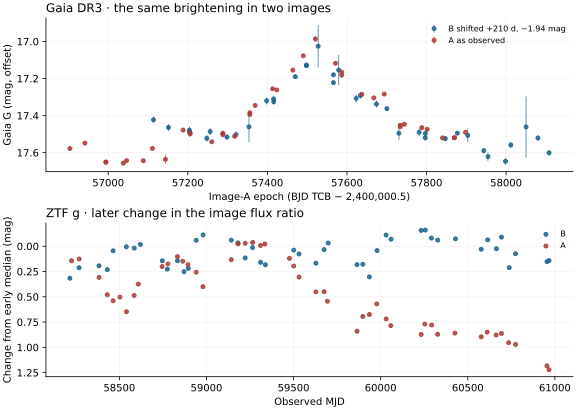

# A roughly seven-month echo in the gravitational lens J0826+7002

The fainter northern image B shows the quasar varying about **210 observer-frame days before the brighter southern image A**. ZTF g-band measurements from 2018–2025 yield a 210-day peak. Gaia independently recorded the fluctuations in 2014–2017. Its calibrated G-band measurements peak at 205 days with the same analysis, or 210 days when used without detrending. A distinct Gaia brightening gives a direct visual check. B reached its brightest sampled point at BJD TCB − 2,400,000.5 = 57317.74 and A at 57520.64, 202.90 days later. These are sampled maxima, with gaps between visits.



Lemon and colleagues identified the two spectra as the same redshift-1.62 quasar and reported three foreground galaxies near image A. They noted a possible third quasar image blended with one of these galaxies. This investigation estimates the delay between the two spectroscopically identified images, 5.83 arcseconds apart. The Ducourant et al. compilation lists the lens in Table A1 and omits it from the 73 systems with compiled measured delays in Table B1. A targeted search for the name, coordinates, models and time-delay measurements found the discovery work and no previous numerical measurement or published delay prediction for this pair. The catalog and search cannot establish absolute priority. [Lemon et al. 2023, section 4.1.24](https://academic.oup.com/mnras/article/520/3/3305/6948349) · [Ducourant et al. catalog and tables](https://cdsarc.cds.unistra.fr/viz-bin/cat/J/A+A/707/A345)

## Where the delay appears

The sign convention places an event seen at B at time *t* at A at time *t* + delay. The scan maximizes the Pearson correlation between supported segments of the two light curves, removing a broad trend separately from each. ZTF g furnished the approximately 210-day candidate before the Gaia measurements were inspected. Both time series in each ZTF half below are cut at MJD 59600 **before** smoothing. This repeats the search on disjoint measurements. Gaia and ZTF have disjoint epochs, independent telescopes, different cadences and different passbands.

| Measurement | Nights B / A | Peak delay | Peak correlation | At 210 d | At zero |
| --- | ---: | ---: | ---: | ---: | ---: |
| ZTF g, all | 418 / 489 | +210 d | 0.665 | 0.665 | −0.378 |
| ZTF g, early | 277 / 322 | +210 d | 0.675 | 0.675 | −0.595 |
| ZTF g, late | 141 / 167 | +215 d | 0.734 | 0.717 | +0.110 |
| Gaia G, all | 37 / 39 | +205 d | 0.847 | 0.847 | −0.227 |
| Gaia G, no detrending | 37 / 39 | +210 d | 0.934 | 0.934 | +0.037 |

Matching the individual Gaia nightly measurements without smoothing or detrending gives **24 one-to-one pairs** within 12 days of the ZTF delay and a correlation of **0.942**. The algorithm takes the closest epoch difference first and uses each night at most once. The same test gives +0.026 at zero delay, −0.758 for reversed image order, −0.658 at −155 days and −0.782 at +575 days. The latter two offsets differ from +210 days by approximately one year. Times are barycentric in Gaia and as reported by IRSA in ZTF. Each delay is estimated within one telescope.

To test what irregular sampling and smooth variability alone can produce, the replay generates independent damped random walks on the actual Gaia timestamps, scales each to the observed image variability, adds the reported nightly errors, and repeats the one-to-one correlation at the ZTF-picked lag. Of 20,000 simulated pairs per damping time, 0, 0, 0 and 1 reached the observed correlation for 30, 100, 300 and 1,000 days, respectively. This is a conditional check of a specified lag under four stochastic models. It does not include arbitrary correlated instrumental errors, other stochastic processes, or a fresh search for the best lag in each simulation.

The five-day search grid is finer than the physical precision of the measurement. The Gaia flare is broad. Direct epoch matches at +155 and +265 days still correlate at 0.782 and 0.710. Omitting each of five consecutive 220-day stretches from both Gaia series gives blind peak lags of 200, 215, 280, 205 and 600 days. The last reaches the search boundary. The full-data result supports an approximate echo. A calibrated confidence interval and a cosmographic inference would require a joint light-curve and lens model.

## A later change in the image flux ratio

Field-840 ZTF photometry measures different multi-year changes in the two images. Values below are differences between median nightly magnitudes in MJD 58900–59500 and 60350–60970. Positive values denote fading. Every other catalog object in the same one-arcminute cone and filter with more than ten accepted nights in both windows contributes to the comparison column. Several objects appear in more than one filter.

| Band | Image A change | Image B change | Change in A−B | Largest absolute change among other field objects |
| --- | ---: | ---: | ---: | ---: |
| g | +0.894 mag | +0.012 mag | +0.882 mag | 0.138 mag (5 objects) |
| r | +0.670 mag | +0.091 mag | +0.578 mag | 0.062 mag (15) |
| i | +0.535 mag | −0.052 mag | +0.587 mag | 0.098 mag (13) |

ZTF's difference-image pipeline finds positive residual flux at A in **129 of 129** selected early detections and negative residuals in **168 of 168** late detections. Median residual positions are 0.187 and 0.077 arcseconds from A. The extraction uses two ALeRCE alert identifiers with overlapping coverage at A, de-duplicates by detection ID and selects credible residuals within 1.2 arcseconds. These counts are detections and include repeat exposures in a night. The difference and direct photometry use the same telescope images. The subtraction check localizes the variable flux close to A and reduces concern that constant, unresolved galaxies alone generated its brightness change.

The image-dependent change is consistent with extrinsic variability such as microlensing. The reported window contrasts are contemporaneous and also contain intrinsic quasar variability entering the images at different times. Constant galaxy light can dilute the two amplitudes unequally, especially in red bands. These data do not uniquely identify the origin of the slow change or constrain the mass of any foreground star.

## Selection, alternative outcomes and prior work

The search used the 364 confirmed lenses in Ducourant et al. Table A1. It removed systems in their time-delay table and kept images with labels A–E, published DR3 G < 20.9, declination above −28°, and at least 2.75 arcseconds to every other labeled quasar image. Fifteen systems retained at least two images. The initial inspection compared g and r peaks and their behavior across time. Some higher correlation peaks occurred for pairs with sparse measurements. J0826+7002 stood out for agreement across its dense g-band halves and a positive-lag r-band peak. Target selection was exploratory. The [target table](targets.csv), [full search output](output.txt) and nightly data retain the other results.

For each cone, ZTF object IDs were assigned to the fixed lens-image positions using the median coordinates of good detections within 0.85 arcseconds. Observations require catflags = 0, 0 < magerr < 0.28, and magnitude at least 0.05 mag brighter than the reported exposure limit. Each retained object group and band has at least eight accepted exposures. The replay uses median observation time, magnitude and catalog uncertainty within integer-MJD nights. Each smoothed point uses a Gaussian weight of width 10 days truncated at two widths, with inverse variance including a 0.035-mag floor. The baseline uses the same recipe at 140 days. The scan evaluates every five days from −600 through +600, with at least 21 jointly covered grid points. These correlated grid values are used to rank lags rather than count independent detections.

The g-band peak after detrending stays at 210–215 days when the lag search extends to ±1,200 days and the baseline width changes to 70 or 300 days. The raw ZTF g curves are dominated by the slow differential change and peak at −900 days over the wider interval. ZTF r peaks at +235 days with the standard detrending but its late subset favors −5 days. ZTF i has competing distant peaks. Undetrended Gaia BP and RP peak near +215 and +205 days, with poorer behavior after detrending. These Gaia bands share the same observing visits.

The much sparser Pan-STARRS1 DR2 photometry is an adverse check. Pooling quality-selected grizy measurements after subtracting the median of each filter within each image yields 33 B nights and 37 A nights. It gives a negative detrended correlation at +210 d (−0.528) and a peak near −565 d. There is only one same-filter pair of nights within 12 days of the +210-day prediction across all five filters (in i). Filter-dependent variability, sparse coverage, the freedom of per-filter offsets, and contamination by nearby galaxies limit interpretation. The positive independent check comes from calibrated Gaia G. [Pan-STARRS1 archive and photometry](https://ps1images.stsci.edu/ps1_dr2_api.html)

## Reproduction and attribution

Run from this directory. The frozen analysis requires Python and NumPy. The optional figure uses Matplotlib. An archive rebuild additionally uses pandas and network access.

```sh
python replay.py
python figure.py
python rebuild.py --cache /tmp/j0826-archives --out /tmp/j0826-reduced
```

The snapshot includes 14,329 reduced ZTF nights across system/image/band combinations, 219 reduced Gaia nights across three bands and both images, 147 PS1 detections, 39 eligible ZTF field object/filter comparisons including A and B, and 1,418 distinct selected difference detections. [Source URLs, retrieval sizes and SHA-256 hashes](sources.csv) record the original data. Rebuilt scientific tables have been checked against the bundled data. TAP response wrappers may contain a changing query timestamp and ZTF and broker endpoints may gain detections over time. Compare the reduced scientific columns if a live HTTP hash changes.

* ZTF observations are from the Zwicky Transient Facility at Palomar Observatory. IRSA serves the PSF photometry, flags and per-exposure limits. The alert comparison uses ZTF data distributed by the ALeRCE broker. [ZTF archive](https://irsa.ipac.caltech.edu/Missions/ztf.html) · [ZTF Science Data System](https://doi.org/10.1088/1538-3873/aae8ac) · [ALeRCE](https://doi.org/10.3847/1538-3881/aba96c)
* The Gaia measurements come from ESA's Gaia mission, processed by DPAC and served by Gaia@AIP. The calibrated epoch light curves are from Gaia DR3. Only measurements passing the relevant variability rejection flag with finite time, magnitude and uncertainty between 0.00001 and 0.3 mag are used. The stored nightly uncertainty is the median single-epoch catalog uncertainty, not a standard error of a mean. [Gaia epoch photometry](https://doi.org/10.17876/gaia/dr.3/55) · [Gaia DR3](https://doi.org/10.1051/0004-6361/202243940)
* Pan-STARRS1 observations were obtained through STScI/MAST. The reduced set requires a position within 0.8 arcseconds of a lens image, psfQfPerfect > 0.8 and positive PSF flux at more than five reported standard errors. [PS1 surveys](https://arxiv.org/abs/1612.05560) · [MAST catalog](https://catalogs.mast.stsci.edu/panstarrs/)
