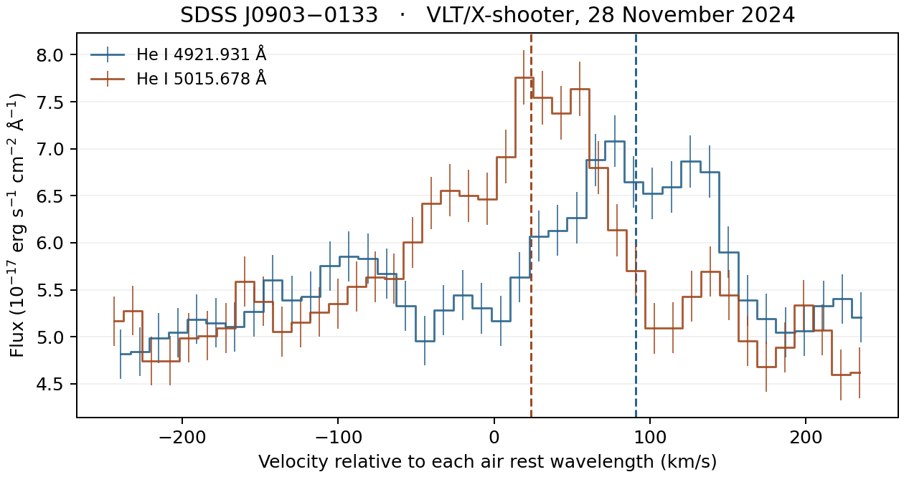

# A velocity difference between two helium emission cores in SDSS J0903−0133

The narrow He I emission core at 4921.931 Å lies **66.9 ± 5.2 km/s** redward of the core at 5015.678 Å, after expressing each velocity relative to its own air rest wavelength. Thirteen simultaneous pairs in VLT/X-shooter spectra on 2024 November 28 give this measurement. The difference persists in both halves of the 55-minute series. A single Doppler shift applied to all the helium emission cannot account for it.

| Measurement | Difference (km/s) |
| --- | ---: |
| All 13 X-shooter exposures | +66.9 ± 5.2 |
| First 6 and last 7 exposures | +53.3 ± 10.0 and +68.1 ± 6.8 |
| Alternating exposures (7 and 6) | +73.6 ± 8.3 and +57.6 ± 6.2 |
| Nine SDSS/BOSS exposures, 2021 | +18.2 ± 34.3 |

The errors in the table come from the fit covariance and pipeline pixel uncertainties. Leaving out one exposure at a time gives a jackknife uncertainty of 5.1 km/s for X-shooter. Twelve of thirteen individual paired differences have the same sign. Twelve combinations of fitting window (±190 to ±350 km/s) and polynomial background (degrees 0–2) give +66.3 to +75.5 km/s. The 2021 BOSS line cores are poorly resolved and do not independently establish the difference.

The dashed lines mark the fitted centroids on each transition’s own velocity scale. Error bars show the propagated pixel uncertainties. Run `python plot_profiles.py` with Matplotlib installed after regenerating `fits.csv` to recreate the figure.

## Interpretation and prior work

Inight et al. confirmed the known binary's helium-dominated spectrum. Schwope et al. measured its He I 5875 velocities from the 2021 BOSS exposures and described weak variability near an hour. The new quantity reported here is the simultaneous difference between the 4922 and 5016 cores in a later observing programme. A target-and-alias literature search did not identify this pairwise measurement for J0903. No orbital period follows from the centroid difference. [Inight et al. 2023, Appendix B22](https://arxiv.org/abs/2305.13371) · [Schwope et al. 2024, §3.1.14 and Fig. 6](https://arxiv.org/abs/2401.17304)

Line-dependent emission spikes and pressure-sensitive helium structure have been studied in GP Com and V396 Hya. For J0903, blends, line-dependent forming regions and an asymmetric underlying disc can also displace fitted cores. A single Gaussian describes the measured feature and does not identify its physical origin. The statistical significance applies to this line pair, selected after inspection of other transitions. The temporal splits and continuum variations test stability within the same observation. [Kupfer et al. 2016](https://academic.oup.com/mnras/article/457/2/1828/971447) · [NIST helium wavelengths](https://physics.nist.gov/PhysRefData/Handbook/Tables/heliumtable2_a.htm)

## Reproduction

Run `python measure.py` in this directory with NumPy and SciPy to regenerate `fits.csv` from the included pixels. Flux for both instruments is in units of 10⁻¹⁷ erg s⁻¹ cm⁻² Å⁻¹. The X-shooter UVB products from ESO programme 113.26X2.001 carry target name AM1. The telescope points about 1.2 arcsec from the Gaia DR3 coordinates of 5764195103095781120, and the target identification is independently supported by the matching broad helium spectrum. Each 177 s exposure has its own raw parent, a native sampling of 0.2 Å and a nominal resolving power of 5453. The FITS headers list their wavelength calibration RMS values in nm. A single common zero point cancels in the paired comparison. A wavelength-dependent calibration error or a blend would not cancel.

`observations.json` lists the original archive URLs and SHA-256 digests. To regenerate the pixel table from those observations, run `python extract_pixels.py PATH_TO_FITS_DIRECTORY` with Astropy and NumPy. The script checks input file digests. X-shooter air wavelengths come from the pipeline. Pixels with nonzero QUAL, invalid flux, or nonpositive uncertainties carry zero weight. BOSS wavelengths are converted from vacuum to air before measuring velocities. Its exposure extensions are indexed by their EXPOSURE headers. Only pixels with a clear AND_MASK, finite flux and positive inverse variance enter. The 2021 and 2024 velocity frames differ by a common correction within each exposure, which drops out of each instrument's paired difference. Both lines fall on the same detector arm. The profile fit uses the original pixel grid and a Gaussian core with a local linear background. [ESO archive](https://archive.eso.org/) · [SDSS DR19](https://sdss.org/dr19/data_access/get_data/)
