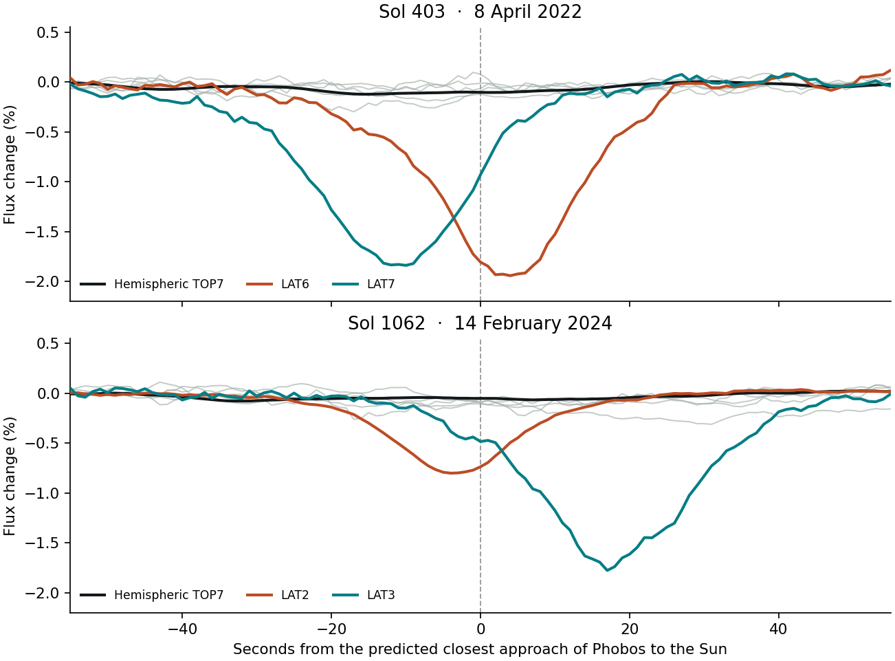

# Perseverance recorded directional sky darkening when Phobos passed outside the Sun

Two passes separated by 677 days show a moving brightness deficit in the part of the Martian sky nearest Phobos’s shadow. The Sun itself remained unobscured from the rover. On 8 April 2022 the signal appeared in adjacent MEDA photodiodes LAT6 and LAT7. On 14 February 2024 it appeared on the opposite side of the rover, in LAT2 and LAT3. The pointing calculation selects these same two pairs from seven channels using the ephemeris and rover attitude alone. This is an archival candidate detection of scattered skylight responding to an off-site Phobos shadow.

| Perseverance sol | Closest approach UTC | Clearance between limbs¹ | Lateral brightness deficits² | Peak times relative to closest approach | Largest broadband deficit² | Stronger same-sol control windows³ |
|---|---|---:|---|---|---:|---:|
| 403 | 2022-04-08 20:37:51.498 | 1.187 solar radii | LAT6 1.94%, LAT7 1.84% | +4 s, −10 s | 0.123% | 0 of 114 |
| 1062 | 2024-02-14 21:27:05.915 | 0.728 solar radii | LAT2 0.80%, LAT3 1.78% | −4 s, +17 s | 0.079% | 0 of 121 |

¹ Center separation minus the apparent solar radius and a 13.4 km bounding radius for Phobos, evaluated at closest center approach with JPL ephemerides and reconstructed rover positions. Sol 403 had center separation 2.787 solar radii, sol 1062 had 2.371. The displacements comfortably exceed reasonable limb or clock errors.

² Maximum of the five-second running mean within ±40 s, relative to separately fitted local linear baselines in each detector. The per-channel maxima occur at different times. TOP7 views a hemisphere over 190–1100 nm. The lateral detectors sample 750 ± 10 nm through ±5° apertures. The Sun was at elevations 42.1° and 61.7°. The two affected pairs have nominal elevations of 20°. Each event had zero archived rover speed and constant yaw through the central 81 seconds.

³ Each trial includes all seven lateral detectors and the same time and adjacent-pair search as the event. These counts are empirical within-sol ranks. The two highlighted examples were identified after examining the search. The counts cannot be multiplied into a discovery significance.



## Tests of the interpretation

- On each sol, the two adjacent channels with the strongest differential deficit are also the two whose viewing directions have the largest projection toward the shadow. The geometric ordering survives adding or subtracting 5° of mounting azimuth and including or omitting rover pitch and roll. The seven directional projections and sensitivity ranges are in `directions.csv`.
- The corresponding on-disk or grazing passes yield much stronger signals in the same directions. On sol 401, LAT6/7 fell by 9.74%/9.11% while TOP7 fell by 2.58%. On sol 1061, LAT2/3 fell by 6.66%/5.87% while TOP7 fell by 0.31%. On sol 1062 the rover still had the same yaw, pitch and roll as on sol 1061.
- A common electronic or broadband illumination change would have to explain the opposing sets of affected channels on the two dates, the inter-channel time offsets, and agreement with an independently calculated bearing. Atmospheric variability and stray light remain possible contaminants for individual channels. The instrument’s absolute calibration errors exceed several of these depths. The measurements use short-term differential precision, which the shifted windows test directly.
- Sol 1722 provides a third example with a narrower 0.062-solar-radius clearance. LAT4/5/6 fell by 6.05%, 2.41%, and 4.04%, compared with 0.94% in TOP7. No control out of 116 matched its adjacent-pair statistic. The low solar elevation of 11.0°, proximity to the adopted limb bound and imperfect within-sector amplitude ordering make this a secondary case.

## Search and controls

The search spans 19 February 2021 to 12 May 2026. NAIF GFSEP finds apparent Sun–Phobos angular-separation minima from the reconstructed rover position. We retained minima with center separation at most five solar radii and planetocentric solar elevation above 5°. Of 55 predictions, 19 could overlap the solar disk and 36 cleared its edge. The radiometric criteria yielded 14 usable possible transits and 10 usable misses. Of the 26 other misses, four had no listed calibrated RDS product at the identified sol directory and 22 failed daylight or cadence requirements. All 55 events are in `geometry.csv` and `outcomes.csv`.

A usable window contains one-second samples in all eight channels through ±42 s, at least 12 simultaneous samples on each baseline flank from 45 to 90 s on either side, and TOP7 above 10 W/m² throughout the valid window. For each lateral channel we subtract the contemporaneous median fractional deficit of the seven lateral channels, then find its maximum differential deficit within ±40 s after five-second smoothing. The pair score takes the smaller peak of each adjacent pair and maximizes over the six pairs. LAT1 is blind and breaks circular adjacency between LAT8 and LAT2. Peaks need not occur in the same second. Trials use non-overlapping 181-s windows aligned to the event’s phase within the sol, more than 181 s from all selected conjunctions on that sol, and identical eligibility criteria. Among the ten usable off-disk windows, three had a score above every same-sol control. All control scores and the other seven off-disk outcomes are included. Shifted windows cover a range of solar elevations and weather on each sol.

The geometric cross-check starts with the vector from the Sun–rover line toward Phobos, projected perpendicular to incoming sunlight. Moving the observer along a viewing ray with a positive projection brings that line closer to the shadow. The mount orientation comes from the independently published sol-117 diagram and RDS channel specifications. Its LAT2 direction is approximately 175° clockwise from north at rover yaw −140°, consistent with LAT1 along rover +X and successive channels separated counterclockwise by 45°. The calculation applies the archived yaw, pitch and roll and ranks the projections. It tests which side of the sky should respond. It does not fit the atmospheric height or predict individual light curves.

## Prior work and scope

The InSight team measured Phobos transit depths and proposed that temporally displaced atmospheric scattering explained the residual timing offsets. Their work also describes a Deimos transit. Earlier Perseverance work used MEDA to measure surface cooling on sols 397 and 398, when Phobos crossed the Sun at the rover. The distinct measurements here are the direction, depth and timing of off-disk skylight deficits observed from Jezero. A targeted search for Jezero, MEDA, Phobos, lateral photodiodes, scattered light, and the candidate sols found no report of these two specific off-disk measurements. This search does not establish publication priority. [InSight transit results](https://doi.org/10.1029/2020GL089099) · [Prior Jezero thermal measurements, section 5.3](https://doi.org/10.1029/2022JE007672) · [Earlier orbital observations of the surface shadow](https://doi.org/10.1029/2004JE002376)

## Reproduction

`analysis.py` with no arguments verifies the six packaged one-second calibrated event excerpts offline. With `--full`, it downloads the PDS sol products identified in `sources.csv`, checks SHA-256 and reproduces all event and control scores. The product values are calibrated radiances integrated over each field of view in W/m². `directions.py` reads the archived attitude excerpts and their provenance in `pointing.csv`. NumPy and pandas suffice for the offline and full radiometry runs. The two geometric scripts also use SpiceyPy and the direction calculation uses SciPy. The plot uses Matplotlib.

```sh
python analysis.py
python analysis.py --full --cache meda-cache --output reproduced
python ephemeris.py --cache kernels --output reproduced/geometry.csv
python directions.py --cache kernels --output reproduced/directions.csv
python plot.py
```

[MEDA PDS archive and product descriptions](https://pds-atmospheres.nmsu.edu/data_and_services/atmospheres_data/PERSEVERANCE/meda.html) · [MEDA instrument, tables 22 and 23](https://doi.org/10.1007/s11214-021-00816-9) · [Published rover pointing diagram, Figure 3E](https://doi.org/10.1126/sciadv.abn3783) · [NAIF mission kernels](https://naif.jpl.nasa.gov/pub/naif/MARS2020/kernels/) · [MAR099s kernels and documentation](https://naif.jpl.nasa.gov/pub/naif/generic_kernels/spk/satellites/)
