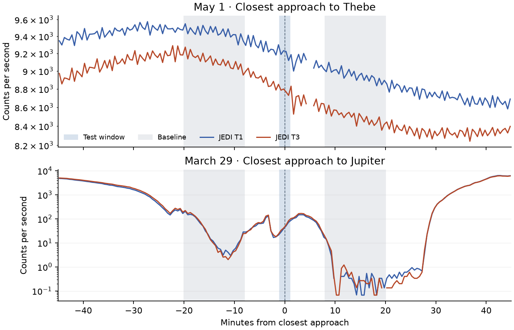

# No two-detector radiation dip at Juno’s closest approach to Thebe

**Null result.** Juno passed **5,495.88 km** from Thebe’s center on 1 May 2026. The Stellar Reference Unit (SRU) recorded an image midpoint **18.817 seconds** before the reconstructed closest approach. The two shielded JEDI channels changed by **+0.20%** and **−0.26%** relative to their local baselines in the fixed two-minute window. The SRU comparison also failed the frozen deficit criterion. The measurements constrain a short dip in these detector responses at this geometry. [November 17 archive release](https://pds.nasa.gov/datasearch/subscription-service/SS-20261117.shtml) · [Frozen protocol](PROTOCOL.md) · [Numerical results](summary.json)

## The moon and planet encounters happened at different times

The reconstructed closest approach to Thebe was at **13:20:05.282 UTC**. Juno reached its minimum distance to Jupiter’s center at 15:02:32.708. NASA’s mission image gives an approximate imaging distance of 5,000 km. Our closest approach uses geometric center-to-center distances from the archived reconstructed Juno and Jupiter satellite ephemerides. Timestamp precision describes the computation and carries no separate estimate of navigation accuracy. Magnetic connection is outside the scope of the geometric calculation. [JPL flyby image](https://www.jpl.nasa.gov/images/pia26751-nasas-juno-misson-captures-jupiter-moon-thebe/) · [Native archive receipts](sources.json) · [Geometry and SRU times](geometry-sru.json)

## Measurements around closest approach

The JEDI test sums recorded counts in channels 02–23 and divides by accumulated exposure duration. The two shielded witness pixels can register penetrating foreground and scattered particles. The comparison uses four 30-second bins centered within one minute of the flyby and 24 on each side of the baseline. All six displaced control windows had coverage. The dead-time cut leaves the same result. The largest absolute change across all five JEDI pixels was below 0.4% relative to their fixed local baselines. Shielded and bare pixels are channels within one instrument. [JEDI user guide](https://pds-ppi.igpp.ucla.edu/data/JNO-J-JED-3-CDR-V1.0/DOCUMENT/MAUK_2023_JGR_SUPPLINFO_JEDI_USERGUIDE.PDF) · [May range receipt](ranges-121.json)

| SRU image midpoint UTC | Derived CCD counts per cm² per second |
| --- | ---: |
| 13:03:35.867 | 2,004,311 |
| 13:19:46.465 | 1,162,363 |
| 14:00:26.662 | 255,114 |

All three images use the same SRU camera and high-rate deposited-noise method. The near-encounter image rate is below the previous image and above the following one. The sparse image times limit the duration of a change that this sampling can resolve. Level-3 Advanced Stellar Compass (ASC) coverage ends in March for this release. [SRU interface specification](https://planetarydata.jpl.nasa.gov/img/data/juno/JNOSRU_0001/DOCUMENT/JUNO_SRU_EDR_CRT_SIS_V01_2.HTM) · [ASC release coverage](https://pds.nasa.gov/datasearch/subscription-service/data_product_information.cfm?dsid=JNO-J-ASC-3-RAD-V1.0&releaseid=0035)



The March pass samples a different part of Jupiter’s radiation environment. Shortly after March perijove, displaced control windows showed large decreases in the JEDI witness counters. Seven ASC and SRU pairs sampled across the March pass give descriptive rank correlation **0.955**. The paired images span hours and contain more than one SRU calibration method. The radiation environment varies strongly along each trajectory. [March range receipt](ranges-088.json) · [Juno radiation map](https://doi.org/10.1029/2024JE008549)

## Archive row-count discrepancies

The SRU labels specify **19** data rows for each of PJ81, PJ82 and PJ83. Their archived CSVs contain **7**, **19** and **20**, respectively. Independent retrieval matched each label’s own MD5 and the recorded SHA-256. The verified files establish label discrepancies for PJ81 and PJ83. The total number of exposures originally acquired remains outside this check. The published errata flag a different PJ83 image outside the three-image comparison. [SRU archive errata](https://planetarydata.jpl.nasa.gov/img/data/juno/JNOSRU_0001/ERRATA.TXT) · [Exact archives and label hashes](sources.json)

Prior work models absorption by Thebe and reports high-energy particles near the gossamer ring. This two-minute test leaves open signals displaced from closest approach, confined to other particle energies, or extended elsewhere along the orbit. [Thebe absorption study](https://doi.org/10.1029/2021JE007050) · [Gossamer-ring energetic particles](https://doi.org/10.5194/egusphere-egu26-14115)

## Reproduce

The native decoder uses Python with NumPy, SciPy and SpiceyPy. Stage the paths in [sources.json](sources.json) in one data directory. Retrieve the listed JEDI HTTP ranges in [March](ranges-088.json) and [May](ranges-121.json). Place each part in a subfolder named after the source file, replacing .TAB with .ranges. The decoder checks source SHA-256, range lengths and record order. Run [decode.py](decode.py) with the data directory, the compact input output path and the geometry output path. The raw data and kernels were kept on the D drive. An independent native replay reproduced the geometry and summary hashes.

Run the offline replay from this directory with NumPy, SciPy and Matplotlib. The compact inputs preserve ASC counts and flags and the JEDI time, duration, mode, quality, sector and per-pixel sums.

```sh
python analyze.py --output summary.json
python plot.py --output radiation-profile.png
```
