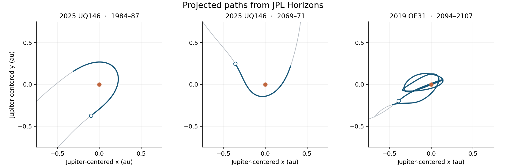

# Two temporary captures of 2025 UQ146 by Jupiter

Telescope positions from 2014, 2021 and 2025 constrain the orbit of asteroid 2025 UQ146. Its reconstructed trajectory puts it below Jupiter's local escape speed in 1984–1987 and predicts a second such passage in 2069–2071. It spent most of each interval inside Jupiter's Hill sphere and swept less than one revolution in each passage. The second object in this investigation, the active 2019 OE31, has a gravity-only trajectory that makes nearly three retrograde turns around Jupiter in 2094–2107. Unmeasured cometary recoil materially changes that forecast.

## What the orbits say

| Body and passage | Time below escape speed (TDB) | Duration | Closest distance in five-day samples | Net turns about Jupiter |
| --- | --- | ---: | ---: | ---: |
| 2025 UQ146, past | Jan 1984 – Mar 1987 | 3.17 years | 0.23786 au | +0.72 |
| 2025 UQ146, future | Apr 2069 – Sep 2071 | 2.41 years | 0.15533 au | +0.70 |
| 2019 OE31, past | Sep 2010 – Sep 2015 | 4.97 years | 0.01708 au | +0.85 |
| 2019 OE31, future | Oct 2094 – Apr 2107 | 12.45 years | 0.11383 au | −3.00 |

The table uses geometric JPL Horizons positions and velocities relative to Jupiter's center. The sign records direction in the fixed J2000 ecliptic projection. The durations interpolate zero crossings of the planet-relative specific energy, v²/2 − GM/r, at five-day cadence. Solar tides change this energy over time. A negative value corresponds to a speed below local two-body escape speed. The 1985 and 2070 events are temporarily bound flybys. Both models place the asteroid back on an unbound trajectory after each passage. [Ephemeris measurements and controls](data/results.json) · [Frozen geometric states](data/horizons.csv.gz)



Blue traces the negative-energy part of each path. The open circle marks entry and the orange point marks Jupiter. The smooth curves connect ephemeris samples. The astrometry falls outside the illustrated intervals.

## What was actually observed

For 2025 UQ146 the Minor Planet Center released 15 optical positions on five nights spanning April 2014 to October 2025. An orbit initialized from the telescope positions reproduces them with a radial RMS residual of 0.407 arcsec. Three fits each excluded one WFST night from both initialization and fitting. They predicted all six withheld positions within 0.42 arcsec. Omitting a whole apparition gives much poorer predictions, including one fit that fails to converge. The three widely spaced apparitions carry essential information on this orbit. The independent refit puts the two closest passages at 0.237873 and 0.155322 au, with Jupiter-relative specific energies of −0.923 and −1.009 km²/s² at closest approach. These differ from the minimum energies along the trajectories. [Observations, full-apparition failures and orbit refit](astrometry/README.md)

A search of 47 separate DECam exposure times recovered the five original 2014 positions to within 0.89 arcsec. The other 42 exposures supplied no additional astrometric epoch. Two sets of nearby detections were stationary sources. [DECam control measurements and misses](astrometry/catalog-check/README.md)

For 2019 OE31, Oldroyd et al. established activity in DECam images and a 2013 Jupiter encounter that changed the object's heliocentric orbit. They also modeled the possibility of a return to a Centaur orbit. The additional prediction here concerns the *planet-centered path* late this century. The JPL fit used 39 positions covering June 2019 through September 2020. A second fit from the MPC used 31 selected observations over 137 days in 2019. These fits have overlapping measurements and different arcs. The October 2026 MPC state also recovers approximately three turns under gravity alone. [Oldroyd et al.](https://doi.org/10.3847/2515-5172/ad14f5) · [JPL fit](data/oe31-jpl.json) · [MPC fit and selected observation count](data/oe31-mpc.json)

## Which predictions survive uncertainty?

We propagated the nominal state and 128 correlated Gaussian samples per body from each of the JPL and MPC covariances. The integrations used Newtonian gravity, the Sun and eight planetary-system barycenters with DE440s starting states. The calculation samples the trajectories every five days and linearly interpolates the crossings of zero energy and the instantaneous Hill radius. Each duration inside the Hill sphere includes only time also spent below escape speed. The calculation rejects any window that begins or ends inside a negative-energy episode. The nominal 2025 UQ146 solutions spent about 2.37 and 1.72 years simultaneously below escape speed and within the instantaneous Hill radius. Every sampled trajectory satisfied both conditions on both encounters. The Hill radius is the instantaneous Jupiter–Sun distance times (Mⱼ/3M☉)^(1/3). The IAS15 integration used the Jovian system mass and barycenter. Horizons supplied a separate implementation of the JPL orbit with a resolved Jupiter center. [All orbit samples, including the two reference solutions](data/orbit-samples.csv) · [Integrator](integrate.py)

For the late-century passage of 2019 OE31, the middle 90% of sampled negative-energy durations were 12.44–12.47 years for JPL and 12.56–12.82 years for MPC. The corresponding nominal turns were −2.997 and −3.003. In the frame rotating with the Sun–Jupiter direction, the nominal trajectories sweep −4.05 and −4.08 turns. The time inside the Hill sphere is intermittent and totals approximately 9.38 and 8.86 years. The counts are conditional on a gravitational force model. The covariance samples quantify the fitted state uncertainties and omit systematic acceleration.

A separate sensitivity experiment applies a persistent radial or transverse acceleration from the JPL fit epoch. With the standard water-sublimation distance law, all tested coefficients through 10⁻⁷ au/day² at 1 au preserve nearly three turns. A more extended inverse-square law produces a different outcome. At a transverse coefficient of +10⁻⁸ or −10⁻⁸ au/day² at 1 au, each trajectory has one fully bracketed negative-energy episode in the tested window. The largest angular excursion within each episode, counting any directional reversal, is 0.67 or 0.54 turn respectively. At ±10⁻⁷ au/day² the sign change disappears from the tested 2092–2114 window. Those accelerations are imposed sensitivity tests. No recoil coefficient or physical sublimation law has been measured here. Fresh astrometry over multiple apparitions can distinguish the extrapolations. [Recoil experiments](data/recoil.csv) · [JPL nongravitational force models](https://ssd.jpl.nasa.gov/horizons/manual.html)

## Selection and controls

The November 14, 2026 JPL close-approach query returned 702 encounter records for 432 distinct bodies between 1900 and 2100, within 0.36 au of Jupiter and at relative speed ≤20 km/s. Recomputing two-body energy gave 28 negative records for 12 bodies. We inspected repeated cases and selected one recently designated asteroid with two separated events and an active object with a long future arc of negative energy. This is an exploratory selection from the close approaches JPL records. Other planets and Earth’s Moon were also inspected while choosing the Jovian problem. Neither the query nor this selection measures a population frequency. Events after the catalog end date were found by extending individual trajectories. [Complete Jovian query](data/encounters.json) · [Source URLs and hashes](data/jpl-receipts.json) · [JPL catalog conventions](https://ssd-api.jpl.nasa.gov/doc/cad.html)

The analysis recovers the published capture of comet 467P/LINEAR–Grauer, including a minimum sampled separation of 0.07488 au. A check on 255P/Levy approaching within 0.229 au gives positive specific energy throughout its sampled window. These controls distinguish passing close to Jupiter from passing slowly enough for negative energy. Published work and the original surveys retain credit for the known objects, observations, activity and named controls. [Emel'yanenko et al.](https://doi.org/10.1134/S0038094613020020) · [Control outputs](data/results.json)

On November 14, 2026, we searched both full and packed designations (K25UE6Q and K19O31E) with terms for Jupiter, temporary capture, satellite, 1985, 2070, 2096 and 2107, the original 2019 OE31 activity report, the September 2025 spatial-capture survey and the 2026 study of satellite-assisted capture. We located the prior 2013 encounter for 2019 OE31 and the prior captured control. We found no earlier report in the sources checked of either paired capture for 2025 UQ146 or the late-century three-turn prediction for 2019 OE31. The JPL close-approach entries and orbit solutions themselves are public prior data. Unindexed analyses and informal reports could precede these interpretations. [2025 capture survey](https://academic.oup.com/mnras/article/543/1/625/8244134) · [2026 capture study](https://academic.oup.com/mnras/article/551/4/stag1498/8762600)

## Near-term observing tests

The frozen JPL solution places 2025 UQ146 at ICRF RA 68.186834°, Dec +22.696803° on 2026-12-06 at 00:00 UTC, at 176.39° solar elongation and predicted V ≈ 22.3. For 2019 OE31 the 2027-05-30 00:00 UTC prediction is RA 249.344497°, Dec −24.956428°, at 175.62° elongation and nominal magnitude 20.35. Activity can affect the brightness. These are geocentric astrometric directions. The weekly table includes sky motion and both marginal 3σ coordinate uncertainties. Observers can obtain topocentric coordinates for their sites. [Frozen weekly predictions](data/recovery.csv)

## Replay

From this directory with Python 3.12, NumPy and REBOUND 5.2.2, the following commands reproduce the search, both orbit ensembles and the recoil tests. The basic search and Horizons summary require only NumPy. The independent sky-position refit has its own instructions. The 32 MB planetary kernel is required only to regenerate the initial states and refit the telescope positions. The code verifies its SHA-256. Live archive responses can change when an orbit is updated. [MPC observation service](https://docs.minorplanetcenter.net/mpc-ops-docs/apis/get-obs/) · [MPC orbit service](https://docs.minorplanetcenter.net/mpc-ops-docs/apis/get-orb/) · [DE440s](https://ssd.jpl.nasa.gov/ftp/eph/planets/bsp/de440s.bsp)

```sh
sha256sum -c SHA256SUMS
python replay.py | diff - data/results.json
python integrate.py /tmp/jupiter-orbit-samples.csv
python recoil.py /tmp/jupiter-recoil.csv
```

The initial-state extraction is `python planet_inputs.py de440s.bsp planets.json` with jplephem installed. To query today's versions of the JPL close-approach catalog and Horizons tables, run `python archive.py downloaded`. The original query receipts and compact trajectories are bundled for offline use. Minor planet observers, the MPC, NASA/JPL Solar System Dynamics and the REBOUND developers provide the observations, catalog solutions and integration tools. [REBOUND](https://doi.org/10.1051/0004-6361/201118085)
