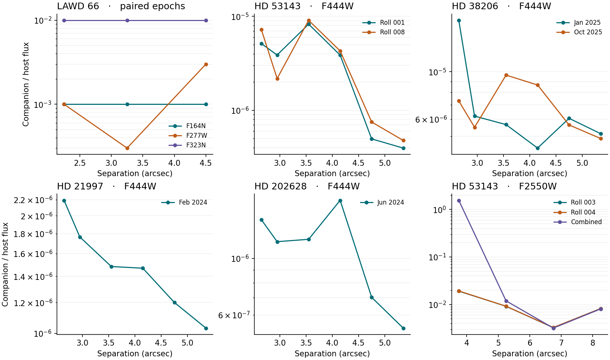

# Five nearby-star fields in multi-epoch JWST imaging

**No new co-moving planet or brown dwarf passed validation in the five fields.** Nine sky positions near LAWD 66 repeat on the stationary background. The brightest source near HD 53143 matches the background object measured with Gemini/NICI in 2009. Two signals remain unclassified: a single-visit F164N peak near LAWD 66 and a reference-sensitive F1140C peak near HD 202628. Neither has an independent co-moving centroid.

These five fields were selected in the [review of PR #142](../jwst-nearby-companions/README.md). The ten-field result there and the five-field result here cover separate samples.

## Results by field

| Field | Observed result | Evidence |
|---|---|---|
| LAWD 66 / L 845−70 | Across eight JWST visits spanning 1,141 days, the host moved 1.207″ relative to the field. Of 93 peaks in the 2–5″ annulus, 92 correspond to nine repeat stationary sky positions. A 6.10-local-MAD F164N peak at 3.274″ on April 21, 2025 has positive flux in four unflagged dithers. It has no qualifying repeat at fixed sky or at the host-following location. | [Eight-epoch astrometry, colours, four-dither test and recovery](lawd66/README.md) |
| HD 53143 | In the April 2024 NIRCam rolls, the 3.37″ source lies 0.149″ from the Gemini/NICI background prediction and 4.67–4.68″ from the co-moving prediction. F200W−F444W is −1.17 AB mag. The other threshold crossings lie in the bright source's diffraction pattern. The two November 2025 F2550W rolls, released November 10, 2026, have zero blind crossings from 3″ to 9″. | [NIRCam fits, June images, Gemini astrometry and model colours](nircam-hd53143-hd38206/README.md) · [MIRI rolls and recovery](hd53143-miri/README.md) |
| HD 38206 | Five January and three October 2025 F444W crossings fail to repeat under either sky-motion prediction. Two pairs repeat at the same flagged detector pixels through a roughly 119° change in sky orientation. Background and co-moving predictions differ by only 35.4 mas over this baseline. None of the eight positions yields a persistent counterpart in the 20 archival Gemini/NICI H-band frames under either track. | [Matched positions, detector checks and recovery](nircam-hd53143-hd38206/README.md) |
| HD 21997 | The F444W search has zero crossings over 2.5–5.5″. A bright F200W mosaic peak fails independent reductions of the native science integrations. The F1140C peaks recur at a detector position that maps to different parts of the sky. The September 2023 and January 2024 science visits were tested separately. | [Native-pixel tests, both MIRI epochs and recovery](hd21997-hd202628/README.md) |
| HD 202628 | Both F444W peaks at 3.91″ and 4.13″ vanish with an independent reference star. A separate F1140C signal at about 3.28″ has positive flux in two same-day rolls. Its first-roll score drops from 6.12 to −0.77 local MAD units with a different reference. The 2024 images yield no independent position under either motion hypothesis. | [Reference substitutions, split integrations, colours, ALMA and recovery](hd21997-hd202628/README.md) |

## Measured contrast limits

Points give the lowest tested companion/host flux ratio reaching the stated fraction of successful artificial-source recoveries at the sampled angles. LAWD 66 uses 90% recovery **including the two-epoch co-motion decision**. The F444W panels use 95% detection-stage recovery, sustained across brighter tested flux levels. The HD 53143 F2550W panel shows 95% detection-stage recovery separately for the rolls and their combined image. Only four angles passed the combined-image weight mask at 3.75″. Individual rolls have full annular support there. The axes vary by panel.

The tables behind these panels contain 14,256 F444W trials, 3,138 F2550W trials, 7,945 LAWD 66 single-image trials and 1,470 LAWD 66 paired trials. Adding these gives 26,809 recorded trials, including trials which share pixels. The [flux ratios and empirical recovery denominators](contrast_summary.csv) are reproduced from the individual ledgers with [recovery.py](recovery.py). Each field folder includes the full trials, filters, usable radii, mask criteria and flux normalization.

An additional F1140C experiment tested HD 202628 at the unclassified signal’s separation of 3.283″. Of 72 position angles, 28 passed the coverage and mask-transmission cuts in both rolls. Native reductions with two independent reference stars reached at least 95% joint recovery at 15 and 20 µJy, respectively. At 10 µJy only 9/28 and 0/28 were recovered in both rolls. The feature’s 2–3 µJy forced-aperture flux estimates fall below these levels. Loss of significance under another reference cannot exclude such a faint source. [Separate trial ledger and calibrated F1140C recovery](hd21997-hd202628/measurements/F1140C_recovery.csv)

## Publication screen and archival checks

The pre-reduction screens covered target aliases, observing programs and primary publications. They identified the previously predicted microlensed background source inside the 2″ inner exclusion around LAWD 66, earlier imaging surveys of all four disk hosts, a prior JWST disk report for HD 21997, and published ALMA sources near HD 202628. A paper that mentioned HD 202628 in a comparison detected its planet around a different star. The literature search is dated November 17, 2026 and gives no priority guarantee. [LAWD 66](lawd66/literature.md) · [HD 53143 and HD 38206](nircam-hd53143-hd38206/publication.md) · [HD 21997 and HD 202628](hd21997-hd202628/README.md#publication-screen)

The HST archive comparison used 24 science products and evaluated 716 source, epoch and track combinations for the four disk fields. The ESA HST footprint query yielded no imaging row for LAWD 66. The field records include Gaia and ground-based comparisons, per-source colour/model tests, and empirical background controls. Where an archive lacked coverage, sensitivity or a usable counterpart, the corresponding motion comparison remains inconclusive. The previously reported ALMA source S1 near HD 202628 favours a stationary position in the independent ALMA comparison. The 0.101″ registration scatter and blending with disk emission limit the interpretation. [HST pixels and archive responses](archives/README.md) · [ALMA comparison](hd21997-hd202628/measurements/ALMA_S1_motion.csv)

## Reproduction and remaining limits

The field READMEs list the commands, archive queries, calibration inputs and SHA-256 manifests. The searches use the merged NIRCam, ordinary-imaging MIRI and two-epoch imaging routines. The G29-38 routine now accepts a supplied science/calibration manifest and band list. Replaying its original command on its original verified FITS inputs reproduced all five deposited measurement CSVs, including all 1,602 original injection records. The eight offline referee tests for PR #142 also passed. To verify the new field dispositions, archive-response hashes, forced-flux fits and all 57 plotted recovery points, and the separate F1140C recovery experiment from their trial ledgers, run `python -m unittest discover -s tests -p test_jwst_five_field_followup.py -v` from the repository root.

The measured null is limited to the listed filters, footprints, separations, detection rules and flux ratios. For the four disk fields the primary calibrated blind search is the F444W annulus from 2.5″ to 5.5″. There is no uniform joint multi-filter or mass completeness limit. Same-day rolls test detector orientation but supply essentially no proper-motion leverage. Masked central regions, fainter objects, or appreciable orbital motion or variability remain outside the exclusions. The two unclassified signals would need independent, adequately deep repeat astrometry for a physical identification. The October 2026 HD 202628 F2550W observations had a MAST release date in October 2027 and do not enter the public-data result.
