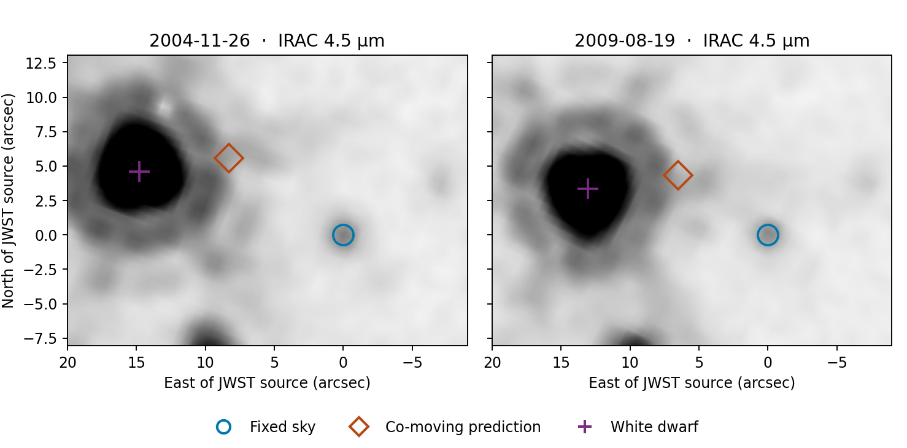

# Spitzer resolves the stationary G29-38 field source

Two historical Spitzer/IRAC 4.5 µm images locate a source within 0.07″ of the November 2025 JWST position at ICRS (352.193797°, +5.246759°). A source with a fixed offset from the white dwarf would have appeared 10.00″ away in 2004 and 7.83″ away in 2009. An independent 8 µm image supports the same identification. The nearby JWST source therefore fails the common-proper-motion test.



| UTC date | Spitzer band | Gaia stars used | Centroid distance to fixed sky | Finite-aperture fixed flux | Co-moving flux | Control scatter fixed / co-moving |
|---|---|---:|---:|---:|---:|---:|
| 2004-11-26 | IRAC 4.5 µm | 24 | 0.070″ | 18.5 µJy | −8.5 µJy | 5.3 / 17.6 µJy |
| 2009-08-19 | IRAC 4.5 µm | 24 | 0.055″ | 16.5 µJy | +9.3 µJy | 4.0 / 17.4 µJy |
| 2004-11-26 | IRAC 8 µm | 8 | 0.157″ | 24.0 µJy | −6.6 µJy | 5.8 / 29.9 µJy |
| 2004-12-02 | MIPS 24 µm | 0 | inconclusive | 34 µJy | 56 µJy | 134 µJy / insufficient controls |

The unmodified SHA post-BCD mosaics use MJy sr⁻¹. Each fit uses a circular Gaussian plus a local plane on the native mosaic. Each IRAC mosaic is translated onto Gaia DR3 using proper-motion-propagated field stars and median-based outlier rejection. Position scatter per coordinate across the calibrator stars is 0.06–0.10″ at 4.5 µm. Positions are propagated with linear proper motion. Co-moving coordinates use the measured central star in each image, its 2025 relative offset and zero orbital motion. Dropping the parallax term can shift that offset by up to roughly twice the white dwarf's 57 mas parallax for two Earth-like observing locations. It is negligible compared with the predicted 7.83–10.00″ displacement.

Fluxes are independent, uncorrected small-aperture checks. A 180° reflection about the primary removes its approximately symmetric halo. A clipped local plane removes sky, and a circular aperture of radius 1.15 PSF FWHM measures the residual. Same-radius rotated apertures establish the reported robust scatter, with both hypotheses and their reflections excluded. The reflected background, finite aperture, local plane and source crowding can change the flux relative to a catalogue measurement. The aperture/control ratios are diagnostic. On the MIPS exposure the co-moving test radius is about one FWHM, the scatter around the stationary position exceeds the measured flux, and the mosaic lacks reliable Gaia registration. It provides no independent positional or photometric confirmation.

Spitzer Enhanced Imaging Products separately catalogues SSTSL2 J232846.52+051448.4 at 0.180″ from JWST. Its reported 24 µm PSF bandfill is 174.9 ± 37.2 µJy, a forced measurement. These catalogue values and the independent MIPS aperture above have different estimators and may use different input combinations. The stationary association identifies the same sky source. Its astrophysical class remains open.

## Reproduce

From this directory, with Python, NumPy, SciPy, Astropy and matplotlib installed, run:

```sh
python fetch.py
python measure.py
python figure.py
```

[The SHA receipt](spitzer-query.json) contains the SIA query, response hash, four observation identifiers and individual input FITS hashes. [The Gaia registration receipt](gaia-query.json) records the exact TAP query and hash of the [field catalogue](gaia-field.csv). [Individual reductions](measurements.json) include both predicted pixel locations, fitted sky coordinates, aperture radii, local scatter and numbers of controls.
