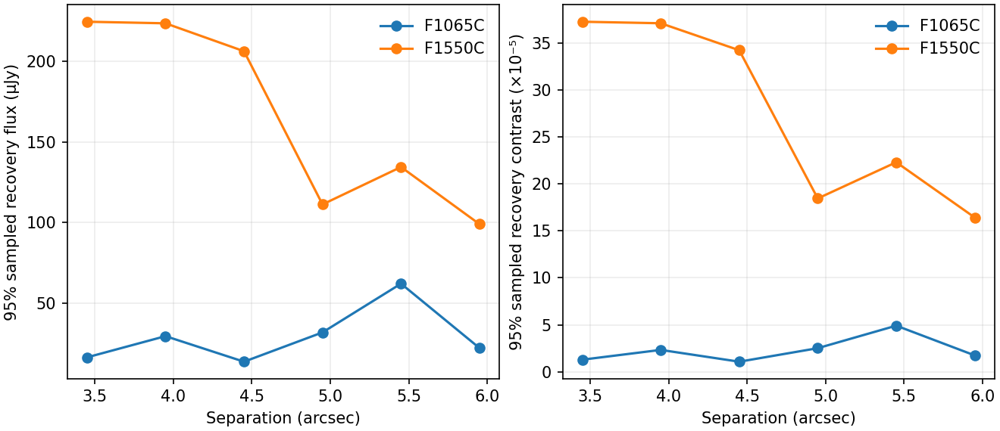

# MIRI coronagraphy of GJ 205 (HIP 25878)

The single blind F1065C source is a known field star. Its measured position is 5.44″ from GJ 205 at PA 47.7°. Gaia DR3 3209938199163908352 has a parallax of 1.140 mas, compared with 175.313 mas for GJ 205. Propagating both sources to the JWST epoch predicts a relative position within 0.051″ of the F1065C measurement. There were zero F1550C blind crossings. No additional companion was recovered in the examined, high-transmission portions of the two masks.

| Filter | Effective exposure | Usable area of 3.2–6.2″ annulus | Blind peaks | Conditional 95% recovery flux | Conditional 95% contrast |
|---|---:|---:|---:|---:|---:|
| F1065C | 1,800.236 s | 75.69% | 1 background star | 13.67–62.10 µJy | 1.08–4.92 × 10⁻⁵ |
| F1550C | 1,800.236 s | 72.32% | 0 | 99.02–224.63 µJy | 1.64–3.73 × 10⁻⁴ |

Ranges are across six measured radii (3.45–5.95″). The 95% recovery fraction is conditional on eligible angles in the well-transmitted sectors. The excluded quadrant seams and bad-pixel regions are outside the search. At 5.70 pc the searched separations correspond to approximately 18–35 au. No mass or orbit limits are inferred.



## Completed reduction

JWST program 9056 observed this star on 2025-09-21 and the associated observations became public on 2026-09-24. We started from six integration-resolved, calibrated stage-2 science planes per filter. Each band has a temporally adjacent nine-position small-grid-dither reference sequence on HD 39853 plus two dedicated backgrounds each for GJ 205 and the reference. In each band, the two background cubes were median-combined across all integrations and subtracted from their respective stellar data. The reference integration medians make a nine-image library. Positive linear combinations and a freely fitted constant model the host halo from 0.36–1.55″ after three robust fits. The reference basis uses the telescope's intentional subpixel dither diversity; no interpolation of its speckle patterns is applied. We median-combined the six science residuals, retaining pixels with at least three valid integrations. All images exclude DQ DO_NOT_USE/SATURATED values. Geometry and units are from the SCI headers. The archive products used pipeline 3.0.0 and jwst_1584.pmap.

**Photometry and transmission.** GO 1538 observed the flux standard HD 167060 off axis on each matching mask. Four independent dither images per band supply the empirical PSF, including detector sampling and the Lyot pupil. Two dithers define the matched filter and two supply held-out point-source injections. The CALSPEC hd167060_mod_006 SED synthesized through SVO F1065C and F1550C gives 37.6503 and 17.8197 mJy, respectively. Each measured template is divided by its corresponding total expected flux and by the relative focal-plane transmission at the standard's position; each trial then receives its local *relative* focal-plane transmission. No further Lyot-pupil efficiency multiplier is applied. Within 16 pixels of the standard, the observed flux divided by the CALSPEC value is 0.737–0.747 at F1065C and 0.664–0.682 at F1550C. These finite apertures provide a check on the normalization.

The two modeled detector-grid intensity-transmission maps come from a pinned spaceKLIP commit. We require transmission at the source center ≥0.90 and minimum transmission over a 5×5 region >0.85. A far off-axis measured PSF approximates the shape inside these sectors. Quadrant-edge distortions, template color and temporal differences, residual backgrounds and absolute calibration are systematic limitations. GJ 205 fluxes of 1.263 and 0.603 Jy use PHOENIX normalized to AllWISE W3. W3 is unsaturated and carries a halo flag. The independent Ks anchor gives 1.041–1.233 and 0.495–0.593 Jy. The flux-density curves are independent of these adopted host fluxes.

**Sensitivity.** Each field uses a matched filter with a local background term, a valid-support mask, one-sided Student-t-corrected Gaussian-equivalent 5σ thresholds from independent-beam-spaced samples in 0.5″ annuli, and a 5×5 peak rule. There are four symmetric negative peaks at F1065C and none at F1550C. These thresholds have no measured global false-positive probability. For each band, six radii × 48 angles × 11 fluxes give 3,168 evaluated trial locations/flux combinations. Each row records the eligibility of the angle. Trials in excluded sectors do not enter the conditional completeness denominator. A detected injection needs a new local peak within 1.5 pixels. The quoted 95% point is the lowest tested flux at which at least 95% of eligible angles are recovered at that and all brighter tested levels. Estimated PSF throughput includes subpixel position and local background/PSF-fit effects; the injected PSF support and the reference-fit region are disjoint. The script verifies the local shortcut by repeating a complete, pre-fit injection and image reduction in each filter. These are discrete angular trials, with existing noise fixed. No independent source Poisson draw or population interpretation is used.

## Source checks

The F1065C peak at zero-based (84,78) appears before reference subtraction, in both odd/even integration stacks, and after background and reference subtraction. The local score is 10.40, and the total-flux-calibrated template estimate is 89.85 µJy with an 8.55 µJy ring-noise scale. The matched amplitude in the original science cube at that location is 86.39 µJy. The reference and two sets of background exposures have no comparable positive source at the same detector coordinate. F1550C forced at the corresponding relative sky location gives 30.53 µJy with a 15.13 µJy ring-noise scale; the local detection statistic is 1.65. There is no independently significant two-band color. See the parent results for the archival Gaia/PS1 proper-motion and prior imaging checks. Boehle et al. (2019) already included GJ 205 in a combined imaging/RV companion search. https://arxiv.org/abs/1907.04334

## Inputs and replay

The two MAST receipts identify the public stage-3 association, constituent products and calibration data. The two input manifests pin the actual FITS bytes, two CALSPEC/SVO inputs per band and the appropriate throughput map with SHA-256. For the 28 GO 9056 inputs, the file service delivered a different FITS-block length from the associated MAST product-list size. Both the provider-listed and downloaded byte sizes are recorded; the downloaded files open as complete multi-extension FITS files. Their SCI/DQ arrays, filters, exposures, calibration version and content hashes were checked. A fresh revision of an archive product requires inspecting its calibration before reproducing these values.

From this directory, with the companion nircam directory alongside it and the same Python dependencies (including matplotlib for the plot), run:

```sh
python ../nircam/nircam_fetch.py --inputs inputs --manifest miri_inputs.csv
python ../nircam/nircam_fetch.py --inputs inputs --manifest miri_f1550_inputs.csv
python miri_reduce.py --inputs inputs --band F1065C --host-jy 1.263
python miri_reduce.py --inputs inputs --band F1550C --host-jy 0.603
python miri_source_checks.py --inputs inputs
python miri_plot.py
```

Per-band CSV files include blind positive peaks, thresholds, every angular injection and flux/contrast limits. The NPZ maps generated by the script include the residual, matched amplitudes, cutoffs, S/N and transmission for inspection. The source-check CSV includes per-exposure forced measurements at the Gaia field star.

## Limits and pending work

The single pointing in each filter tests resolved sources in a finite annulus. Distinguishing stationary and comoving objects relied on the earlier Gaia astrometry for the one detected source. Limits close to the phase-mask center, within the excluded sectors, at other separations and around other MIRI targets remain unmeasured in this reduction.

The source has 51 unstarred solar-C/O Sonora Bobcat atmosphere models across three metallicities matching F1065C within three local ring standard deviations if placed at the stellar distance. They predict F1550C fluxes of 169–493 µJy, well above the forced aperture’s 30.5 µJy measurement. The F1550C peak is below the detection threshold. In a 79.99″-radius Gaia field, one object other than the host is G ≤ 17. These finite colour and count checks supplement the much more discriminating Gaia motion test. Run `python field_color.py /path/to/bobcat.tar.gz` with the input pinned in the sibling MIRI calibration manifest. [Model grid](field_model_grid.csv) · [Colour and density check](field_color.json) · [Host flux scale](../stellar/hip25878/README.md)
