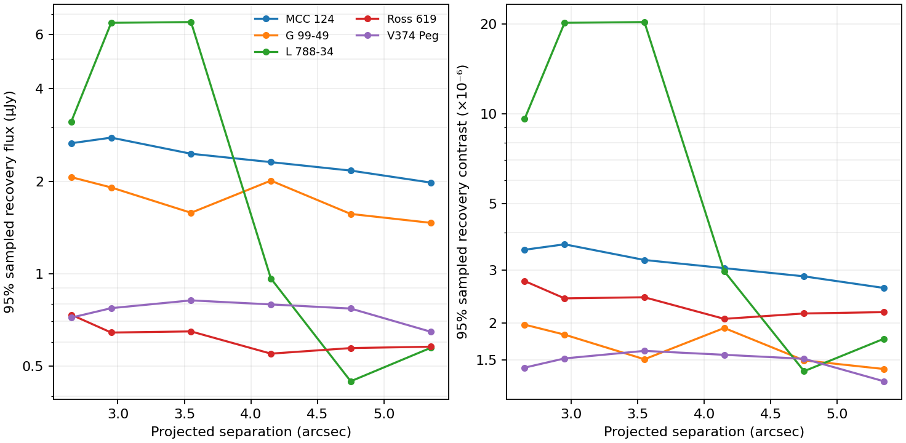
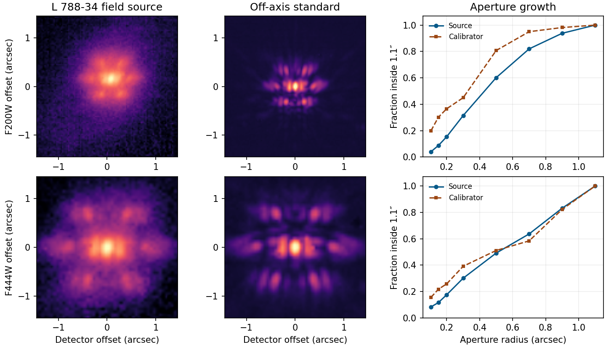

# JWST NIRCam F444W companion search

Five stars were searched from 2.5″ to 5.5″. Four public GO 8826 fields were observed on 2025-10-29 and released on 2026-10-29. MCC 124 was observed and released on 2025-05-15 in GO 5835. None of these fields contains a validated new companion in this analysis. The only source that survives an independent reference library is **extended in the L 788-34 field**. Its central peak and diffraction structure account for seven F444W threshold crossings. Independent archival checks find a Pan-STARRS DR2 counterpart (object 86863357822955473, 14 detections, 0.143″ from the JWST SIP position) and a 2014 VISTA Ks source at the fixed sky location. The object is a stationary, galaxy-like background source.

| Star | Integrations | Positive peaks | Result in the search annulus | 95% recovery, µJy | 95% recovery, combined-light contrast |
|---|---:|---:|---|---:|---:|
| G 99-49 | 8 | 0 | No positive crossing | 1.47–2.06 | 1.40–1.97 × 10⁻⁶ |
| L 788-34 (GJ 4274) | 8 | 7 | One extended source at 3.205″, PA 85.45° | 0.45–6.59 | 1.38–20.30 × 10⁻⁶ |
| Ross 619 | 8 | 2 | Reference-dependent peaks at 3.61″ and 4.11″ | 0.55–0.74 | 2.06–2.76 × 10⁻⁶ |
| V374 Peg | 8 | 0 | No positive crossing | 0.65–0.82 | 1.27–1.61 × 10⁻⁶ |
| MCC 124 (HIP 50156) | 7 | 0 | No positive crossing | 1.98–2.77 | 2.61–3.66 × 10⁻⁶ |

Ranges span six measured radii from 2.65″ to 5.35″. They are recovered fluxes on the tested grid, with no interpolation to other radii. The L 788-34 source raises the measured noise near its separation. The curves quantify the initial blind detection step. An additional reference-library or epoch confirmation requirement has a different, unmeasured completeness.



## Completed measurements

**Input verification.** Two manifests contain product URIs, SHA-256 hashes of the downloaded bytes, program targets, calibration roles and MAST release fields. For GO 8826 each long-wave target serves as the science observation in its own reduction and as a reference for the other three. The manifests share the off-axis F444W calibrator and transmission map. The query receipts include requests, service response hashes, matching observation rows, rights and products with byte sizes. The calibrated science inputs are stage-2 CALINTS, pipeline 3.0.0, CRDS jwst_1584.pmap. Detector-level ramps were not reprocessed.

**Reference subtraction.** In each detector frame, reject nonfinite SCI and DQ bits DO_NOT_USE and SATURATED. Fit a normalized median PSF and its two spatial derivatives plus a constant to each integration in the 0.45–0.95″ halo, clipping at four robust standard deviations for three fits. Identical subarray geometry places mask centers on the same detector pixels. Derivative terms allow first-order relative registration. This is an open classical RDI implementation using NumPy and SciPy. Use eight adjacent-in-time science stars from GO 5835 as MCC 124 references and the other three same-day GO 8826 science stars for each GO 8826 target. Median-combine the residuals and require at least four valid integrations per pixel. The 8826 exposures are 2,976.207 s each. MCC 124 has 2,604.181 s. The primary geometrical reference is the archive mask center. A subpixel occulted-star centering uncertainty remains. The adopted pixel scale is the geometric mean from the CD matrix. Local CD astrometry of the extended source is relative to that center.

**Detection.** Use G191-B2B from GO 1537, the same detector, F444W, MASK335R and subarray. Two off-axis dithers supply the matched-filter kernel and three held-out dithers supply the injected template. Normalize each dither within 30 detector pixels (1.87″). A local constant is fit simultaneously with the empirical kernel. Mask locations with insufficient valid PSF support or relative transmission below 0.95. About 99.55–99.58% of annular pixels pass. Estimate noise at beam-spaced locations in each 0.30″ annulus and apply a Student-t correction for a one-sided Gaussian-equivalent 5σ per-resolution-element threshold. Retain 5×5-pixel local maxima. Odd/even integration scores are diagnostics with shared instruments and references. Negative peaks pass the symmetric thresholds in several fields, showing that the nominal threshold has no measured survey-wide false-alarm probability.

**Injection and recovery.** Per target, 36 evenly spaced detector angles × 11 fluxes × 6 radii give 2,376 trials (11,880 total). Shift an independently measured off-axis PSF to the subpixel location, apply the relative mask map from a pinned spaceKLIP commit, and use the same kernel, bad-pixel support, blank-field noise thresholds and local-maximum test. Recovery needs a new peak within 1.5 pixels of the injected position. Pre-existing coincident peaks do not count. The truncated injected PSF does not touch the reference fit annulus. Adding the signal before RDI and median stacking is therefore exactly equivalent to adding the DQ-masked PSF locally in the median residual. Each run explicitly checks a complete pre-fit injection against the fast path. The highest absolute discrepancy among the five fields is below 10⁻⁸ in matched-filter units. The empirical fraction is discrete. The 95% value is the lowest tested flux level with at least 35/36 recoveries at that and every brighter tested level. The 36 angles are not independent draws from a population, and fluxes use the observed noise rather than an additional Poisson realization per injected source. These tests do not include all possible companion spectra or PSF variability.

**Flux scale.** Use SCI MJy/sr and the exposure's PIXAR_SR. The F444W calibration PSF has finite aperture, color and field dependence. It encloses about 98.3% as much signal within 25 pixels as within 30 pixels. The 0.974 minimum relative map transmission is in the searched annulus. The map uses the MASK335R geometry at F335M and the measured off-axis substrate level. W2-anchored PHOENIX stellar flux estimates are 1.047, 0.32484, 0.26697, 0.50918 and 0.758 Jy for G 99-49, L 788-34, Ross 619, V374 Peg and MCC 124, respectively. The flux-density sensitivities can be rescaled if better photometry becomes available. The host normalization includes unresolved components, including the known compact MCC 124 system.

## Vetted triggers

**L 788-34.** A compact central peak and off-axis PSF lobes initially trigger at seven pixels. One empirical F444W PSF fitted at (131.417, 221.408), zero-based, removes all seven *positive* crossings. Substantial negative residuals and excess extended light remain. The formal point-template flux is biased by this shape and is unsuitable as a total flux. Rerunning with nine archived 5835 reference stars recovers the central peak at a local score of 14.05. Direct SIP WCS places the center at ICRS (335.782384°, −17.612404°) at the JWST epoch, before external registration. In coeval F200W, 15.3% of the 1.1″ aperture flux lies inside 0.2″ versus 36.6% in the off-axis standard. In F444W the fractions are 17.5% and 25.8%. The F200W comparison is on the same NRCA2 detector, filter and round Lyot pupil but through the MASK210R off-axis field. The F444W comparison uses the same MASK335R as the science data. A broad, elongated component surrounds the central peak, especially at F200W.

The matched 0.9″ radius apertures give F200W = 83.84 µJy and F444W = 35.63 µJy, or F200W−F444W = −0.93 AB mag. A 1.1″ radius gives −0.80 mag. The 0.9″ blank-aperture robust scatters are 0.56 and 0.22 µJy, from overlapping controls at the same primary-star separation. Sky annulus 1.16–1.50″ around each aperture. The aperture dependence and different filter PSFs matter more than the formal background scatter here. The parent results report the independent astrometric checks and cool-companion model comparisons.



**Ross 619.** Two F444W local peaks reach 5.77 and 6.27 in the same-day reduction, with recovered point-template fluxes of 0.54 and 0.50 µJy. They drop to 1.31 and 3.08 (0.17 and 0.28 µJy) with nine independent GO 5835 reference stars. Coeval F200W small-aperture measurements are −0.81 and −2.54 local standard deviations. These are reference-dependent triggers. The results do not establish a companion or distinguish a physical faint signal from subtraction residuals. Second-epoch validation is outstanding for any claim that these are real.

## Files and reproducibility

Every field has a contrast CSV, all per-angle injection trials, a peak ledger (including headers when empty), radial noise statistics and summary JSON. The NPZ residual, matched amplitude, threshold and S/N planes are regenerated by the reduction. The trigger-check CSV reports results at every originally flagged location. For Ross 619, the one-source-subtraction columns repeat the primary result because no bright source was fitted in this field. The F200W small-core aperture values in that table are diagnostic only. The growth-curve table contains the measurements for extended-source color.

From this directory, with Python 3.12 or newer, install numpy, scipy, astropy and matplotlib. The run used Python 3.12.14, numpy 2.3.5, scipy 1.17.0, astropy 8.0.2 and matplotlib 3.10.8. Keep the two input directories separate.

```sh
python nircam_fetch.py --inputs inputs5835 --manifest mcc124_inputs.csv
python nircam_fetch.py --inputs inputs8826 --manifest go8826_inputs.csv
python nircam_reduce.py --field mcc124 --inputs inputs5835 --host-jy 0.758
python nircam_reduce.py --field g99_49 --inputs inputs8826 --host-jy 1.047
python nircam_reduce.py --field l788_34 --inputs inputs8826 --host-jy 0.32483977846125917
python nircam_reduce.py --field ross619 --inputs inputs8826 --host-jy 0.26697414579879847
python nircam_reduce.py --field v374peg --inputs inputs8826 --host-jy 0.5091775014389148
python nircam_check_sources.py --inputs inputs8826 --archival inputs5835
python nircam_morphology.py --inputs inputs8826
python nircam_plot.py
```

## Limits and pending work

The measurements cover one angle per field and the specified annulus, with relative photometry and empirical angular completeness. They do not cover the occulted core, objects below threshold, all public targets or all companion masses. Projected separations cannot establish orbits. The alternate RDI uses the same photons and is independent only in its reference stars. No astrometric or companion inference follows from comparing the two RDI results. Dedicated stellar-centering calibration, a wider reference/model grid, repeat wavelengths/rolls and a complete census of other programs remain open.
