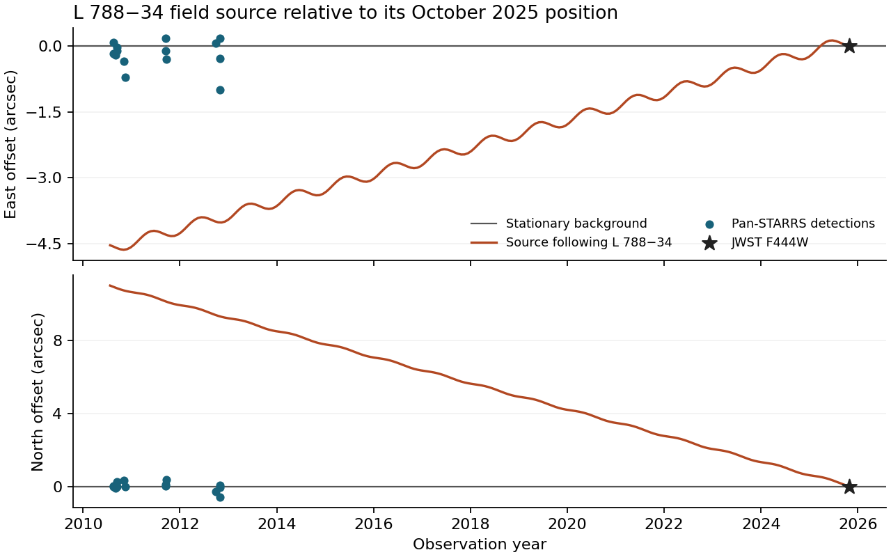

# Motion tests for the three repeatable field sources

The three repeatable sources are associated with previously catalogued background objects. The two weak Ross 619 peaks disappear with the independent reference library and have no astrometric identification. Dated optical measurements and the relative Gaia test provide the clearest discrimination for the three repeatable sources.

| JWST field | Independent archive evidence | Consequence |
|---|---|---|
| L 788−34 | Pan-STARRS DR2 object 86863357822955473 is 0.143″ from the F444W SIP position. Across its 14 detections on nine nights in 2010–2012, the median residual from fixed sky is 0.252″, versus 11.13″ if it followed the host. The 2014 VISTA Ks measurement at that fixed position is 6.61 times the same-radius control scatter. | Stationary extended source, consistent with a galaxy. Its individual galaxy type and redshift are unknown. |
| HIP 25878 / GJ 205 | Gaia DR3 3209938199163908352 has parallax 1.14 mas and proper motion (−4.09, −5.65) mas/yr. The host has parallax 175.31 mas and proper motion (+761.63, −2092.21) mas/yr. Propagating both gives a relative separation vector (+4.044, +3.706)″ at the JWST epoch, 0.051″ from the measured vector. The source also has 57 PS1 detections. | Background star. The relative fit accounts for proper motion and parallax; the unregistered absolute MIRI WCS has a larger residual. |
| G29−38 | PS1 DR2 object 114293521937476539 lies 0.082″ from the F2100W position and Legacy Surveys DR10 puts a source 0.064″ away. Three earlier PS1 detections in 2012–2014 have a median 0.246″ fixed-sky residual and 5.54″ host-motion residual. Gaia-registered Spitzer 4.5 µm pixels from 2004 and 2009 put the source within 0.070″ and 0.055″ of its 2025 position; the host-relative predictions are 10.00″ and 7.83″ away. | Previously catalogued stationary field source. Its optical and infrared matches distinguish it from a companion to the moving white dwarf. |

[PS1 detections for L 788−34](ps1_motion.csv) · [GJ 205 and G29−38 dated PS1 detections](other_ps1_epochs.csv) · [Gaia and Legacy Surveys measurements](field_identifications.json)



## Additional checks and limitations

- The two very short-period RV planets of GJ 4274 (L 788−34) have semimajor axes of 0.0153 and 0.186 au. The JWST source is 3.20″ from the host, about 23 au in projection if at the stellar distance. It is also resolved in both JWST bands. The observed 0.9″-aperture colour is −0.93 AB mag. At the host distance, solar-C/O Sonora Bobcat models in the measured F444W brightness range have F200W−F444W of +11.3 to +18.0 mag. The JADES GOODS-S control field contains 45 catalogued galaxies with similar colours and F444W ≥20 µJy in 61.5 arcmin². [Colour grid and control counts](background/README.md)
- VISTA/VIRCAM's 2014 Ks and J tiles have fixed-position aperture fluxes above same-host-radius controls (6.61 and 4.03 MAD-derived scatters). The host-relative position lies deeper in the stellar halo. The local scatters include diffraction structure, and the controls overlap; these scores are not Gaussian false-alarm probabilities. In the 1997 HST/NICMOS data the stationary position falls outside the image. Detector flags limit the fixed host-offset aperture, and the usable F180M measurement is consistent with zero. [Both loci in every image](historical_loci.csv)
- For the L 788−34 and Ross 619 fields, every initial F444W peak has an optical catalogue crossmatch and the two reference-library scores. A nearest entry outside a positional error circle is recorded as a distance, without assigning it as a counterpart. [Gaia and SIMBAD cones](catalogue_matches.csv) · [PS1 and Legacy DR10 cones](historical_catalog_matches.csv) · [NIRCam per-peak diagnostics](../nircam/nircam_trigger_checks.csv)
- The track used for a companion keeps its instantaneous angular offset from its host fixed. It includes linear proper motion and annual parallax using the geocentric observer approximation. Orbital and perspective terms are omitted. The identification of each field source rests on its archival positional match and other evidence specific to that source. Finite catalogues have magnitude and colour selection limits. PS1 residual summaries include all indexed detections, including lower-quality individual measurements.

## Reproduction

Use Python, NumPy, SciPy, Astropy and Matplotlib. The frozen bytes and URI for the released survey images and full Tractor bricks appear in the manifests. The `--refresh` options update live catalogue responses; ordinary replay uses the archived data or validates fetched files against their digest.

```sh
python archival_images.py /tmp/hci-archives /tmp/archival-results
python motion.py
python other_tracks.py /tmp/hci-tracks
python field_catalogs.py
python plot_motion.py
```

[HST, ESO, Pan-STARRS and Tractor input manifest](archive_inputs.json) · [GJ 205 and G29−38 manifest](other_archive_inputs.json) · [PS1 detection query and digest](catalogs/ps1_query.json)

[Spitzer pixels for G29−38](../g29/spitzer/README.md) · [Limits of the Spitzer motion test for L 788−34](spitzer/README.md)
