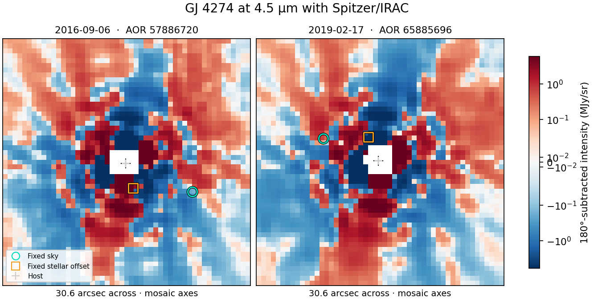

# GJ 4274 at the two Spitzer epochs

Two earlier Spitzer/IRAC channel 2 mosaics cover the source location supplied from JWST. **Neither image distinguishes motion with GJ 4274 from a fixed background source at the reported F444W brightness of about 25 µJy.** The nearest test positions in the two hypotheses are separated by several arcseconds, but the stellar halo limits the photometry at each. IRAC2 and F444W have different bandpasses.

| UTC date | AOR | Fixed-sky separation from the star | Fixed-sky flux / azimuthal scatter | Fixed stellar-offset flux / scatter |
|---|---:|---:|---:|---:|
| 2016-09-06 | 57886720 | 8.97″ | −44 / 207 µJy | +2,392 / 4,712 µJy |
| 2019-02-17 | 65885696 | 7.30″ | −29 / 264 µJy | −876 / 5,131 µJy |

The displayed estimator subtracts the image reflected about the fitted stellar centroid, then fits a local plane and empirical PSF to the fixed position. Flux is normalized inside a 6″ aperture and is signed. Scatter is 1.4826 times the median absolute deviation of control fits at the same radius. Opposite trial angles share pixels. These values describe the systematics across the annulus and do not define Gaussian errors or formal upper limits. The 2016 and 2019 native-image fits with a quadratic local background returned +176 and −316 µJy at the fixed sky location, with scatter of 114 and 326 µJy. At the fixed stellar offset, those fits gave +311 and −2,491 µJy, with scatter of 3,479 and 1,724 µJy. A 25 µJy injection using a field-star PSF held out of the fitting template shifted the fitted flux by 22–25 µJy in all eight fits. That linear response is well below the empirical scatter.



The [IRSA query and input hashes](spitzer-receipt.json) identify the executed PIDs 11161 and 14018. The post-BCD science mosaics have 0.6″ pixels and units of MJy/sr. The host cores have missing pixels. The fit centers the star from its unsaturated wings, obtaining shifts of 0.41 and 0.56 pixel relative to the linear proper-motion prediction. The empirical PSF uses the surrounding field, with one reference withheld for the injection. The [complete numerical results](forced-photometry.json) include template-star pixels, fitted centers, pixel counts and control fluxes.

An additional two-epoch subtraction uses the opposite Spitzer visit as the stellar PSF, matched in detector-oriented mosaic coordinates. A Gaia DR3 field registration uses 62 and 70 unsaturated sources. The jointly fit stationary-position flux is +97 µJy with a local plane, compared to a control median of +24 µJy and robust scatter of 21 µJy. A local quadratic gives +103 µJy, control median +10 µJy and scatter 30 µJy. The strongest individual-lobe fits in a ±1.2″ scan fall 0.45″ north in 2016 and 0.60″ west, 0.45″ north in 2019. The co-moving fit is within one robust scatter of controls in both variants. This marginal fixed-sky residual has centroids that differ between visits, exceeds the JWST flux, and draws on few independent angular controls. The Spitzer data alone do not establish an identification or permit a source-motion measurement. [Paired-epoch fits](paired-results.json)

The fixed-sky hypothesis uses the MAST 2025 JWST pointing (335.781477°, −17.612468°), offset by 3.18″ east and 0.22″ north. The fixed stellar-offset test applies that offset relative to the historical stellar centroid. We seed the centroid using SIMBAD proper motion (+308.712, −718.387 mas/yr). Orbital motion, parallax at Spitzer, are unmodeled in the single-epoch fits. With no significant source available for an earlier-epoch centroid, a common-proper-motion likelihood is unavailable.

Before JWST, the Palomar 8 pc survey included this primary as **8pc 134.40** (table 1). The CAESAR study explicitly lists **LHS 3799** among the 12 targets with companion constraints. Their table lists 118 CTIO V-band observations during 2003.52–2012.70. The known SPIRou RV planets b and c are interior to this separation. These sources establish previous target searches. The identity of the 3.19″ source is unresolved. [Oppenheimer et al. 2001](https://doi.org/10.1086/319941) · [CAESAR 2015](https://doi.org/10.1088/0004-6256/149/3/106) · [Charpentier et al. 2026](https://doi.org/10.1051/0004-6361/202557666)

```sh
python spitzer_inputs.py /tmp/gj4274-irac2
python measure_l788.py /tmp/gj4274-irac2
python cutouts.py /tmp/gj4274-irac2
python paired_epochs.py /tmp/gj4274-irac2
```

The first script uses the Python standard library. The reduction requires Astropy, SciPy and NumPy. The plotting script also requires Matplotlib.
