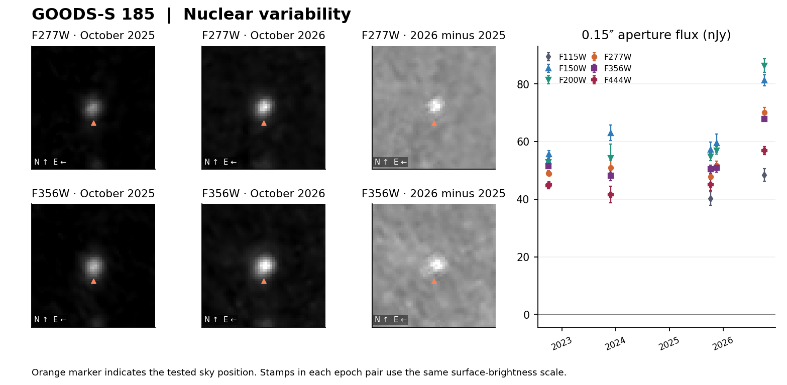
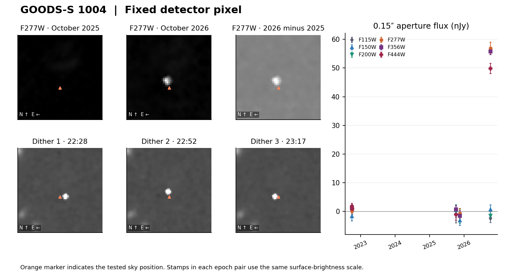

# GOODS-S · the October 2026 repeat

**One nuclear brightening merits further follow-up.** At (53.188672°, −27.812554°), site **185** coincides within 0.005″ with JADES DR2 galaxy 103607. Independent F277W measurements in a 0.15″-radius aperture cluster around 49–52 nJy between 2022 and late 2025. The October 2026 measurement is 70.07 ± 1.81 nJy. The annual difference is positive and centrally concentrated in five filters. An AGN fluctuation and a transient projected on the nucleus remain viable. No classification spectrum or transient redshift is established here. A second, weaker nuclear variation carries substantial dither scatter. Neither site demonstrates a redshift above five.



## Observations and measurements

Two public GOODS-S pointings from programs [8060](https://www.stsci.edu/jwst-program-info/program/?program=8060) and [12577](https://www.stsci.edu/jwst-program-info/program/?program=12577) cover October 6, 2025 and October 9–10, 2026 in F115W, F150W, F200W, F277W, F356W and F444W. The UTC times of individual filters differ. Program 8060 also supplies November 18 and December 31, 2025 visits in four filters where coverage overlaps. Additional measurements use eligible public products from the 2022 JADES observations and subsequent follow-up. Each [historical measurement](history_forced_lightcurves.csv) retains its program, observation, filter, UTC and error. Programs 1180 and 6541 supply measurements at retained positions. Archive keys for the historical query are [listed here](historical_index.csv).

Flux timestamps identify the beginning of the corresponding filter observation. The two October 2026 dates span an overnight observation and a second pointing. The primary catalog comparison registers each year and pointing using stationary sources. The twelve filter-pointing pairs contain **20,568 mutual source associations**, counting each filter separately. Median post-registration radial residuals are about 0.01″. The search uses aperture-corrected pipeline fluxes from 40 public catalogs, including the two supplementary epochs. A magnitude-dependent empirical scatter rescales the catalog errors. The primary annual screen retains candidates with at least two filters showing the same sign, at least 5 empirical standard deviations, a change above 16% of the brighter epoch, and at least one excursion at 7 standard deviations. It returns 30 groups. A separate two-band search for a compact source appearing or disappearing between catalogs finds 64 groups before image coverage and morphology checks. [Catalog statistics](catalog_stats.csv) · [Catalog nominations](multiband.csv) · [Onset nominations](onsets.csv)

Independent fixed-position photometry samples SCI on a 0.03″ common tangent grid with a 0.15″ aperture and 0.27–0.42″ sky annulus. Errors are robust scatters of nearby displaced apertures. These include local background structure, but do not propagate source Poisson noise, relative calibration or PSF systematics. The image-level morphology test requires a same-sign residual in at least two filters, absolute local significance ≥5, peak displacement ≤0.10″, Gaussian core correlation ≥0.65 and negative/positive residual ratio <0.65. It leaves five persistent-source sites and one separate apparent onset. [All 2025–26 forced measurements](forced_lightcurves.csv) · [Image checks](image_checks.csv) · [Independent dithers](dither_fluxes.csv)

## Dispositions

| Site | Position (J2000 degrees) | JADES DR2 host photo-z, 68% interval | F277W annual aperture change, nJy | Disposition |
|---|---|---|---:|---|
| 185 | 53.188672, −27.812554 | 2.47 [1.907, 2.514] | +22.25 ± 1.15 | Unclassified nuclear brightening. Centroids remain consistent within dithers. No positional match to transient lists or AGN catalogs checked. |
| 525 | 53.149880, −27.787521 | 0.05 [0.032, 0.062] | −36.98 ± 1.40 | Lower-confidence nuclear variation. It passes the image check in F150W/F277W only. The October 2026 F277W individual measurements are 176.8, 183.5 and 216.4 nJy, against 208.2–212.6 in 2025. One new exposure is consistent with the old flux. The host fit has minimum χ² ≈37. A variable foreground source or measurement systematic is open. |
| 93 | 53.195389, −27.779357 | 2.95 [2.921, 3.218] | −44.31 ± 2.48 | Previously flagged by the observing program as `trans` target 2510042, 0.074″ away. Independently recovered. |
| 99 | 53.155913, −27.822297 | 0.67 [0.621, 0.745] | −81.03 ± 1.68 | Previously flagged as `trans` target 2510062, 0.067″ away. Fading is present in all six filters and in three F277W dithers per year. |
| 829 | 53.152985, −27.735207 | 0.71 [0.592, 0.747] | −1010.80 ± 3.99 | Known AGN. Lyu et al. ID 37256 is 0.07″ away, Chandra M691 is 0.27″ away and the 3D-HST counterpart has spectroscopic redshift 0.665. |

For site 185, October F277W dither medians are 50.6 nJy in 2025 and 71.5 nJy in 2026, from two valid independent exposures per year. F356W gives 52.7 nJy in one valid earlier exposure and 68.6 nJy in two later exposures. Independent native SCI/DQ checks find peak DQ=0 in all twelve F277W/F356W exposures at 185 (three dithers per filter per year). A second check in the narrower 2.5-pixel aperture finds peak DQ=0 in all seven individually photometered F277W/F356W exposures at 185. Some surrounding pixels carry flags. None of the five nuclear sites meets the repeated flagged-pixel rejection. Nearby objects in each exposure provide astrometric controls. Within-year source centroid excursions relative to control medians are below 0.02″ per axis in these bands. The nearest explicitly transient-labelled program target is 5.42″ away. The nearest entry in the 305,064-row Fink TNS mirror is 71.29″ away. Neither catalog establishes that the object is unreported everywhere. [Native pixel checks](nuclear_native_checks.csv) · [Aperture DQ counts](nuclear_dq_apertures.csv) · [Dither astrometry in 2025](astrometry-185-8060.csv) · [Dither astrometry in 2026](astrometry-185-12577.csv) · [Program-target matches](apt_nearest.csv) · [Catalog matches](nearest_reference.csv)

At the nearest galaxy's photometric redshift the annual F277W difference for site 185 corresponds to an **aperture-based absolute difference magnitude of −17.18**, with envelope [−17.27, −16.64], at rest wavelength ≈0.80 µm. For site 525 the corresponding value is −9.27 [−9.79, −8.25] at ≈2.64 µm. The calculation uses Planck18 and the exact observer filter shifted to rest frame, with \(M_\Delta=m_{|\Delta f|}-DM(z)+2.5\log_{10}(1+z)\). The envelope combines the host's 68% endpoints and one local flux-scatter unit at their extremes. It is conditional on host association and does not include a point-source aperture correction, extinction or a fitted peak. [All candidate parameters](nuclear_candidates.csv) · [Nearest three galaxies and redshift intervals](host_neighbors.csv) · [3D-HST comparison](3dhst_redshifts.csv)

## A false three-filter dropout

Site 1004 appears at (53.214163°, −27.769795°) in three long-wave filters. The October 2025 F277W and F356W apertures give 0.62 ± 1.43 and 0.68 ± 1.33 nJy. The October 2026 values are 56.88 ± 2.11 and 55.79 ± 1.09 nJy, with difference significances of 30 and 38. The corrected exposure positions move with the telescope dither. Every one of the nine F277W/F356W/F444W CAL exposures peaks at **NRCALONG native pixel (434, 343)**, zero-based. Eight exposures set DQ bit 4 (`JUMP_DET`) at this pixel, and the ninth sets bit 2 (`SATURATED`). In the eight nonsaturated exposures 96–99% of the local background-subtracted 3×3 flux lies in that one pixel. This rejects the source as a fixed detector artifact. Neighboring stars have typical per-axis astrometric offsets of order 0.01″. A two-pass JPL small-body identification query centered on this position, using a Horizons JWST geocentric state vector and 1′ half-width on October 10 at 00:00 UTC, returned no known object. The detector test is decisive. [Native pixels and DQ](onset_detector.csv) · [Individual exposures and stars](onset_dither_astrometry.csv) · [Light curve](follow_forced_lightcurves.csv) · [JPL response](known_moving_objects.json)



## Blind image search and injection recovery

A separate blind test uses the same fixed 1,536 × 1,536-pixel interior crop in pointing 1 in F277W and F356W, chosen from the mosaic geometry before detecting sources. SCI and ERR are read by byte range; the reference is bilinearly resampled onto the newer WCS. The existing repository subtraction engine then estimates residual registration and empirical compact-source PSFs, cross-convolves, measures a local noise correction and applies the two-sided 7σ search and morphology screen. The measured solid angles after masking are 2.335 and 2.331 arcmin², respectively; the areas overlap. On-sky injections use independent random subpixel positions and both signs on the actual measured background, with the fitted registration and PSFs held fixed. Depth is for the single-band image trigger. The catalog, second-filter, native-pixel and classification steps have additional selection losses.

| Filter | Morphology-selected peaks | Recovery at 27.0 AB | Recovery at 27.5 AB | Recovery at 28.0 AB |
|---|---:|---:|---:|---:|
| F277W | 105 of 148 | 284/294 (96.6%) | 212/294 (72.1%) | 9/294 (3.1%) |
| F356W | 80 of 103 | 317/324 (97.8%) | 246/324 (75.9%) | 21/324 (6.5%) |

Of 31 same-sign coincidences within 0.12″, 28 have one fixed flagged native detector pixel, concentrated in a 3×3 patch, in both filters and two or more dithers. Of the three remaining fades, site 2010 matches published Chandra/Lyu/SMILES AGN positions (nearest 0.053″), site 2028 matches JADES team `trans` target 2510042 (0.026″), and 2027 sits on a resolved source with a dipolar residual and fails the independent point-source morphology test in both filters. The fixed-area search yielded **zero previously unreported, validated point-source transients**. The catalog comparison extends over both pointings and has different selection and depth. [Areas](blind_area.csv) · [Both-sign recovery and Wilson intervals](blind_recovery.csv) · [Coincidences](blind_pairs.csv) · [Pixel rejections](blind_fixed_pixels.csv) · [Three remaining sites](blind_image_checks.csv)

## Audit and reproduction

Use Python with NumPy, pandas, SciPy, Astropy, sep, lxml and Matplotlib. Run from this directory with writable scratch space. The two `acquire.py` calls download approximately 105 MB of public catalog inputs. The image steps use verified HTTP byte ranges from the STScI public AWS mirror. Their SCI and ERR files are large in full and need not be downloaded in full. `blind.py` requires the parent directory's existing `screen.py`. Public snapshot updates can change input hashes.

```sh
python acquire.py 8060
python acquire.py 12577
python catalog_screen.py
python onsets.py
python get_stamps.py
python get_onsets.py
python measure.py
python measure.py --onsets
python follow_onset.py
python measure.py --follow
python historical.py
python measure.py --history
python individual.py
python motion_dithers.py
python detector.py
python moving.py
python dither_stamps.py
python blind.py 1 277 west
python blind.py 1 356 west
python blind_summary.py
python blind_native.py
python follow_onset.py --blind
python measure.py --blind
python hostcat.py
python hosts.py
python comparison_sources.py
python known.py
python apt_targets.py
python nuclear.py
python blind_native.py --nuclear
python native_apertures.py
python figures.py
```

Run `python motion_dithers.py SITE PID` for site 185 or 99 and PID 8060 or 12577 to reproduce those detailed exposure comparisons. Data hashes and URLs are in [8060 inputs](8060_manifest.csv), [12577 inputs](12577_manifest.csv), [host catalog ranges](host_input_ranges.csv), [comparison catalogs](comparison_inputs.csv), [APT projects](apt_inputs.csv) and [Fink receipt](fink_receipt.json). The snapshot includes the GOODS subset used for matching. Direct TNS catalog access returned HTTP 403; the time-limited empty Transients.fyi response and Fink mirrors have independent coverage limitations. Published comparisons include [DeCoursey et al.](https://arxiv.org/abs/2406.05060), [Luo et al.](https://vizier.cfa.harvard.edu/viz-bin/VizieR?-source=J/ApJS/228/2), [Lyu et al. 2022](https://arxiv.org/abs/2209.06219), [Lyu et al. 2024](https://vizier.cfa.harvard.edu/viz-bin/VizieR?-source=J/ApJ/966/229), [Pouliasis et al.](https://doi.org/10.1093/mnras/stz1483), Gaia DR3 and [JADES](https://archive.stsci.edu/hlsp/jades). Source positions alone do not distinguish SN from AGN. Gaps between visits, host surface brightness, correlated drizzle errors and a few usable dithers limit inference from these retrospective data.


### Additional checks at site 185

At each of the three October 9–10 filter-pair start times, NASA/JPL's two-pass small-body identification search returned no cataloged object within a 1′ half-width box about site 185, using the JWST state from Horizons. These are checks of known orbits. The detector and sky-centroid tests separately establish the repeatability of the change. [First lookup](goods185_jpl_1.json) · [Second lookup](goods185_jpl_2.json) · [Third lookup](goods185_jpl_3.json)

The closest JADES/DAWN NIRSpec target, galaxy 103483, is 1.529″ away. Its secure z = 5.2509 belongs to that separate galaxy. The closer 3D-HST entry has a photometric estimate only. The five archive checks found no secure spectroscopic redshift for the nucleus. [Nuclear spectroscopy, separations and receipts](nucleus-check/README.md)
