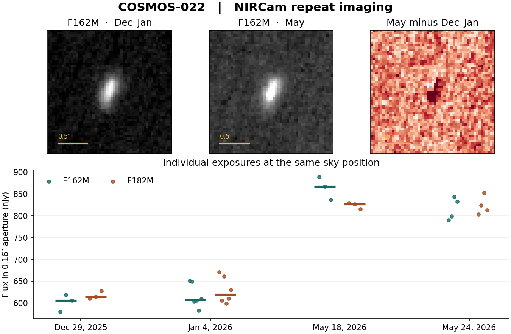

# A multi-epoch COSMOS brightening and the repeat-catalog search

**COSMOS-022** brightened at J2000 **150.122033°, +2.323386°** between the December 2025–January 2026 and May 2026 MINERVA visits. Its position is 0.015″ from galaxy COSMOS2020 Classic 953994. The galaxy has a spectroscopic redshift of **0.5067** in the COSMOS Spec-Z Compilation. Its LePhare and EAZY photometric estimates are 0.529 [0.507, 0.549] and 0.513 [0.503, 0.523], respectively (68% intervals). The flux increase repeats across individual exposures on both May dates. Nuclear AGN variability and an unresolved transient on the host remain viable.



| Filter | December 29 / January 4 individual apertures | May 18 / May 24 individual apertures | Difference between visits from the mosaics |
|---|---:|---:|---:|
| F162M | 606.4 nJy median (580.1–651.2) | 836.9 nJy median (790.5–888.6) | +236.2 ± 18.2 nJy |
| F182M | 614.7 nJy median (599.6–671.1) | 824.4 nJy median (803.2–853.0) | +212.1 ± 18.1 nJy |

The single-exposure I2D check has nine earlier and seven valid later apertures in each filter. A separate native CAL check includes eight late exposures. Dropping every exposure with a DO_NOT_USE bit in its 0.16″ core retains six earlier and four later measurements per band, with disjoint flux ranges. The ranges span individual 0.16″-radius aperture measurements. The errors on the mosaic differences include the local displaced-aperture scatter and a 2.5% floor. Different detector sets cover the earlier and later visits. All eight matched medium-filter catalog fluxes increased. The nearest entry in both the published 68-source COSMOS-Web sample and the Fink TNS snapshot is AT 2023aeaw, 12.14″ away. The nearest Chandra COSMOS-Legacy source is 41.25″ away. At the host spectroscopic redshift, the F162M increment corresponds to an absolute difference magnitude of −16.45 (flux-only envelope −16.53 to −16.36) at rest wavelength approximately 1.08 µm. This quantity uses the measured fixed-aperture change and includes no total-flux or peak-time correction. No listed counterpart establishes an earlier report of this brightening. [Daily individual measurements](cosmos022_daily.csv) · [Matched-filter catalog light curves](matched_photometry.csv) · [Host-conditioned absolute difference magnitude](cosmos022_host_magnitude.json)

## Search population and falsification

The new frozen sample covers COSMOS-Web, COSMOS-3D, PRIMER, MINERVA, CEERS, Abell 370, WHL0137 and MACS J0138. Its 69 distinct STScI source catalogs contain 317,286 input rows. Ten visit comparisons in 37 matched filter pairs yielded 47,584 eligible source/filter comparisons. These counts include repeat measurements of the same objects. The table requires positive catalog flux in both epochs. First appearances and disappearances fall outside it. A separate blind image experiment in GOODS-S tests that class. [Pairs](pairs.csv) · [Dates and measured exposure intervals](observing_intervals.csv) · [Frozen input hashes](catalog_inputs.csv) · [Counts by filter](screen_counts.csv)

The two-sided catalog selection produced 463 single-filter triggers and 42 same-sign multi-filter groups. We measured the original SCI images for every trigger and triggering filter, giving 100 position/filter checks. Fourteen groups repeat at ≥5 times the empirical error in two or more filters at both 0.16″ and 0.28″ radii. Seven of those have nearby objects with stellar SED classifications in COSMOS2020. The image checks retain resampling correlations in the noise estimate, but unresolved host gradients, spatially varying PSF, saturation and visit-dependent coverage can still affect a mosaic. The separate individual-exposure checks directly test several of these effects. [All 42 dispositions](dispositions.csv) · [Fixed-aperture measurements](pixel_apertures.csv) · [Local comparison sources](local_controls.csv) · [Centroid and opposite-sign residual checks](morphology.csv)

- **Abell 370.** A four-filter brightening coincides to 0.079″ with the ALMA position of the known broad-absorption-line quasar L1 of SMM J02399−0136. MUSE spectroscopy independently gives z = 2.798 at 0.073″. The source was already bright in 2024. Older exposures also have saturated cores. [51 public product checks, 64 individual exposures and published identifications](a370-long-003/README.md)
- **CEERS.** An apparent six-day increase in F140M and F210M came from one early dither in which a detector edge cuts the galaxy core. Independent early exposures agree with the late fluxes. [CEERS and COSMOS individual exposure reports](exposure-followup/README.md)
- **COSMOS.** COSMOS-009 has a stellar HST counterpart and a 0.335″ long-baseline shift relative to nearby galaxies. Matched-detector exposures remove the apparent two-band fading. Separate exposure tests at 007, 010, 012 and 014 also fail to reproduce the large catalog amplitudes. COSMOS-008 has a nominal LePhare galaxy-template redshift near 5.06, but the catalog classifies the source as stellar, and its two-aperture test fails. [Constituent exposure fluxes](individual_apertures.csv) · [Host and Gaia neighbors](host_neighbors.csv)

## Counterpart coverage

We compared all 42 groups against the Fink TNS resolver snapshot (305,064 records), the rolling one-year Transients.fyi TNS feed, 20,312 coordinate records from 38 Kyoto 2026 TNS pages, the 68 COSMOS-Web transient positions of Coulter et al., and the 104 event identifiers in the Abell 370 Dragon arc catalog. The explicit guest request for the official TNS ZIP returned HTTP 403. A missing entry in these snapshots leaves open unpublished identifications and gaps in the mirrors. For COSMOS we also checked the 677-source VST-COSMOS AGN catalog and the observed part of the Chandra COSMOS-Legacy field. The 3D-HST queries record whether VizieR returned a table. [Nearest reported positions](nearest_reports.csv) · [Catalog receipts](comparison_receipts.json) · [Historical and AGN neighbors](archival_neighbors.csv) · [Archive lookup status](archival_receipts.json)

## Reproduction

The original [48-catalog checkpoint](../repeat-catalogs/README.md) remains separately replayable. Install NumPy, pandas, SciPy, Astropy, lxml and Matplotlib. From this directory use empty cache directories for a fresh replay. The first command verifies raw catalog bytes and source counts against this campaign's frozen receipt. Archive changes appear as hash mismatches.

```sh
python campaign.py /path/to/catalog-cache
python intervals.py /path/to/comparison-cache
python registry_mirror.py
python counterparts.py /path/to/comparison-cache
python hosts.py /path/to/comparison-cache
python archival_classes.py /path/to/comparison-cache
python local_controls.py /path/to/catalog-cache
python pixel_check.py /path/to/stamp-cache
python morphology.py /path/to/stamp-cache
python exposure_flux.py
python exposure_flux.py --bright-source
python candidate_photometry.py
python dispositions.py
python figure_cosmos022.py /path/to/stamp-cache
```

The sky-position and literature checks use dated external snapshots. Their receipt tables identify the exact bytes for this run. The per-band search does not assign a blind limiting magnitude or transient rate to this catalog-selected population. The independently injected GOODS-S, NEXUS and MACS0416 experiments supply the measured depths for their own selection functions.
