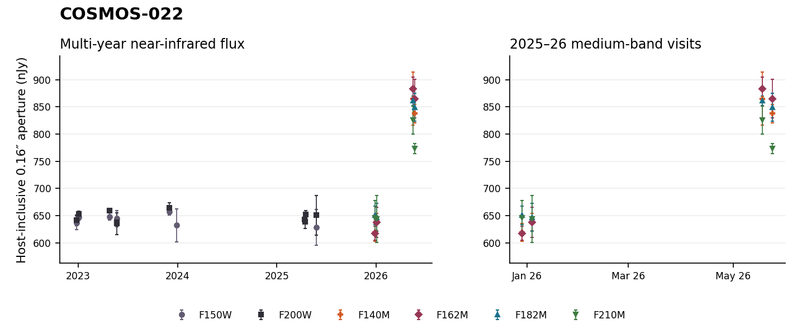

# COSMOS-022, time coverage back to 2022

**COSMOS-022 was already present at approximately its lower near-infrared flux through early January 2026. It was brighter in all eight matched medium bands in May.** The sky position is (150.122033°, +2.323386208°). The high-state measurements span six observer days. The January 4 to May 18 observing gap is 134 days. There is no measured decay back to baseline in this NIRCam census.

The exact-position ESA JWST ObsCore query returned 361 NIRCam exposure-level and 71 mosaic-level observations. The measurements below use calibrated uncombined exposures (`i2d`) for UTC-night photometry and the public event-search mosaics for filter-by-filter consistency. The mosaic start and end dates may span visits; only the individual exposures establish when this position was observed. The independently queried MAST 0.001° cone returns 79 public NIRCam observation records. Neither inventory contained an August–November 2026 NIRCam exposure at this position. MAST also lists contemporaneous MIRI F770W and F1500W products from program 9400 marked `EXCLUSIVE_ACCESS`. The earlier public MIRI data do not supply this high-state color. The HST 2022+ cone ends in 2024. [ESA L2 inventory](level2.csv) · [ESA L3 inventory](level3.csv) · [MAST NIRCam](mast_cone.csv) · [MAST MIRI](miri_fields.csv)

## Flux and cadence

| UTC day | F162M median flux (nJy) | Dithers | F182M median flux (nJy) | Dithers |
|---|---:|---:|---:|---:|
| 2025-12-29 | 617.8 | 3 | 650.8 | 3 |
| 2026-01-04 | 637.7 | 6 | 646.7 | 6 |
| 2026-05-18 | 883.6 | 3 | 861.4 | 3 |
| 2026-05-24 | 865.1 | 3 | 849.2 | 3 |

All eight matched-filter changes have the same sign. The 0.16″ aperture change is largest in F162M (+228 nJy), with comparable changes in F140M (+214 nJy) and F182M (+199 nJy), and smaller changes in F210M (+147 nJy), F250M (+112 nJy), F300M (+126 nJy), F360M (+105 nJy) and F460M (+64 nJy). The different filters have different PSFs and aperture fractions. Absolute comparisons do not include a color-dependent aperture correction. Agreement in the 0.28″ and recentered apertures is also available for each exposure. These host-inclusive data do not uniquely classify the variable component as an SN, AGN flare or TDE. [Nightly medians and scatter](nightly.csv) · [Eight-band changes](medium_changes.csv)

From 2022-12-26 through May 2025, the same-filter nightly broad-band medians were F150W 629–658 nJy on 7 UTC nights, F200W 636–665 nJy on 10 UTC nights, F277W 559–584 nJy on 8 UTC nights and F356W 357–385 nJy on 10 UTC nights. These measurements establish that the galaxy already had substantial near-infrared flux. Broad and medium filters probe different bandpasses. The rise amplitude comes from the eight same-filter pairs.

## Methods and limitations

The source-centered 0.025″ tangent-plane grid samples native SCI values in MJy/sr through each file's celestial WCS. The fixed circular aperture radius is 0.16″, with a 0.36–0.64″ background annulus, and uses the projected sky pixel area to convert to nJy. At least 99% of the aperture and 95% of the background annulus must contain finite pixels. The code also measures a recentered 0.16″ aperture, a 0.28″ aperture, the position of an inner centroid, and empirical local blank-aperture scatter. The latter is a background measure; the nightly dither scatter additionally captures local repeatability. The nominal error on a galaxy includes source noise and relative PSF calibration as well. A missing exposure, including a detector gap, gives no flux measurement. Both filtered associations and non-measurements are retained, with the reason and SHA-256 of successful byte ranges.

The final census yields 344 exposure measurements and 55 mosaic measurements. Different MAST and ESA observation grouping and footprint conventions lead to different inventory sizes. The earlier `individual_apertures.csv` campaign used a fractional aperture and a different sky annulus, so absolute fluxes differ slightly. This broader census uses one photometry prescription across all returned NIRCam filters and groups exposure products by the original time and optical filter, without treating a mosaic as an extra dither. [All single exposures](phot_l2.csv) · [All mosaics](phot_l3.csv) · [Input checksums](inventory_checksums.csv)

To reproduce, run `python census.py`, `python mastcheck.py`, `python phot.py 3`, `python phot.py 2`, then `python summarize.py` from this directory, with NumPy, SciPy, pandas, Astropy and Matplotlib installed. `phot.py` uses HTTP byte ranges from the STScI public AWS mirror and verifies their start, end and length. Completeness of transient detection is outside this targeted light-curve measurement.
