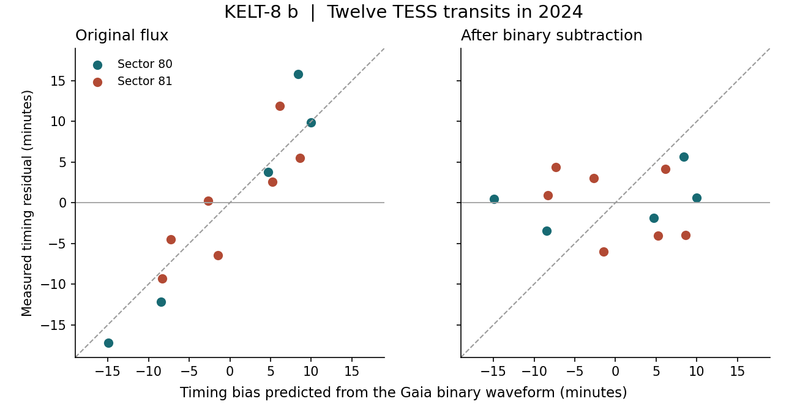

# An eclipsing binary shifts the apparent transit times of KELT-8 b

Gaia resolves an eclipsing binary 25 arcseconds from the known hot Jupiter KELT-8 b. Its cataloged brightness waveform predicts when a transit fit to TESS photometry will put the planet early or late. In two 2024 TESS sectors outside the catalogs used to identify the signal, the predicted and measured timing offsets correlate at **0.930** across 12 transits. Subtracting the binary model reduces the timing scatter from **9.72 to 3.68 minutes**. The result identifies a source of apparent timing variations in a planet with widely used archived timing measurements. It provides no evidence of another planet.

## What the observations add

Wang & Espinoza located the contaminating source using Gaia photometry and TESS centroids. Their paper reported **transit depth** changes. Ivshina & Winn had already flagged variability in the KELT-8 aperture as a potential timing systematic. Here we test the **sign and size of the timing error** in individual transits using the independent, spatially resolved Gaia binary ephemeris. We also measure how strongly this bias remains in two published series of fitted transit centers. In searches on 2026-11-14 for KELT-8, TOI-2132.01 and the Gaia source ID with transit timing, pulsation, blend and timing alias, we found the earlier depth result and the timing warning. We did not locate an earlier measurement of these individual timing biases. [Prior depth measurement, §3.3.1](https://doi.org/10.3847/1538-3881/ad09bd) · [Prior timing survey](https://arxiv.org/abs/2202.03401) · [Discovery photometry and geometry](https://doi.org/10.1088/0004-637X/810/1/30)

| TESS data | Accepted transits | Measured vs predicted timing, Pearson r | Earlier/later sign correct | Timing RMS before → after subtraction |
| --- | ---: | ---: | ---: | ---: |
| Sectors 26, 40, 53 and 54 (2020–22) | 29 | 0.976 | 29/29 | 8.89 → 1.82 min |
| Sectors 80 and 81 (2024) | 12 | 0.930 | 11/12 | 9.72 → 3.68 min |



The dashed line shows equality. Each point is an observed transit. The axes in both panels use the same scale. Rebuild the figure with `python plot.py` and Matplotlib.

We subtract a separate best-fit constant and linear trend in orbit number from each series in each comparison. The 2024 observations were taken after the data used in the two timing catalogs. The target emerged in an exploratory inspection of published timing data. The later sectors provide an archival out-of-sample check. Their out-of-transit data set the contamination amplitude in each aperture. The method never tunes the binary's phase against planetary transit times.

## How a second star shifts a transit

Gaia source **4534144923690486144** (TIC 358516610) has an orbital frequency of 2.5382887537 ± 0.0000027609 cycles per day. Its two eclipses and ellipsoidal modulation produce a strong 0.1969831-day brightness cycle. KELT-8 b transits every 3.24408156 days. The strong component advances by 16.46883 cycles between transits. Sampling it once per planetary orbit produces an apparent period close to **6.92 days**. The part of the binary waveform that falls on ingress or egress shifts a symmetric transit fit. The full prediction uses the Gaia two-Gaussian plus cosine model, including the different eclipse depths. [Gaia geometric model, equations 1–3](https://doi.org/10.1051/0004-6361/202245330) · [Gaia catalog fields](https://gaia.aip.de/metadata/gaiadr3/vari_eclipsing_binary/)

1. Select finite, positive-error, quality-zero 120-second SPOC measurements of TIC 358516596. Convert BJD(TDB) to BJD(TCB) for the Gaia phase. Freeze Gaia’s epoch, frequency, two eclipse profiles and ellipsoidal phase and amplitude. Convert magnitudes to relative flux.
2. Estimate one scale per TESS sector from cadences more than 0.13 d from transit. Remove a separate linear trend from each day in the data and template and iteratively reject 5-MAD outliers in this calibration. Across the six sectors the out-of-transit correlations with the fixed Gaia waveform are 0.787–0.827.
3. Fit each transit in a ±0.23 d window with a free center, depth, intercept and slope. Fix the total duration and ingress duration at 0.1444 and 0.0277 d. Require at least ten good cadences in each baseline, ingress, center and egress region. Repeat after subtracting the template from the observed flux.
4. For the prediction, generate a constant 1.3%-deep transit at the same actual timestamps, add the Gaia waveform scaled only by out-of-transit data, and fit it with the original timing procedure. Compare the predicted bias with the real untreated transit offsets. The synthetic transit evaluates the expected bias. All observed early/late timings in the table come from the real light curves.

The fitted timing excursion depends on the treatment of stellar variability and the transit shape. For 29 shared transits, the bias predicted for our trapezoidal fit correlates at **0.915** with Wenqin Wang et al.'s published timing residuals and **0.672** with the centers accompanying Gavin Wang & Espinoza's depth catalog. The fitted scale relative to our predicted shift is 0.259 and 0.108, respectively. The corresponding per-catalog linear-ephemeris scatter falls from 2.39 to 0.97 min and from 1.35 to 1.00 min after fitting this scale. These reductions reuse the same TESS exposures. [Published timing data](https://arxiv.org/abs/2310.17225) · [Published transit depth data and center column](https://github.com/gavinxwang/variable-depths)

## Where the two signals originate

In the two later target-pixel files we fitted the Gaia waveform and planet transit simultaneously to each pixel, allowing each pixel a separate intercept and slope per observing day. For each fitted image we subtracted the median exterior background and computed a positive-weight centroid in a 5×5-pixel box centered on the brightest pixel. In Sector 80 the binary waveform lies **1.7 arcsec from the Gaia neighbor** and 23.7 arcsec from the host. The planet transit lies 0.9 arcsec from the host. Sector 81 puts the binary waveform 6.6 arcsec from the neighbor and 20.4 arcsec from the host, with the transit 6.8 arcsec from the host. The source assignments also hold with 3×3 and 7×7 boxes. The centroids use the TESS aperture WCS and Gaia J2016.0 positions. Window dependence reaches several arcseconds. [Pixel-centroid measurements](pixel-centroids.csv) · [Gaia field positions](field.csv)

## Controls and limits

In Sectors 80–81 the prediction still correlates at 0.933 using simple aperture flux, 0.936 with a wider ±0.30 d window, and 0.931 using the longer 0.0332 d ingress solution. Shifting the binary clock by one eighth of its full orbit places the dominant brightness cycle a quarter-cycle out of phase. That control correlates at only 0.274 and subtraction leaves 8.95 min timing scatter. Exact signed offsets, depths, formal measurement errors, sector calibrations and controls are in [events.csv](events.csv), [sectors.csv](sectors.csv) and [summary.json](summary.json).

A Gaia G-band template scaled into TESS leaves residuals from passband differences, aperture effects, correlated noise and imperfect transit shape. The formal center errors propagate only the supplied flux errors. The remaining 3.68 minutes is the scatter of these fits across two later sectors. It does not establish the planet's intrinsic timing scatter or rule out sub-minute dynamics.

## Reproduce

Use Python 3.10+, NumPy, SciPy and Astropy. From this directory run:

```sh
python replay.py --fetch --cache /tmp/kelt8-spoc --out /tmp/kelt8-replay
```

The replay downloads about 105 MB of SPOC light curves and target-pixel files, checks all SHA-256 digests, and writes the timing, sector, pixel-centroid and control results. Use the same command without `--fetch` for offline replay after the first download. [inputs.json](inputs.json) identifies every file by archive URL and SHA-256. It includes the source archive and member hashes for the two catalog extracts. The Gaia query and its exact result are included. The public MAST S3 products can be reprocessed in place. A changed digest stops the replay. Sector numbers, cadence counts and the measured dilution coefficients are in the sector table.

This work uses NASA TESS data from MAST and ESA Gaia DR3 data processed by DPAC. Funding for TESS is provided by NASA's Science Mission Directorate. [TESS archive](https://doi.org/10.17909/t9-nmc8-f686) · [Gaia acknowledgements](https://www.cosmos.esa.int/web/gaia-users/credits)
