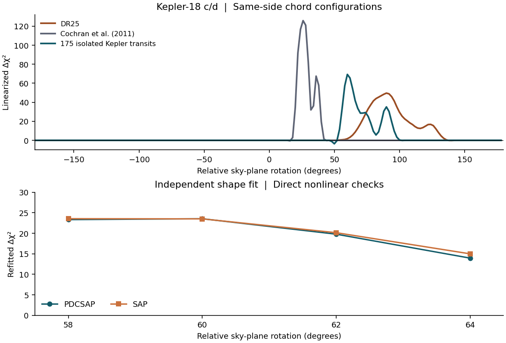

# Testing the orbital orientation of Kepler-18 c and d

Kepler recorded five simultaneous c/d transits. Four have one-minute coverage. Under a geometry fitted independently to 117 isolated c transits and 58 isolated d transits, a +60° rotation with both impact parameters positive predicts a planet–planet eclipse with matched-template S/N 7.05. The measured amplitude is −0.20 of the predicted positive amplitude. With event times, individual depths and baseline refitted from five starting points per event, adding this crossing worsens the fit by **Δχ² = 23.55 in PDCSAP and 23.51 in SAP**. A faster, first-order angular scan gives 69.28 and 70.61, respectively. Long cadence alone gives 5.81 in that scan. The short-cadence measurements supply most of the information at this orientation.

The result constrains a **combination of transit chords and projected rotation**. Different measured impact parameters and limb-darkening laws shift the angles at which the disks intersect. No common two-degree grid point reaches Δχ² > 25 for all seven independent shape and sensitivity fits. We find no new planet–planet eclipse and cannot assign a geometry-independent interval to the relative node.

## Measurements

| c midpoint (BKJD) | d midpoint (BKJD) | Separation (min) | Coverage |
| ---: | ---: | ---: | --- |
| 143.05051 | 143.01310 | 53.9 | Long |
| 410.50581 | 410.47322 | 46.9 | Short and long |
| 677.96108 | 677.93543 | 36.9 | Short and long |
| 945.41603 | 945.39583 | 29.1 | Short and long |
| 1212.87031 | 1212.85595 | 20.7 | Short and long |
| 1480.32506 | 1480.31575 | 13.4 | Gap |

BKJD is BJD(TDB) − 2454833. Predicted midpoints combine Holczer's linear ephemerides with interpolated timing deviations from unflagged, isolated transit timings. The local fits adjust those centers. Kepler-18 b is included in the baseline model, including the windows near BKJD 410 and 1213. Nine unique FITS files supply 4,895 archived samples before quality filtering. SAP and PDCSAP use the same exposures.

Independently stacked short-cadence transits give impact parameters near zero and 0.544 for c and d, radius ratios of 0.04235 and 0.05370, and durations of 3.398 and 3.585 h. The c fit reaches the central-transit boundary. Four chronological block fits span 0–0.513 for c and 0.444–0.603 for d. Cochran et al. (2011) give 0.593 and 0.767. NASA's DR25 KOI fits give 0.027 and 0.255. The angular scans carry these alternatives. The direct nonlinear checks span +58°, +60°, +62° and +64° under the full isolated-transit geometry. At +60°, allowing the individual transit centers to move partly absorbs the predicted bump. The opposite-sign branch places d's chord on the other side of the stellar center before rotating the direction of motion. The reported angle is a sky-plane rotation.

At the illustrative +60° orientation, a matched-score threshold of 4 recovers 1,999 of 2,000 full-amplitude injections, 638 of 2,000 half-amplitude injections and 0 of 2,000 zero-amplitude injections. Each trial independently circularly shifts the residual sequence from each event before adding the projected signal. The empirical recovery fractions condition on this angle, shape and observed noise. Circular shifts place the ends of each residual window next to each other.

## Model

Each circular planet travels along a straight, constant-speed chord. The model integrates long cadences at 17 sub-times and averages five short-cadence measurements using their actual timestamps. It uses the exact two-circle intersection area, evaluates quadratic stellar intensity near the intersection midpoint and includes the additive crossing light only when both planet disks lie entirely inside the stellar limb. Each event independently fits three timings, three depth multipliers and a quadratic baseline. In the direct refit, the nuisance parameters are optimized after adding the geometric silhouette intersection. The local derivative projection used for the wide grid is less accurate near +60°. The crossing comparison removes projections onto the additive model's local nuisance-parameter derivatives. Large timing changes and nonlinear covariances can alter the result. These fixed-template Δχ² values have no assigned global significance.

The orientations table steps by 2° under three geometries, with both signs of d's impact parameter. The sensitivity table includes the isolated-transit fit, four equal-sized time blocks and two alternative quadratic limb-darkening laws.

## Search context

The exploratory search selected 45 Kepler hosts with high-signal confirmed pairs (catalog per-transit proxy above 6 and predicted simultaneous windows), retrieving 743 long-cadence FITS products. It then screened non-false-positive KOIs in those hosts and produced 524 measured pair windows in 44 hosts. The screen table gives pair names, anticipated centers, fitted timing shifts in days, residual-window center, amplitude in ppm, number of cadences and local noise proxy. Scores maximize over one to eight adjacent long cadences and have no trial-corrected interpretation. The known Kepler-89 d/e crossing was recovered near BKJD 378.50 at 489 ppm over two cadences. The Kepler-51 b/d published candidate scored only 1.34 in this screen. Kepler-411 and Kepler-210 produced high residuals but both stars have published spot-crossing and double-transit studies. These signals were not promoted to discoveries.

## Replay

From this directory, run the following with NumPy, pandas and SciPy installed.

~~~sh
python replay.py
python sensitivity.py
python refit.py
python injections.py
~~~

The included windows, event centers and isolated-shape fit table support offline replay. To refresh the nine event windows from the original MAST FITS files listed in products.csv, install Astropy and run `python replay.py --fetch`. To recalculate isolated shapes, install Astropy and batman-package, run `python prepare_isolated.py`, then `python fit_isolated.py`, and repeat the angular scans. The extraction reads 44 short-cadence FITS products, selects isolated transits from epochs.csv, detrends each transit against its nearby baseline, and bins exposures into three-minute samples. The shape fitter uses BATMAN's quadratic kernel and three sub-samples per bin.

### Repeat the exploratory survey

Run these commands from the screen subdirectory using NumPy, pandas, SciPy and Astropy. They fetch the original tables and STScI products and write a fresh screen.csv locally. Compare that file with the survey table in the parent directory. The original 743 exposure-product names are listed in screen/products.txt.

~~~sh
cd screen
python fetch_catalogs.py
python rank_pairs.py
python fetch_lightcurves.py
python search_residuals.py
~~~

The NASA cumulative input used 880,084 bytes (SHA-256 d64b28c0a985d792c9c14880976b1467d25345ac08874b1a2356fc431db93e2c). The original VizieR extraction contained 295,187 data rows. Its header contains a generated retrieval timestamp, so the byte hash changes on a new retrieval. Orbit fits, source fluxes, extracted windows, angular-scan results and score tables are checked by SHA256SUMS.

## Sources and prior work

- [MAST Kepler archive](https://archive.stsci.edu/missions-and-data/kepler) and [STScI public AWS collection](https://registry.opendata.aws/mast-kepler/).
- [Cochran et al. (2011), Kepler-18 planets and dynamical constraints](https://doi.org/10.1088/0067-0049/197/1/7). They examined mutual inclination through duration changes. Searches using Kepler-18 c/d, KOI-137, projected mutual inclination, nodal angles, overlapping transits and planet–planet occultations located no previous report of this five-event angular test.
- [Holczer et al. (2016), Kepler transit timing catalog](https://doi.org/10.3847/0067-0049/225/1/9) and [Table 3](https://vizier.cfa.harvard.edu/viz-bin/VizieR?-source=J/ApJS/225/9/table3). The catalog already records overlapping transits.
- [NASA Exoplanet Archive Kepler-18 parameters](https://exoplanetarchive.ipac.caltech.edu/overview/Kepler-18). The cumulative KOI table supplied search inputs and limb-darkening coefficients.
- [Masuda et al. (2013), Kepler-89 eclipse](https://doi.org/10.1088/0004-637X/778/2/185), [Masuda (2014), Kepler-51 possible eclipse](https://doi.org/10.1088/0004-637X/783/1/53) and [Sun et al. (2019), Kepler-411 double transits and spots](https://doi.org/10.1051/0004-6361/201834275).
