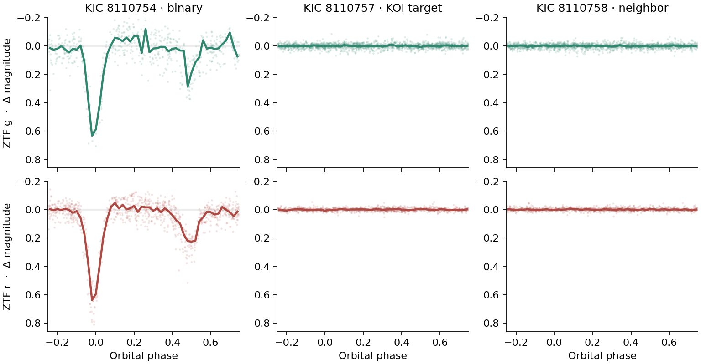

# Spatially resolved eclipses in ZTF

Zwicky Transient Facility photometry independently identifies KIC 8110754 as the eclipsing star. It lies between the two brighter Kepler targets KIC 8110757 and KIC 8110758. Resolved photometry records two dips per orbit in both bands on KIC 8110754. The other two stars have millimagnitude-level contrasts at the same phases. Every phase window below was set from the Gaia DR3 binary model before inspecting the ZTF phase curves.

| Star | Band | Good measurements | Primary dip, mag (95% interval) | Secondary dip, mag (95% interval) |
|---|---|---:|---:|---:|
| KIC 8110754, Gaia binary | g | 574 | 0.422 (0.363 to 0.537) | 0.138 (0.100 to 0.213) |
| KIC 8110754, Gaia binary | r | 1,005 | 0.524 (0.493 to 0.589) | 0.217 (0.194 to 0.232) |
| KIC 8110757, KOI-7865 target | g | 1,788 | −0.0003 (−0.0025 to 0.0024) | 0.0009 (−0.0016 to 0.0054) |
| KIC 8110757, KOI-7865 target | r | 1,196 | 0.0019 (−0.0013 to 0.0056) | −0.0034 (−0.0062 to 0.0003) |
| KIC 8110758, KOI-7866 target | g | 1,779 | 0.0007 (−0.0014 to 0.0033) | −0.0001 (−0.0024 to 0.0025) |
| KIC 8110758, KOI-7866 target | r | 1,195 | 0.0009 (−0.0012 to 0.0027) | −0.0015 (−0.0045 to 0.0034) |



The phase on the figure is relative to Gaia’s deeper minimum. Positive changes in magnitude are fainter. Dots are individual measurements and lines connect 0.02-cycle bin medians. All panels share the same vertical scale.

## An independent orbital period

A joint fit to **1,579 ZTF measurements over 2,758.65 days** gives a period of **0.51805730 ± 0.00000025 days** and a primary minimum at **BJD TDB 2459249.80406 ± 0.00032**. Quoted uncertainties are one-standard-error estimates clustered by night. Separate g and r fits and fits to the first and second observing intervals agree within about 1.1 combined standard errors. Extrapolating this ZTF-only ephemeris to the primary eclipse nearest Gaia’s geometric-model reference epoch misses it by **0.50 minutes** (absolute). The Gaia frequency uncertainty alone implies a period uncertainty of about 0.16 seconds. These measurements support a common clock. They do not establish period evolution.

The fit searches the neighborhood of the already identified half-day period (±1 second). It gives each field/filter series a separate magnitude zero point, fits Gaussian primary and secondary dips, and includes cosine terms at the orbital frequency and its harmonic. Both filters share the period, epoch, durations and secondary phase. Each filter has independent amplitudes. A robust loss limits the influence of large residuals. The period uncertainty reflects this light-curve model. Sampling much broader aliases and assigning them prior probabilities are outside this fit. Selection-specific results are in [ztf_periods.csv](ztf_periods.csv).

## Measurement and replay

Each IRSA query used a 1.8-arcsecond cone around a distinct Gaia coordinate. The closest centers are 4.8 arcseconds apart. We selected unflagged ZTF observations, converted exposure-midpoint MJD UTC at Palomar to BJD TDB, and converted the Gaia epoch and frequency from TCB to TDB. The Gaia reference epoch is JD 2455197.5 + 2234.0540609516934 TCB and the frequency is 1.9302825156283367 cycles per TCB day. The model primary and secondary phases are 0.7466577 and 0.2377278. Each reported dip compares the median within ±0.04 cycle of its center against the out-of-eclipse median. Out-of-eclipse points avoid the primary by 0.165 cycle and the secondary by 0.15 cycle. We median-center each field/filter series separately. The intervals come from 1,000 resamples of nights and are conditional on those zero points and the adopted Gaia ephemeris. [Gaia binary model](https://doi.org/10.1051/0004-6361/202245330) · [ZTF photometry documentation](https://irsa.ipac.caltech.edu/data/ZTF/docs/ztf_explanatory_supplement.pdf)

The three compressed CSV files contain the six measurement columns used in the calculation. [ztf_receipts.json](ztf_receipts.json) records the source URLs and hashes of the original unabridged responses. For replay, run the following from this directory with NumPy, SciPy, Astropy and Matplotlib installed.

```sh
python ground_photometry.py
python ztf_clock.py
python plot_ground.py
```

The saved tables replay offline. Passing `--download` to the first script refreshes the snapshots from IRSA, whose catalog can grow. The pixel analysis uses separate data products and is documented in [KEPLER_METHOD.md](KEPLER_METHOD.md).
