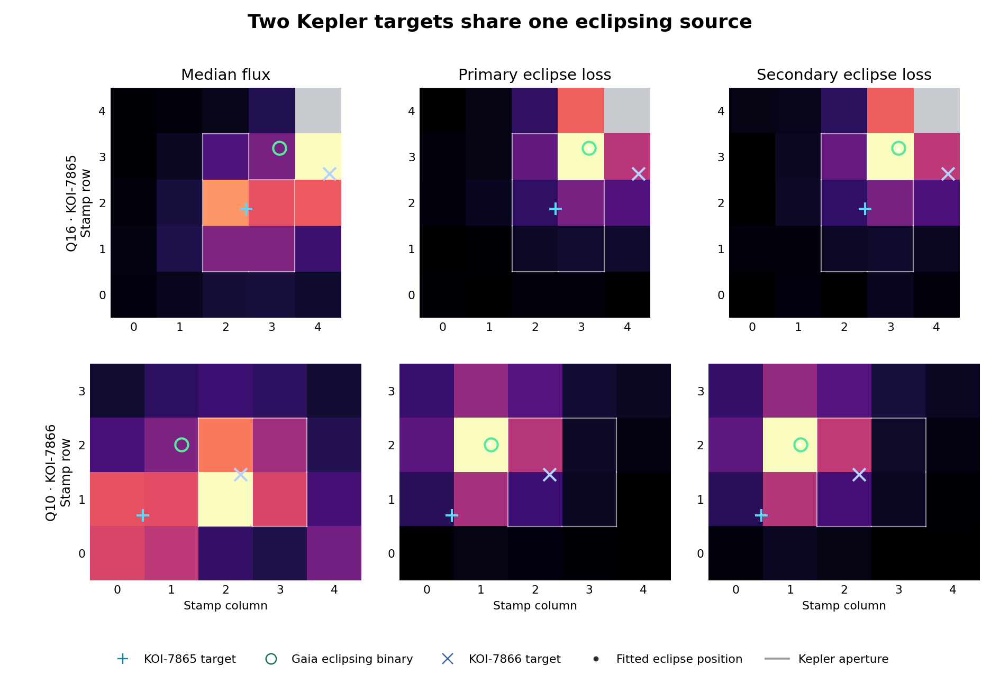

# Kepler image localization of KOI-7865.01

In Kepler quarter 16, both eclipses of the 0.518060209-day signal on KIC 8110757 originate at the neighboring Gaia DR3 eclipsing binary 2079577157039120128 (KIC 8110754). The Gaia source is 5.79 arcseconds from the Kepler Input Catalog position used for the KOI. Its Gaia period is 0.518058881 days, a 2.56 ppm fractional difference. Gaia had already cataloged the eclipsing binary. The measurement here identifies its contribution to the KOI aperture.

| Q16 measurement | Primary | Secondary |
|---|---:|---:|
| Complete events | 118 | 124 |
| Fitted stamp column, row (zero-based) | 3.169, 3.171 | 3.166, 3.167 |
| Angular separation from Gaia eclipsing source | 0.059″ | 0.077″ |
| Angular separation from Gaia counterpart of KOI target | 5.932″ | 5.912″ |
| Angular separation from brighter eastern stamp neighbor | 4.815″ | 4.819″ |
| Mean optimal-aperture depth in inner phase window | 1,626 ppm | 858 ppm |



The top row shows the Q16 quarter. The bottom row shows a separate target and detector in Q10, with the same sky positions projected through a different WCS. The image panels each use a square-root intensity scale with independent normalization. Gray marks the unobserved corner. The peak of each eclipse loss falls outside the five-pixel optimal aperture. The optimal aperture still collects 36.1 and 19.1 electrons per second of the primary and secondary flux loss. The two 24-pixel difference vectors have cosine similarity 0.99985.

## A second target and detector

The broad search also matched this Gaia binary to the neighboring false-positive KOI-7866.01 on KIC 8110758, the brighter star southeast of the EB. Its only public long-cadence target-pixel series covers quarter 10, about 1.5 years before KIC 8110757's quarter 16. The second series contains 4,079 usable cadences on module 9, output 3. To provide an independent prediction, this reduction uses the Gaia geometric model's frequency of 1.9302825156283367 cycles/day, reference JD 2457431.5540609517 and primary/secondary phases of 0.7466577 and 0.2377278.

| Q10 measurement | Primary | Secondary |
|---|---:|---:|
| Complete events | 130 | 156 |
| Fitted separation from Gaia eclipsing binary | 0.124″ | 0.056″ |
| Separation from Gaia counterpart of Q10 target (KOI-7866) | 4.954″ | 4.862″ |
| Separation from Gaia counterpart of Q16 target (KOI-7865) | 5.916″ | 5.898″ |
| Mean Q10 optimal-aperture depth in inner phase window | 1,414 ppm | 877 ppm |

Each Q10 half independently localizes both eclipses within 0.27″ of the binary. The Kepler fit for KOI-7866.01 in the cumulative catalog had already flagged it as a false positive, with a stellar-eclipse and a centroid flag. The two detector stamps identify a single eclipsing source that leaked into both KOI apertures.

## Catalog selection

The NASA cumulative table returned 9,564 KOIs. A 12-degree-radius field centered at ICRS (292.25°, +44.5°) returned 44,400 Gaia DR3 geometric EB models. The screen accepted separations up to 90″ and fractional period differences up to 0.002 at KOI-to-Gaia period ratios of 1, 2, 3, 4 and their reciprocals. It yielded 578 pairs, including five involving a KOI designated candidate or confirmed. All five are in `active_matches.csv`. KOI-7865.01 had the smallest separation and period mismatch among the five. The other four have separations of at least 29.97″ and fractional period mismatches of at least 117 ppm.

Repeating the screen for the 4,725 candidate/confirmed KOIs with 12 declination shifts (±600 to ±3,600″) gave nine broad matches across all shifted samples. Zero satisfied 6″ and 10 ppm together. These tighter values summarize where the selected lead fell. This shift test is descriptive and does not constitute a calibrated false-alarm probability.

## Difference images

1. Read the public Q16 calibrated target-pixel series and its aperture WCS. Retain the 3,318 finite-time, zero-quality-flag cadences out of 4,203. Twenty-four pixels are finite across all retained cadences. The 85.82-day span covers BKJD 1472.118–1557.938. The MAST target-pixel directory for KIC 8110757 contains this quarter only.
2. Fold at the DR25 KOI period and epoch (BKJD 131.9425). Use independent event windows centered at phases 0 and 0.5. For each eclipse average the inner ±0.05 in phase. Estimate each pixel's counterfactual flux at the mean in-eclipse time by interpolating its means in the two exterior windows at phases −0.26 to −0.14 and +0.14 to +0.26, relative to eclipse center. Require at least two cadences per window and difference the interpolated baseline and the in-eclipse mean.
3. Average the event images with equal weight per event. Fit Kepler's oversampled pixel response function (PRF), interpolating between the calibration file's three enclosing focal-plane nodes for module 17, output 3. Use the stamp’s aperture physical WCS for its focal-plane coordinates. The free parameters are the variable source's column, row, amplitude and additive background. The fit uses per-pixel standard errors measured among events. The stamp's missing corner lies near the variable source. Raw first moments fall about half an arcsecond closer to the target than the fitted PRF does.
4. Propagate Gaia DR3 J2016 coordinates with both proper-motion components to the mean observing epoch (2013.163). Compare the three projected positions with the free-position PRF. Refit fixed-position PRFs with independent amplitude and sky for the target, EB and the bright neighbor. For the primary, weighted residual sums are 55.2 (free, 20 degrees of freedom), 69.8 (EB fixed), 16,899 (target fixed), and 13,434 (bright neighbor fixed). The corresponding secondary sums are 92.8, 113.7, 18,927 and 16,539. Pixel residuals can be correlated and the PRF is imperfect, so these sums are descriptive.
5. Refit each eclipse separately before and after median observing time. All four half-series solutions lie 0.15–0.31″ from the EB and 5.83–6.03″ from the Gaia target. The split shows time-dependent detector astrometry at roughly 0.3″, larger than the formal full-series offsets. The CSV also includes 95% percentile intervals from 350 circular block-bootstrap draws, with blocks of eight consecutive retained events. Those intervals describe sampling scatter. The observed target/EB separation comfortably exceeds the split-to-split drift.

DR25 already measured a catalog-referenced difference-image PRF displacement of (−2.856″ east, −4.861″ north), or 5.637 ± 0.067″ from the KOI's catalog coordinates (`koi_dikco_*`). This matches the direction to the Gaia EB at (−2.955″ east, −4.975″ north). The separate DR25 difference-image offset relative to the out-of-transit image centroid (`koi_dicco_*`) is (−3.632″ east, +1.423″ north). The bright neighboring field star shifts the out-of-eclipse light centroid. DR25 had already established that the eclipse was displaced. This analysis links that displacement to a named eclipsing source and locates both eclipse minima independently.

The depth in this report is the average in the inner phase window relative to the temporally interpolated aperture baseline. DR25's transit-fit depth is 2,258 ppm. The KOI cumulative row has a stellar-eclipse flag of 1 and zero centroid and ephemeris-contamination flags. These classifications and the later published KOI vetting should be consulted when interpreting the historical candidate status.

## Reproduction

Use Python 3.10+ with NumPy, pandas, SciPy, Astropy and Matplotlib. From this directory run:

```sh
python catalog_screen.py
python pixel_localization.py
python second_aperture.py
python plot_maps.py
```

Each script reads local derived tables or downloads its inputs to `.cache/`. The four Kepler FITS products are validated against their SHA-256 checksums. The small public catalog outputs used here are identified in `kepler_sources.csv`. VizieR response headers contain timestamps, so the hash of a new TSV download can change even when the scientific rows are unchanged. The NASA cumulative catalog can also change between retrievals.

## Sources

- NASA Exoplanet Archive, [Q1–Q17 DR25 cumulative KOI table](https://exoplanetarchive.ipac.caltech.edu/docs/API_kepcandidate_columns.html).
- Mowlavi et al., [Gaia DR3 catalog of eclipsing binaries](https://doi.org/10.1051/0004-6361/202245330) and [VizieR I/358](https://cdsarc.cds.unistra.fr/viz-bin/cat/I/358).
- Gaia Collaboration, [Gaia DR3 main catalog](https://cdsarc.cds.unistra.fr/viz-bin/cat/I/355).
- NASA Kepler, [KIC 8110757 target-pixel products](https://archive.stsci.edu/missions/kepler/target_pixel_files/0081/008110757/) and [focal-plane PRFs](https://archive.stsci.edu/missions/kepler/fpc/prf/).
