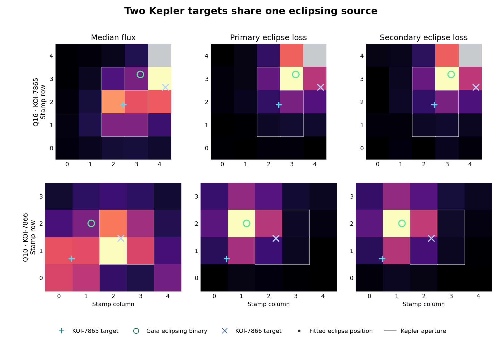

# One eclipsing binary produced two Kepler Objects of Interest

**KIC 8110754 (Gaia DR3 2079577157039120128) produced both KOI-7865.01 and KOI-7866.01.** Separate Kepler pointings put each dip on this star, and later spatially resolved ZTF photometry shows it undergoing both eclipses. The source identification overturns a specific published archival model. The 2016 positional-probability report for KOI-7866.01 assigned KIC 8110754 a relative probability of 7.778 × 10⁻⁹⁶ and selected an unspecified background star. [Original model, inputs and reproduction](PRIOR_WORK.md)

| Independently observed data | Primary | Secondary |
|---|---:|---:|
| Kepler Q10, 2011, KIC 8110758 aperture | 130 eclipses, center 0.124″ from KIC 8110754 | 156 eclipses, 0.056″ |
| Kepler Q16, 2013, KIC 8110757 aperture | 118 eclipses, center 0.059″ from KIC 8110754 | 124 eclipses, 0.077″ |
| Resolved ZTF r band on KIC 8110754, 2018–25 | 0.524 mag dip (95% interval 0.493–0.589) | 0.217 mag (0.194–0.232) |
| Resolved ZTF g band on KIC 8110754, 2018–25 | 0.422 mag dip (0.363–0.537) | 0.138 mag (0.100–0.213) |

The Kepler offsets are measured separations. Splitting the exposures gives roughly 0.3″ empirical astrometric scatter. Both KOI target stars are about five arcseconds from the eclipsing source. Both show millimagnitude-level ZTF contrasts at the eclipse phases. A fit to the resolved source alone gives a period of **0.51805730 ± 0.00000025 days**, equivalent to 12 h 26 min. Propagating that period back to the Gaia reference epoch reproduces Gaia's primary minimum within half a minute.

The distinction matters for catalog users. NASA's KOI table lists 7865.01 as a planet candidate with a stellar-eclipse flag. Lissauer et al. (2024) had already rejected the planetary radius. NASA lists 7866.01 as a false positive. Gaia already cataloged KIC 8110754 as an eclipsing binary. This work establishes which star supplied the light variation in both apertures, and measures its eclipses independently. [Catalog disposition and literature checks](PRIOR_WORK.md)

The initial screen compared 9,564 KOI rows with 44,400 Gaia eclipsing binaries in the search field. The signal at 7865.01 had a 2.56-parts-per-million period match and a 5.79″ separation from its listed Kepler target. The positional and photometric tests used spacecraft pixels and resolved ground measurements in addition to the catalog periods.

The [Kepler analysis](KEPLER_METHOD.md) includes target pixels, calibrated pixel-response fits, split-quarter tests, comparison positions, candidate selection and displaced-field checks. The [ZTF analysis](GROUND_PHOTOMETRY.md) includes frozen photometry for all three stars, phase curves, a measured orbital ephemeris and replay commands.
