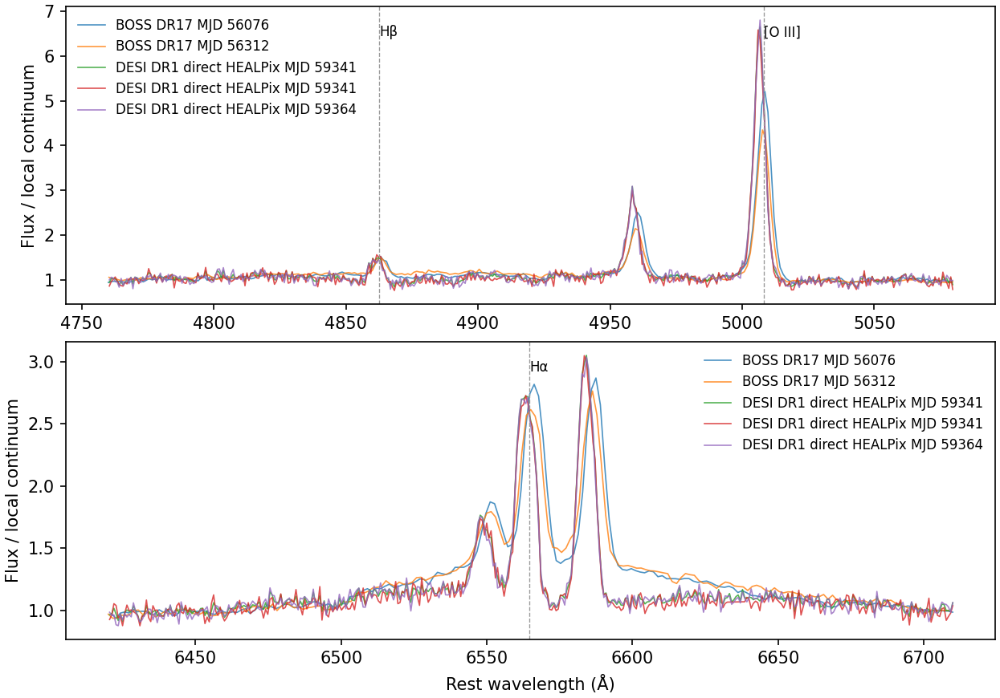
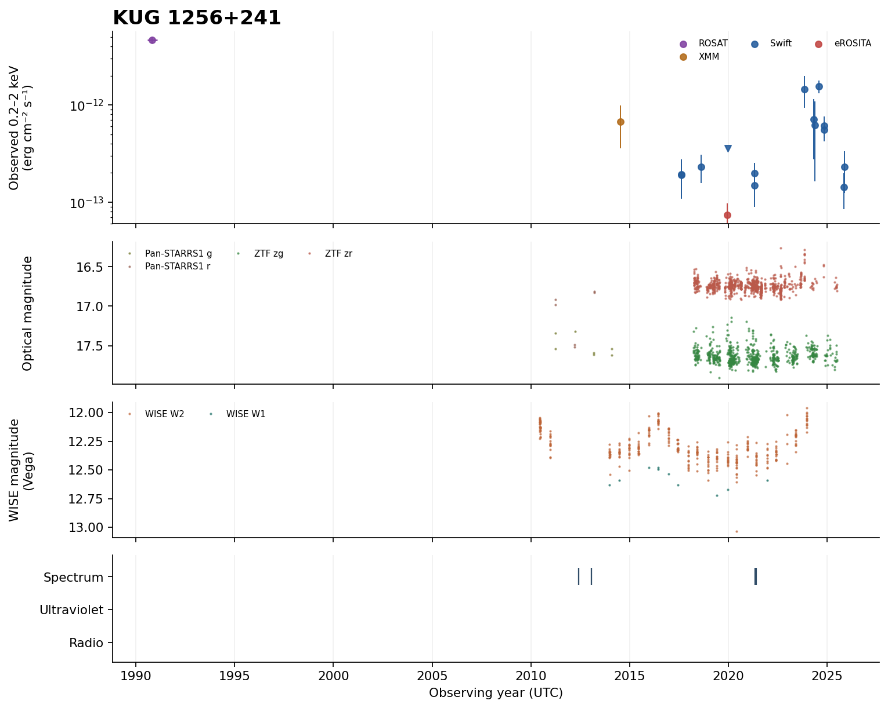

# KUG 1256+241 is a candidate changing-look active galaxy

**The broad Hα profile seen by BOSS in 2012–2013 was roughly four times weaker on both DESI nights in May 2021.** A weaker broad component remained. The adjacent narrow [N II] line stayed similar in strength, and the optical continuum changed less. This broad-line change qualifies KUG 1256+241 as a changing-look AGN candidate. The spectra do not date the transition to the December 2019 X-ray low or establish whether absorption or intrinsic variability drove the 63-fold soft X-ray fade. [Line fits and uncertainties](outputs/fixed-width-balmer.csv) · [Free-width fits and continua](outputs/free-profile-balmer.csv)



## What changed in the optical spectra

The table uses the same centered, 5,000 km/s FWHM profile in all four independent observations. Its width matches the broad Hα feature in the early spectra. Hydrogen-line fluxes are in 10⁻¹⁴ erg cm⁻² s⁻¹. The last column is observed flux density in 10⁻¹⁷ erg cm⁻² s⁻¹ Å⁻¹ in the rest-frame 5100 Å window.

| Spectrum | MJD | Broad Hα template | Broad Hβ template | Continuum |
|---|---:|---:|---:|---:|
| BOSS, 2012 | 56076 | 2.174 ± 0.052 | 0.234 ± 0.049 | 35.37 |
| BOSS, 2013 | 56312 | 1.962 ± 0.077 | 0.526 ± 0.068 | 43.23 |
| DESI, first May 2021 night | 59341.18 | 0.495 ± 0.060 | −0.226 ± 0.062 | 29.93 |
| DESI, second May 2021 night | 59364.18 | 0.522 ± 0.056 | −0.249 ± 0.064 | 31.08 |

The negative Hβ entries are signed fit amplitudes. Stellar absorption, Fe II and continuum placement affect this blend. A published fit to the SDSS spectrum found Hβ much broader than the fixed template, at 9,661 ± 242 km/s. These data cannot demonstrate complete Hβ disappearance. [Published optical measurements, table 2](https://doi.org/10.3847/1538-4365/acd783) · [Target row and field definitions](outputs/literature-extra.json)

For Hα, the BOSS free-width fits give 4,918 and 5,071 km/s. The normalized spectra show weaker wings in both DESI observations. The narrow [N II] λ6585 reference stays in the range (4.97–5.22) × 10⁻¹⁵ erg cm⁻² s⁻¹ across the four nights. The fourfold change applies specifically to the early profile. Allowing its width to vary gives a DESI coadd broad flux of (1.30 ± 0.31) × 10⁻¹⁴ erg cm⁻² s⁻¹, with a fitted width near 8,464 km/s. This fit illustrates the uncertainty in the total broad-line flux. Differences in fiber size, seeing and host light also affect absolute fluxes. [Sensitivity and profile assumptions](outputs/spectra-pass2.md) · [Free-width results](outputs/free-profile-balmer.csv)

The searches use the 2MASX J12585149+2355268 nucleus (ICRS 194.714542°, +23.924111°), about 3.6 arcseconds from the refined X-ray position (194.714898°, +23.923199°). Each BOSS and DESI fiber position falls within 0.5 arcseconds of the nucleus. The DESI survey coadd repeats the two individual nights. MAST entries repeat BOSS observations. The queried LAMOST DR5/DR6 holdings and ESO search supplied no nuclear spectrum. The 6dF service checks were incomplete. NED returned no contributed spectrum. [Pixel and exposure index](outputs/optical_pixels/index.json) · [DESI and LAMOST searches](outputs/spectral-search-pass2.json) · [Archive coverage and failures](outputs/coverage.csv)

## All epochs on one timeline



The full timeline has 2,220 records, including individual exposures, repeated reductions, catalogue intervals, limits and possible pointings. Entries with unknown dates appear last. The representative X-ray epochs below use observed 0.2–2.0 keV fluxes in erg cm⁻² s⁻¹. [Full timeline with uncertainties and provenance](outputs/timeline.csv) · [Original survey comparison](../xmmsl2-erass1-rass/README.md)

| Epoch | Observation |
|---|---|
| 16–18 December 1990 | ROSAT aperture events localize the bright survey epoch to these dates. The catalogue flux was (4.65 ± 0.33) × 10⁻¹². The large ROSAT beam includes neighboring optical components. |
| April 2002 | Chandra ObsIDs 3002 and 3003 targeted RX J1258.8+2355. The nuclear catalogue source has a combined, projected flux of 2.67 × 10⁻¹³. Separate visit fluxes could not be recovered. |
| 18 July 2014 | The XMM slew measured (6.77 ± 3.18) × 10⁻¹³ from about five net soft counts. |
| 2017–2018 | Swift LSXPS gave (1.90 ± 0.81) × 10⁻¹³ and (2.32 ± 0.74) × 10⁻¹³ in two visits. The overlapping 2SXPS entry uses some of the same photons. |
| 12–13 December 2019 | eRASS1 measured (7.36 ± 2.39) × 10⁻¹⁴. The nominal ROSAT/eRASS1 ratio is 63.2. The original conservative spectral floor is 12.6. A Swift visit one week later gave an upper limit of 3.58 × 10⁻¹³. |
| Shortly before the May 2021 spectra | Swift measured (1.98 ± 0.55) × 10⁻¹³ at MJD 59331 and (1.49 ± 0.59) × 10⁻¹³ at MJD 59334, within ten days of the first DESI epoch. |
| 2023–2025 | Swift detected the source again at higher flux. It reached (1.56 ± 0.23) × 10⁻¹² in August 2024 and returned to (1.42 ± 0.57) × 10⁻¹³ in November 2025. The later 3eRASS catalogue also detects the source, without an independent observation date in the matched table. |

[ROSAT aperture timing](outputs/xray-extra-rass-timing.json) · [Independent eRASS1 start, end and on-axis times](outputs/xray-extra-erass-heasarc.json) · [Chandra pointing log](outputs/xray-extra-chanmaster.json) · [Common-band measurements and limits](outputs/xray-extra-fluxes.csv) · [Survey and stacked fluxes](outputs/xray-fluxes.csv)

### Absorption or a change in the nucleus?

The bright-state ROSAT colors were HR1 = −0.324 ± 0.053 and HR2 = +0.047 ± 0.095. Its power-law fit gave a column of (1.43 ± 1.33) × 10²⁰ cm⁻², consistent with the Galactic estimate of 1.36 × 10²⁰ cm⁻². Ten models consistent with those colors still give a guarded decline of at least 17.8 if the eROSITA conversion is held fixed. The faint eRASS1 detection had only about 11 fitted soft counts. These data do not measure a change in absorbing column between epochs. [Bright-state fit and finite model grid](../xmmsl2-erass1-rass/outputs/rass_hardness/source_diagnostics.csv) · [Faint-state catalogue row](outputs/xray-extra-erass-heasarc.json)

The later rise and fall in Swift count rate establishes recurrent X-ray variability in the same instrument. Nuclear luminosity changes and variable obscuration both remain viable. The optical change adds independent evidence of a different broad-line appearance by 2021. Sparse sampling leaves open whether the optical and X-ray transitions were simultaneous. The common-band projections assume an absorbed power law with photon index 2 and column 3 × 10²⁰ cm⁻². Statistical error bars exclude spectral-model uncertainty. The XMM pointed searches found no catalogue match or boresight within the tested radii. The Einstein Probe services yielded no source-specific exposure or limit. Footprints alone carry no flux constraint. [X-ray conversion and scope](outputs/xray.md) · [Pointing and service checks](outputs/coverage.csv)

### Optical, infrared, ultraviolet and radio

- **Optical light curves.** Pan-STARRS1 provided 46 usable measurements around the earlier spectra and slew. ZTF provided 1,738 quality-filtered band measurements beginning in 2018, including the eRASS1 epoch. These surveys have different filters and apertures. CRTS endpoints yielded no usable light curve. The matched Gaia DR3 source, 3956880840692699392, has no released epoch photometry. [Photometry, selections and date ranges](outputs/photometry.md)
- **WISE and NEOWISE.** The closest W2 visits within 45 days of the slew and eRASS1 have medians 12.345 and 12.415 Vega mag, with 13 exposures each. W2 had brightened to 12.061 by late 2023. Its fluctuations are larger than this 0.070 mag difference. W1 has one usable profile-fit point in each comparison window. The independent aperture measurements cover June 2010 only. The 2010–2024 release search does not establish an infrared counterpart to the 63-fold X-ray decline. [Matched windows](outputs/optical-ir-near-xray.csv) · [All seasons](outputs/photometry-seasons.csv) · [Fixed apertures](outputs/wise-fixed-aperture.csv)
- **Ultraviolet.** The 2004 GALEX coadds give NUV 18.673 ± 0.039 and FUV 19.078 ± 0.100 AB mag. The visit and coadd products overlap. Swift logs list UVOT exposures, but the catalogue and image queries supplied no calibrated nuclear flux or limit. The available UV measurements do not bracket the transition. [GALEX matches](outputs/galex-matched-bands.csv) · [Swift observation log](outputs/xray-extra-swiftmastr.json)
- **Radio.** The FIRST image gives a 1.4 GHz upper limit of 1.04 mJy/beam. The VLASS epoch-1 component search was empty. Five public footprint records cover four observing dates, but the image requests yielded no 3 GHz flux or local limit. These data cannot establish radio variability. [Image checks](outputs/image-checks.csv) · [Full coverage](outputs/coverage.csv)

## Previous reports

The galaxy was already identified as a ROSAT Seyfert. A later compilation lists it as Seyfert 1.5. Published SDSS line fits report broad Hα and Hβ at the early epoch. None of the retrieved target-specific records reports the BOSS-to-DESI weakening measured here. The 15 object-linked references include no ATel, and the same index recovered ATel 3811 for a comparison source. Two ANTARES loci in the earlier 35-arcsecond search carried no TNS association. Direct TNS access returned HTTP 403, the unrestricted ADS API search required authentication, the NED reference service supplied no validated bibliography and the direct ATel search failed its control. A complete claim of priority is unwarranted. [ROSAT Seyfert study](https://doi.org/10.1046/j.1365-8711.2001.04763.x) · [Targeted papers, electronic tables and abstract checks](outputs/literature-extra.json) · [ADS records and access results](outputs/literature.json) · [Prior source bibliography](../xmmsl2-erass1-rass/outputs/seyfert_literature.json) · [Broker checks and controls](../xmmsl2-erass1-rass/outputs/broker_cones.json)

## Reproduce the result

From the repository root, check the deposited products and refit the broad-line template to the archived pixels.

```bash
python -m pip install -r results/kug-1256-241-followup/requirements.txt
python results/kug-1256-241-followup/replay.py
python results/kug-1256-241-followup/spec_extra.py --replay
python -m open_space.verify
python -m unittest discover -s tests
```

For a fresh live collection once GitHub has registered this workflow on the default branch, dispatch it on the study branch. A normal workflow-file push to the named branch reuses the frozen first-pass snapshot and repeats the targeted checks.

```bash
gh workflow run kug-1256-241-followup.yml --ref followup/kug-1256-241 -f refresh=true
```

The input receipts contain request parameters, times, byte counts and SHA-256 fingerprints. Extra X-ray service responses have separate fingerprints. The output manifest covers the tables, plots and optical pixels. [Input receipts](outputs/inputs.jsonl) · [Original X-ray input digests](outputs/xray-extra-inputs.tsv) · [Supplemental service digests](outputs/xray-extra-service-inputs.tsv) · [Output SHA-256 manifest](outputs/snapshot.json) · [Two-run provenance](outputs/collection-history.json) · [Workflow](../../.github/workflows/kug-1256-241-followup.yml)
