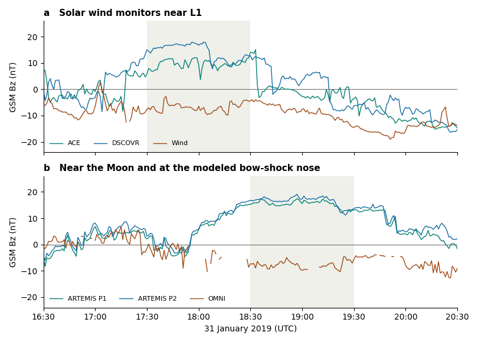

# Five spacecraft resolve opposite solar-wind magnetic polarities on 31 January 2019

Wind measured southward magnetic field for every minute of a full hour at Sun–Earth L1 while ACE and DSCOVR simultaneously measured northward field. Two ARTEMIS magnetometers near the Moon independently detected the northward state on the dawn side after the nominal solar-wind transit time. During the downstream hour the Wind-derived OMNI reconstruction at Earth's bow-shock nose stayed southward in all 56 available minutes. Southward and northward interplanetary fields imply different magnetic coupling with Earth. This case measures how large the discrepancy can be between sampled locations.



## Measurements

The quantity is the northward magnetic-field component, Bz, in geocentric solar magnetospheric (GSM) coordinates. Positive points north. All averages below are equally weighted one-minute means. Times are UTC and exclude the right endpoint. Positions use geocentric solar ecliptic (GSE) coordinates and Earth radii of 6,378 km.

| Interval | Instrument or product | Mean Bz (nT) | Minutes north / valid | Mean GSE position (Earth radii) |
|---|---|---:|---:|---|
| 17:30–18:30 | ACE MAG | +9.53 | 60 / 60 | (218.4, +7.2, −8.7) |
| 17:30–18:30 | Wind MFI | −6.91 | 0 / 60 | (245.2, +71.1, +1.6) |
| 17:30–18:30 | DSCOVR magnetometer | +14.28 | 60 / 60 | (238.5, −28.7, −27.5) |
| 18:30–19:30 | ARTEMIS P1 (THEMIS-B) FGM | +15.42 | 60 / 60 | (46.4, −45.8, +3.1) |
| 18:30–19:30 | ARTEMIS P2 (THEMIS-C) FGM | +16.53 | 60 / 60 | (44.7, −42.0, +2.2) |
| 18:30–19:30 | OMNI high-resolution reconstruction | −7.78 | 0 / 56 | Bow-shock nose, propagated |

On all 56 matched minutes, both lunar instruments measured positive Bz while OMNI reported negative Bz. Every valid OMNI field sample came from Wind (IMF source 52). OMNI therefore supplies a reconstruction to compare against the lunar measurements. The five spacecraft supply the independent magnetic observations. Negative GSE Y is dawnward. The lunar pair was 4.21 Earth radii apart, far sunward and dawnward of Earth's bow-shock nose. Quality-selected lunar ion moments give median sunward-axis velocities near −400 km/s at both probes, consistent with flowing solar wind. The lunar probes did not sample the actual nose.

## Selection and falsification

- In the returned 2015–2025 archive slices, 32,868 UTC hour bins contained valid ACE and Wind GSM Bz. For each consecutive window of one, two or three hours, compare the mean fields in each direction, taking the smallest signed difference when Wind is shifted by −1, 0 or +1 hour. The highest surviving difference in **all three scans** fell on this date. The maxima were 12.194, 9.688 and 7.021 nT across 32,771, 32,719 and 32,668 eligible windows. The snapshot has substantial gaps, including no returned Wind rows for 2016. These ranks apply only to the measured coverage.
- We inspected the high-cadence ACE and Wind time series to locate the coherent 17:30–18:30 hour. Its boundaries and the screen statistics are exploratory. DSCOVR and ARTEMIS were excluded from the screen. The minutes are correlated and supply no independent-trial significance estimate.
- ACE and Wind were 412,994 km apart transverse to the Sun–Earth line. Their radial separation gives a 6.67-minute flight time at the measured median absolute ACE radial velocity of 427.2 km/s. Shifting the upstream one-hour windows independently by up to 30 minutes leaves every instrument's **mean** polarity intact. The ranges are +5.09 to +10.01 nT at ACE, −7.68 to −6.37 nT at Wind and +9.19 to +14.29 nT at DSCOVR. ACE and DSCOVR have considerable transverse separation too. The data establish different local histories. A tilted front and lateral structure both remain possible.
- Pure radial flight from L1 to the lunar P1 X coordinate takes 43–49 minutes depending on monitor. The alternate downstream hour 18:15–19:15 gives +15.31 and +16.57 nT at the lunar pair, with OMNI at −7.80 nT over 47 valid minutes. Shifting OMNI by up to 15 minutes keeps its mean for the primary hour between −8.02 and −6.92 nT. A time delay from the lunar X coordinate to the nose is about 8 minutes at this flow speed assuming a nose near 13 Earth radii. The lateral offset remains.
- A same-instrument control later that day shows all three L1 instruments southward throughout 20:00–20:30. This and a coordinate check using ACE's own GSE/GSM vectors test a stable calibration or axis-sign error. DSCOVR has a GSE vector. We transform it with the time-dependent rotation determined from Wind's paired GSE/GSM components. Applying that rotation to independent ACE vectors reproduces native ACE GSM Bz to 0.020 nT RMS across the 16-hour evidence window.
- DSCOVR and both lunar magnetometers retain only quality flag zero. The ARTEMIS plasma check likewise retains only zero-quality-flag moments. Invalid or missing magnetic measurements are excluded, including OMNI's +9999.99 nT fill. ACE and Wind use the archived science vectors and their missing-value filters. Plasma checks have 6 and 7 occupied minute bins at the two ARTEMIS probes in the downstream hour.

This establishes a counterexample to treating one upstream field record as spatially uniform across the sampled region. Inferring which field reached the actual bow-shock nose, a continuous spatial width or the solar structure's origin would require additional constraints. We found earlier studies of L1 sampling and multispacecraft magnetic structures, and NASA already serves combined ACE, Wind and ARTEMIS data. Searches for the date with ACE, Wind, DSCOVR, ARTEMIS and solar-wind Bz did not locate this specific five-spacecraft interval. The claim concerns this measured configuration. Publication priority remains open. [Earlier L1 constellation analysis](https://doi.org/10.1029/2020JA027978) · [Earlier uncertainty analysis](https://doi.org/10.1029/2019JA026507) · [NASA combined magnetometer data](https://omniweb.gsfc.nasa.gov/ftpbrowser/mag_thbcwa.html)

## Replay and provenance

Run from this directory with Python 3, pandas and NumPy. The offline measurement uses the two committed compressed tables.

```sh
python measure.py > reproduced.json
diff -u measurement.json reproduced.json
```

To rebuild the one-minute inputs and their manifest from the NASA source feeds, use a fresh cache outside the result directory. The source manifest preserves every exact HAPI request, byte count and original response SHA-256. The upstream archive can revise its files after the snapshot.

```sh
python reduce.py --cache /tmp/l1-20190131-event --output /tmp/l1-20190131-rebuild
python screen.py --cache /tmp/l1-20190131-hourly > /tmp/l1-20190131-screen.json
```

The hourly screen manifest lists per-year input record counts and digests. The annual ACE timestamps and Wind half-hour timestamps are floored into the same UTC clock-hour bin. The high-resolution replay uses native timestamps before averaging. The event table contains GSM Bz in nT, GSE plasma velocities in km/s and density in cm⁻³. `orbits.csv.gz` contains GSE positions in km. Both tables use UTC minute starts. For plotting event times use spacecraft time for in situ measurements and propagated time for OMNI. [ACE product](https://cdaweb.gsfc.nasa.gov/misc/NotesA.html#AC_H0_MFI) · [Wind product](https://cdaweb.gsfc.nasa.gov/misc/NotesW.html#WI_H0_MFI) · [DSCOVR product](https://cdaweb.gsfc.nasa.gov/misc/NotesD.html#DSCOVR_H0_MAG) · [ARTEMIS science products](https://cdaweb.gsfc.nasa.gov/misc/NotesT.html#THB_L2_FGM) · [OMNI data and shifting conventions](https://omniweb.gsfc.nasa.gov/html/omni_min_data.html)

Run `python plot.py` to regenerate the two-panel figure (Matplotlib and Pillow). Shading marks the two measured hours and broken OMNI segments are missing data.
