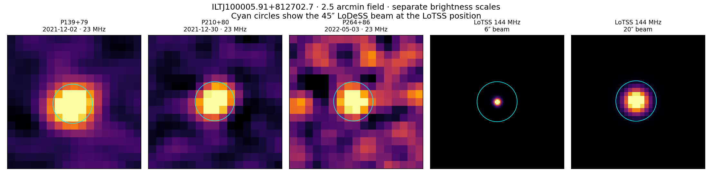
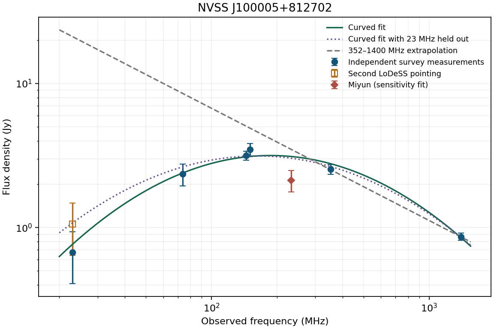
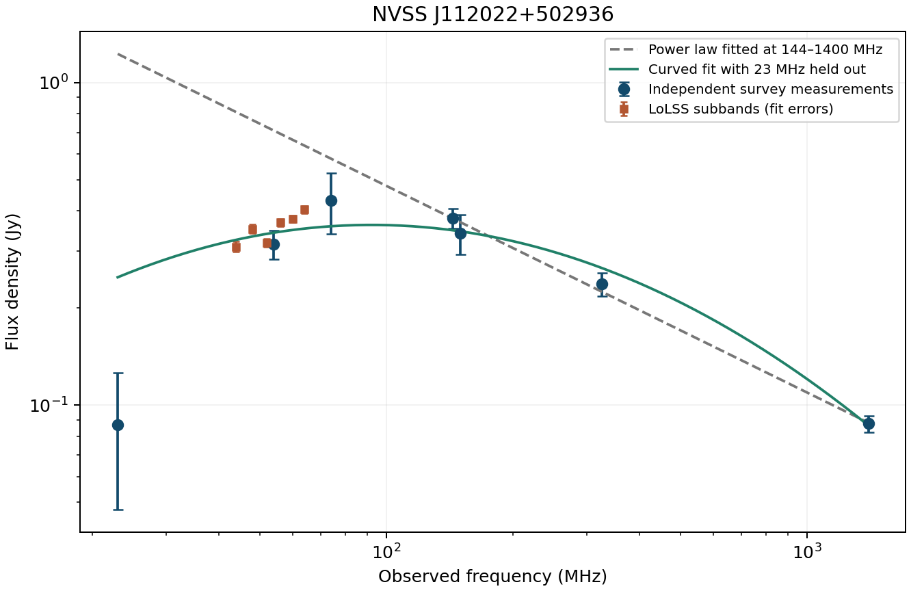

# Two low-frequency turnovers in the LoDeSS DR1 footprint

NVSS J100005+812702 and NVSS J112022+502936 are known radio sources whose broadband spectra turn over below a few hundred MHz. We found neither turnover in the source-specific references and published peak lists we checked. J100005 has the stronger decametre evidence. J112022 has independent evidence of curvature above 23 MHz, but its decametre flux is unusually sensitive to the local field response. These are exploratory source-level findings. See the [original research plan and repository overlap check](PLAN.md), [prior identifications and exclusions](literature/README.md) and [survey crossmatches](comparison/README.md).

## NVSS J100005+812702

At the LoTSS position (ICRS 150.0246°, +81.4508°) the good P139+79 field yields 0.671 ± 0.025 Jy at 23 MHz. The uncertainty here is the local image noise. As a sensitivity allowance, the survey's 39% empirical scale term for good-field compact sources adds 0.262 Jy. The source is 3.02° from this pointing centre. It also appears in P210+80, a different field 28 days apart and 9.22° off axis. The second fixed-position fit gives 1.060 ± 0.054 Jy and its aperture gives 0.801 Jy. A third image, from P264+86 on 2022-05-03 at 10.48° off axis, gives 0.435 ± 0.063 Jy. The three peaks are within 3.4″ of the LoTSS position. The original source catalogue contains the object at zero-based row 9460 in P210+80. Matching only against entries assigned to P139+79 misses it. The Gaussian table retains the individual pointing detections. Fits at 144 MHz give 3.125 and 3.031 Jy in the same 60″-radius aperture on 6″ and 20″ images. The two off-axis observations verify the position. Their response and residuals limit the repeatability of the 23 MHz flux. The measured 23-to-144 MHz ratio for the good pointing is about 13 times below the extrapolation from 144 MHz and 1.4 GHz. [Five image stamps, positions and measurements](release/evidence/J100005)



A VLA 73.8 MHz image yields a 2.27 ± 0.11 Jy fixed-position fit before CLEAN bias. Taking the flux in a 90″ aperture and applying the published CLEAN-bias allowance gives 2.35 ± 0.20 Jy, with a further 0.35 Jy scale allowance. The measured spectrum reaches 3.159 Jy at 144 MHz (LoTSS) and 3.489 Jy at 150 MHz (TGSS), before declining to 2.541 Jy in the WENSS polar band (modeled at 352 MHz; the historical compilation labels it 325 MHz), 0.863 Jy at 1.4 GHz (NVSS) and 0.122 Jy at 7.7 GHz (RATAN). LoTSS accounts for essentially all the high-resolution catalogue flux in the VLSSr beam. A 2006 VLBA image also shows a 0.150 Jy/beam component at 2.3 GHz. These independent observations support a compact radio emitter with a broadband turnover. They do not locate an absorbing screen. SPECFIND's previous fit for this source used frequencies at and above 150 MHz. The RATAN paper's published spectrum started at 325 MHz. [SPECFIND V3](https://cdsarc.cds.unistra.fr/viz-bin/cat/VIII/104) · [Mingaliev et al.](https://arxiv.org/abs/astro-ph/0102275) · [VLBA map](https://astrogeo.org/image_prod/npcs_pet/J1000+8127_S_map.fits)

For seven other compact, bright VLSSr emitters within 3° that also have a good-field LoDeSS catalogue centroid, the ratios of forced 23 MHz to 144 MHz flux range from 1.54 to 4.81 (median 3.14). J100005 gives **0.212**. The catalogue 74 MHz peak divided by 144 MHz integrated flux is 0.69 for the target and 1.04–1.73 for these seven. The controls confirm that the whole patch is not dimmed by the same factor. Requiring a good-field centroid selects against weak controls, so these ratios cannot supply a population significance. [Comparison positions and fluxes](evidence/polar_controls.csv)

A smooth curved spectrum improves AIC by **30.8** over an unbroken power law using the primary 23 MHz image and five higher-frequency surveys. Holding out **both LOFAR surveys** leaves VLSSr, TGSS, WENSS and NVSS. Those four independently observed measurements still favor curvature by **17.9 AIC units**, with a fitted maximum near 164 MHz. The baseline peak is 187 MHz and replacing the primary LoDeSS flux with the brighter repeat gives 169 MHz. Allowing an extra 20% scatter per survey gives a 13.0-unit improvement. The fits share data and the values are conditional on selection, error allowances and spectral shape. The Miyun 232 MHz datum is 2.13 ± 0.36 Jy using local noise and 16.6% empirical inter-survey scatter. Including it gives a peak of 181 MHz (conditional 95% profile interval 118–218 MHz). Holding out the 23 MHz data while retaining Miyun gives 152 MHz (67–212 MHz) and an 18.6-unit AIC improvement. The precise maximum and absorption mechanism remain open. The 38 MHz 8C survey's published source list has no counterpart here and its local sensitivity has not been established. [Photometry and fit variants](comparison/evidence/j100005_fits.csv) · [8C archive](https://www.mrao.cam.ac.uk/projects/surveys/8C/)



## NVSS J112022+502936

This source at ICRS 170.0922°, +50.4932° is missing from the LoDeSS source catalogue within 30″. Measuring directly at the LoLSS position in P171+49 gives **86.8 ± 19.9 mJy** at 23 MHz. The 39% scale allowance raises the uncertainty to 39.3 mJy in quadrature. The 54 MHz catalogue measurement is 315 ± 5 mJy, and a common 45″ beam and 60″ aperture gives 69, 387 and 337–378 mJy at 23, 54 and 144 MHz respectively. The VLA image at 73.8 MHz gives **408 ± 84 mJy** before CLEAN bias. Independent TGSS and earlier 6C measurements at 150–151 MHz agree broadly with LoTSS. At 340 MHz VCSS reports a corrected 252 mJy, consistent with WENSS at 325 MHz. International LOFAR stations detected fringes at 140 MHz, providing evidence of a subarcsecond component. The optical value-added catalogue gives no adopted host redshift. [Image measurements](release/README.md) · [Fluxes and limits](evidence/photometry.csv) · [Prior records](literature/README.md)



A fit to 144–1400 MHz predicts 1.23 Jy at 23 MHz. With 23 MHz held out entirely, smooth curvature improves AIC by 22.0 over a power law across 54–1400 MHz. A log-parabola and an external free-free absorption model place the maximum at 92 and 91 MHz respectively, conditional on those shapes. Their predictions at 23 MHz span 0.004–0.249 Jy. The fits establish how strongly the data require curvature under the stated errors, while the low-frequency shape remains poorly determined. [Fits, including the high-frequency extrapolations](evidence/fits.csv)

The apparent fourteenfold 23 MHz deficit against the high-frequency extrapolation overstates the source-specific effect. For 29 other compact, isolated counterparts within 2°, the median measured/predicted fraction is 0.162 at 23 MHz and 0.812 at 54 MHz. For the target the fractions are 0.070 and 0.441. Several controls are fainter relative to prediction at 23 MHz, while the target falls below all 29 controls at 54 MHz. The six-channel 44–64 MHz slope is +0.64 ± 0.18 using the convention S ∝ ν^α. LoLSS reports a typical positive bias of 0.2–0.3. The two more distant LoDeSS pointings give 177 ± 102 and 2 ± 131 mJy. Neither independently verifies the primary flux. A 36.528 MHz OVRO-LWA map has about 1.84 Jy local scatter and cannot resolve the ambiguity. [Local peers](evidence/local_peers.csv) · [LoLSS DR1](https://arxiv.org/abs/2301.12724) · [Channel morphology and repeat measurements](release/README.md)

## Search population and false positives

| Selection | Coverage and outcome |
|---|---|
| LoDeSS-detected sources | 21,465 source rows and 33,890 Gaussian rows. Field assignment from the WCS leaves 11,008 source rows in good fields. Of 3,041 within 3.5° of their good-field centre, 901 pass the single-component, isolation and brightness cuts, and 138 also pass high-resolution compactness, neighbour-flux and NVSS counterpart cuts. The highest predicted/measured ratios include previously recognized spectral breaks, objects with uncertain low-frequency flux recovery, and clean rediscoveries. [All 138](evidence/detected_sample.csv) |
| LoLSS-selected forced photometry | 275 bright, isolated sources in three good fields, 207 with no LoDeSS centroid within 30″. Each position had usable 23 MHz pixels and 272 had at least five matched subband detections. Six slopes exceed three formal errors before the beam-bias allowance. Five of the six are already in published peak lists. We retained signed 23 MHz measurements for all 275. [Parent sample](evidence/lolss_parent.csv) |
| Expanded LoLSS screen | A 60 mJy threshold and looser compactness cut yielded 780 sources. Of these, 743 passed six-channel quality cuts. The strongest candidate, J115948+582020, already has a published 270 MHz peak. Its possible second rise at 23 MHz is sensitive to aperture and calibration next to a projected X-shaped radio galaxy. [Expanded screen](release/README.md) |
| VLSSr-selected sources | 622 unique bright compact sources in the good fields, with 155 same-field catalogue nonmatches across 153 objects. All 18 externally supported apparent nondetections below 3 local σ in P136+36 were detected in P136+30 at 8.9–53.4σ. These neighbouring pointings demonstrate how a convincing false cutoff can arise. [Repeat-pointing evidence](comparison/evidence/vlssr_repeat.csv) |
| GLEAM northern edge | 3,631 positional matches in the full release. Among 284 row matches satisfying nonpoor field, radius, compactness, neighbour-flux, TGSS and NVSS cuts, 216 supplied measurements in all four broad channel groups above twice the conservative errors. None had a positive 76–227 MHz slope exceeding three formal errors. This tests a rising slope across that band and is insensitive to many peaks below 76 MHz. Both named candidates lie north of GLEAM EGC coverage. [Screen](evidence/gleam_screen.csv) |

The WCS audit identified **1,635 source rows from three fields rated poor** in the survey paper (P100+30, P17+40 and P317+27), despite the release page's statement that poor fields are excluded. Every single-component row used to resolve field identity matched its own Gaussian position and identifiers. Using the pointing closest on the sky would wrongly retain some rows from other fields, especially in overlaps. [Full field audit and acquisition receipts](release/README.md) · [LoDeSS DR1](https://lofar-surveys.org/lodess.html) · [Cordun et al.](https://arxiv.org/html/2610.04698v1)

## Statistical interpretation

The field-level screens are exploratory and overlap. Their counts cannot be added to estimate an incidence rate. The DR1 continuum is one datum per observation across 15–30 MHz. Quoted image errors come from repeated measurements at local offset positions. The catalogue errors alone omit direction-dependent calibration. For the six LoLSS-selected objects’ broadband fits we used independent Gaussian survey gains with fractional allowances of 39% (LoDeSS), 10% (LoLSS), 15% (VLSSr), 7% (LoTSS), 10% (TGSS), 8% (WENSS) and 5% (NVSS), added to the quoted measurement errors in flux space. Some catalogue uncertainties already include part of the scale term. The J100005 fit uses the native TGSS uncertainty without a further gain term, the polar-band WENSS frequency, and a separate Miyun sensitivity fit. These working assumptions cannot measure the individual field gains. Each fit uses one broadband datum per survey. The LoLSS subbands have a common scale, a 4% per-channel differential floor and a separate spectral-index bias sensitivity test. The GLEAM screen groups adjacent bands and keeps the largest individual uncertainty in a group plus a 5% differential floor; a shared absolute gain cancels from its slope. Large GLEAM beams and partial footprints limit interpretation.

The compact-source fit uses a power law, a concave quadratic in log frequency versus log flux, and a power law multiplied by exp[−τ(ν/144 MHz)^−2.1]. The last is an idealized foreground absorption screen. A better fit by this function does not distinguish free-free absorption, synchrotron self-absorption, or multiple unresolved components. The fitted turnover frequencies are model-dependent observed-frame estimates; there are no 15 and 30 MHz subband measurements to locate a peak within the LoDeSS band. AIC differences are conditional fit comparisons and have no survey-wide false-discovery interpretation. The likelihood for signed forced flux is Gaussian in flux; the table also gives conservative one-sided limits of max(0,flux)+1.645σ for weak measurements and the model probability of falling below those limits. Footprint gaps and catalogue nonmatches receive no automatic limits.

Consistent flux measurements from different instruments near 150 MHz, reference-source comparisons, fixed-position image fits and repeated pointings reduce the opportunities for blending and large amplitude changes to mimic these spectra. The present data have no simultaneous 23–150 MHz spectrum. A new near-axis 25–60 MHz observation at matched resolution, with local calibrators and a separately observed epoch, would test whether the decametre suppression persists and discriminate between the low-frequency models.

## Reproduction

From this directory, use Python 3.12 with NumPy, SciPy, pandas, Astropy, lxml and Matplotlib. Start with the downloads and field mapping in [release](release/README.md), followed by the archive and LoTSS queries in [comparison](comparison/README.md). For the commands below, `DATA` is the release directory containing `sources.fits`, `fields.csv`, `source_fields.csv` and the images. `ARCHIVES` contains the downloaded HEASARC tables and `MATCHES` the matched LoDeSS rows. Use a fresh working directory for outputs. Fetching the LoLSS parent from the original files preserves its row order for the second LoTSS query.

```bash
mkdir -p work/evidence work/parent-tap
python detected_sample.py "$DATA" "$MATCHES" work/evidence
python gleam_screen.py "$DATA/source_fields.csv" "$MATCHES" work/evidence
python lolss_sample.py "$DATA" work/lolss work/evidence
python comparison/fetch_lotss.py work/lolss/parent_positions.fits work/parent-tap
python comparison/match_catalogues.py work/lolss/parent_positions.fits work/parent-tap work/parent-tap --surveys lotss
python comparison/match_catalogues.py work/lolss/parent_positions.fits "$ARCHIVES" work/parent-tap --surveys nvss vlssr gmrtas150m wenss
python model_spectra.py work/evidence/lolss_parent.csv work/parent-tap work/evidence
python polar_controls.py "$DATA" "$MATCHES" comparison/evidence/vlssr_parent.csv.gz work/evidence/polar_controls.csv
```

The release and comparison directories list the source URLs, observed input hashes, catalogue row conventions, images and validation commands. Raw multi-gigabyte survey images remain available from the original archives. DR1 calibration and source-extraction details are in the release paper. [Observation manifest](release/evidence/acquired.json) · [External archive checksums](comparison/archives.csv) · [LoLSS input checksums](evidence/lolss_inputs.csv)
