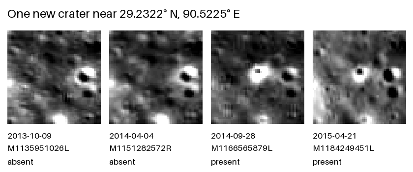

# A lunar impact counted in two catalogue entries has a shorter formation interval

Two rows in the February 2025 LROC release point to one newly formed crater on the Moon's eastern limb, near **29.2322° N, 90.5225° E**. Both cite the same post-impact image. An additional, observation taken under closely matched illumination shows the crater still absent on **4 April 2014**. It appears on **28 September 2014** and remains visible on **21 April 2015**. The new 177-day bracket halves the narrower of the two published image-pair intervals. The identification and revised date bracket refer to an already imaged crater. [LROC data release](https://data.lroc.im-ldi.com/lroc/view_rdr/SHAPEFILE_GLOBAL_NEW_CRATERS) · [Product records and links to original images](frame_sources.csv)



Each panel covers the same 55 × 55 reference pixels, roughly 72 m across. The candidate sits at the center of each panel. The bright rim and dark interior appear together in the third and fourth panels. A pre-existing crater toward the right edge helps align the terrain by eye. Each cutout has its own contrast stretch. The measurements below use archive coordinates and acquisition dates.

| One-indexed DBF row | Latitude | East longitude | Catalogue diameter | Last absent in listed pair | First present in listed pair | Interval |
|---|---:|---:|---:|---|---|---:|
| 11 | 29.2322° | 90.5225° | 9.1 m | 2013-10-09, M1135951026L | 2014-09-28, M1166565879L | 354 d |
| 72 | 29.2322° | 90.5226° | 8.7 m | 2013-04-15, M1120656220R | 2014-09-28, M1166565879L | 531 d |

The two reported centers lie **2.65 m** apart, inside the radius of either reported crater, on the same after-image. Independent registration against both before-images isolates the same new structure. The 4 April and 28 September frames have incidence angles of 41.46° and 42.08°, respectively, and sample the site at 1.37 and 1.31 m per pixel. The April 2015 view has a different incidence angle of 64.57°. Along with the earlier before-frames, this later view helps distinguish lasting relief from a one-frame detector artifact. The centroid of the displayed structure derives from image registration. The decimals printed in the table come from the catalogue. Absolute lunar geolocation is less precise. [Image records](frame_sources.csv) · [LROC geolocation study](https://doi.org/10.3847/psj/ad54c6)

This one duplicate makes 221 an upper bound on the number of distinct impacts represented by the 222 rows in **this released shapefile**. The discovery neither re-estimates the lunar flux nor establishes what went into any unpublished counting ledger. The difference between duplicate rows and separate impacts cannot generally be resolved from a proximity cut alone. A separate reconstruction by Sokołowska et al. provides exact positions and frame pairs for a subset. Searches of its crater table and published references under these camera IDs did not locate this tighter interval. [Speyerer et al. (2016)](https://doi.org/10.1038/nature19829) · [Independent reconstruction](https://doi.org/10.5281/zenodo.15755155)

## The original impact-flash search

A separate all-pairs screen compared 222 crater rows with 420 distinct NASA MEO flash IDs with positions. It combines the preliminary 443-ID archive with the 299 usable refraction-corrected rows from Moser et al. Table 4. Twenty-three late-2017 events in the MEO archive have missing coordinates. The table marks the corrected position unavailable for flash 16, so the analysis keeps its preliminary position. All angular distances use a 1,737.4 km lunar sphere and east-positive longitude. A deliberately generous exploratory 25 km radius gave five pairs. **All five failed their image dates.** They supply no evidence for a new flash/crater association. We did not estimate chance-coincidence rates after eliminating the entire shortlist on chronology. The independently known 17 March 2013 impact, inserted separately as a coordinate/sign control, lies 3.04 km from the refraction-corrected flash. [MEO archive](https://www.nasa.gov/wp-content/uploads/2016/12/alamo_lunar_impact_observations443.pdf) · [Refined coordinates](https://ntrs.nasa.gov/api/citations/20150021386/downloads/20150021386.pdf) · [Published positive control](https://ntrs.nasa.gov/citations/20150016509)

| Flash ID | Distance (km) | Flash UTC date | Date bracket of nearest spatial match |
|---:|---:|---|---|
| 13 | 10.28 | 2006-10-30 | 2012-08-09 to 2013-07-29 |
| 74 | 23.15 | 2007-11-17 | 2013-03-01 to 2015-02-08 |
| 185 | 23.71 | 2009-10-25 | 2013-03-31 to 2014-09-13 |
| 260 | 21.52 | 2011-12-29 | 2014-04-12 to 2015-04-01 |
| 363 | 18.74 | 2015-12-15 | 2011-10-14 to 2014-03-18 |

## Reproduce

Run from this folder. The flash screen requires Python 3 and Poppler's `pdftotext`. It downloads and hashes the two original PDFs and the shapefile. The four-visit image replay requires NumPy, SciPy and Pillow. It reads the original LROC Zoomify display pixels, uses image corners for initial pointing and registers the images with normalized correlation on the surrounding terrain. It compares the resulting 55 × 55 cutouts to the frozen arrays. The figure can also be regenerated offline. [Image label receipts](image_dates.csv) · [Catalogue and PDF checksums](source_hashes.json)

```sh
python screen_flashes.py /tmp/lunar-flash-cache
python reduce_images.py /tmp/lroc-tiles
python make_panel.py
```
