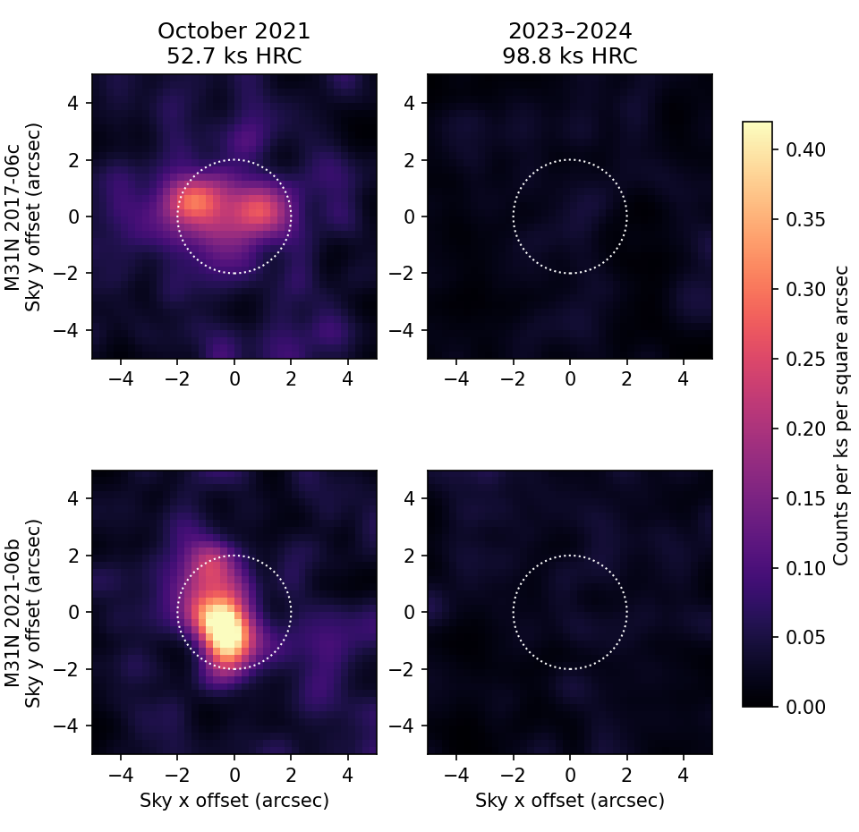
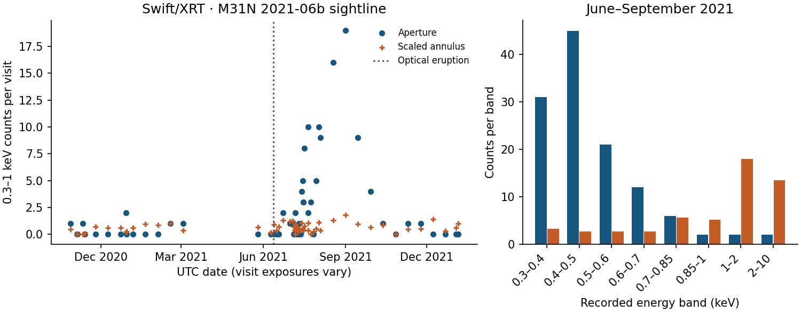

# Two candidate X-ray counterparts of optical novae in M31

Chandra measured a point source 0.246 arcsec from the Fe II nova M31N 2017-06c more than four years after its optical discovery. A second point source appeared 0.178 arcsec from M31N 2021-06b about four months after discovery. Both were bright in two October 2021 visits. By the 2023 and 2024 visits, counts at both optical positions had fallen close to the local background. The X-ray sources themselves appear in the Chandra Source Catalog (CSC). This study proposes the two optical associations and measures the X-ray excesses in the discovery and later comparison visits.

| Optical eruption | CSC 2.2 source | Optical-to-X-ray delay in the two visits | Oct 2021 HRC counts / local background | 2023–24 HRC counts / local background |
|---|---|---|---:|---:|
| M31N 2017-06c | 2CXO J004232.8+411223 | 1,592.28 and 1,594.97 days | 120 / 27.50 | 32 / 24.58 |
| M31N 2021-06b | 2CXO J004258.9+411808 | 128.28 and 130.97 days | 140 / 25.50 | 33 / 30.67 |

The circles mark the optical apertures. All four panels share a count-rate scale and 0.5-arcsec Gaussian smoothing. The full lists and aperture calculations use unsmoothed photons. [Figure code](figure.py)

The two 2021 visits provided 52.70 ks of exposure. The nine later HRC visits provided 98.77 ks. Every count in the table comes from a circular 2-arcsec aperture centered on the **optical** coordinates. The 4–8 arcsec annulus has 12 times the source area. The two individual visits show positive excesses at each target. Conservative 95% lower bounds on the decline in HRC aperture count rate are 4.79-fold for 2017-06c and 7.59-fold for 2021-06b. These bounds use one-sided exact Poisson limits on four on/off means with a Bonferroni correction, a locally uniform background in each epoch, and comparable HRC response at these nearly identical pointings. Four ACIS pointings in 2024 independently gave 3 and 4 aperture counts, with expected backgrounds of 3.42 and 3.33 counts, respectively. The event lists cover the same sources in two older HRC control fields. [All measurements](measurements.txt) · [Official file identifiers and hashes](observations.csv)

A late X-ray phase can accompany nuclear burning on a white dwarf after a nova. A four-year delay makes 2017-06c particularly interesting. For 2017-06c the observations establish the X-ray state in October 2021 and leave the intervening years sparsely measured. HRC has limited energy resolution. A separate transient at the same position, or a later unobserved eruption, could contribute. The optical classifications differ. M31N 2017-06c has spectroscopy, while 2021-06b has optical and ultraviolet measurements. [2017 discovery](https://www.astronomerstelegram.org/?read=10484) · [2017 spectroscopy](https://www.astronomerstelegram.org/?read=10487) · [2021 optical discovery](https://www.astronomerstelegram.org/?read=14702) · [Published M31 nova X-ray monitoring](https://doi.org/10.1051/0004-6361/201322426)

## The optical spectrum and X-ray energy bands

The three 600 s Liverpool Telescope SPRAT exposures from 2017 June 13 resolve Balmer emission from **M31N 2017-06c**. Williams & Darnley reported these same observations, identified the Fe II class and measured an Hα width of about 1,100 km/s. We retrieved the level-2 spectra from programme JL17A03 and measured the apparent widths per exposure. The following values include the instrumental line spread. [Observers' report](https://www.astronomerstelegram.org/?read=10487) · [SPRAT data products](https://telescope.livjm.ac.uk/TelInst/Inst/SPRAT/) · [FITS manifest](sprat-observations.csv)

| Exposure start (UTC) | Hα centroid (Å) | Hα FWHM (Å) | Hα FWHM (km/s) | Hβ FWHM (km/s) | Nearby sky [O I] 6300 FWHM (Å) |
|---|---:|---:|---:|---:|---:|
| 03:48:53 | 6558.52 | 29.36 | 1341 | 1354 | 16.33 |
| 03:59:02 | 6558.65 | 30.14 | 1377 | 1342 | 15.52 |
| 04:09:10 | 6557.95 | 29.24 | 1336 | 1519 | 16.79 |

The plotted spectra use a common continuum interval for normalization and the inset scales each continuum-subtracted Hα profile to its own peak. [Plot code](plot_sprat.py)

Each fit uses an unweighted Gaussian plus a sloped continuum over ±80 Å about the laboratory wavelength, on the archive's 9.2 Å grid. Moving the edges to ±60 or ±100 Å and independently extracting nine slit rows around the spatial peak with local sky subtraction gives Hα widths of 1,279–1,421 km/s across all fits. This range measures method and exposure sensitivity. The three share the same wavelength calibration. The nearby sky line is narrower in every exposure. Gaussian quadrature subtraction using its width as an approximate instrumental reference yields Hα widths near 1,090–1,180 km/s for the default fits, consistent in scale with the original report. Slit illumination differs for the sky and a point source. A coarse grid, blending, sky subtraction and the line-spread function limit the precision. The archive supplies relative detector counts for this extraction. [All fits](sprat-lines.csv) · [Sampled spectra and slit-sky profiles](sprat-spectra.csv)

For **M31N 2021-06b**, MASTER reported an unfiltered magnitude of 15.9 at this sightline in August 2018 and a limiting magnitude of 19.5 on 2021 June 8. In June 2021 Swift/UVOT measured uvw1 = 17.82 ± 0.08 AB on June 13, fading below the uvw1 detection limit of 20.0 AB by July 2. The earlier MASTER detection complicates identification of the eruptive object in this crowded field. The 2021 data support a UV-bright transient. Recurrence, blending and the optical classification remain open. A 30-arcsec Liverpool archive search returned 2019 spectra of two nearby, differently positioned targets, with no level-2 SPRAT spectrum of this eruption. [MASTER](https://www.astronomerstelegram.org/?read=14703) · [UVOT June](https://www.astronomerstelegram.org/?read=14716) · [UVOT July](https://www.astronomerstelegram.org/?read=14762)

Two Swift/XRT photon-counting visits bracket the 2021 October 18 and 20 Chandra detections. A six-pixel aperture (14.1 arcsec radius) at each optical position contained at most one 0.3–10 keV event. These short exposures yield upper limits. The single event at 2021-06b had PI = 41 (nominally 0.41 keV), while the October 13 annulus predicts 0.87 soft-band background events there. It carries no individual source attribution.

| Date (2021 UTC) | Sightline | Mean aperture exposure (s) | Aperture events / scaled annular background (0.3–10 keV) | One-sided 95% upper limit (counts/ks) |
|---|---|---:|---:|---:|
| Oct 13 | 2017-06c | 1515 | 0 / 2.85 | 1.98 |
| Oct 13 | 2021-06b | 1528 | 1 / 2.02 | 3.10 |
| Oct 27 | 2017-06c | 125 | 0 / 0.19 | 23.95 |
| Oct 27 | 2021-06b | 122 | 0 / 0.16 | 24.62 |

The Swift selection uses the two HEASARC `swiftmastr` pointings with positive PC exposure, start MJD 59492–59518, RA 10.30°–11.10° and Dec 40.96°–41.55°. Both cover both targets in their calibrated exposure maps. The cleaned event files' PC exposures are 1,533 and 131 s. We scale annular counts by the ratio of summed map exposures in the source and background regions (12–24 pixel background annulus). We keep grades 0–12 and PI 30–1000. The exposure in the table is the mean map exposure in the source aperture. Limits use the one-sided 95% Poisson bound on the total aperture counts and omit background subtraction to give conservative source limits. All rates refer to the aperture and have no PSF or energy-flux correction. Diffuse emission and neighbouring sources enter the large Swift apertures. Their response and coverage differ from the October 18–20 HRC observations. [Event and exposure-map manifest](swift-observations.csv) · [Swift/XRT documentation](https://www.swift.ac.uk/user_objects/docs.php)

In the four August 2024 ACIS pointings (117.803 ks total), both 2-arcsec optical apertures contained **zero events between 0.3 and 2 keV**, giving a marginal 95% upper limit of 0.0254 aperture counts/ks in this band per target. At 2–7 keV the apertures contained 1 and 2 events against expected backgrounds of 1.17 and 0.92, respectively. The ACIS bands use the PI-channel midpoint, (PI − 0.5) × 0.0146 keV. The background region is the original 4–8 arcsec annulus. ACIS rates here divide by the nominal observation exposures as in the original replay. These late counts and the shallow Swift visits leave the spectrum, temperature and luminosity of the 2021 HRC sources undetermined. [Band-by-band counts and upper limits](xray-bands.csv) · [ACIS PI convention](https://cxc.cfa.harvard.edu/ciao/dictionary/pi.html)

Run `python sprat.py` for the line-fit CSV and `python xray_bands.py --swift-cache /path/to/cache` for the X-ray CSV. The latter fetches four small public Swift products by checksum and requires Astropy. Omitting the cache option replays the ACIS rows offline. To regenerate the SPRAT data, select night of **20170612** (local observing night), instrument **SPRAT**, level **2**, programme **JL17A03** in the Liverpool archive. Download the three products in the manifest and run `python sprat.py --extract /path/to/fits --output regenerated.csv`. The extractor checks SHA-256 of the decompressed FITS. The output contains three detector-count spectra from SPEC_SS, a second extraction from LSS_NONSS for each, and the median slit sky for the wavelength and resolution check. The archive records an arc-fit status flag of 3 and the same comparison arc for all three exposures. The sky-line checks apply at the two tabulated lines. [Liverpool archive](https://telescope.livjm.ac.uk/cgi-bin/lt_search) · [Replay code](sprat.py) · [X-ray extraction](xray_bands.py)

The Liverpool Telescope on La Palma is operated by Liverpool John Moores University at the Instituto de Astrofísica de Canarias' Observatorio del Roque de los Muchachos, with support from the UK Science and Technology Facilities Council. We credit the JL17A03 observers and the UK Swift Science Data Centre, Swift team and HEASARC archive for the public data. [Telescope and instrument references](https://telescope.livjm.ac.uk/Ack/)

## A soft Swift/XRT transient toward M31N 2021-06b

The Living Swift-XRT Point Source Catalogue (LSXPS) already lists the soft source **LSXPS J004258.9+411807**, 1.4 arcsec from M31N 2021-06b, with a 3.0-arcsec catalogue 90% error radius. Its public per-observation light curve records ten soft-band detections from July 14 through September 15, about 33–96 days after optical discovery. The master entry's longer date span includes stacked coverage. We re-extracted the same underlying Swift photons at the fixed optical position, added pre-eruption and late control periods, and tested the association with the optical eruption and later Chandra position. The catalogue measurements and this reanalysis share the observations. [UKSSDC catalogue source](https://www.swift.ac.uk/LSXPS/LSXPS%20J004258.9%2B411807) · [Catalogue measurements](swift-lsxps-detections.csv) · [Archive checks and attribution](swift-catalog-check.md)

Swift recorded a 0.3–1 keV excess near the 2021 optical eruption during July–September, before the October Chandra detections. The strongest single visit, on September 1 (81 days after the catalogued optical discovery), contained 19 soft counts in the optical aperture versus 1.8 expected from its exposure-weighted local annulus. On August 18 the same aperture contained 16 versus 1.31. These are independent observing visits. Swift's angular resolution permits a blend with a second Chandra position. The comparisons below concern the **sightline**.

| Swift PC visits at the optical position | Visits | Mean aperture exposure summed (ks) | 0.3–1 keV on / scaled background | 1–2 keV on / scaled background | 2–10 keV on / scaled background |
|---|---:|---:|---:|---:|---:|
| Oct 28, 2020–Jun 9, 2021 | 17 | 20.804 | 6 / 7.39 | 5 / 6.81 | 2 / 4.83 |
| June 13–September 29, 2021 | 33 | 46.302 | **117 / 22.26** | 2 / 18.05 | 2 / 13.48 |
| Oct 13, 2021–Jan 5, 2022 | 8 | 9.637 | 3 / 5.13 | 0 / 4.11 | 0 / 2.16 |

The left panel shows gross counts per visit and the local background estimate. Exposures differ by visit. The right panel sums counts in bands of unequal widths. [Plot code](plot_swift_history.py)

Of the 117 summer soft events, 76 had recorded energies of 0.30–<0.50 keV (6.01 expected from the annuli) and 33 had 0.50–<0.70 keV (5.41 expected). At 0.70–<1 keV the aperture contained 8 against 10.84 expected. The six soft-energy bins, all 58 visits and the wider bands are released as detector counts. The excess appears in the lower-energy channels in several pointings. The short October PC observations alone missed it. HRC and XRT sampled different times and responses. The data do not determine a temperature, absorption column, intrinsic flux, or a turn-on date.

**Source confusion.** A 14.1-arcsec-radius aperture around the optical position encompasses 2CXO J004258.0+411809, 10.27 arcsec away. The summer soft events within that aperture have an unweighted mean offset 2.41 arcsec west and 2.07 arcsec south of the optical position. Centering the same aperture on the neighbouring CSC source returns 110 counts against 19.78 expected. Both apertures include much of the same emission. A centroid measured inside an aperture is pulled toward its center. Measurement scatter, Swift aspect calibration, the PSF and an unresolved mixture all limit source attribution. The candidate 2CXO J004258.9+411808 remains the closest October HRC source to the nova at 0.178 arcsec. The neighbour has wide-band flux significance zero in both October HRC visits. Its historical catalogue significance is low. Those data leave its state during the summer Swift visits open. [CSC cone extract](csc-neighbors.csv) · [183 neighbour extractions](swift-neighbor-csc-history.csv) Two older catalogued eruptions, M31N 2012-05a and M31N 1954-06b, also lie inside the Swift aperture at approximately 7 and 13 arcsec. These positions supply alternatives without evidence for a 2021 eruption there. [Nova catalog](https://ashafter.sdsu.edu/m31_nova_table.html)

**Spatial and temporal controls.** Shrinking the summer aperture to 9.4 arcsec gives 79 soft events versus 10.00 expected. Expanding it to 18.9 arcsec gives 146 versus 39.22. Eight equal-size apertures displaced 28.3 arcsec in equally spaced directions yield 14–29 soft counts over comparable exposures. They sample a crowded, nonuniform field. The hard-band local annulus overpredicts the central aperture counts. The simple background scaling assumes uniform surface brightness after weighting by the exposure map. Comparing the same optical aperture over time also shows that the excess concentrates after the eruption. Reported per-visit tails condition on the aperture and annulus totals in one band and one visit. The target, dates and bands were examined retrospectively, so these tails do not express the probability of an optical identification or a survey-wide false-alarm rate.

**Reproduction.** The HEASARC `swiftmastr` selection uses start MJD 59100–59610, RA 10.30°–11.10°, Dec 40.96°–41.55°, positive PC exposure and the two public queries split near the discovery at MJD 59376. The 58 unique observations include M31 monitoring and pointings for other novae. The input table records the raw catalog exposure, SHA-256 and URL for all 116 PC event files and maps. For each named aperture, retain visits with at least 30 s mean source- and background-region map exposure. All 58 visits pass for the six-pixel optical aperture. All 33 summer visits pass for all eight shifted controls. Counts use grades 0–12, the calibrated PI channels in the table and the same 12–24 pixel annulus as above. Spatial offsets use the event/map WCS, with east and north positive. [Swift manifest](swift-timeline-obs.csv) · [Visit and control counts](swift-timeline-counts.csv)

Run `python swift_history.py` to aggregate the bundled measurements offline and print each visit's 0.3–1 keV result. Run `python swift_history.py --extract /path/to/cache > regenerated.csv` to rebuild the entire table from FITS. The selected [CSC 2.2 TAP](https://cda.cfa.harvard.edu/csc22tap) master-source rectangle was RA 10.72°–10.77° and Dec 41.28°–41.32°. The ZTF Bright Transient Survey also catalogues ZTF21abgkipt at this optical position as a nova. We found no spectrum of the 2021 optical eruption in the Liverpool search. [ZTF BTS](https://sites.astro.caltech.edu/ztf/bts/explorer.php?f=s&classstring=nova) · [Replay and regeneration](swift_history.py)

## Search, competing sources and controls

An exploratory cross-match of optical novae, XMM-Newton and Chandra led to the two October pointings. For the defined October test, we took all 325 optical eruptions with JD 2456000 through 2459505.78 in the November 13, 2026 living catalog. We matched them against the 100 distinct CSC sources with HRC wide-band flux significance of at least 3 in **both** ObsIDs 23871 and 26163. This is a retrospective sample. The optical catalog includes M31 candidates outside the observed field. Each mission centroid was compared with every eligible optical position on the unit sphere. The matching radius was 2.5 arcsec. [Optical input](nova_positions.csv) · [X-ray inputs](epoch_detections.csv)

Six pairs qualified, covering five optical eruptions. Four of these pairs had significant X-rays in earlier observations before the corresponding optical eruption. This includes the apparently close 0.425-arcsec match at 2017-01a, which had significant X-rays in 103 pre-eruption visits. The two sources reported here had zero pre-eruption observations reaching a flux significance of 3 in any reported band, over 178 and 180 CSC extractions. The final two detections in each history are the October 2021 visits. Differences in instrument response and exposure affect the historical limits. [Source histories](source_history.csv.gz)

For a crowding control, we shifted the whole optical catalog through 36 directions at each of 5, 10, 20 and 40 arcsec. Three optical positions lie within 0.5 arcsec of a doubly detected source in the real field. The maximum was one in the 144 shifted fields. At 2.5 arcsec, one shifted field matched as many novae as the original. These correlated shifts describe local chance alignments and do not give a posterior probability for either association. The fixed-aperture binomial tails in the replay describe a local background test assuming locally uniform surface density.

A weaker case, M31N 2019-07c, shows photon excesses in the optical aperture but fails the two-visit catalog threshold. Its second wide-band flux significance is 2.77, and one pre-eruption CSC observation reaches 3.65. The released cutouts include this case so that its exclusion can be checked.

Searches through November 14, 2026 used both nova names, optical-coordinate aliases, both 2CXO names, and both Chandra observation IDs. The Pietsch table updated in 2022 records optical spectroscopy or UV follow-up at these positions. The later living catalog lists the optical eruptions. We found no paper or telegram reporting these two optical-to-X-ray associations in the checked sources. LSXPS explicitly reports a Swift source and its 2021 soft-band detections at the 2021-06b position. The proposed optical association and comparisons above build on that public catalogue. The CSC positions and flux extractions are public mission results. [Pietsch catalog](https://www.mpe.mpg.de/~m31novae/opt/m31/M31_table.html) · [Living catalog](https://ashafter.sdsu.edu/m31_nova_table.html) · [Chandra Source Catalog](https://cxc.harvard.edu/csc/)

## Replay

From this directory, run the offline calculation using Python, NumPy and SciPy.

~~~sh
python replay.py
~~~

The raw calibrated event files are publicly downloadable. To re-extract the cutouts, install Astropy and run the following command.

~~~sh
python extract.py /path/to/chandra-cache regenerated.csv.gz
~~~

The extractor verifies each input SHA-256, applies its sky WCS to the optical coordinates, and exports every level-2 event within 10 arcsec, including the spatial offsets, event time and mission pulse-invariant channel. Compare the uncompressed CSV bytes to the bundled cutout. The full inputs total about 0.87 GB. The later HRC and ACIS observations were selected from the Chandra observation catalog independently of the CSC source positions; their coverage uses all 2023–24 visits in the returned central-pointing set.

Catalog provenance and exact joins are recorded in [catalog_queries.md](catalog_queries.md). The optical positions are redistributed from Shafter, Hornoch & Zhao, *A Living Catalog of Novae in M31*, under [CC BY 4.0](https://creativecommons.org/licenses/by/4.0/). The catalog credits W. Pietsch for the pre-May-2022 entries. This research uses data obtained from the Chandra Data Archive and the Chandra Source Catalog, provided by the Chandra X-ray Center. [Chandra catalog publications](https://cxc.harvard.edu/csc/publications/)
