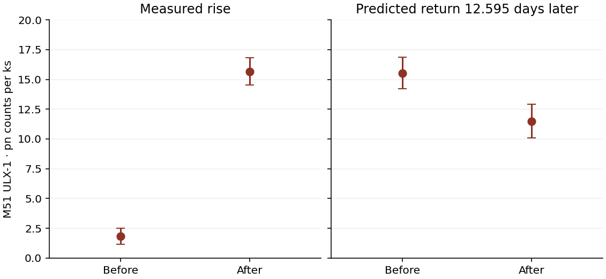
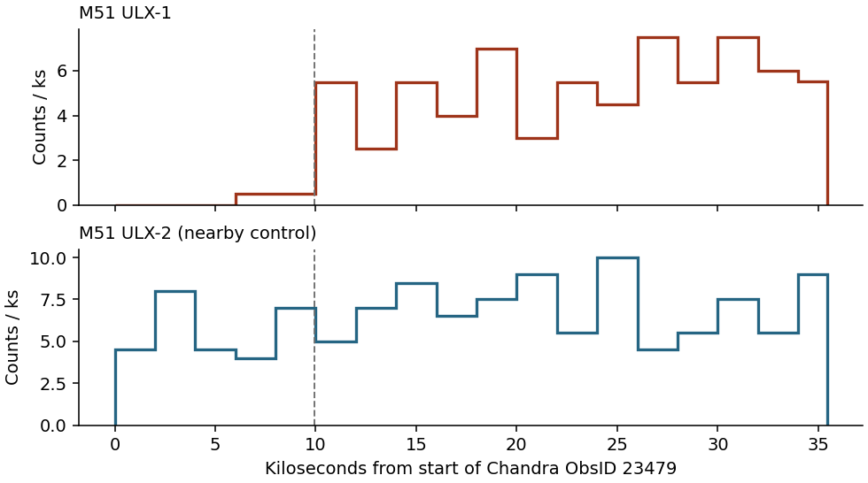

# Two archival rises in M51 ULX-1 and a missing repeat

On 14 May 2018, all three XMM-Newton EPIC cameras measured a rise in CXOM51 J132940.0+471237 (M51 ULX-1). A second XMM observation covered the time at which a deep eclipse should end 12.595 days later. ULX-1 was already bright for 22 ks before that predicted return. A new Chandra measurement in June 2021 resolves an even sharper rise at the same source. The neighboring binary M51 ULX-2 is 8.4 arcseconds away and was measured separately throughout.

The fitted sharp edge of the May 2018 rise falls **four minutes** from the date predicted by a 6.297632-day spacing between the 2012 and 2021 rises. That numerical agreement is real. The immediate repeat test fails. A stable orbit with a deep eclipse on every predicted cycle cannot account for all three observations under this identification. Variable obscuration, changes in eclipse visibility or unrelated dips remain possible. These observations establish two source-specific transitions and a missing repeat. They leave the binary orbital period open.



## Source-resolved measurements

| Visit and detector | ULX-1 before | ULX-1 after | Evidence and controls |
|---|---:|---:|---|
| 2018 May, XMM 0824450901 EPIC pn | 1.85 ± 0.67 | 15.67 ± 1.15 | At a common transition time, allowing ULX-1 to change improves the Cash statistic by 106.5 even with ULX-2 and backgrounds free on each side. |
| Same visit, MOS1 | 0.23 ± 0.43 | 6.85 ± 0.74 | ΔC = 55.5. ULX-2 changes from 3.49 to 3.89. |
| Same visit, MOS2 | 1.20 ± 0.52 | 8.00 ± 0.81 | ΔC = 47.3. ULX-2 changes from 3.08 to 3.50. |
| Predicted return, XMM 0830191401 EPIC pn | 15.53 ± 1.32 | 11.50 ± 1.41 | Live time 22.03 and 16.51 ks. ULX-1 is bright on both sides of the predicted boundary. |
| 2021 June, Chandra 23479 ACIS-S | 0.10 | 5.37 | One aperture photon in 9.94 ks and 137 in 25.51 ks. ULX-2 gives 56 and 177 photons. |

Rates are counts per kilosecond. XMM entries are fitted counts in a registered two-source spatial model, using 0.9–7 keV. Quoted errors come from the spatial fit at the chosen windows. Chandra entries are direct 1.8-arcsecond aperture counts in 0.3–7 keV. The different instruments and energy bands have different throughput. The two XMM cameras named MOS and the pn camera independently record photons during the same astrophysical event.

The best joint XMM sharp-step time is MJD 58252.13450. Its conditional profile bracket (ΔC ≤ 3.84) is 58252.13375–58252.14425. A smooth-rise fit gives a midpoint near MJD 58252.1402 and a 10–90% rise duration of roughly 6.6 ks. The four-minute residual compares fitted epochs and is smaller than the uncertainty in the physical contact time. Chandra gives MJD 59373.11583 for the June rise, with a corresponding profile bracket 59373.11167–59373.12139. All times here are MJD on a TDB timescale with projected Earth-to-barycenter light time included. Omission of the spacecraft position contributes less than one second. [XMM timing profile and camera checks](xmm/) · [Chandra fits](step-fits.csv)

## How the repeat test was constructed

Urquhart & Soria discovered eclipses in this binary and reported two period families around six and twelve days. The analysis on this branch began with those alternatives and reserved later Chandra visits to test them. The archived [initial question and test](https://github.com/dovvnloading/Open-Space/blob/a558d7e3/results/m51-ulx-eclipse-aliases/README.md) predates photon extraction on this branch. XMM deblending and the subsequent return test were exploratory extensions of that test. The published M51-ULS-1 planet candidate concerns another source in the same galaxy. [Original eclipse measurements](https://arxiv.org/abs/1608.01111) · [Multiband identification](https://academic.oup.com/mnras/article/475/3/3561/4795313) · [M51-ULS-1 study](https://doi.org/10.1038/s41550-021-01495-w)

1. Refit the 2012 Chandra egress in ObsID 13813 at MJD 56180.21617 and ingress in 13814 at 56191.61960. The source counts change from 25 to 1,609 across egress and 1,255 to 18 across ingress. Identify the distinct 2021 egress-like rise in ObsID 23479.
2. For each integer number of cycles between the 2012 and 2021 rises, calculate the period and the width implied by the 2012 ingress. Retain the original paper's 1.04–1.70-day duration range and either one or two cycles across the short 2012 baseline. This gives 39 discrete possibilities. Compare their predictions with the 2001 ingress and every other covered visit, allowing each visit its own flux normalization. No inference here requires a completely faint visit to be an eclipse. [All period aliases](period-grid.csv)
3. **507 cycles** across the long baseline give **6.29763248 days**. With 329 cycles from 2012 to 2018, the independent egress-like rise in the three XMM cameras falls 3.96 minutes early. No other retained period puts this edge within 0.20 days. This interpretation predicts the 2001 ingress approximately 1.74 days late.
4. Predict another egress two cycles after the *measured 2018 edge*, at MJD 58264.729765. ObsID 0830191401 covers it. The pre/post windows exclude the boundary by 0.025 days on each side. The pre-return flux matches the bright state from the first visit. This test requires extrapolation over only 12.595 days. It also covers one cycle of the exact double-period alternative. [Return windows and measured rates](xmm/xmm-2018-recurrence.csv)
5. Two XMM pn observations in 2021/22 provide further independent checks. At the 6.297632-day spacing, ObsID 0883550201 gives 9.47 ± 0.81 counts/ks within the predicted deep eclipse and 9.68 ± 0.93 outside. ObsID 0883550301 gives 13.80 ± 0.92 inside and 14.97 ± 1.05 outside. Other Chandra aliases also encounter bright intervals. For example, the 6.398597-day solution predicts eclipse throughout a 63.83 ks pn interval with 14.38 ± 0.71 counts/ks in 0824450901. [Spatial fits by period and visit](xmm/xmm-alias-rates.csv)

## Checks and coverage

A Chandra observing-catalog cone within 20 arcminutes returned 27 ACIS visits. ObsIDs 12562 and 12668 have no photons in the extraction region, with the nearest recorded events about 39 arcsec away. They supply no flux constraint. The other 25 visits provide 1.251 Ms of target-CCD good-time intervals. The spectra and event distributions in these apertures can include diffuse emission. The reported exposure is good-time duration, before CCD readout dead-time correction. [Observation list](chandra-ocat.tsv) · [Product URLs and SHA-256](chandra-products.csv) · [Visit counts](visits.csv)

In Chandra ObsID 23479 the smaller 1.2-arcsecond aperture gives 0 → 118 photons and the 2.5-arcsecond aperture gives 1 → 143. The local 3–6 arcsecond annulus gives 7 → 9. The chip-7 good-time interval is continuous. The calibrated bad-pixel file contains no listed bad region in an expanded box around the observed detector footprint. The test of a constant source count rate gives a conservative Bonferroni bound of 5.1 × 10⁻¹³ across both tails, both sources and every 10-second grid cut examined in the Chandra extraction. This tests the change in rate. The possible astrophysical causes still include accretion or absorption changes. [Aperture controls](controls.csv) · [Detector check](bad-pixels.py)



XMM partially blends the two sources. The fit registers each EPIC image using independent Chandra field sources, fits both positions simultaneously, allows a spatially varying background, and uses detector-specific live times after background-flare filtering. The stress tests vary the point-spread model, registration, energy bands and extraction region. Same-radius comparison apertures rotated around ULX-2 test whether its wings can explain the apparent ULX-1 emission. Detailed selection, visits and limitations accompany the [XMM analysis](xmm/).

A search by source names, Chandra and XMM observation IDs, event dates and period found the original eclipse analysis, multiband follow-up, and studies of other M51 sources. Publication priority of these particular archival measurements is unverified. This contribution adds a new target and result directory to Open-Space.

## Reproduce

Use Python 3.11 or later with NumPy, SciPy, pandas, Matplotlib and Astropy. From this directory, run the commands below. Budget about 450 MB for the Chandra cache. The XMM directory contains compact photon lists, good-time intervals and instructions to reproduce the fits or rebuild the extraction from mission products.

```sh
python fetch.py /tmp/m51-acis
python extract.py /tmp/m51-acis /tmp/m51-photons
python measure.py /tmp/m51-photons /tmp/m51-results
python bad-pixels.py /tmp/m51-acis/23479.fits.gz
python paired-visits.py
```
