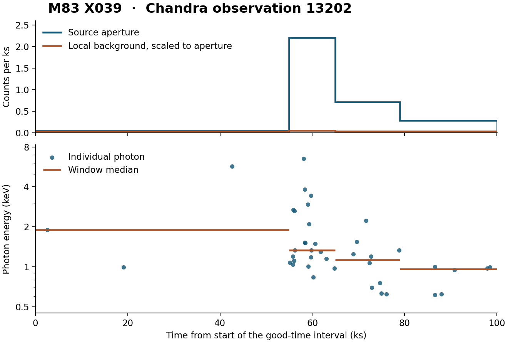

# A spectrally softening X-ray flare at M83 X039 and a red optical counterpart candidate

Chandra recorded a flare at the position of [LKB2014] X039 on 2010 December 26. Across the exposure, later photons had lower energies. Two optical surveys independently place a red source within 0.24 arcsec of the published X-ray position. These measurements motivate a stellar-flare interpretation. The optical object has no established distance, and a projection against an X-ray source in M83 remains possible.

## What was already known

Long et al. catalogued X039 in their deep M83 survey at (204.190875°, −29.830556°), with an N flag denoting persistent detection in their analysis. The Chandra Source Catalog identifies the source as 2CXO J133645.8−294950. Its release 2.2 observation table assigns **broad-band variability index 8 to ObsID 13202**. The source and its variability were therefore known. This result adds a measured energy decrease through the flare, optical colors, and quantitative checks on the proposed association. Searches by source designations, coordinates, galaxy, event date and ObsID did not identify a paper characterizing this combination. Priority remains unverified. [Long et al. (2014)](https://doi.org/10.1088/0067-0049/212/2/21) · [NASA catalog and variability definitions](https://heasarc.gsfc.nasa.gov/W3Browse/all/m83cxo.html) · [CSC detection tables](https://cxc.cfa.harvard.edu/csc/download/vo.html)

## X-ray measurements

The search used the published coordinates of 458 M83-field sources in 12 Chandra ACIS observations from 2000 to 2011. A total of 3,943 source–observation combinations contained six or more 0.35–8 keV photons. Each search aperture increased with off-axis angle and was capped at 45% of the nearest cataloged neighbor's separation. For each allowed group size from a grid of 12 values, the search took the shortest contiguous photon interval. The comparison uses uniform order statistics conditional on the number of photons. The reported Bonferroni bound includes every overlapping group, all 12 group sizes and all 3,943 combinations. For other targets the initial screen approximates the observing interval by the first and last good time on the dominant chip, so gaps and exposure losses can produce false positives. X039 has one continuous 100,046.7-second good-time interval on CCD 7. [Chandra level-2 event file](https://cxc.cfa.harvard.edu/cdaftp/byobsid/2/13202/primary/acisf13202N003_evt2.fits.gz) · [VizieR source table](https://vizier.cds.unistra.fr/viz-bin/VizieR?-source=J/ApJS/212/21/xray)

At X039, 32 of 41 photons in the 2.324-arcsec aperture arrived during 23,698 seconds beginning at 08:20:25 UTC. Under a constant detected rate, the family-wise upper bound for a concentration this extreme is 1.61 × 10⁻⁶. That test concerns variability. It does not distinguish between astrophysical mechanisms or imply the object lies in M83. The nearby background is relatively steady.

| Seconds from start of chip good time | Source photons | Photons in 5–12 arcsec background annulus | Expected background in source aperture | Median source-aperture energy (keV) |
| --- | ---: | ---: | ---: | ---: |
| 0–55,000 | 3 | 46 | 2.09 | 1.90 |
| 55,000–65,000 | 22 | 12 | 0.54 | 1.33 |
| 65,000–79,000 | 10 | 11 | 0.50 | 1.13 |
| 79,000–100,047 | 6 | 17 | 0.77 | 0.96 |

The time–energy Spearman correlation is −0.568 for the 41 photons. A two-sided permutation of energy across the observed times gives p = 0.000160 (100,000 shuffles, fixed seed). Multiplying by all 11 source–observation pairs with a time-clustering bound below 0.05 gives 0.00176 as a sensitivity check. The ranking statistic and X039 follow-up were chosen during exploration, which limits interpretation of that number. The local annulus has 86 photons and a weaker correlation of −0.171. The source correlation stays negative from 1 to 3 arcsec (−0.76 to −0.58 at the endpoints). An independent 29.59-ks Chandra ACIS-I observation on 2014 June 7, withheld from the screen, contains two source-aperture photons versus 0.44 expected background. It provides no second flare. Because the hot-state duration and duty cycle are unknown, this single quiet epoch places little constraint on recurrence. The event does not yield an established thermal temperature. [Independent ObsID 16024](https://cxc.cfa.harvard.edu/cdaftp/byobsid/4/16024/primary/acisf16024N004_evt2.fits.gz)



## Optical counterpart and limits

Pan-STARRS DR2 object 72202041909333633 lies **0.172 arcsec** from the Long position, with seven detections and mean PSF magnitudes z = 19.79 and y = 19.51. NOIRLab Source Catalog DR2 object 147490_8194 lies **0.231 arcsec** away. Its 142 measurements give r = 22.227 ± 0.011, i = 20.385 ± 0.003 and z = 19.674 ± 0.006, with formal catalog uncertainties. The red colors (r−i = 1.843, i−z = 0.711) and X-ray spectral evolution are consistent with a flare on a cool star. Contamination from unresolved light in the M83 field and the lack of a parallax or identifying spectrum limit the classification. [Pan-STARRS DR2](https://catalogs.mast.stsci.edu/panstarrs/) · [NOIRLab Source Catalog DR2](https://datalab.noirlab.edu/data/nsc)

Among Pan-STARRS sources with at least two detections, 79 lie between 10 and 60 arcsec from X039. A uniform local surface density gives a 0.067% chance of at least one within the observed 0.172 arcsec, and 1.44% within the 0.803-arcsec semimajor axis of the CSC error ellipse. These are single-position crowding estimates. Optical clustering, positional uncertainties and target selection preclude using them as association probabilities.

The NOIRLab catalog gives proper motion (−4.13 ± 1.15, −3.64 ± 1.13) mas/yr. Of 55 objects within 65 arcsec with similar i magnitude, at least 30 detections and formal motion errors below 5 mas/yr, **40 have motions at least as large** relative to the local median. Proper motion in this catalog provides insufficient evidence for a foreground classification. An optical spectrum could distinguish a dwarf from a luminous M83 counterpart. Repeated astrometry tied to local reference stars could independently test the foreground interpretation.

## Reproduction

Python 3 with NumPy, SciPy and Astropy is required. Run the commands from this directory. The target analysis downloads about 45 MB and checks the SHA-256 of the versioned Chandra event file. The complete field scan downloads about 310 MB. The saved target summary contains the optical catalog selections, window counts, rank test and all aperture checks. The photon table has the times, energies and detector pixel positions of every event used. The threshold table includes the other ten flagged pairs, which require their own instrumental checks before any astrophysical interpretation.

```bash
python analyze.py --cache x039-cache --output reproduced
python holdout.py --cache x039-cache
python screen.py --cache screen-cache --output screen.csv
python plot.py  # Optional figure, requires Matplotlib
```

The optical measurements from two surveys supply independent positional evidence. They are survey averages from other epochs and do not show an optical flare simultaneous with the Chandra event.
