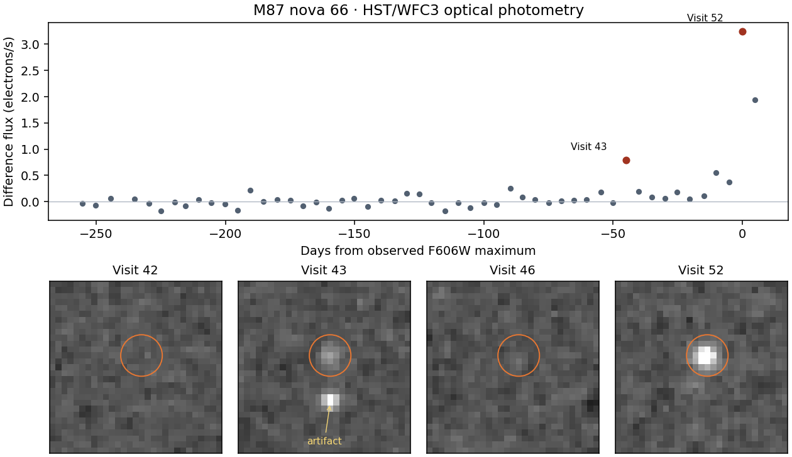

# M87 nova 66 brightened twice in the 2017 HST observations

On 2017 June 11 HST measured an optical pulse at the position of M87 nova 66, **44.90 days before its brightest observed optical visit on July 26**. In between, the source faded below four consecutive published F606W detection limits. The early source is present in both 360-second optical exposures. A much brighter detector artifact just south of it in the June visit appears in only one exposure. The scientific addition here is an exposure-level verification and quantitative separation of this pulse from the artifact. Shara et al. already published the nova, its measurements and its light curve in Figure 80. The data support two optical brightenings of an unresolved source. A secondary maximum of one eruption is viable. Establishing recurrent thermonuclear eruptions would require additional evidence. [Shara et al., 2023](https://arxiv.org/abs/2308.15599) · [Published photometry](https://vizier.cfa.harvard.edu/viz-bin/VizieR?-source=J/ApJS/269/42)



| HST/WFC3 F606W observation | June 11 pulse | July 26 maximum |
|---|---:|---:|
| Visit | 43 | 52 |
| Published magnitude | 25.85 ± 0.11 | 24.45 ± 0.04 |
| Difference-image aperture, electrons/s | 0.792 | 3.246 |
| Local blank-aperture MAD units | 7.64 | 27.51 |
| Individual calibrated exposures, local sky subtracted, electrons/s | 0.919, 0.948 | 3.465, 3.400 |

The two positive difference-flux centroids within a 3-pixel radius differ by 0.012 arcsec on the common image grid. This is a relative measurement without a formal centroid uncertainty. At M87's distance even subpixel agreement leaves unresolved blends possible. The published magnitudes imply a 3.63-fold brightness ratio. The June 26, July 1, July 6 and July 11 optical limits are 27.13, 26.56, 27.32 and 27.03 mag, respectively. The five-day cadence bounds the two observed maxima imperfectly.

A strict 44.9024-day recurrence clock makes four additional predictions within the survey. Visits 34, 25, 16 and 7 sample those extrapolated phases within 0.06, 0.25, 0.20 and 0.34 days, respectively. Their optical difference fluxes are +0.249, +0.017, +0.034 and −0.180 electrons/s. None reaches the 0.792 electrons/s June pulse. This disfavors a coherent train of comparable, day-long eruptions over this baseline. Shorter flashes, cycle-to-cycle timing changes and changing eruption amplitudes remain possible.

## Selection and controls

An exploratory scan used all 4,982 rows from 94 novae in Table 3. Sixty-six had tabulated times at least 25 days before a measured optical maximum. We required an early two-filter detection with reported magnitude uncertainties below 0.25 (F606W) and 0.40 (F275W), and two later visits more than 1 mag fainter before day −5. A limit qualified if it was deeper than the cut, and a measured dip qualified if its uncertainty was below 0.5 mag. Nova 66 alone passes, at visit 43. Visits 44, 45, 46, 48 and 49 meet the dip criterion. Cuts were selected during exploration, so this count is descriptive.

The image check used **program GO-14618**, both filters in all 53 visits, without using the discovery team's photometry for the flux measurements. We reprojected the 97 × 97 pixel stamps at the Table 2 position (12h 30m 45.06s, +12° 23′ 26.44″) to a grid of 0.04 arcsec/pixel using each FITS WCS and bilinear interpolation. A pixelwise median of visits 1–41 gives the pre-event reference in each band. At the visit-52 optical peak one pixel east of the catalog center, we summed within 2.7 pixels and subtracted the median annulus at radii 4–6 pixels. `visits.csv` contains all 106 visit/filter rows. Optical visit 4 has incomplete aperture coverage and is represented by NaN. The other 52 optical visits yield measurable flux. The June 11 pulse exceeds every earlier optical visit. For the Figure 80 location and the two dates, this is an independent reduction of the same HST observations.

The spatial control samples a grid of equal apertures spaced 6 pixels apart, excluding the 10-pixel radius around the target. A MAD unit is 1.4826 times the median absolute deviation, evaluated after local median subtraction. The control apertures overlap in their sky annuli and the drizzled pixels have correlated noise. These scores describe the local scatter and have no global false-alarm calibration. Comparison to pre-event target fluxes gives 11.95 MAD units for the pulse. `exposures.csv` provides individual-frame measurements without template subtraction, using the SCI header SIP solution and local background subtraction. The feature at the secondary aperture 0.32 arcsec south of the target is 0.015 and 6.904 electrons/s in the June optical exposures. This single-exposure contaminant is resolved from the pulse. The June visit's independent F275W measurement is marginal (2.65 local MAD units), and a UV exposure has a nearby high pixel. Our physical interpretation rests on the optical evidence. [MAST original science products](https://mast.stsci.edu/search/ui/#/hst)

## Reproduction

Run from this directory using Python, NumPy, SciPy, Astropy and Matplotlib. `images.py` downloads only the primary and science headers and the image strips required for the cutouts, via verified byte ranges. `screen.py` retrieves Table 3 from VizieR. `catalog66.csv` preserves the source's 53 catalog rows and flags. Reproducibility checks are the visit-43 split fluxes above and the single Table 3 selection.

```bash
python screen.py
python images.py
python measure.py
python figure.py
```

Searches on 2026-11-14 for M87 nova 66 with “secondary maximum”, “rebrightening”, “precursor” and “44.9 days” found the catalog paper and its figure. We found no explicit earlier isolation or split-exposure test of this pulse in those searches. The 2024 analysis of this sample tested spatial concentration near the M87 jet and population-level properties. Galactic nova studies already document secondary maxima and flares. The contribution here is specific to the verified morphology of M87 nova 66. This is a limited prior-art check. Attribution of the individual data points belongs to the observing team. [Survey light curves and recurrence discussion, Section 5](https://arxiv.org/abs/2308.15599) · [2024 M87 follow-up](https://arxiv.org/abs/2309.16856) · [Strope et al. nova morphology atlas](https://doi.org/10.1088/0004-6256/140/1/34)
